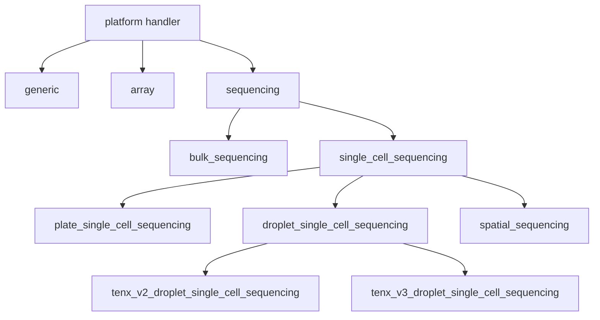

<!--
Authors

Created by jaychowcl @ Saez-Rodriguez Group & EMBL-EBI Functional Genomics Team on May 2026
https://github.com/jaychowcl
https://saezlab.org
https://www.ebi.ac.uk/about/teams/functional-genomics/
-->
# meta_standards_converter Codebase Handoff

This is the canonical handoff for the live package under
`src/meta_standards_converter`. It covers the unified Python API and CLI, nine legacy conversion paths and the explicit legacy importer, their
runtime boundaries, extension contracts, and the evidence needed to change them
safely.

<a id="architecture"></a>
## Architecture

`meta_standards_converter` is a Python library and eleven-command toolkit for
moving study metadata and expression assets among GEO MINiML, the package's
parsed JSON model, ArrayExpress MAGE-TAB, delimited sample tables, and AnnData
H5AD. CLI modules are thin batch adapters. Converter classes own use-case
orchestration; fetchers and parsers own repository-specific I/O; MAGE-TAB
constructors and H5AD/tabular projectors own output models. The current distribution is **MSC 9.0.0**. Current output contracts are MINiML 3.1 and patch 3.2; [legacy compatibility](#harmonization-depth-contract) is explicit.

Start with [the design and class map](#oop-design), then follow one
[principal workflow](#principal-workflows). Use the
[package layout](#project-purpose-and-layout) to locate code and the
[API inventory](#public-api-and-callable-reference) for exact signatures.
The reference describes the current checkout; dated acceptance reports are
historical evidence, not a claim that external providers were retested.

```text
Users: CLI / Python / Docker / rootless Compose
                         |
            Converter.convert + source/preparation/export services
       +-----------------+--------------------+
       |                 |                    |
 GEO/AE/SRA/ENA     local JSON/files    explicit/discovered assets
       |                 |                    |
 fetch + parse       validate/group       plan/download/run nf-core
       |                 |                    |
 enrich (optional)  project/construct     normalize/project AnnData
       +-----------------+--------------------+
                         |
      JSON | IDF/SDRF | TSV/CSV | H5AD + provenance
```

The package owns conversion policy and emitted artifacts. GEO, NCBI, ENA,
BioStudies, OLS, nf-core, Nextflow, Docker, and the Atlas v1 wire contract are
delegated boundaries. MSC implements that wire boundary locally and does not
import its producer package. See
[Project purpose and layout](#project-purpose-and-layout) for the module tree
and [Runtime behavior](#runtime-behavior) for concrete dependencies.

<a id="system-context-and-boundaries"></a>
## System context and boundaries

| Boundary | Data crossing it | Repository responsibility | Failure owner |
| --- | --- | --- | --- |
| CLI/Python callers | Accessions, paths, options, injected projectors | Validate supported combinations and return/write deterministic results | CLI records per-input failures; most library calls raise, while H5AD group aggregation records per-group failures |
| GEO FTP | GSE accession, MINiML tar/XML | Fetch safely, scope packages, and avoid leaking query data to logs | `GEOWebFetcher` and `RateLimitedRequester` |
| NCBI/ENA/PubMed/OLS | Accessions and public metadata | Rate-limit, retry, parse, and attach enrichment without owning upstream availability | Service fetcher or harmonizer; enrichment records partial failures where supported |
| BioStudies/HTTP/local MAGE-TAB | IDF/SDRF references and text | Resolve exactly one IDF plus SDRFs, parse and retain round-trip evidence | `AEWebFetcher`/`AEParser` |
| Filesystem | JSON, MAGE-TAB, matrices, H5AD, manifests, references | Validate paths, protect existing output unless overwrite is explicit, and write provenance | Converter owning the artifact |
| Nextflow/nf-core/runtime | FASTQ samplesheet, references, workflow parameters | Pin default revisions, reserve converter-owned parameters, execute and collect outputs | `NFCoreRunner`; subprocess failures become conversion failures |
| Docker/rootless Compose | Image, socket, output tree, caches | Provide a hardened supported process boundary, not a daemon | Provisioning/helper scripts and connected daemon operator |
| Atlas v1 JSON | Versioned document and harmonized dataset metadata | Validate the delegated wire format with `AtlasV1Reader` and emit organization-neutral package groups | MSC owns reading/adaptation; the producer owns atlas creation and the canonical model |

The base Python path has no persistent database. Files are the durable boundary;
in-memory dictionaries, typed MAGE-TAB models, and AnnData objects are
conversion-scoped state. Remote metadata is public study metadata, but logs
must not include URL queries, request parameters, XML, metadata payloads,
credentials, or tokens.

<a id="architectural-decisions"></a>
## Architectural decisions

<a id="decision-service-request-budgets"></a>
### Share request budgets by provider service

Provider quotas follow services, which do not map one-to-one to HTTP hostnames.
MSC separates ENA, BioSamples and BioStudies URL paths and joins the NCBI
E-utilities hostname aliases. Defaults leave headroom below documented limits;
unknown quotas retain conservative spacing. Explicit caller overrides remain
available, while retries, redirects and terminal cooldowns use the same shared
gate. This changes transport timing without changing converter routes, source
curations, output formats, enrichment or cross-format retrieval. See
[request policy](#request-helper) and `tests/test_endpoint_pacing.py` for the
boundary, concurrency and credential-presence checks.

<a id="decision-thin-cli-adapters"></a>
### AD-001: Keep CLI adapters thin and converters reusable

- **Status:** Observed
- **Decision:** Each console script parses a batch and delegates one input at a time to a converter class; converters expose the programmatic workflow.
- **Rationale:** Not documented.
- **Consequences:** CLI failures can be isolated per input, while Python callers retain exceptions and injectable collaborators.
- **Affected components:** `cli/*`, `converters/*`, logging configuration, and output status handling.
- **Evidence:** [`pyproject.toml`](../pyproject.toml), [`cli/geo2ae.py`](../src/meta_standards_converter/cli/geo2ae.py), and [`converters/geo2ae.py`](../src/meta_standards_converter/converters/unified/engine.py).

<a id="decision-magetab-round-trips"></a>
### AD-002: Preserve MAGE-TAB round trips beside the mapped core

- **Status:** Observed
- **Decision:** `ae2json` maps semantic MAGE-TAB content into MSC MINiML 3.0; `json2ae` regenerates ordered IDF/SDRF tables from that typed model.
- **Rationale:** Not documented.
- **Consequences:** Metadata semantics are editable and format-independent. Raw row layout is not replayed; unsafe consolidation of heterogeneous SDRF document graphs is rejected.
- **Affected components:** `AEParser`, `ae_model`, `MINiMLV1Migrator`, and `AEConstructor`.
- **Evidence:** [`ae_parser.py`](../src/meta_standards_converter/magetab/parser.py), [`ae_model.py`](../src/meta_standards_converter/magetab/semantics.py), and [`migration.py`](../src/meta_standards_converter/miniml/migration.py).

<a id="decision-expression-source-planning"></a>
### AD-003: Select expression assets before normalizing AnnData

- **Status:** Observed
- **Decision:** `json2h5ad` resolves explicit and discovered sources into a plan, then dispatches processed assets or raw nf-core execution before a common normalization/projection stage.
- **Rationale:** Not documented.
- **Consequences:** Source precedence is centralized; incompatible samples remain as per-sample H5ADs and make the aggregate result partial.
- **Affected components:** `AssetManifest`, `SourcePlanner`, `NFCoreRunner`, and `JSON2H5ADConverter`.
- **Evidence:** [`json2h5ad.py`](../src/meta_standards_converter/converters/json2h5ad.py) and [`test_h5ad_pipeline.py`](../tests/expression/test_h5ad_pipeline.py).

<a id="decision-fail-closed-projectors"></a>
### AD-004: Extend emitted metadata through fail-closed projector protocols

- **Status:** Observed
- **Decision:** AnnData and delimited outputs accept injected projector protocols; explicit tabular projectors replace the default MSC projection.
- **Rationale:** Not documented.
- **Consequences:** Downstream adapters can add organization-specific fields without coupling them into MSC, while collisions, invalid vector lengths, and projector errors stop unsafe output unless tabular invalid-output mode is explicit.
- **Affected components:** `AnnDataMetadataProjector`, `TabularMetadataProjector`, H5AD normalization, and delimited converters.
- **Evidence:** [`json2h5ad.py`](../src/meta_standards_converter/converters/json2h5ad.py), [`json2tabular.py`](../src/meta_standards_converter/converters/json2tsv.py), and their projector tests.

<a id="decision-rootless-runner"></a>
### AD-005: Isolate raw processing behind a restricted rootless runner

- **Status:** Documented
- **Decision:** The supported Compose workflow connects a locked runner to its rootless Docker socket, mounts one output tree, drops capabilities, and uses a read-only container filesystem.
- **Rationale:** Limit host access while still allowing Nextflow's Docker profile to launch containers and produce project-owner-readable artifacts.
- **Consequences:** Provisioning requires Linux root access once; raw inputs, caches, work, and outputs must live below the dedicated output root.
- **Affected components:** `Dockerfile`, `compose.yaml`, `provision-rootless-json2h5ad.sh`, and `json2h5ad-compose.sh`.
- **Evidence:** [`compose.yaml`](../compose.yaml), [`provision-rootless-json2h5ad.sh`](../scripts/provision-rootless-json2h5ad.sh), and [`test_docker_artifacts.py`](../tests/test_docker_artifacts.py).

<a id="design-invariants-and-expectations"></a>
## Design invariants and expectations

- A parsed source contains at least one package group and at least one
  convertible sample; packages remain scoped to their Series.
- JSON consumers accept native parsed MINiML or `schema_version = "1.0"` Atlas
  documents. Atlas v1 `accessions` envelopes fail with explicit pinned-v1
  guidance; MSC has no runtime/build dependency on ThematicAtlases.
- CLI batch commands continue after an input failure and return `1` if any
  input fails. Most programmatic workflows propagate exceptions; H5AD group
  aggregation is the explicit exception and converts per-group exceptions
  into `BatchConversionResult.failures`.
- `geo2ae`/`json2ae` use the same selected platform handler for IDF and SDRF.
- MAGE-TAB regeneration preserves typed-model semantics. Raw table layout is
  not part of the runtime model.
- H5AD source priority remains manifest, explicit specification, then JSON
  discovery; processed H5AD/matrix sources outrank raw FASTQ within a tier.
- Existing H5AD, tabular, and provenance outputs are protected unless the
  relevant overwrite option is explicit. H5AD sample, combined, and manifest
  artifacts publish as one staged bundle with backup/rollback on commit error.
- Metadata projectors cannot silently replace existing AnnData keys or emit
  axis vectors of the wrong length. Tabular collisions and invalid projections
  fail closed unless `allow_invalid=True`; projector-reported H5AD errors use
  the same explicit policy, while structural errors always fail.
- External calls use service-specific requester settings. Safe telemetry never
  logs credentials, URL queries, raw XML, or study payloads.
- Remote expression assets cross `RetrievalPolicy`: provider hosts and public
  addresses are checked before every request/redirect, cross-scheme redirects
  and URL credentials are rejected, and object/run/cache/disk ceilings are
  mandatory. Cache reuse requires a matching SHA-256 sidecar.
- XML provider bodies and GEO archives use the selected typed resource profile.
  XML is byte-bounded; one ordinary external SYSTEM/PUBLIC DTD may be stripped
  without resolution, while entities, internal subsets, malformed declarations,
  and misplaced declarations fail closed. GEO archives are streamed to a
  disk-preflighted temporary file and may contain safe auxiliary files and
  directories alongside exactly one expected bounded XML member.
- Converter-owned nf-core input/output/reference parameters override additional
  params JSON; Nextflow config is for infrastructure and resources.
- Rootless Compose refuses a daemon without rootless security mode and confines
  writable state to the configured output tree.

<a id="typed-mage-tab-model"></a>
<a id="harmonization-depth-contract"></a>
## Depth-aware harmonization and review transport

Current writers emit MINiML **3.1**, harmonization patches **3.2**, and direct
`hz_<field>` values. Ancestors use `hz_<field>__ancestor_depth_N`; ontology and
depth companions share that prefix. Repeated values at one depth use `(1)`,
`(2)`; direct and unknown-depth indexes are preserved. Semantic field names and
integer depths remain separate. The `__ancestor_depth_` marker is reserved.
All MINiML, MAGE-TAB, table and AnnData writers share the MSC name renderer.

Readers accept legacy MINiML 3.0 groups and new groups; a depth encoded in a
name must agree with its companion. New named rows and mapping members use the
new spelling without changing raw metadata, protocol definitions or retained
patch evidence. An absent depth remains unknown. No existing files are migrated
in place.

`canonical_miniml_document(..., schema_version="3.0")` and
`miniml_source_fingerprint(..., schema_version="3.0")` preserve the original
canonicalization for old sources. New patches normalize a copy to 3.1 before
fingerprinting and application. Patch 3.0/3.1 verification and application use
MINiML 3.0 first, then upgrade the result; stored source/result hashes retain
their original meaning. An existing retained patch ID remains idempotent.
Defaults are the new versions; the legacy selector is only for compatibility.

Atlas readers accept 1.0 and 1.1. Publication review 1.1 adds model confidence
and an optional historical policy record with version, action, exclusion
eligibility, review-required flag and reason. When present, that historical
record must follow its original high-confidence exclusion rules. Missing records
remain optional. MSC validates transport without importing AC, synthesizing policy
actions, or deciding the producer's current filtering behavior.

Public helper additions:
- `meta_standards_converter.miniml.harmonization.wire_schema`: context-local,
  exception-safe legacy rendering, never a process-global toggle.
- `meta_standards_converter.miniml.harmonization.parse_harmonized_key_details`:
  field, role, index and optional encoded depth; the original three-part parser
  remains a compatibility view.
- `meta_standards_converter.miniml.harmonization.rewrite_harmonized_names`:
  copy-based current spelling migration preserving raw rows and extensions.

Verification: `tests/test_harmonization_depth_contract.py` contains a frozen
pre-change legacy hash/patch fixture, exact compatibility and tamper checks,
independent depth collisions, named rows and SDRF round trips.
`tests/test_atlas_v1_reader.py` covers old/new Atlas review policy transport.
Purposeful decision (2026-10-06): version canonical bytes rather than changing
what old source-bound hashes mean. No live provider evidence or accepted pins
are changed by this format revision.

<a id="proposed-enriched-miniml-core"></a>
## Enriched MINiML-compatible core

MSC MINiML 3.0 folds semantic MAGE-TAB content into the typed package itself:
`series.protocols` owns protocol identity and details, `series.assay_paths`
owns ordered node and protocol-application paths, named values own units and
`hz_*` groups, and annotated channel scalar objects retain harmonized values
beside their raw `value`. Declaration lists retain QC/replicate/normalization
semantics, and `source.documents` records source-document provenance. Raw IDF
and SDRF table layouts and the former `mage_tab` replay sidecar are deliberately
outside the runtime representation.

MAGE-TAB construction is therefore semantic and deterministic. IDF ordering
is a renderer responsibility, while assay-path order and repeated
characteristic/parameter occurrences remain data. The SDRF renderer reads the
canonical `name` field (with `tag` only as a migration fallback) and unwraps typed
ontology values such as channel `source` and `molecule` instead of serializing
their JSON object representation. IDF renderers emit the MAGE-TAB 1.1 labels
`Publication Status Term Source REF`, `Publication Status Term Accession
Number`, `Protocol Term Source REF`, and `Protocol Term Accession Number`.
The parser retains the four former MSC labels as input-only aliases and gives
the canonical rows precedence when both spellings are present. Parsing retains
characteristic units and ontology companions, keeps Protocol Contact distinct from per-application
Protocol Performer, and preserves generic IDF/SDRF comments as named comments.
Blank and external Protocol REF values and external sample names are retained
with compatibility diagnostics. Unknown layout remains outside the semantic
model and is reported rather than replayed.

SDRF row order is scoped to each `SourceDocument`. The public
`meta_standards_converter.magetab.semantics.render_miniml_assay_documents`
returns one rendered table per document, preserving repeated Sample Name paths,
protocol-application performer/date/comments, ontology companion columns,
`Unit[type]`, factor qualifiers, and repeated headers. The legacy AE constructor
has a single SDRF-table return shape, so it consolidates compatible document
graphs and raises for heterogeneous layouts instead of silently losing order or
path multiplicity.

Runtime converters accept only explicit schema `3.0` packages. Legacy or
unversioned source data enters through `MINiMLV1Migrator`, which folds supported
sidecar semantics and legacy harmonized values directly into v3 `hz_*` groups.
It preserves explicit source labels and reports dropped source-layout evidence.
No v2 package or wire annotation array is constructed during ingestion.

**Current-state evidence:** [`ae_parser.py`](../src/meta_standards_converter/magetab/parser.py),
[`ae_model.py`](../src/meta_standards_converter/magetab/semantics.py),
[`migration.py`](../src/meta_standards_converter/miniml/migration.py),
and [`ae_constructor.py`](../src/meta_standards_converter/magetab/constructor.py).


<a id="data-contracts"></a>
## Data contracts and preservation

| Contract | Current version | Role |
| --- | --- | --- |
| MSC distribution | 9.0.0 | Python/CLI compatibility and version-specific checkpoint namespace |
| MSC MINiML | 3.1 | Canonical metadata; reads 3.0/3.1 and rejects v2 |
| Harmonization patch | 3.2 | Source-bound decisions; historical 3.1 hashes remain verifiable |
| Patch extension ledger | 1.0 | Retained operations in `extensions.msc_harmonization` |
| Atlas document | 1.0/1.1 | Independent producer wire formats accepted by MSC's local reader |
| H5AD metadata | 2.0 | Dotted observation fields and normalized sample values |
| Exported assay metadata | 3.0 | Occurrence structures with `hz_value`, `hz_unit` and companions |
| MINiML AnnData transport | 1.0 | Canonical packages and typed field ledger in `uns["msc_miniml"]` |
| Replacement profile | 1.0 | Optional export-time destination replacement policy |
| Operational status | 2.0 | Independent execution/completeness/evidence/validation/publication axes |

`hz_*` evidence is exported by default. A `replacement_profile` additionally
selects harmonized values for ordinary destination fields on a conversion copy.
It does not change canonical source values, ontology decisions, or retained
patch evidence. Profile-free `miniml_json` envelopes remain accepted; embedded
`harmonization_overrides` is rejected. See [replacement profiles](#harmonization-overrides).

**Round-trip boundary:** v3 canonical packages and AnnData transport retain the
patch ledger. MAGE-TAB preserves supported sample/channel/path occurrences,
source and harmonized values, units, ontology companions, hierarchy depth and
indexed groups. Reparse preserves flattened provenance comments, but does not
reconstruct the complete `extensions.msc_harmonization` patch ledger. Raw
IDF/SDRF byte layout is also outside this contract. Cross-location ambiguity
is diagnosed rather than resolved by final row number.

**Evidence:** [model](../src/meta_standards_converter/miniml/model.py),
[patches](../src/meta_standards_converter/miniml/patches.py),
[assay projection](../src/meta_standards_converter/metadata/projection/assay.py),
[AnnData projection](../src/meta_standards_converter/metadata/projection/anndata.py),
[harmonized MAGE-TAB](../src/meta_standards_converter/magetab/harmonized.py),
[provenance transport](../src/meta_standards_converter/metadata/provenance.py).

<a id="component-relationships-and-data-flow"></a>
## Component relationships and data flow

| Source | Destination | Interface and direction | Data/lifecycle | Failure behavior |
| --- | --- | --- | --- | --- |
| CLI module | converter | `convert(...)` control call | One converter instance per command; inputs processed in order | Logs per-input exception and records non-zero status |
| GEO converters | `GEOWebFetcher` → `GEOSource` → `GEOParser` | internal calls around HTTP/XML | GSE becomes Series-scoped immutable `MINiMLPackage` objects | Fetch/parse errors propagate |
| GEO/JSON converters | `MINiMLEnricher` | optional internal mutation | Adds PubMed and SRA/ENA evidence to a package | Enricher records service-specific misses where implemented |
| GEO/JSON converters | `AEConstructor` | `miniml2magetab` then optional `MAGETabWriter.write` | Package becomes IDF/SDRF row collections; `MAGETabWriter` owns files | Validation/handler/write errors propagate |
| `ae2json` | `AEWebFetcher` → `AEParser` | resolve and parse | IDF/SDRF text becomes canonical v3 packages with source documents | Invalid source cardinality or MAGE-TAB fails |
| tabular converters | `JSONPackageSource` → `MINiMLMetadataProvider` → projectors | load/group, obtain format-neutral sample metadata, then `project_sample` | Dataset groups become ordered row maps | Collisions/invalid output fail closed by default |
| `JSON2H5ADConverter` | planner/downloader/runner | plan, localize, or process | Per-conversion state becomes sample AnnData | Per-sample failures retained; aggregate can be partial |
| tabular and H5AD converters | `MINiMLMetadataProvider` | public injected service calls | Study/sample identity, canonical metadata, and modality use one scientific interpretation | Provider failures propagate without partial output |
| H5AD converter | metadata projectors | `project_sample`/`project_combined` | Projection applied before each write | Collision/shape/projector error fails conversion |
| Atlas/MINiML source | `JSON2H5ADConverter` | `AtlasV1Reader` → `JSONPackageSource.load` then group conversion | Harmonized Atlas v1 datasets or ordinary packages become one conversion per dataset | Invalid versions/shapes raise before aggregation; non-harmonized states warn; per-group conversion failures are retained |
| `NFCoreRunner` | Nextflow/nf-core | subprocess/system call | Samplesheet + reference + params produce pipeline results | Exit/output failure becomes a recorded pipeline failure |

The orchestrating converter owns transient conversion state and output
decisions. Fetchers own network protocol details; parsers own input shape;
constructors/projectors own output shape; callers own retrying a failed
top-level conversion.

<a id="json-helper"></a>
<a id="oop-design"></a>
## Design and object relationships

The useful organizing principle is **one orchestration layer, several replaceable
services, and a typed canonical model**. A converter selects and sequences work;
source services perform retrieval; parsers interpret supplied content; constructors
and projectors build the destination representation. MSC does not use a common
converter superclass to own all workflows.

```text
CLI parser -> converter instance -> conversion-scoped services and data
                                    |
           +------------------------+-------------------------+
           |                        |                         |
      source services          MINiMLPackage              output services
   fetch / resolve / group   immutable canonical v3    build / project / write
           |                        |                         |
     pure parsers           conversion copy + policy    files / result objects
```

| Relationship | Actual design | State and change implications |
| --- | --- | --- |
| `JSON2TSVConverter` → `JSON2DelimitedConverter` | Specializes delimiter/output selection | Shared base owns grouping, projection, deterministic columns, validation and writing |
| `JSON2OBSConverter` → `JSON2H5ADConverter` + `AnnDataComponentExporter` | Composition, not inheritance | Build a temporary per-sample catalogue, export metadata components, then clean up temporary matrices |
| `JSON2H5ADConverter` → planner, reader, downloader, runner, metadata service | Constructor-injected collaborators | Converter owns sequencing, admission, checkpoints and publication; collaborators own their specific operations |
| `AEConstructor` → export plan, IDF/SDRF builders, protocol registry | Per-operation composition | Receives prepared evidence; registry identity agrees across IDF and SDRF |
| SDRF technology handlers → base/array/sequencing specializations | Inheritance within one rendering domain | Override technology behavior without placing retrieval policy in row rendering |
| Projectors and source contracts → `Protocol` interfaces | Structural typing | Callers can inject compatible objects without subclassing MSC implementations |
| `MINiMLPackage` → series, samples, channels, paths, named values | Frozen typed records with mapping codecs | Replace/copy records for transformations; `to_mapping()` produces the serializable boundary |

**State ownership:** protocol registries and rendering graphs belong to a
construction operation. Dataset groups and replacement resolutions belong to a
conversion. Checkpoints, asset caches and host pacing persist independently and
must use their own identity and integrity policies. A converter instance may
retain injected clients and cumulative request metrics; it is not a claim of
thread safety or a process-global cache.

**Design decisions:** favor composition for independently replaceable I/O and
scientific interpretation; retain inheritance where implementations share a
specific behavior family. These are observed relationships, not invented
historical rationale. The evidence-backed [decision records](#architectural-decisions)
state which rationale is documented.

**How to change behavior:** new metadata columns belong in a
[projector](#api-tabular-metadata-projector), new expression formats in an
[asset reader/planner](#package-exports), source retrieval changes in
[source services](#msc6-source-services), and wire representation changes in
[MINiML](#miniml-package-model). Trace the affected public workflow and its
[tests](#test-plan) before editing a shared helper.

**Evidence:** [converter constructors](../src/meta_standards_converter/converters/),
[source contracts](../src/meta_standards_converter/sources/contracts.py),
[MINiML model](../src/meta_standards_converter/miniml/model.py),
[SDRF handlers](../src/meta_standards_converter/magetab/sdrf/handlers/),
[component exporter](../src/meta_standards_converter/expression/components.py).

<a id="entrypoints-and-interfaces"></a>
## Entrypoints and interfaces

The supported public entrypoints are:

<a id="interface-cli"></a>
- ten console scripts registered in `pyproject.toml`: `sra2json`, `ena2json`,
  `geo2ae`, `geo2json`, `json2ae`, `ae2json`, `json2h5ad`, `json2tsv`, `json2obs`,
  and `miniml-migrate`;
<a id="interface-python"></a>
- the unified `Converter`, `InputSpec`, `ConversionBatchResult` and nine legacy
  converter-class exports from `meta_standards_converter.converters`,
  plus supported models, source services, projectors and expression collaborators
  from their [owning packages](#package-exports);
<a id="interface-docker"></a>
- a Docker image that accepts any installed console command;
<a id="interface-rootless-compose"></a>
- rootless Compose and its two operational scripts for raw `json2h5ad`.

Every CLI parser contract, option, default, and batch status rule is listed
under [CLI](#cli). Docker and rootless process contracts are described under
[Rootless json2h5ad runtime](#rootless-json2h5ad-runtime). No HTTP server,
database service, or plugin discovery mechanism is exposed.

<a id="orchestrators-and-core-types"></a>
## Orchestrators and core types

<a id="orchestrator-atlas-v1-reader"></a>
- `AtlasV1Reader` owns version detection, structural/cross-reference/summary
  validation, harmonized-dataset selection, skipped-state diagnostics, and
  adaptation to locally owned immutable reader results. `JSONPackageSource`
  owns the subsequent MINiML package grouping/deduplication contract.

<a id="converter"></a>
<a id="orchestrator-metadata-converters"></a>
- `geo2ae`, `geo2json`, `json2ae`, and `ae2json` coordinate metadata-only
  conversions. `AEConstructor` owns MAGE-TAB evidence orchestration and handler selection;
  `MAGETabWriter` owns file output and `AEParser` owns reverse semantic mapping.
<a id="orchestrator-json2h5ad-converter"></a>
- `JSON2TSVConverter`, `JSON2H5ADConverter`, and `JSON2OBSConverter` own the respective JSON-origin workflows. Their manifest,
  H5AD, and AnnData-metadata methods back the three thin CLI wrappers.
  `JSON2H5ADConverter` owns the expression conversion lifecycle beneath it.
  `SourcePlanner`, `AssetManifest`, and `AssetDownloader` resolve inputs;
  `ReferenceResolver`, `AnnotationConverter`, and `NFCoreRunner` own raw-data
  execution; an injected `DatasetCombinationPolicy` owns fail-closed
  organism/reference/modality/feature-namespace evidence inspection but refuses
  implicit matrix combination. Per-sample H5ADs plus a truthful catalogue
  manifest are the expression output; result dataclasses expose complete and
  partial outcomes.
<a id="orchestrator-json2delimited-converter"></a>
- `JSON2DelimitedConverter` owns JSON grouping, sample iteration, projection,
  column ordering, validation policy, and file output. `JSON2TSVConverter`
  selects TSV or CSV through `output_format`. Both tabular and H5AD conversion
  depend on the public `MINiMLMetadataProvider` contract instead of calling
  another converter's private helpers; `MINiMLMetadataService` is the default.
<a id="core-rate-limited-requester"></a>
- `RateLimitedRequester` is the shared external-call boundary.
  `GEOWebFetcher`, `AEWebFetcher`, `PubmedWebFetcher`, and `INSDCWebfetcher`
  apply repository-specific URL and response semantics.
- `HostRequestGate` persists request-start timestamps and provider
  cooldowns under an owner-only per-user runtime directory. Its `flock`
  boundary coordinates unrelated local processes as well as MSC instances;
  an unavailable implicit XDG runtime path falls back to an owner-only `/tmp`
  directory, while an explicit unsafe path still fails closed.
- `NCBIApplicationIdentity` supplies validated application tool/contact
  parameters and an optional secret API key to every PubMed/SRA E-utilities
  request without exposing their values in logs. A missing email warns once
  and retains conservative pacing.
- `OperationStatusV2`, `SafeErrorEnvelope`, and `ResourceProfile` are the
  shared status, persistence-safe error, and resource-policy vocabulary.
  `RetrievalService` consumes the resource profile behind the supported
  `AssetDownloader` facade.
<a id="core-magetab-construction"></a>
### Network-free MAGE-TAB construction

`MAGETabExporter.render` resolves each group/profile then calls
`AEConstructor.miniml2magetab` → `prepare` → `render`. Preparation validates once and
owns a detached mapping, protocol registry, technology selection, prefix rows and an
`SDRFExportPlan`. Canonical assay paths are selected when present; otherwise technology
handlers provide paths. Each document carries paths, planned columns and audit state.

`SDRFConstructor.prepare` registers protocols and audit effects once, before column
planning. `SDRFConstructor.render` invokes `SDRFRenderer.render_paths` once per document.
Compatible document layouts retain the existing consolidation contract; incompatible
layouts fail explicitly. No discarded intermediate SDRF is rendered. Injected builders
implement the same `prepare`/`render` interfaces; there are no type/method-identity gates.
Collaborators must not change plan input after preparation. Caller metadata remains detached.

Rendering builds the IDF from prepared publication/run evidence, then performs semantic
annotation, factor declarations, provenance comments and final validation explicitly.
Constructors/renderers have no provider clients and cannot supplement missing evidence.
**Evidence:** [constructor](../src/meta_standards_converter/magetab/constructor.py),
[SDRF plan/render](../src/meta_standards_converter/magetab/sdrf/constructor.py),
[regression](../tests/magetab/test_export_boundary.py).

<a id="public-api-reference"></a>
## Public API reference

The public facade is distributed across owning packages. `converters` exports
the unified API, nine legacy converter classes and two archive result types lazily; `miniml`, `sources`, `expression`, `metadata`,
`metadata.projection`, `magetab`, and `atlas_v1` expose their own contracts.
The [package export table](#package-exports) enumerates their current names.
The [source inventory](#public-api-and-callable-reference) lists every public-named
production definition, constructors, public methods and properties. Importable
implementation helpers are distinguished from explicitly exported interfaces;
Python visibility alone is not a stability guarantee.

The curated contracts below explain the most consequential integration points.
Unified and loaded-data contracts are listed under [Unified converter](#unified-converter).
Other exact signatures, including inherited dataclass fields, appear in the
source inventory; it supersedes historical call examples from preceding releases.

<a id="atlas-v1-reader"></a>
### Atlas v1 reader facade

- `AtlasV1Reader.load(path) -> AtlasV1ReadResult` reads UTF-8 JSON;
  `from_mapping(value) -> AtlasV1ReadResult` accepts an already decoded object.
- `AtlasV1ReadResult.datasets` contains immutable `AtlasV1Dataset` records for
  datasets whose status is `harmonized`; each record carries `dataset_id`,
  `source_repository`, `source_ordinal`, and copied MINiML-compatible metadata.
  `warnings` describes every skipped state and its document diagnostics.
- `JSONPackageSource` turns each retained dataset into one
  `DatasetPackageGroup`. Ordinary metadata is one package; metadata whose exact
  shape is `{"packages": [...]}` expands the validated object list within that
  same group. Sample deduplication and conflicting-metadata rejection then run
  across all contained packages.
- `AtlasV1Error` is the fail-closed `ValueError` subclass for unsupported
  versions, legacy unversioned envelopes, malformed collections, duplicate IDs, broken
  publication references, invalid dataset metadata, and inconsistent summary
  counts.
- A dataset's optional `harmonization.status` is parsed as the shared
  `OperationStatusV2` contract. Invalid or legacy status mappings fail closed;
  documents that omit the field remain compatible with Atlas schema 1.0.
- `SCHEMA_VERSION` is currently `"1.0"`. The producer-owned golden fixture is
  copied verbatim to `tests/fixtures/contracts/atlas-document-v1.json`; tests
  consume it without importing ThematicAtlases.
- Qualified production symbols are
  `meta_standards_converter.atlas_v1.reader.AtlasV1Dataset`,
  `meta_standards_converter.atlas_v1.reader.AtlasV1Error`,
  `meta_standards_converter.atlas_v1.reader.AtlasV1ReadResult`, and
  `meta_standards_converter.atlas_v1.reader.AtlasV1Reader`.
- Side effects are limited to reading the supplied path. The reader performs no
  network, subprocess, database, or output writes.

<a id="api-asset"></a>
### `Asset`

- **Signature:** `Asset(scope_id, path, kind, role="primary", source="json", members=(), features_path=None, barcodes_path=None, orientation="auto", md5=None, study_scope=None, reference=None, annotation_source=None, annotation_format=None, annotation_sha256=None, effective_annotation=None)`.
- **Inputs:** sample/study scope, source path/kind, role and optional matrix,
  checksum, reference, and annotation metadata.
- **Outputs:** frozen description of one processed, matrix, 10x, or raw
  expression source.
- **Failures:** construction performs no custom validation; consuming planners
  and converters validate supported combinations.
- **Side effects:** none.
- **Support:** formal export for source-planner and adapter integrations.
- **Source:** [assets.py](../src/meta_standards_converter/expression/assets.py).

<a id="api-json2h5ad-converter"></a>
### `JSON2H5ADConverter`

- **Signature:** `JSON2H5ADConverter(planner: 'SourcePlanner | None' = None, reader=None, asset_cache_dir=None, pipeline_runner: 'NFCoreRunner | None' = None, downloader: 'AssetDownloader | None' = None, metadata_projectors: 'Sequence[AnnDataMetadataProjector] | None' = None, package_source: 'JSONPackageSource | None' = None, retrieval_policy: 'RetrievalPolicy | None' = None, resource_profile: 'str' = 'standard', resource_overrides: 'Mapping[str, int | float] | None' = None, metadata_service: 'MINiMLMetadataProvider | None' = None, combination_policy: 'DatasetCombinationPolicy | None' = None, available_memory: 'Callable[[], int] | None' = None, memory_estimator: 'Callable[[str, Asset], int] | None' = None)`; see [exact method signatures](#public-api-and-callable-reference).
- **Inputs:** native MINiML or Atlas v1 JSON, source/reference/runtime options,
  and optional public collaborators.
- **Outputs:** single or batch conversion results plus a transactional
  per-sample H5AD catalogue bundle and manifest declaring no expression
  integration.
- **Failures:** structural, validation, filesystem, external process, and
  publication failures follow the strict/permissive and batch contracts in
  [JSON to H5AD](#workflow-json2h5ad).
- **Side effects:** may read/download assets, run nf-core, and publish staged
  H5AD/provenance artifacts.
- **Support:** formal export and composition boundary.
- **Source:** [json2h5ad.py](../src/meta_standards_converter/converters/json2h5ad.py).

The non-exported injection implementation and its typed scientific rejection
are importable as
`meta_standards_converter.converters.dataset_combination.DatasetCombinationPolicy`
and
`meta_standards_converter.converters.dataset_combination.DatasetCompatibilityError`.
They are documented implementation seams rather than additions to
`converters.__all__`.

<a id="api-source-planner"></a>
### `SourcePlanner`

- **Signature:** `SourcePlanner(discovery=None)`; `plan(packages, explicit_assets=None, force_reprocess=False) -> dict[str, Asset]`. The injected discovery collaborator supplies `discover(packages)`.
- **Inputs:** MINiML packages and optional explicit assets.
- **Outputs:** one ranked `Asset` per sample; inject an `AssetDiscovery` implementation
  to specialize discovery while retaining converter-owned lifecycle policy.
- **Failures:** unsupported or missing sources raise `ValueError`.
- **Side effects:** planning does not download, execute, or publish.
- **Support:** formal export and source-planning extension point.
- **Source:** [planning.py](../src/meta_standards_converter/expression/planning.py).

<a id="api-anndata-metadata-projection"></a>
### `AnnDataMetadataProjection`

- **Signature:** `AnnDataMetadataProjection(obs={}, var={}, uns={}, obs_renames={}, obs_drops=(), warnings=(), errors=())`.
- **Inputs:** mappings of additions for AnnData axes/unstructured metadata, atomic observation rename/drop requests, and warning and validation-error strings.
- **Outputs:** frozen projector-result dataclass.
- **Failures:** construction performs no validation; application rejects missing transform sources, duplicate/colliding targets, rename/drop overlap, addition collisions, and wrong-length axis values.
- **Side effects:** none.
- **Support:** formal export.
- **Source:** [anndata.py](../src/meta_standards_converter/metadata/projection/anndata.py).

<a id="api-anndata-projection-error"></a>
### `AnnDataProjectionError`

- **Signature:** `AnnDataProjectionError(errors)`; subclass of `ValueError`.
- **Inputs:** projector-reported validation error strings.
- **Outputs:** fail-closed exception exposing the normalized `errors` tuple.
- **Failures:** raised before final bundle publication unless `allow_invalid=True`.
- **Side effects:** none; staged files are discarded.
- **Support:** formal export.
- **Source:** [anndata.py](../src/meta_standards_converter/metadata/projection/anndata.py).

<a id="api-anndata-metadata-projector"></a>
### `AnnDataMetadataProjector`

- **Signature:** structural `Protocol` with `project_sample(*, adata, context) -> AnnDataMetadataProjection`.
- **Inputs:** current sample AnnData plus one context. Former
  `project_combined` methods on third-party objects are ignored because no
  combined expression object exists.
- **Outputs:** metadata additions and warnings.
- **Failures:** projector exceptions, collisions, invalid vectors, and wrong result types fail conversion.
- **Side effects:** the converter, not the projector contract, owns applying returned additions.
- **Support:** formal export and injection extension point; it has no `@runtime_checkable`, so runtime protocol checks are unsupported.
- **Source:** [anndata.py](../src/meta_standards_converter/metadata/projection/anndata.py).

<a id="api-metadata-projection-context"></a>
### `MetadataProjectionContext`

- **Signature:** `MetadataProjectionContext(sample, package, study_accession, sample_accession, asset, base_metadata)`.
- **Inputs:** read-only mappings, identifiers, selected `Asset`, and base metadata.
- **Outputs:** frozen H5AD-projector context.
- **Failures:** no custom validation.
- **Side effects:** none.
- **Support:** formal export; these are all current fields.
- **Source:** [anndata.py](../src/meta_standards_converter/metadata/projection/anndata.py).

<a id="api-json-data-output-orchestrator"></a>
### `JSON2OBSConverter`

- **Signature:** `JSON2OBSConverter(h5ad_converter=None, components=None)`; see [exact method signatures](#public-api-and-callable-reference).
- **Inputs:** JSON source, output destination, optional per-sample sidecars, and H5AD conversion options.
- **Outputs:** `AnnDataMetadataBatchResult` with aggregated observation tables and optional sample components.
- **Failures:** Preserves group errors, overwrite refusal, and atomic publication/recovery errors.
- **Side effects:** Converts selected assets, then publishes tables through the artifact bundle service.
- **Support:** Public MSC 6 API. TSV manifest publication is owned by `JSON2TSVConverter.export_manifest`; H5AD publication by `JSON2H5ADConverter.convert`.
- **Source:** [json2obs.py](../src/meta_standards_converter/converters/json2obs.py).

<a id="api-anndata-metadata-export-result"></a>
### `AnnDataMetadataExportResult`

- **Signature:** `AnnDataMetadataExportResult(dataset_id, obs, var, uns, obs_path, var_path, uns_path, manifest_path, warnings=(), errors=(), partial=False)`.
- **Inputs:** one dataset's row-aggregated sample observation metadata, optional published paths, and diagnostics.
- **Outputs:** in-memory `obs`, optional `var`/`uns`, artifact locations, and a compact `to_dict()` summary.
- **Failures:** construction performs no custom validation; the orchestrator validates and serializes its data.
- **Side effects:** none.
- **Support:** formal export and successful per-dataset result for `json2obs`.
- **Source:** [components.py](../src/meta_standards_converter/expression/components.py).

<a id="api-anndata-metadata-batch-result"></a>
### `AnnDataMetadataBatchResult`

- **Signature:** `AnnDataMetadataBatchResult(source, conversions=(), warnings=(), failures=())`.
- **Inputs:** source path, completed dataset exports, cross-dataset warnings, and keyed failures.
- **Outputs:** immutable batch status, `partial` state, and compact `to_dict()` summary.
- **Failures:** construction performs no custom validation; conversion failures are retained in `failures`.
- **Side effects:** none.
- **Support:** formal export and multi-dataset result for `json2obs`.
- **Source:** [components.py](../src/meta_standards_converter/expression/components.py).

<a id="api-json2tsv-converter"></a>
### `JSON2TSVConverter`

- **Signature:** `JSON2TSVConverter(metadata_projectors: 'Sequence[TabularMetadataProjector] | None' = None, package_source: 'JSONPackageSource | None' = None, metadata_service: 'MINiMLMetadataProvider | None' = None, *, output_format: 'str' = 'tsv') -> 'None'`; see [exact method signatures](#public-api-and-callable-reference).
- **Inputs:** parsed MINiML JSON or canonical Atlas v1, TSV/CSV format, and destination.
- **Outputs:** selected delimited file and result metadata.
- **Failures:** invalid formats, source, projector, collision, fail-closed diagnostic, and protected-output errors propagate.
- **Side effects:** creates the destination parent and writes TSV or CSV.
- **Support:** formal export.
- **Source:** [json2tsv.py](../src/meta_standards_converter/converters/json2tsv.py).

<a id="api-miniml-metadata-service"></a>
### `MINiMLMetadataProvider` and `MINiMLMetadataService`

- **Signature:** `MINiMLMetadataProvider` is the structural service contract;
  `MINiMLMetadataService()` is its default stateless implementation.
- **Inputs:** parsed MINiML package/sample mappings.
- **Outputs:** canonical study/sample identity, tuple-valued or rendered sample
  metadata, platform resolution, normalized values, and modality.
- **Failures:** malformed collaborator inputs and ontology protocol mapping
  failures propagate to the owning converter.
- **Side effects:** none; the service does not read files, access the network,
  execute processes, or publish artifacts.
- **Support:** both names are formal exports and the supported injection seam
  shared by tabular and AnnData output adapters.
- **Source:** [`metadata/interpretation.py`](../src/meta_standards_converter/metadata/interpretation.py).

<a id="api-msc-metadata-projector"></a>
### `MSCMetadataProjector`

- **Signature:** `MSCMetadataProjector()` and `project_sample(*, context: TabularMetadataContext) -> TabularMetadataProjection`.
- **Inputs:** one sample context.
- **Outputs:** canonical dotted `msc.*` values and ordered base columns.
- **Failures:** converter validation applies to the returned projection.
- **Side effects:** none.
- **Support:** formal export and default projector when no explicit projectors are supplied.
- **Source:** [tabular.py](../src/meta_standards_converter/metadata/projection/tabular.py).

<a id="api-tabular-conversion-result"></a>
### `TabularConversionResult`

- **Signature:** `TabularConversionResult(row_count, columns, dataset_ids, warnings=(), errors=(), output_path=None)`.
- **Inputs:** immutable output summary values.
- **Outputs:** frozen result; `partial` is `True` exactly when `errors` is non-empty.
- **Failures:** no custom validation.
- **Side effects:** none.
- **Support:** formal export; `partial` is its public property.
- **Source:** [tabular.py](../src/meta_standards_converter/metadata/projection/tabular.py).

<a id="api-tabular-metadata-context"></a>
### `TabularMetadataContext`

- **Signature:** `TabularMetadataContext(package, sample, dataset_id, study_accession, sample_accession, base_metadata)`.
- **Inputs:** group/package/sample mappings, identifiers, and base metadata.
- **Outputs:** frozen context passed to every tabular projector.
- **Failures:** no custom validation.
- **Side effects:** none.
- **Support:** formal export; these are all current fields.
- **Source:** [tabular.py](../src/meta_standards_converter/metadata/projection/tabular.py).

<a id="api-tabular-metadata-projection"></a>
### `TabularMetadataProjection`

- **Signature:** `TabularMetadataProjection(values, columns=(), warnings=(), errors=())`.
- **Inputs:** projected values, preferred column order, and diagnostics.
- **Outputs:** frozen per-sample projection.
- **Failures:** converter rejects wrong types/collisions; errors raise `TabularProjectionError` unless `allow_invalid=True`.
- **Side effects:** none.
- **Support:** formal export.
- **Source:** [tabular.py](../src/meta_standards_converter/metadata/projection/tabular.py).

<a id="api-tabular-metadata-projector"></a>
### `TabularMetadataProjector`

- **Signature:** structural `Protocol` with `project_sample(*, context: TabularMetadataContext) -> TabularMetadataProjection`.
- **Inputs:** one immutable sample context.
- **Outputs:** projected values, order, warnings, and errors.
- **Failures:** projector exceptions propagate; converter validates type and collisions.
- **Side effects:** none required.
- **Support:** formal export/injection extension point; not runtime-checkable.
- **Source:** [tabular.py](../src/meta_standards_converter/metadata/projection/tabular.py).

<a id="unified-converter"></a>
## Unified converter API

`Converter.convert` is the canonical Python metadata orchestration boundary in MSC 9.
`geo2json`, `ae2json`, `json2ae` and `geo2ae` are thin CLI adapters to this API.
They share defaults, output naming, atomic publication, diagnostics and structured outcomes.

```python
from meta_standards_converter.converters import Converter, InputSpec, PreparationPolicy, RuntimeOptions

result = Converter().convert(
    "GSE234602", out_type="csv", outfile="exports/samples.csv",
    preparation=PreparationPolicy(enrichment="curators", expand_studies=False),
    runtime=RuntimeOptions(resource_profile="large", resource_overrides={"max_xml_bytes": 67108864}),
)
for item in result.items:
    print(item.execution, item.completeness, item.validation, item.artifacts)
```

```python
Converter(*, services=None, handlers=None).convert(
    input=None, outdir=None, *, out_type, in_type="auto",
    preparation: PreparationPolicy | None = None,
    runtime: RuntimeOptions | None = None,
    input_options=None, output_options=None, outfile=None, input_manifest=None,
) -> ConversionBatchResult
```

`None` selects immutable default policy/options. Preparation defaults are `standard`
enrichment, `expand_studies=True`, `linked_metadata=True`, `peer_provider=True`.
Runtime defaults are the standard resource profile, no overwrite, no fail-fast,
no recursive discovery, no raw processing, and no optional metadata budget.
`RuntimeOptions.resource_overrides` is defensively copied and immutable; host and
reserved-path collections are normalized to tuples. See [settings](#unified-routes).

`InputSpec.preparation` optionally replaces the whole call policy for that input.
A policy with only `enrichment="off"` still has expansion enabled. To disable all
optional retrieval set both `enrichment="off"` and `expand_studies=False`.
Fetching an accession or a required remote companion remains source loading.
`input_options` and `output_options` contain only applicable format settings;
obsolete, misspelled or irrelevant configuration is rejected before execution.
Input type selection never bypasses structural or retrieval-policy validation.

MINiML 3.1, harmonization patch 3.2 and Atlas document versions are unchanged.
See [MSC 9 migration](#unified-compatibility) for removed interfaces.

<a id="unified-cli"></a>
## Unified command-line interface

#### `msc-convert`

`msc-convert INPUT... --out-type TYPE [options]` is the terminal interface to
`Converter.convert()`. The entrypoint is `meta_standards_converter.cli.convert.main`
(`main(argv=None) -> int`). The CLI translates arguments and handles logging/reports;
the facade owns discovery, enrichment, validation, routing and publication.
All six destinations (`json`, `magetab`, `tsv`, `csv`, `h5ad`, `obs`) are available.
No input or destination is required for help and listing operations.

Defaults are automatic input detection, `standard` enrichment, study expansion
on, overwrite off, and continuation after individual failures. Unlike the Python
API, omitting `--out`/`--outdir` and `--outfile` writes to the current directory.
`--outfile` is an exact single-file destination and cannot accompany a directory;
MAGE-TAB pairs, batches and metadata-backed expression catalogues need a directory.
H5AD/OBS still require the scientific extra, and raw processing requires explicit
`--allow-processing` plus the API's reference and runtime prerequisites.

Only explicitly supplied settings are forwarded. Manifest per-input settings
retain their API precedence. The facade rejects irrelevant settings and conflicting
settings; contradictory positive/negative CLI switches are usage errors. Expansion
is on by default and independent of enrichment. Removed aliases are usage errors.

Human summaries show status totals and artifact paths. Detailed diagnostic codes remain
in the result report and logs. Logs and progress use stderr (`-v`: INFO, `-vv`: DEBUG,
`--quiet`: ERROR). Quiet suppresses progress and human summaries, but preserves JSON results. `--report-json PATH` writes `ConversionBatchResult.to_dict()`
without scientific payloads. `--report-json -` produces JSON-only stdout.
Exit codes: **0** complete, **1** partial/failed conversion or operational/report
failure, **2** invalid arguments/configuration. Earlier successful artifacts remain
available if a later input fails; `--fail-fast` marks subsequent inputs skipped.

Report/log files are preflighted against inputs, manifest dependencies, supplied
assets and exact outputs. Existing report/log files require `--overwrite`.
Output-directory paths and internal `.artifact-bundles` paths cannot be report/log
destinations. Their paths are reserved against conversion publication, including when overwrite
is enabled, and excluded from discovery. An existing report inside an explicitly
scanned input directory is treated as an input conflict; use a separate report path.
Reports are published atomically. The optional Python runtime setting `reserved_paths`
provides the same local-path reservation, including ancestor/descendant file-directory
conflicts; it defaults to an empty sequence.

The full flag reference follows. Boolean settings have explicit positive/negative
forms. Repeated assets, hosts and SDRF sources accumulate; resource override keys
with contradictory values are rejected. Relative terminal paths use the current
directory; input-manifest paths retain the existing manifest-relative semantics.

| Argument | Meaning |
| --- | --- |
| `-h` / `--help` | show this help message and exit |
| `inputs` | Set inputs. |
| `--out-type` | Set out type. Choices: `csv`, `h5ad`, `json`, `magetab`, `obs`, `tsv`. |
| `--in-type` | Set in type. Choices: `auto`, `ae_accession`, `anndata`, `atlas`, `atlas_v1`, `curator`, `ena`, `ena_accession`, `ena_records`, `ena_xml`, `fastq`, `geo`, `geo_accession`, `geo_archive`, `geo_xml`, `h5ad`, `json`, `magetab`, `matrix`, `miniml`, `msc_miniml`, `sra`, `sra_accession`, `sra_records`, `sra_xml`. |
| `--input-manifest` | Version 2.0 JSON input manifest; may accompany positional inputs. |
| `--out` / `--outdir` / `-o` | Output directory (default: current directory). |
| `--outfile` | Exact single-file output; incompatible with MAGE-TAB and batch inputs. |
| `--list-input-types` | Set list input types. |
| `--list-output-types` | Set list output types. |
| `--platform-handler` | Force IDF and SDRF generation through the selected platform handler. Choices: `plate_single_cell_sequencing`, `droplet_single_cell_sequencing`, `tenx_v2_droplet_single_cell_sequencing`, `tenx_v3_droplet_single_cell_sequencing`, `single_cell_sequencing`, `spatial_sequencing`, `bulk_sequencing`, `sequencing`, `array`, `generic`. |
| `--list-platform-handlers` | List available platform handler keys and exit. |
| `--enrichment` | Set enrichment. Choices: `standard`, `curators`, `off`. |
| `--expand-studies` | Expand verified related studies (default: enabled). |
| `--no-expand-studies` | Disable expand studies. |
| `--peer-provider` | Allow peer archive enrichment with standard preparation. |
| `--no-peer-provider` | Disable peer provider. |
| `--linked-metadata` | Allow linked GEO/ArrayExpress enrichment with standard preparation. |
| `--no-linked-metadata` | Disable linked metadata. |
| `--remove-empty` | Remove empty parsed GEO fields. |
| `--no-remove-empty` | Disable remove empty. |
| `--evidence-dir` | Set evidence dir. |
| `--sdrf-source` | Set sdrf sources. |
| `--orientation` | Orientation of an input matrix. Choices: `auto`, `genes-by-observations`, `observations-by-genes`. |
| `--aggregate` | Aggregate datasets within one logical metadata input. |
| `--no-aggregate` | Disable aggregate. |
| `--allow-invalid` | Allow outputs with projector-reported validation errors. |
| `--no-allow-invalid` | Disable allow invalid. |
| `--include-var` | Include feature metadata in OBS output. |
| `--no-include-var` | Disable include var. |
| `--include-uns` | Include unstructured metadata in OBS output. |
| `--no-include-uns` | Disable include uns. |
| `--replacement-profile` | Replacement profile as inline JSON; supplying it activates replacements. |
| `--replacement-profile-file` | Path to a replacement profile JSON object. |
| `--asset` | Set asset specs. |
| `--asset-manifest` | Existing CSV/TSV asset manifest. |
| `--explicit-assets` | JSON array of Asset field mappings. |
| `--explicit-assets-file` | JSON file containing an array of Asset field mappings. |
| `--matrix-orientation` | Set matrix orientation. Choices: `auto`, `genes-by-observations`, `observations-by-genes`. |
| `--pipeline` | Set pipeline. Choices: `auto`, `rnaseq`, `scrnaseq`. |
| `--allow-processing` | Permit raw-read pipeline execution; references are still required. |
| `--no-allow-processing` | Disable allow processing. |
| `--force-reprocess` | Rebuild from raw reads instead of using processed assets. |
| `--no-force-reprocess` | Disable force reprocess. |
| `--accept-inferred-reference` | Allow a supported reference inferred from organism metadata. |
| `--no-accept-inferred-reference` | Disable accept inferred reference. |
| `--resume` | Resume from workflow and processing checkpoints. |
| `--no-resume` | Disable resume. |
| `--force-memory` | On resume, bypass the profile ceiling but retain the available-memory safety ceiling. |
| `--no-force-memory` | Disable force memory. |
| `--allow-unverified-combination` | Deprecated compatibility option; never combines matrices. |
| `--no-allow-unverified-combination` | Disable allow unverified combination. |
| `--genome` | Set genome. |
| `--fasta` | Set fasta. |
| `--gtf` | Set gtf. |
| `--gff` | Set gff. |
| `--revision` | Set revision. |
| `--params-file` | Set params file. |
| `--nextflow-config` | Set nextflow config. |
| `--work-dir` | Set work dir. |
| `--processed-checkpoint-dir` | Set processed checkpoint dir. |
| `--execution-profile` / `--profile` | Nextflow execution profile. |
| `--overwrite` | Replace existing conversion outputs and report/log files. |
| `--no-overwrite` | Disable overwrite. |
| `--fail-fast` | Skip later inputs after the first unsuccessful input. |
| `--no-fail-fast` | Disable fail fast. |
| `--recursive` | Discover inputs recursively, excluding caches and nested outputs. |
| `--no-recursive` | Disable recursive. |
| `--resource-profile` | Set resource profile. Choices: `standard`, `large`. |
| `--resource-override` | Set resource override. |
| `--metadata-timeout-seconds` | Set metadata timeout seconds. |
| `--metadata-max-requests` | Set metadata max requests. |
| `--insdc-default` | Set insdc default. Choices: `ena`, `sra`. |
| `--allowed-host` / `--asset-host` | Set allowed hosts. |
| `--reserved-path` | Reserve an additional path against discovery/publication. |
| `--report-json` | Write a structured result summary; use - for JSON-only stdout. |
| `-v` / `--verbose` | Increase logging verbosity. Use -v for INFO and -vv for DEBUG. |
| `-q` / `--quiet` | Only emit ERROR logs. |
| `--log-file` | Optional file path to write logs. |
| `--log-format` | Log file format (default: text). Choices: `text`, `jsonl`. |
| `--log-file-level` | File threshold, independent of console verbosity (default: DEBUG). Choices: `DEBUG`, `INFO`, `WARNING`, `ERROR`, `CRITICAL`. |
| `--progress` | Terminal progress; quiet disables it (default: auto). Choices: `auto`, `plain`, `off`. |

<a id="unified-cli-guide"></a>
### Curator guide

The standalone [curator guide](curators-guide.md) covers Conda installation,
GEO, ArrayExpress, SRA, ENA and DDBJ-to-MAGE-TAB examples, main CLI arguments,
enrichment defaults and platform selection. Use the [complete CLI reference](#unified-cli)
for additional flags, summaries and reports, and the [unified API](#unified-converter)
for Python calls.

<a id="unified-inputs"></a>
### Inputs, detection and explicit binding

| Input | Handler / binding |
| --- | --- |
| GEO Series accession | `geo_accession` (`geo` alias); GSE accessions |
| ArrayExpress / BioStudies accession | `ae_accession`; E-… or supported S-… identifiers |
| INSDC study/project/sample/experiment/run accession | `sra_accession` / `ena_accession` (`sra` / `ena` aliases) |
| MINiMLPackage, package mapping, or collection of packages | `miniml` (`msc_miniml` alias) |
| MINiML JSON document | `json`, or detected `miniml` |
| Atlas v1 document / Curator `miniml_json` envelope | `atlas` (`atlas_v1` alias) / `curator` |
| GEO MINiML XML / family .tgz or .tar.gz | `geo_xml` / `geo_archive` |
| Native SRA experiment packages / ENA study, sample, experiment and run XML | `sra_xml` / `ena_xml`; one explicitly bound bundle or directory grouping |
| Native `StudyRecords` object | `sra_records` / `ena_records`; verified study references are required |
| IDF, SDRF, or IDF/SDRF bundle | `magetab`; SDRF alone requires a uniquely associated or explicit IDF |
| H5AD (.h5ad or .h5ad.gz) / AnnData | `h5ad` / `anndata` |
| Supported delimited count matrix, 10x HDF5 or MEX | `matrix`; MEX requires features and barcodes; delimited matrices require orientation |
| FASTQ / explicitly bound read collection | `fastq`; metadata and processing requirements apply |

Automatic INSDC accession routing uses SRA for SR*, PRJNA* and SAMN*; ENA for
ER*, PRJEB* and SAMEA*. Other supported DDBJ/INSDC prefixes use
`RuntimeOptions.insdc_default` (`"ena"` by default; `"sra"` permitted).
Forcing a provider overrides this choice, without fallback or automatic merging
of peer evidence. Native peer/GEO-AE enrichment remains explicitly configurable.

Use `InputSpec(sources, id=None, in_type=None, companions={}, metadata=None,
input_options={}, output_options={})` for one logical source. A list/tuple of
MINiML package objects or package mappings is one metadata source with dataset
groups. Other lists/tuples are batches; wrapping a list in `InputSpec` explicitly
binds a file/record bundle. Read bundles and standalone matrices with supplied
metadata must bind to exactly one sample.

```python
result = converter.convert(
    InputSpec(
        "counts.mtx.gz",
        id="library_a",
        companions={"features": "features.tsv.gz", "barcodes": "barcodes.tsv.gz"},
        metadata="study.json",
    ),
    out_type="h5ad",
    outdir="catalogue",
)
```

Companion roles are `idf`/`sdrf` for MAGE-TAB and `features`/`barcodes` for
matrices. Unrelated companions or supplied metadata on a metadata-only handler
are request errors. Explicit bindings take precedence and still undergo parser
and relationship validation.

Ordinary strings are paths, approved remote URLs, or accessions. Inline JSON/XML
strings require an explicit `in_type` or `InputSpec.in_type`. A missing
`Path`, including `Path("GSE1")`, is an input failure and never a retrieval
request. `in_type` selects exactly one handler: it bypasses detection,
not schema, companion, resource or retrieval-policy checks.

Detection uses bounded document reads and structural signatures, without
converting or publishing. XML uses the existing safe parser. GEO family
archives reject traversal, links, duplicate members, excessive sizes and
ambiguous XML payloads; they are read without extracting archive paths. Remote
input localization delegates to the existing retrieval policy and temporary
operation cache. Unknown remote filename formats need an explicit type.

Directories are sorted and nonrecursive unless `recursive=True`. Directory
symlinks are never traversed. Output locations and recognized cache/work
directories are excluded. IDFs claim their SDRFs once; competing automatic
associations are errors. 10x feature/barcode files bind to their matrix once;
mixed directories retain their other logical inputs. Native XML records group
by provider format, then verified study references. Conflicting native record
identities fail validation. Unsupported entries remain visible as failed
outcomes; exact duplicate paths are skipped, and conflicting settings for the
same source are reported.

<a id="unified-manifest"></a>
### Input manifest version 2

A mapping or JSON path must declare `schema_version: "2.0"` and an ordered `inputs`
array. Version 1 is rejected with migration guidance. Relative paths resolve against
the manifest directory. Companion bindings, input IDs and per-format options retain
their existing meanings. `preparation` is a full replacement policy, not a merge.

```json
{
  "schema_version": "2.0",
  "inputs": [
    {"id": "geo", "sources": "GSE234602", "preparation": {"enrichment": "curators", "expand_studies": false}},
    {"id": "saved", "sources": "study.json", "preparation": {"enrichment": "off", "expand_studies": false},
     "output_options": {"platform_handler": "generic"}}
  ]
}
```

Move preparation fields out of `input_options` into `preparation` when migrating.
Runtime policy is operation-owned and cannot be overridden inside a manifest entry.

<a id="unified-routes"></a>
### Loaded data, routes and options

The internal `LoadedInput` holds existing `SourceLoadResult` dataset groups,
lazy expression/asset references, origins, companion bindings, source-file or
canonical-content identity, and diagnostics. It does not invent an alternative
scientific model. `routes.ROUTES` registers explicit content/destination pairs;
there is no shortest-path search.

```text
convert request
  -> validate settings and discover ordered logical inputs
  -> probe/select exactly one handler (or force it)
  -> handler.validate -> handler.load
  -> validate typed groups and select explicit route
  -> expand verified study families and apply one preparation policy
     | metadata -> JSON / MAGE-TAB / sample TSV or CSV
     | metadata + selected expression assets -> H5AD catalogue / OBS bundle
     | AnnData/H5AD or bound matrix -> H5AD / OBS
     | raw reads + metadata + permission + reference -> existing pipeline
  -> preflight destination collisions -> existing publishers
  -> outcome with payload/artifacts and independent status axes
     failure -> retain diagnostics and earlier artifacts; continue next input
```

| Loaded content | Destinations and requirements |
| --- | --- |
| Metadata packages | JSON, MAGE-TAB, sample TSV/CSV |
| Metadata with suitable expression assets | Above plus H5AD/OBS catalogues; require `outdir` |
| Standalone H5AD/AnnData | H5AD copy or observation/component export; OBS reads files backed |
| Supported matrix | H5AD/OBS; explicit orientation for delimited matrices, verified companions for MEX |
| Raw reads | H5AD/OBS only after `allow_processing=True`, metadata binding and reference preflight |
| Expression source with supplied or embedded MSC metadata | Metadata destinations additionally available; observation columns are never used to reconstruct a study |

Metadata-only output from a read bundle does not run a pipeline. H5AD/OBS
assembly preserves the existing per-sample catalogue policy and never combines
expression matrices implicitly. Standalone full matrix loads use existing
memory estimators and resource-profile limits. Caller-owned packages, mappings
and AnnData objects are not mutated.

Settings have one owner. Preparation and runtime settings are immutable public
objects; dictionaries contain only format-specific options.

| Owner | Settings |
| --- | --- |
| `PreparationPolicy` | `enrichment`, `expand_studies`, `linked_metadata`, `peer_provider` |
| `RuntimeOptions` | `overwrite`, `fail_fast`, `recursive`, `allow_processing`, `resource_profile`, `resource_overrides`, `insdc_default`, `allowed_hosts`, `reserved_paths`, `metadata_timeout_seconds`, `metadata_max_requests` |
| `input_options` | GEO `remove_empty`; AE `sdrf_sources`; native `evidence_dir`; matrix `orientation` |
| `output_options` | Applicable `aggregate`, `platform_handler`, `replacement_profile`, projection/OBS options, expression assets and pipeline/reference/checkpoint settings |
| Direct arguments | `outdir`, `outfile`, `input_manifest`, `in_type`, `out_type` |

For complete per-format sets see [option validation](../src/meta_standards_converter/converters/unified/options.py).
Raw processing still requires permission and references; matrix-combination rules are unchanged.

| Format | `input_options` keys |
| --- | --- |
| geo_accession | `remove_empty` |
| sra_accession | `evidence_dir` |
| ena_accession | `evidence_dir` |
| ae_accession | `sdrf_sources` |
| magetab | `sdrf_sources` |
| geo_xml | `remove_empty` |
| geo_archive | `remove_empty` |
| matrix | `orientation` |

| Destination | `output_options` keys |
| --- | --- |
| json | `aggregate` |
| magetab | `platform_handler`, `replacement_profile` |
| tsv | `aggregate`, `allow_invalid`, `replacement_profile` |
| csv | `aggregate`, `allow_invalid`, `replacement_profile` |
| h5ad | `accept_inferred_reference`, `allow_invalid`, `allow_unverified_combination`, `asset_manifest`, `asset_specs`, `explicit_assets`, `fasta`, `force_memory`, `force_reprocess`, `genome`, `gff`, `gtf`, `matrix_orientation`, `nextflow_config`, `params_file`, `pipeline`, `processed_checkpoint_dir`, `profile`, `replacement_profile`, `resume`, `revision`, `work_dir` |
| obs | `accept_inferred_reference`, `allow_invalid`, `allow_unverified_combination`, `asset_manifest`, `asset_specs`, `explicit_assets`, `fasta`, `force_memory`, `force_reprocess`, `genome`, `gff`, `gtf`, `include_uns`, `include_var`, `matrix_orientation`, `nextflow_config`, `params_file`, `pipeline`, `processed_checkpoint_dir`, `profile`, `replacement_profile`, `resume`, `revision`, `work_dir` |

<a id="unified-preparation"></a>
### Enrichment presets and study expansion

| Preset | Optional preparation |
| --- | --- |
| `standard` | Publications, applicable run evidence, permitted peer and linked repository metadata, guarded GEO parent publications |
| `curators` | Publications and recorded conflict checks; no run refresh or peer/linked repository retrieval |
| `off` | No optional enrichment or reconciliation; supplied conflicts remain reportable |

Expansion is an independent boolean in every preset. `StudyFamilies` follows verified
hierarchy edges, sorts and deduplicates studies, detects cycles and retains valid partial
results after provider failure. Publication-only relatives without convertible samples
can provide evidence but cannot become output study groups.

The explicit stages are request validation/discovery → source load/parse → loaded
validation → expansion/preparation → prepared validation → output construction → publication.
`MetadataPreparation` invokes injected source and enrichment services directly. A
`PreparationSession` belongs to one `convert` operation and is passed explicitly to
retrieval consumers. Cached candidates are detached; provider issues replay on cache
hits. Budget exhaustion is not cached as a successful retrieval. Budgets retain their
per-input lifetime, while provider clients, request/session caches and prepared-package
reuse last only for the current operation. Metrics and budget instrumentation retain
their established scoped implementation; they do not select enrichment/export behavior.

GEO parent publication inheritance runs before publication enrichment for both accession
and saved-file routes. Exactly one parent and one PMID, reciprocal child membership, and
no direct child publication are required. Provenance is retained in
`extensions.publication_inheritance`. Retrieving parent evidence does not add the parent
to output when expansion is disabled. Optional failures retain the last valid package and
produce a partial diagnostic; invalid enrichment candidates are rejected before replacement.

Injection interfaces are explicit: `geo_source.load(accession, remove_empty=...)`,
`ae_source.load(source, sdrf_sources=...)`, native `load(accession, publications=..., evidence_dir=...)`,
and ENA `resolve_arrayexpress(accession)` returning a verified study/project mapping,
`enricher.enrich_selected(data, publications=..., run_metadata=..., session=...)`, and
`linked_enricher.enrich_selected(data, accessions=..., session=..., mode=...)`.
Services receive immutable packages; renderers receive prepared, detached export data.
See [network-free construction](#core-magetab-construction).

<a id="unified-results"></a>
### Outcomes and publication

Diagnostics optionally include `provider_issue`: a stable `reason`, `operation`,
existing safe `error` envelope and optional `retry_at`. Remote invalid JSON/XML,
exhausted transport failures and HTTP failures use `provider_response_invalid`,
`provider_transport_failure` and `provider_http_failure`. Local parsing, budget
limits and scientific disagreements do not receive provider retry tags.
Auxiliary BioSamples and PMC identifier requests retain their own provider
identity even when invoked by an SRA/ENA source service.
Facts are collected at remote boundaries per input, deduplicated by correlation
ID, and retained through handled failures and operation-scoped memoization.
No global exception tracer is used. Recovered request attempts do not create
unresolved tags. Existing warnings, fallbacks, pacing and retry counts remain.
Missing native packages preserve the underlying provider cause instead of only
the final `InputError`. Callers retry the whole conversion; MSC does not schedule
recovery. The optional field is omitted from legacy diagnostic serialization.
Focused coverage: `tests/test_provider_recovery.py`.

BioStudies availability has explicit terminal reasons: `source_inaccessible` and
`source_not_found`. Confirmed access denial bypasses immediate HTTP retries only
for the BioStudies study-info request; unrecognized 403, 429 and 5xx responses
retain bounded retries and cooldowns. Accessible studies can report `missing_idf`,
`missing_sdrf`, `ambiguous_idf` or `ambiguous_sdrf`. An empty `{}`, malformed JSON,
invalid listing shape or incomplete pagination is `provider_response_invalid`,
never evidence that files are absent. Safe diagnostics retain accession, provider,
HTTP status where present, stage and recovery guidance without response bodies.
See [verified ENA fallback](#workflow-ae2json).

Recovery interfaces: `meta_standards_converter.provider_issues.ProviderIssue`
stores the typed fact; `meta_standards_converter.provider_issues.provider_boundary`
and `meta_standards_converter.provider_issues.record` classify remote failures.
`meta_standards_converter.provider_issues.collect_provider_issues` owns the
per-input lifetime; `meta_standards_converter.provider_issues.snapshot` and
`meta_standards_converter.provider_issues.restore` preserve memoized facts;
`meta_standards_converter.provider_issues.recover` marks an explicitly recovered
alternative. These helpers do not perform retrieval or schedule retries.
`meta_standards_converter.converters.unified.outcomes.failure` preserves safe
causes, while `meta_standards_converter.converters.unified.outcomes.snapshot`,
`meta_standards_converter.converters.unified.outcomes.delta` and
`meta_standards_converter.converters.unified.outcomes.add` account for requests.

Each `ConversionItemResult` also exposes `error` (a `SafeErrorEnvelope` or
`None`), `retry_at` (an optional absolute retry time), and `metrics`
(`RequestMetrics`). The envelope preserves transient versus terminal failure
classification without requiring callers to parse diagnostic messages. These
fields are included in `to_dict()`; scientific payloads remain in `payload`.
`Converter.metrics()` reports cumulative request attempts, retries and wait
time, including failed conversions. An orchestrator can checkpoint each full
conversion outcome and retry that input without controlling MSC substages.

Every call returns `ConversionBatchResult`, including a single input.
`items` preserves request order. Each outcome carries the input ID, source and
origins, selected/forced type, provider, canonical metadata content ID, route,
dataset identities, in-memory `payload`, published `artifacts`, and structured
`Diagnostic(code, message, stage, severity)` values and `preparation` operation records. `to_dict()` returns a
JSON-compatible summary without embedding potentially large scientific payloads
or secret URL query parameters.

Execution (`succeeded`/`failed`/`skipped`), completeness
(`complete`/`partial`/`unknown`) and validation
(`valid`/`invalid`/`unknown`) are independent. Upstream native partial
status and skipped Atlas dataset states survive successful downstream export.
Valid partials may publish. The facade applies the existing `MINiMLCodec.decode(strict=True)`
policy at ingress, when accepting preparation candidates, and before export.
Invalid source references prevent publication. Optional enrichment receives an
isolated candidate; compatibility failure retains the last valid package and
reports the operation, issue code and path. Publication therefore can succeed
with partial completeness and valid retained metadata. Disabled preparation
operations do not evaluate their prerequisites or inspect unrelated records.
ENA project traversal discriminates record kind and dictionary shape; list-valued
cross-reference evidence remains intact. Independent study expansion is unchanged.
`allow_invalid` is a separate, explicit projector permission. Request-level
configuration errors raise before execution; operational input failures become
outcomes. `fail_fast=True` marks later inputs skipped. Batch status is complete
only when every input completes; failed/skipped-only batches are failed,
otherwise mixed outcomes are partial.

| Destination | No output path | With output path |
| --- | --- | --- |
| JSON | List of typed MINiML packages | Dataset JSON files, or one explicitly aggregated package list |
| MAGE-TAB | Constructed table dictionaries | `<accession>.idf.txt` and `<accession>.sdrf.txt`, with bundle pointer |
| TSV/CSV | Dataset-keyed `ProjectedTable` objects (rows, columns, identities, diagnostics) | `<dataset>.tsv/.csv` |
| Standalone H5AD | Independent AnnData object | Exact `outfile` or `<input-name>.h5ad` |
| Standalone OBS | Copied `obs`, optional `var`/`uns` | Exact OBS CSV `outfile`, or component bundle plus manifest |
| Metadata-backed H5AD/OBS | Destination-required diagnostic | Existing per-sample catalogue or observation/component bundles |

`outfile` is an exact single-file destination; `outdir` is required for
published batches, MAGE-TAB pairs and catalogues. Both together are rejected.
Multiple datasets need a directory unless JSON/table `aggregate=True` is
explicit. Aggregation is within a logical metadata source; batches remain
independent. Output names derived from identities must be safe path components.
No destination means no implicit current-directory publication. Directory discovery retains explicitly selected input roots when the output directory is equal to or above them; nested output directories remain excluded.

Known collisions are checked before publishing each logical input. Duplicate
destinations across inputs are rejected even with overwrite enabled. Existing
atomic no-replace/replace primitives publish files or coherent bundles.
Atomicity is per artifact bundle, not a batch-wide transaction. Earlier
successful outcomes/artifacts remain recorded after later failures.

<a id="msc9-validation"></a>
### MSC 9 fidelity and performance review

The hidden-constructor regression first failed because the old constructor called
PubMed despite disabled enrichment. Rendering now passes provider-call and
provider-client-construction prohibition tests. Other gates cover canonical and
fallback paths, mixed technologies, multiple SDRF documents, injected services,
detached input data and operation-owned caches.

Reviewed expected-output changes are limited to the new defaults and preparation
contract, explicit GEO database declarations in three routing IDF goldens, and
MSC version provenance changing from 8.0.0 to 9.0.0 in the two PBMC export goldens.
No SDRF golden cells or MINiML/patch/Atlas document versions changed. Related-study
failure produces the unified valid partial outcome. Parent publication evidence
is shared by accession and saved-file routes; a publication-only parent without
convertible samples remains evidence and is not emitted as an output package.

Three fresh-process offline pairs compare accepted MSC 8 commit
`2416c2446cd3e001cb8a6878e7313856d8be009c` with this implementation. Each process
loads the existing GSE328265 GEO XML, E-MTAB-1 IDF/SDRF and GSE328265 MINiML JSON
fixtures and publishes GEO→JSON, AE→JSON and JSON→MAGE-TAB artifacts. Both use
explicit enrichment off and expansion disabled, the same interpreter and fixed
IDF date; provider sockets are prohibited. Pair order alternates. All artifact
hashes and renderer counts match in all three pairs.

| Median per three-route process | MSC 8 | MSC 9 | Change |
| --- | ---: | ---: | ---: |
| Wall time | 2.7601 s | 2.7595 s | −0.02% |
| Process CPU | 2.6939 s | 2.6986 s | +0.18% |
| Process peak RSS | 49,623,040 bytes | 50,434,048 bytes | +1.63% |

The complete offline suite against the installed MSC 9 package passed 2,554 tests
and 55 subtests (5 live-provider tests skipped). A subsequent expanded CLI/API
parity and documentation check passed 102 tests. Wheels built and imported with
the retired converter modules absent. The generic documentation-skill validator
reports the same pre-existing README/decision-template differences as the baseline;
the repository-specific documentation checks pass.

These small fixtures establish output fidelity and no material timing change;
they do not measure provider latency or large-study throughput. Raw measurements
and the reproduction scripts are local validation artifacts under the integration
checkout's `.dev/msc-metadata-cleanup-20261117/`. Historical benchmark evidence is
unchanged.

<a id="unified-compatibility"></a>
### MSC 9 migration and service boundaries

The standalone Python `GEO2JSONConverter`, `AE2JSONConverter`, `JSON2AEConverter`
and `GEO2AEConverter` classes and their implementation modules are removed. Use
`Converter.convert(..., out_type="json" | "magetab")`; read `batch.items` instead of
expecting a package list or an exception for each input. Each item separates execution,
completeness and validation and contains payload, artifacts, diagnostics and a safe error.
A valid partial result is usable metadata. CLI exit status is zero only for a complete batch.

| MSC 8 configuration | MSC 9 owner |
| --- | --- |
| `enrichment`, `expand_studies`, `related_series`, `enrich` | `preparation=PreparationPolicy(...)` with explicit preset and independent expansion |
| `include_peer`, `enrich_from_geo_ae` | `PreparationPolicy(peer_provider=..., linked_metadata=...)` |
| Flat `options`, `runtime_options` | `runtime=RuntimeOptions(...)` plus format-specific dictionaries |
| `force_in_type` | `in_type` |
| Preparation inside `InputSpec.input_options` | `InputSpec.preparation` (full replacement); manifest v2 |
| Constructor provider clients / evidence resolver | Prepare publications and runs through the injected `enricher` service |
| Converter-nested collaborator discovery | Direct `geo_source`, `ae_source`, `sra_source`, `ena_source`, `enricher`, `linked_enricher`, `magetab_exporter` services |

Named metadata CLIs share `--enrichment`, `--expand-studies`/`--no-expand-studies`,
`--peer-provider`/`--no-peer-provider`, `--linked-metadata`/`--no-linked-metadata`,
resource-profile, retrieval-budget and execution flags. Obsolete enrichment/related
aliases are rejected. `json2ae` selects the JSON reader; the other named adapters use
normal source detection. All use unified publication and collision rules.

`MAGETabExporter.render(SourceLoadResult, platform_handler=..., replacement_profile=...)`
is the pure prepared-data export service. `JSONPackageSource.load/decode` owns grouping.
Other expression/table converter interfaces retain their established contracts.
Historical checkpoints and benchmark evidence remain unchanged. The audit replay reader
explicitly translates frozen MSC 8 request declarations before calling MSC 9; this is not
an alias in the public API. Consumer dependency constraints are `>=9,<10`.

Validation covers typed policies, manifest migration, source/file equivalence, provider
failures and budgets, candidate rejection, family cycles, publication provenance, canonical
and fallback paths, detached data, injected services, and output goldens. See
[tests](#test-plan) and [export measurements](#magetab-export-performance).

<a id="principal-workflows"></a>
## Principal workflows

<a id="workflow-geo2ae"></a>
### `geo2ae: GEO to MAGE-TAB`

```text
geo2ae.main → cli.convert.main → Converter.convert(out_type="magetab")
  → validate request and discover inputs
  → GEO loader → fetch/local read → GEOParser.parse → MINiMLPackage groups
  → validate loaded metadata ── invalid → failed item
  → StudyFamilies.expand → MetadataPreparation.prepare
       optional retrieval failure → retain valid candidate + partial diagnostics
  → validate prepared metadata ── invalid → reject candidate
  → MAGETabExporter.render → AEConstructor.prepare → AEConstructor.render
  → optional atomic IDF/SDRF publication
       construction/publication failure → failed item; retain earlier artifacts
  → ConversionItemResult; next input unless fail_fast
```

1. Load and parse through the format service shown above; no nested public converter call.
2. Apply the shared [preparation policy](#unified-preparation), independent of output type.
3. Construct and [publish](#unified-results), retaining per-input status and diagnostics.

Pseudocode: `plan(request); for input: load → validate → prepare → validate → export → publish → outcome`.
**Evidence:** [engine](../src/meta_standards_converter/converters/unified/engine.py),
[loaders](../src/meta_standards_converter/converters/unified/loaders.py),
[source services](../src/meta_standards_converter/sources/metadata.py).

<a id="workflow-geo2json"></a>
### `geo2json: GEO to JSON`

```text
geo2json.main → cli.convert.main → Converter.convert(out_type="json")
  → validate request and discover inputs
  → GSE accession → GEOMetadataSource.load → GEOWebFetcher.fetch_gse_miniml
  local XML/archive → load_geo_xml/load_geo_archive
  both → GEOParser.parse → MINiMLPackage groups
  → validate loaded metadata ── invalid → failed item
  → StudyFamilies.expand → MetadataPreparation.prepare
       optional retrieval failure → retain valid candidate + partial diagnostics
  → validate prepared metadata ── invalid → reject candidate
  → JSON payload → optional JSON publication
       construction/publication failure → failed item; retain earlier artifacts
  → ConversionItemResult; next input unless fail_fast
```

1. Load and parse through the format service shown above; no nested public converter call.
2. Apply the shared [preparation policy](#unified-preparation), independent of output type.
3. Construct and [publish](#unified-results), retaining per-input status and diagnostics.

Pseudocode: `plan(request); for input: load → validate → prepare → validate → export → publish → outcome`.
**Evidence:** [engine](../src/meta_standards_converter/converters/unified/engine.py),
[loaders](../src/meta_standards_converter/converters/unified/loaders.py),
[source services](../src/meta_standards_converter/sources/metadata.py).

<a id="workflow-json2ae"></a>
### `json2ae: JSON to MAGE-TAB`

```text
json2ae.main → cli.convert.main → Converter.convert(in_type="json", out_type="magetab")
  → validate request and discover inputs
  → JSONPackageSource.load/decode → MINiML or Atlas reader → dataset groups
  → validate loaded metadata ── invalid → failed item
  → StudyFamilies.expand → MetadataPreparation.prepare
       optional retrieval failure → retain valid candidate + partial diagnostics
  → validate prepared metadata ── invalid → reject candidate
  → MAGETabExporter.render → resolve replacement profile
  → AEConstructor.prepare → AEConstructor.render → optional atomic IDF/SDRF publication
       construction/publication failure → failed item; retain earlier artifacts
  → ConversionItemResult; next input unless fail_fast
```

1. Load and parse through the format service shown above; no nested public converter call.
2. Apply the shared [preparation policy](#unified-preparation), independent of output type.
3. Construct and [publish](#unified-results), retaining per-input status and diagnostics.

Pseudocode: `plan(request); for input: load → validate → prepare → validate → export → publish → outcome`.
**Evidence:** [engine](../src/meta_standards_converter/converters/unified/engine.py),
[loaders](../src/meta_standards_converter/converters/unified/loaders.py),
[source services](../src/meta_standards_converter/sources/metadata.py).

<a id="magetab-export-performance"></a>
### MAGE-TAB export measurements and reuse

Export emits `magetab_*` stages through the existing operational-event interface:
package resolution, model reconstruction, normalization, protocol matching, native
file projection, routing, protocol registration, path construction,
column planning, row rendering, IDF construction, semantic overlay, validation and
writing. Existing enclosing `export`, `projection` and `serialization` stages remain.
These are observational attributes, not fields in MINiML or MAGE-TAB.

The implementation helpers are
`meta_standards_converter.magetab._performance.phase` (`name, **counts`) (a scoped
measurement context), `meta_standards_converter.magetab._performance.measured_phase`
(a decorator using that context), and
`meta_standards_converter.magetab._performance.work` (incremental work counts on
the current phase). Their signatures and lifetime are internal to export; they
do not change the public converter result.

Each export phase reports inclusive `wall_seconds` and `process_cpu_seconds`.
`exclusive_instrumented_wall_seconds` and `exclusive_instrumented_cpu_seconds`
subtract only directly nested measured export phases; ordinary logging spans are
not subtracted. Do not add inclusive parent and child durations. CPU time belongs
to the process and can include concurrent activity.

`peak_rss_bytes` and `initial_peak_rss_bytes` are process-lifetime high-water marks,
labelled `peak_rss_scope=process_lifetime_high_water`, not per-phase allocations.
Unavailable RSS is null. Protocol definition/candidate-pair counts, path counts and
column-group counts explain scaling without logging metadata contents.

Purposeful decision: instrumentation changes no source precedence, protocol binding,
row/column ordering, validation or rendering route. The export-only measurement
context is released on success and failure and does not alter the shared codec.
Regression coverage lives in `tests/magetab/test_export_performance.py`; native
file, protocol export and operation-logging tests remain complementary gates.

Protocol export normalizes comparison values once per supplied definition and
compares distinct definitions only within matching normalized-description groups.
Comparison-equivalent definitions share an immutable neighborhood of original
positions; authored definitions, duplicate occurrences and registered identifiers
remain separate until the existing compatibility rules allow coalescing.
Group lookup uses these neighborhoods without changing source order or registered
name precedence. A sparse definition cannot bridge two conflicting richer
definitions, and a definition compatible with multiple registered names remains
unbound. The `protocol_candidate_pairs` count now measures distinct comparison
pairs; `protocol_definition_classes` identifies shared comparison work.

Purposeful decision: this index preserves non-transitive compatibility rather than
using a transitive union or a description-only deduplication rule. Protocol export
regressions include sparse ambiguity, empty descriptions, type aliases, registered
collisions, reference bindings and bounded normalization/comparison work.

Native file projection builds ordered source-occurrence and sample-scoped file
location indexes after sparse-branch completion. Adding a supported sample report
updates the indexes before later links are considered. Source annotations are
matched only against the same explicitly bound sample, while every compatible
source occurrence and conflicting aliquot remains available to the existing rules.
These indexes live inside one projection call; they never merge sample identities
or choose a run for an unbound file. Regression tests bound relationship traversal
work and preserve duplicate links, scoped reports and ambiguous source facts.

The constructor decodes and validates incoming metadata once, then materializes
one detached canonical mapping for normalization and IDF/SDRF preparation. It no
longer encodes that freshly decoded model through another reconstruction. Mutable
branches belong to the export; immutable scalar values can be shared safely.
No prepared mapping is retained on the constructor after the call or an exception.

With no replacement profile, JSON-to-MAGE-TAB validates built-in package groups
directly instead of performing a disabled-profile encode/copy/decode round trip.
Replacement profiles and custom group resolvers retain their existing resolution
path. Injected constructors still receive typed `MINiMLPackage` values. External or
changed typed inputs are revalidated at the constructor boundary, including
duplicate identities and malformed schema content. Study identity checks inspect
only typed series identity fields, without serializing unrelated source evidence.
This is export-local reuse; shared codec/model contracts and JSON export do not
change.

Canonical and fallback paths enter the explicit export plan before rendering.
Each SDRF document is rendered once, including with injected collaborators. See
[construction interfaces](#core-magetab-construction). Package/group reuse stays in
`DatasetPackageGroup.resolved`; it validates immutable data and preserves injected
resolution behavior without exact-type checks in the exporter.

Harmonized sample-to-path binding builds its sample identity map once per call,
after export transformations, and keeps path occurrences in source order. The
existing source/channel evidence rules still reject pooled or ambiguous bindings.
Each call builds a fresh index, so later calls observe changed samples without
retaining package state. `magetab_sample_binding` reports this work separately.

<a id="ae-web-fetcher"></a>
<a id="ae-parser"></a>
<a id="workflow-ae2json"></a>
### `ae2json: MAGE-TAB to JSON`

```text
ae2json.main → cli.convert.main → Converter.convert(out_type="json")
  → validate request and discover inputs
  → AE accession → MAGETabMetadataSource.load → AEWebFetcher.resolve
      → BioStudies study info → validated paginated file listing → IDF/SDRF
      → inaccessible/not found/missing required files:
          ENASource.resolve_arrayexpress → exact study_alias search
          → public Browser study/project record with exact ArrayExpress link
          → one verified study after alias deduplication
          → NativeMetadataSource.load via the same PreparationSession
  IDF/SDRF files → load_magetab → companion discovery → same source service
  MAGE-TAB → AEParser.parse(MAGETabInput) → MINiMLPackage groups
  ENA fallback → ENAParser → MINiMLPackage groups + source-fallback provenance
  → validate loaded metadata ── invalid → failed item
  → StudyFamilies.expand → MetadataPreparation.prepare
       optional retrieval failure → retain valid candidate + partial diagnostics
  → validate prepared metadata ── invalid → reject candidate
  → JSON payload → optional JSON publication
       construction/publication failure → failed item; retain earlier artifacts
  → ConversionItemResult; next input unless fail_fast
```

1. Load and parse through the format service shown above; no nested public converter call.
2. Apply the shared [preparation policy](#unified-preparation), independent of output type.
3. Construct and [publish](#unified-results), retaining per-input status and diagnostics.

Pseudocode: `plan(request); for input: load → validate → prepare → validate → export → publish → outcome`.
**Evidence:** [engine](../src/meta_standards_converter/converters/unified/engine.py),
[loaders](../src/meta_standards_converter/converters/unified/loaders.py),
[source services](../src/meta_standards_converter/sources/metadata.py).

Fallback applies only to accession loading and is independent of enrichment and
study expansion. Supplied local IDF/SDRF files remain authoritative. Parsing,
validation, ambiguous bundles and malformed provider responses do not trigger
source substitution. Alias matches discover candidates; titles and accession
resemblance never establish a relationship. Public record identifiers deduplicate
project/read-study aliases, and an exact ArrayExpress URL or cross-reference must
verify one unique study. A failed or budget-limited candidate inspection cannot
establish uniqueness. No public converter is called recursively.

The requested accession remains the input identity; the actual provider is ENA.
The normal output naming rules apply. `extensions.insdc.records` records the
verified mapping, evidence links and fallback reason as `source_fallback`;
`Comment[MSCSourceFallback]` carries the same provenance in MAGE-TAB. Reports
retain the original source diagnostic and a `source_fallback` preparation record.
Valid output has `execution=succeeded`, `validation=valid`, `completeness=partial`
because ArrayExpress-specific metadata was unavailable. Reloading saved JSON keeps
that incomplete status even with enrichment off. If fallback fails, both the
original problem and fallback failure appear, with no output from the failed item.

The operation caches access denials across initial loading and linked enrichment,
including default option variations, avoiding request/fallback loops. Optional
BioSamples failures retain valid native metadata and separate retryable provider
facts. Consumers keep valid partial packages; confirmed access denial alone does
not schedule automatic retries, while an explicit manual retry remains possible.
The CLI prints `partial output written` or `no output produced`, diagnostic stages
and recovery actions on stderr, including with JSON-only stdout. Complete returns
exit zero; partial/failed returns nonzero. No CLI or document schema version changed.

Regression coverage: `tests/sources/test_ae_source_failures.py`,
`tests/sources/test_ae_ena_mapping.py`, and `tests/converters/test_ae_fallback.py`.
Both E-MTAB-16245 → ERP185477/PRJEB104172 and E-MTAB-13162 → ERP149729/PRJEB64550
exercise the same evidence-based resolver; neither mapping is hardcoded.

Source-boundary interfaces:
`meta_standards_converter.sources.errors.MetadataSourceError` carries a controlled
code, accession, provider and HTTP status; response bodies never become messages.
`meta_standards_converter.sources.ae_fallback.resolve_arrayexpress` returns
`meta_standards_converter.sources.ae_fallback.VerifiedENAStudy` after inspecting
public identifier/link evidence. `meta_standards_converter.metadata.source_fallback.annotate`
returns a detached package with portable mapping evidence;
`meta_standards_converter.metadata.source_fallback.recorded` reads that evidence
for policy-independent partial reporting. Archive HTTP, ENA and SRA sources expose
their requester metrics explicitly so discovery, fallback loading and peer requests
reach the existing structured outcome counters.

<a id="workflow-json2h5ad"></a>
### `json2h5ad`: MINiML/Atlas v1 JSON to H5AD

The source may be ordinary parsed MINiML JSON (one object or list) or a
canonical Atlas v1 document. `AtlasV1Reader` validates and selects harmonized
datasets; `JSONPackageSource` adapts each selected dataset to one package group
and carries skipped-state warnings. An exact `metadata.packages` wrapper
expands multiple MINiML packages inside that group without changing the Atlas
dataset ID or output containment scope.

```text
path -> missing/invalid/no groups --------------------------> exception
     -> one group via convert -> package conversion --------> ConversionResult
     -> multiple groups via convert/any via convert_source
          -> each group in child directory when multiple
          -> success ---------------------------------------> conversions[id]
          -> exception -------------------------------------> failures[]; continue
          -> aggregate -------------------------------------> BatchConversionResult
package conversion -> processed normalize / raw reference + nf-core
          -> estimate memory; oversized sample retained as partial failure
          -> admitted samples checkpoint sequentially; release each matrix
          -> one H5AD per sample; no expression-matrix join
          -> catalogue manifest declaring expression_integration=none
```

1. `convert(json_path, ...)` returns `ConversionResult` for one group or
   `BatchConversionResult` for multiple groups.
2. `convert_source(json_path, ...)` always returns `BatchConversionResult`,
   including for one group.
3. With multiple groups, `_convert_groups` places each group in an output-root
   child directory named for `dataset_id`; one group uses the root directly.
4. Planning applies manifest, explicit, then discovered asset precedence. It
   indexes candidates once by sample/study scope, avoiding a full asset scan
   for every sample while preserving source order and rank behavior.
5. Processed assets normalize directly; ordinary H5AD and delimited paths do
   not import Scanpy, while 10x HDF5/MTX branches import it lazily. Raw assets
   call reference resolution and Nextflow/nf-core through `NFCoreRunner`.
6. Per-sample failures and allowed projector errors can make
   `ConversionResult.partial`; per-group exceptions are caught in
   `BatchConversionResult.failures`. Organism, reference, modality, and feature
   namespace heterogeneity is catalogued rather than joined and is not itself a
   conversion failure. `allow_unverified_combination=True` /
   `--allow-unverified-combination` is retained as a deprecated compatibility
   option and ignored with a warning.
7. Invalid path/source/no-group/no-sample and unsafe dataset-ID conditions raise before aggregation; successful
   groups and diagnostics survive later failures.
8. Bound MAGE-TAB Parameter Values are projected to dotted `obs` columns and
   every typed attribute occurrence is retained in `uns["msc_mage_tab"]`.
   Raw named characteristics use `msc.characteristics.<name>`; their typed
   ontology annotations use separate
   `msc.characteristics.hz_<field>` value/ID/ontology columns. Typed
   organism annotations take precedence over raw organism labels in each
   sample artifact.
9. `uns["msc_miniml"]` retains the flattened query table and provenance plus
   `packages_json`, a deterministic JSON encoding of the complete MSC MINiML
   package list. JSON encoding is intentional because HDF5 cannot represent
   heterogeneous lists of nested MINiML objects natively; `json.loads`
   reconstructs the data-model shape losslessly.
10. Before loading an expression matrix, conversion estimates peak resident
   memory. Normal admission is `min(profile ceiling, 70% available RAM)`, where
   `standard` is 8 GiB and `large` is 32 GiB. Oversized samples are skipped and
   recorded in `memory_report`, making the result partial. Only
   `--resume --force-memory` bypasses the fixed ceiling; its non-bypassable
   limit is 90% of current host/cgroup availability.
11. Every admitted sample is normalized and atomically checkpointed before its
   AnnData matrix is released. The default checkpoint root is
   `{out}/.processed/{study}`; `--processed-checkpoint-dir` overrides it. The
   fingerprint covers source JSON, sample, asset, orientation, and converter
   version. With `--resume`, valid matching checkpoints are copied into the
   catalogue without materialising their expression matrices; incomplete,
   corrupt, colliding, or stale checkpoint pairs are ignored.

Pseudocode: `load -> if one and convert: convert_packages; else for group: try convert_packages into child; except record; return batch`.

**Evidence:** [`JSON2H5ADConverter`](../src/meta_standards_converter/converters/json2h5ad.py), [`JSONPackageSource`](../src/meta_standards_converter/sources/json.py), and [`cli/json2h5ad.py`](../src/meta_standards_converter/cli/json2h5ad.py).

<a id="workflow-json2tsv"></a>
### `json2tsv`: MINiML/Atlas JSON to sample manifest

```text
source -> load/group --failure--> exception
       -> project each sample
          -> bad type/collision ---------------------------> exception
          -> errors + !allow_invalid ----------------------> TabularProjectionError
          -> errors + allow_invalid -----------------------> partial result
       -> destination exists + !overwrite ----------------> FileExistsError
       -> write selected TSV/CSV + JSON manifest ----------> result
```

1. `JSONPackageSource.load` accepts native MINiML or canonical Atlas v1 data.
2. The converter builds base metadata and invokes every projector per sample.
3. Preferred columns precede sorted extras; diagnostics are deduplicated.
4. Validation is fail-closed unless `allow_invalid=True`.
5. The selected table and result JSON are staged and published as one bundle. Manifest export reuses the injected package source, metadata service and projectors, including virtual sources; it does not fall back to default services.

Pseudocode: `load -> project -> validate -> order -> protect -> write selected delimiter + result JSON`.

**Evidence:** [`converters/json2tsv.py`](../src/meta_standards_converter/converters/json2tsv.py), [`sources/json.py`](../src/meta_standards_converter/sources/json.py), and [`cli/json2tsv.py`](../src/meta_standards_converter/cli/json2tsv.py).

<a id="workflow-json2obs"></a>
### `json2obs`: MINiML/Atlas JSON to AnnData metadata

```text
JSON + expression assets -> per-sample H5AD catalogue
       -> no sample H5AD ----------------------------------> failure
       -> concatenate obs metadata rows only --------------> .obs.csv
       -> include_var + one sample ------------------------> .var.csv
       -> include_var + multiple samples ------------------> explicit failure
       -> include_uns -------------------------------------> typed sample-namespaced .uns.json
       -> atomic component bundle + JSON result manifest
```

1. Asset resolution, raw processing, normalization, projectors, and smart IDs
   exactly match `json2h5ad`; expression matrices are not combined.
2. Sample `obs` tables are read in backed mode and row-aggregated with
   `cell_id`; source and canonical names remain unchanged.
3. Optional `var` uses `feature_id` only for a single-sample catalogue because
   a union feature table would imply an unperformed integration. Optional
   `uns` uses tagged JSON for nested mappings, arrays, and DataFrames and is
   namespaced by sample for multi-sample catalogues.
4. Every batch conversion publishes beneath its dataset-ID directory, even when other groups fail and only one dataset succeeds.
5. The CLI prints only a compact JSON summary to stdout, sends logs to stderr, and returns status `1` for partial/failure outcomes.

Pseudocode: `catalogue -> backed-read each sample metadata -> concatenate obs rows -> serialize selected components -> atomic publish -> result`.

**Evidence:** [`converters/json2obs.py`](../src/meta_standards_converter/converters/json2obs.py) and [`cli/json2obs.py`](../src/meta_standards_converter/cli/json2obs.py).

<a id="workflow-miniml-migrate"></a>
### `miniml-migrate`: explicit legacy source import

```text
source JSON -> read + decode JSON -- invalid/unreadable --> exception; no write
            -> preserve object/list shape
            -> migrate every unversioned/1.0 package
                 |-- v2 / unsupported schema -----------> exception; no write
                 |-- malformed legacy content ----------> exception; no write
                 `-- all converted to v3
                       -> write destination -> print diagnostic summary -> exit 0
```

1. Parse the required source and destination paths; this command is not a batch
   converter with per-input error continuation.
2. Read a mapping or list and call `MINiMLCodec.migrate_v1` for every package.
   `MINiMLV1Migrator` builds v3 directly, including supported legacy semantic
   sidecars; it never constructs or accepts an intermediate v2 package.
3. Encode all converted packages before writing; errors leave the destination
   unwritten. Parent directories must already exist. A successful write uses
   `Path.write_text` and **replaces an existing destination**; no overwrite flag
   or durable artifact transaction is provided by this small utility.
4. Print a JSON summary with `packages_migrated` and location-bearing diagnostics.
   Empty input lists retain their list shape and produce an empty output list.

Pseudocode: `parse args -> json.load -> migrate_v1 each -> to_mapping each ->
write original object/list shape -> print diagnostics`.

**Evidence:** [CLI](../src/meta_standards_converter/cli/miniml_migrate.py),
[codec](../src/meta_standards_converter/miniml/codec.py),
[migrator](../src/meta_standards_converter/miniml/migration.py).
Saved v2 inputs require regeneration or conversion using the preceding release;
see [compatibility guidance](#miniml-v3-only-cutover).

<a id="extension-and-change-guidance"></a>
## Extension and change guidance

- Add a converter workflow behind a reusable converter first, then register a
  thin CLI and update `pyproject.toml`, parser-contract tests, README interface
  tables, this handoff, and the index.
- Add organization-specific H5AD or table metadata through the public projector
  protocols. Preserve collision, length, ordering, warning, and fail-closed
  contracts; do not import downstream organization packages here.
- Add a MAGE-TAB technology through the shared platform registry and matched
  IDF/SDRF handler selection. Update handler-list tests and document the new
  metadata-based detection rule.
- Add an expression source by extending `Asset` classification, precedence,
  localization, and normalization together; test explicit, manifest, and
  discovery paths plus partial failure and overwrite behavior.
- Add an external service behind `RateLimitedRequester` with explicit timeout,
  delay, retry, safe-logging, and response validation tests.
- Any round-trip model change requires source-value and harmonized-occurrence
  preservation, edited-core authority, duplicate-header alignment, and explicit
  path/channel association tests. Raw layout and the complete patch ledger are
  not reconstructed from flattened MAGE-TAB comments.
- Any raw-runner change requires Docker artifact tests, rootless-daemon
  rejection, mount/ACL review, and corresponding README/codebase updates.

<a id="insdc-provider-reference-material"></a>
## INSDC provider reference material

The repository vendors offline, source-faithful provider evidence for designing
future SRA- and ENA-native conversions. This reference material does not implement `sra2json` or `ena2json`; no new CLI, converter, or runtime endpoint is registered.

| Route | Contents and contract |
|---|---|
| [SRA snapshot](sra/README.md) | All eight `SRA.*.xsd` files from INSDC SRA 1.5; NCBI BioSample/BioProject schemas; SRA EInfo and BioSample catalogues; NCBI composite SRA, BioSample, BioProject, and available PubMed fixtures; integrity manifest |
| [SRA expected fields](sra/expected-fields.md) | Study/sample/experiment/run hierarchy, XPath/cardinality/value classes, linked-record joins, strict-validation limits, current MSC subset, precedence, and future MAGE-TAB coverage |
| [ENA snapshot](ena/README.md) | All eight in-scope `ENA.*.xsd` files, four OpenAPI documents, nine result-type field catalogues, 18 controlled vocabularies, checklist evidence, Browser/Portal/file-report/Xref/Taxonomy fixtures, integrity manifest |
| [ENA expected fields](ena/expected-fields.md) | Endpoint/column and XML contracts, accession classes, semicolon-aligned files, missing-value semantics, current MSC subset, precedence, and future MAGE-TAB coverage |
| [Checklist availability](ena/checklist-availability.md) | Snapshot reconciliation: Portal declared 47 checklist IDs, while the documented Browser route supplied 31 XML records and returned HTTP 404 for 16 |

Two fixture chains cover complementary conditions: `SRX017289` links
`SRP002056` → `SRS011830` → `SRX017289` → `SRR037073` with BioProject,
BioSample, GEO, and PMID `20133686`; `SRX7812918` links `SRP250911` →
`SRS6225446` → `SRX7812918` → `SRR11192680` with BioProject/BioSample,
paired files, geographic sample attributes, and no publication. Provider files
remain byte-for-byte snapshots. Each provider manifest records URL, retrieval
timestamp, content type, available HTTP validators, SHA-256, local path, and
fixture accession; offline tests recalculate every digest.

The active implementation boundary remains deliberately narrow.
`MINiMLEnricher` discovers SRA accessions from GEO sample relations and uses
NCBI SRA EFetch for accessions, library values, instrument model, runs, file
fallbacks, and read lengths. It uses ENA only for a four-column read-run file
report, preferring a non-empty ENA FASTQ list over NCBI file entries. PubMed
ESummary is driven by PubMed IDs already present in GEO MINiML. It does not
currently fetch the separate BioSample/BioProject fixtures or consume ENA
Browser, search, Xref, Taxonomy, analysis, assembly, or checklist records.

SRA/ENA enrichment does not overwrite GEO geographic or biological fields.
The sequencing SDRF handler explicitly chooses GEO sample-level library values
and instrument model over conflicting SRA values, logs the disagreement, and
keeps the GEO accession when the SRA `geo_sample` differs. ENA precedence is
limited to file metadata for the same run. These observed rules inform future
converter design but do not define precedence for an SRA- or ENA-native input.

The ENA schemas retain their provider `schemaLocation` values. Resolve local
SRA imports through `docs/sra/schemas/` rather than rewriting XSD bytes;
complete `ENA.webin.xsd` compilation additionally needs excluded `EGA.*.xsd`
dependencies. Likewise, NCBI's archive-oriented `EXPERIMENT_PACKAGE_SET`
contains extensions beyond submission-oriented SRA 1.5 schemas, so fixture
verification asserts well-formedness and field contracts rather than claiming
strict whole-document XSD validity.

**Evidence:** [`tests/test_provider_reference_material.py`](../tests/test_provider_reference_material.py),
[`sources/insdc.py`](../src/meta_standards_converter/sources/insdc.py),
[`metadata/enrichment.py`](../src/meta_standards_converter/metadata/enrichment.py),
and [`magetab/sdrf/constructor.py`](../src/meta_standards_converter/magetab/sdrf/constructor.py).

<a id="project-purpose-and-layout"></a>
## Project Purpose And Layout

`meta_standards_converter` converts biological study metadata between repository standards. The current package focuses on GEO MINiML to ArrayExpress/MAGE-TAB-style output.

```text
src/meta_standards_converter/
├── cli/                       # unchanged command names and option contracts
├── converters/                # unified orchestration, native archive and expression/table converters
├── sources/                   # GEO, MAGE-TAB/BioStudies, PubMed, INSDC, JSON groups
├── miniml/                    # typed models, codec, patches, pure GEO XML parser
├── magetab/
│   ├── parser.py              # IDF/SDRF decoding
│   ├── constructor.py         # ordered evidence and build orchestration
│   ├── writer.py              # IDF/SDRF file publication
│   ├── semantics.py           # semantic overlay and round-trip contracts
│   ├── protocols.py           # operation-local registry
│   ├── technology.py          # technology selection
│   ├── idf.py                 # network-free IDF row construction
│   └── sdrf/                  # model, constructor, renderer, technology handlers
├── metadata/                  # enrichment, interpretation, overrides, provenance
│   └── projection/            # tabular, AnnData, assay semantics
├── expression/                # assets, planning, readers, normalization, memory
│                              # references, nfcore, checkpoints, catalogue, components
├── atlas_v1/                  # unchanged standalone Atlas input contract
├── helpers/                   # shared JSON, requests and host gates
├── retrieval.py               # shared source and asset policy
├── runtime_contracts.py       # resource and failure contracts
└── artifact_bundle.py         # durable publication and recovery

```

Tests cover parser packaging, converter orchestration, CLI flags, AE constructor composition, IDF behavior, and SDRF rendering:

```text
tests/miniml/test_geo_parser.py
tests/converters/test_geo2ae.py
tests/converters/test_geo2json.py
tests/converters/test_json2ae.py
tests/converters/test_ae2json.py
tests/sources/test_ae_webfetcher.py
tests/expression/test_json2h5ad.py
tests/cli/test_cli_geo2ae.py
tests/cli/test_cli_geo2json.py
tests/cli/test_cli_json2ae.py
tests/cli/test_cli_ae2json.py
tests/cli/test_cli_json2h5ad.py
tests/test_project_scripts.py
tests/magetab/test_ae_constructor.py
tests/magetab/test_ae_sdrf_handlers.py
tests/metadata/test_miniml_enricher.py
tests/test_request_helper.py
tests/sources/test_geo_webfetcher.py
tests/sources/test_insdc_webfetcher.py
tests/sources/test_pubmed_webfetcher.py
tests/test_retrieval.py
tests/test_runtime_contracts.py
tests/test_xml_safety.py
tests/GSE328265_family.xml
```

<a id="configuration"></a>
## Configuration

The package has no mandatory application config file. Configure conversions with CLI flags or the equivalent Python `convert()` keyword arguments; use files only for detailed asset mappings, nf-core parameters, or Nextflow infrastructure settings.

| Area | CLI / Python configuration | Default |
| --- | --- | --- |
| Related GEO studies | `--expand-studies` / `PreparationPolicy.expand_studies` | Verified expansion enabled |
| Empty MINiML fields | `--remove-empty` or `--no-remove-empty` / `input_options["remove_empty"]` | Remove empty fields |
| Remote enrichment | `--enrichment` / `PreparationPolicy.enrichment` | Guarded parent-publication, PubMed, and SRA/ENA enrichment enabled |
| MAGE-TAB platform handler | `--platform-handler` / `platform_handler` | Automatic metadata-based detection |
| Resource envelope | `--resource-profile`, `--resource-override` / `resource_profile`, `resource_overrides` | Typed `standard` profile |
| Additional MAGE-TAB source host | `--allowed-host` / `RuntimeOptions.allowed_hosts` or an injected retrieval policy | Fixed public provider suffixes only |
| Output location | CLI `--out` / Python `outdir` | Current directory in CLI; Python returns in memory when omitted |
| Logging | `-v`, `-vv`, `-q`, `--log-file` | WARNING normally; all conversion CLIs log to stderr and preserve result stdout |
| H5AD asset override | `--asset`, `--asset-manifest` / `asset_specs`, `asset_manifest`, `explicit_assets` | Discover assets from JSON |
| Matrix orientation | `--matrix-orientation` / `matrix_orientation` | `auto`; ambiguous delimited matrices fail |
| Raw pipeline | `--pipeline` / `pipeline` | `auto` modality detection |
| Reference | `--genome`, or `--fasta` with `--gtf`/`--gff` | Explicitly accepted human/mouse inference when available |
| Nextflow | `--profile`, `--revision`, `--params-file`, `--nextflow-config`, `--work-dir`, `--resume` | Docker profile and pinned pipeline revision |
| Existing H5AD outputs | `--overwrite` / `overwrite=True` | Protect existing outputs |
| H5AD projector validation | `--allow-invalid` / `allow_invalid=True` | Fail closed before publishing artifacts |
| Legacy unverified-combination flag | `--allow-unverified-combination` / `allow_unverified_combination=True` | Deprecated and ignored; matrices are never combined |

#### Platform handlers

`geo2ae` and `json2ae` detect the MAGE-TAB platform handler from study metadata by default. Use `--platform-handler KEY` (or the Python `platform_handler` argument) to force a handler, and run either command with `--list-platform-handlers` to print the authoritative runtime catalog.

The following graph shows the conceptual specialization of the selectable handlers. It is not the literal inheritance tree of the private IDF and SDRF implementation classes.



For detailed H5AD source configuration, `--asset-manifest` accepts CSV or TSV. `scope_id` and `path` are required; supported optional columns are `kind`, `role`, `read`, `lane`, `run`, `md5`, `features_path`, `barcodes_path`, and `orientation`.

```csv
scope_id,path,kind,role,read,lane,md5,orientation
GSM9651991,/data/GSM9651991.h5ad,h5ad,primary,,,,
GSM9651992,https://example.org/GSM9651992_R1.fastq.gz,raw,primary,1,L001,,
GSM9651992,https://example.org/GSM9651992_R2.fastq.gz,raw,primary,2,L001,,
```

Reference combinations accepted for raw processing are `--genome GENOME`, `--genome GENOME` with one annotation override, or `--fasta FASTA` with exactly one of `--gtf GTF` and `--gff GFF`. GFF/GFF3 is converted to a checksum-addressed GTF. A JSON object supplied through `--params-file` is merged into nf-core parameters, but converter-owned input, output, and reference values take precedence; `--nextflow-config` is reserved for resource and infrastructure configuration.

The rootless Compose helper derives `DOCKER_HOST` and its runtime paths. `ROOTLESS_DOCKER_SOCKET` is the single test/operations seam for overriding the derived user socket; `JSON2H5AD_OUT` overrides the default `.out/json2h5ad` tree. Compose sets `META_STANDARDS_REQUIRE_ROOTLESS_DOCKER=1`, causing Docker-profile raw processing to fail before Nextflow starts unless the connected daemon reports rootless security mode.


Replacement profiles are optional and direct: supplying one enables replacements.
See [profile validation and fallback](#harmonization-overrides).


<a id="cli"></a>
## CLI reference

All eleven commands are registered in [pyproject.toml](../pyproject.toml).
The tables below are derived from their current `argparse` parsers.
`None` denotes an omitted value; repeatable options accumulate unless a
mutually exclusive group is noted. Use `COMMAND --help` for installed-version help.

The nine conversion commands isolate failures per input and return nonzero on
errors (H5AD/OBS also report partial results). `miniml-migrate` propagates
read/validation/write failures directly. Python errors are described with each
workflow.


<a id="command-ae2json"></a>
### `ae2json`

Thin adapter to the [shared CLI](#unified-cli). The output is
`json`; all configuration, summaries, reports,
failure continuation and publication behavior are shared. `json2ae` selects the JSON reader.
Use `--enrichment off --no-expand-studies` for no optional retrieval.
See the [workflow](#workflow-ae2json) and [migration guide](#unified-compatibility).

<a id="command-geo2ae"></a>
### `geo2ae`

Thin adapter to the [shared CLI](#unified-cli). The output is
`magetab`; all configuration, summaries, reports,
failure continuation and publication behavior are shared. `json2ae` selects the JSON reader.
Use `--enrichment off --no-expand-studies` for no optional retrieval.
See the [workflow](#workflow-geo2ae) and [migration guide](#unified-compatibility).

<a id="command-geo2json"></a>
### `geo2json`

Thin adapter to the [shared CLI](#unified-cli). The output is
`json`; all configuration, summaries, reports,
failure continuation and publication behavior are shared. `json2ae` selects the JSON reader.
Use `--enrichment off --no-expand-studies` for no optional retrieval.
See the [workflow](#workflow-geo2json) and [migration guide](#unified-compatibility).

<a id="command-json2ae"></a>
### `json2ae`

Thin adapter to the [shared CLI](#unified-cli). The output is
`magetab`; all configuration, summaries, reports,
failure continuation and publication behavior are shared. `json2ae` selects the JSON reader.
Use `--enrichment off --no-expand-studies` for no optional retrieval.
See the [workflow](#workflow-json2ae) and [migration guide](#unified-compatibility).

<a id="command-json2h5ad"></a>
#### `json2h5ad`

Convert parsed MINiML or canonical Atlas v1 JSON files to H5AD.

| Argument | Type / values | Default | Meaning |
| --- | --- | --- | --- |
| `-h`, `--help` | flag | `'==SUPPRESS=='` | show this help message and exit |
| `json_path` | text; multiple | `required` | Parsed MINiML or canonical Atlas v1 JSON file(s), for example GSE234602.json. |
| `--out`, `--outdir` | text | `'.'` | Directory for generated H5AD files. Defaults to the current directory. |
| `--asset-manifest` | text | `None` | CSV/TSV mapping GEO accessions to local or remote assets. |
| `--asset` | text; repeatable | `[]` | Explicit H5AD, matrix, or FASTQ asset. Repeat for multiple assets. |
| `--force-reprocess` | flag | `False` | Ignore processed assets and rebuild every eligible sample from raw FASTQs. |
| `--pipeline` | auto / scrnaseq / rnaseq | `'auto'` | nf-core pipeline for raw inputs. Defaults to metadata-based selection. |
| `--genome` | text | `None` | nf-core genome key, for example GRCh38. |
| `--fasta` | text | `None` | Custom reference genome FASTA path. |
| `--gtf` | text | `None` | Custom reference annotation GTF path. |
| `--gff` | text | `None` | Custom reference annotation GFF3 path. |
| `--accept-inferred-reference` | flag | `False` | Allow a supported reference inferred from GEO organism metadata. |
| `--profile` | text | `'docker'` | Nextflow profile. Defaults to docker. |
| `--revision` | text | `None` | Override the pinned nf-core pipeline revision. |
| `--params-file` | text | `None` | Additional nf-core JSON parameters. |
| `--nextflow-config` | text | `None` | Nextflow resource/infrastructure config path. |
| `--work-dir` | text | `None` | Nextflow work directory. |
| `--resume` | flag | `False` | Resume from the Nextflow cache. |
| `--force-memory` | flag | `False` | On a resumed run, bypass the fixed in-memory profile ceiling while retaining the hard 90%% available-memory ceiling. |
| `--processed-checkpoint-dir` | text | `None` | Persistent directory for resumable processed-sample checkpoints. |
| `--overwrite` | flag | `False` | Replace existing normalized outputs. |
| `--allow-invalid` | flag | `False` | Write outputs carrying projector-reported validation errors. |
| `--allow-unverified-combination` | flag | `False` | Deprecated compatibility flag; ignored because outputs are a per-sample catalogue and expression matrices are never combined. |
| `--matrix-orientation` | auto / genes-by-observations / observations-by-genes | `'auto'` | Orientation for generic delimited matrices. |
| `--replacement-profile` | text | `None` | Replacement profile as inline JSON; supplying it activates replacements. |
| `--replacement-profile-file` | text | `None` | Path to a replacement profile JSON object. |
| `--resource-profile` | standard / large | `'standard'` | Typed resource envelope. Defaults to standard. |
| `--resource-override` | parse_resource_override; repeatable | `[]` | Override one typed profile field; repeat for multiple fields. |
| `--asset-host` | text; repeatable | `[]` | Explicitly allow one additional exact remote asset hostname. |
| `-v`, `--verbose` | flag | `0` | Increase logging verbosity. Use -v for INFO and -vv for DEBUG. |
| `-q`, `--quiet` | flag | `False` | Only emit ERROR logs. |
| `--log-file` | text | `None` | Detailed log file, independent of console verbosity. |
| `--log-format` | choice | `text` | File format: text or jsonl. |
| `--log-file-level` | choice | `DEBUG` | File threshold: DEBUG, INFO, WARNING, ERROR or CRITICAL. |
| `--progress` | choice | `auto` | Automatic terminal bar, plain markers, or off; quiet disables progress. |

Mutually exclusive: `--replacement-profile`, `--replacement-profile-file`.

Mutually exclusive: `-v`, `-q`.

[Execution and failure behavior](#workflow-json2h5ad); [parser source](../src/meta_standards_converter/cli/json2h5ad.py).


<a id="command-json2tsv"></a>
#### `json2tsv`

Convert parsed MINiML or canonical Atlas v1 JSON files to a sample manifest.

| Argument | Type / values | Default | Meaning |
| --- | --- | --- | --- |
| `-h`, `--help` | flag | `'==SUPPRESS=='` | show this help message and exit |
| `json_path` | text; multiple | `required` |  |
| `--out`, `--outdir` | text | `'.'` |  |
| `--format` | tsv / csv | `'tsv'` |  |
| `--allow-invalid` | flag | `False` |  |
| `--overwrite` | flag | `False` |  |
| `--replacement-profile` | text | `None` | Replacement profile as inline JSON; supplying it activates replacements. |
| `--replacement-profile-file` | text | `None` | Path to a replacement profile JSON object. |
| `-v`, `--verbose` | flag | `0` | Increase logging verbosity. Use -v for INFO and -vv for DEBUG. |
| `-q`, `--quiet` | flag | `False` | Only emit ERROR logs. |
| `--log-file` | text | `None` | Detailed log file, independent of console verbosity. |
| `--log-format` | choice | `text` | File format: text or jsonl. |
| `--log-file-level` | choice | `DEBUG` | File threshold: DEBUG, INFO, WARNING, ERROR or CRITICAL. |
| `--progress` | choice | `auto` | Automatic terminal bar, plain markers, or off; quiet disables progress. |

Mutually exclusive: `--replacement-profile`, `--replacement-profile-file`.

Mutually exclusive: `-v`, `-q`.

[Execution and failure behavior](#workflow-json2tsv); [parser source](../src/meta_standards_converter/cli/json2tsv.py).


<a id="command-json2obs"></a>
#### `json2obs`

Aggregate AnnData observation metadata without combining expression matrices.

| Argument | Type / values | Default | Meaning |
| --- | --- | --- | --- |
| `-h`, `--help` | flag | `'==SUPPRESS=='` | show this help message and exit |
| `json_path` | text; multiple | `required` |  |
| `--outdir` | text | `required` |  |
| `--include-var` | flag | `False` |  |
| `--include-uns` | flag | `False` |  |
| `--asset-manifest` | text | `None` |  |
| `--asset` | text; repeatable | `[]` |  |
| `--force-reprocess` | flag | `False` |  |
| `--pipeline` | auto / scrnaseq / rnaseq | `'auto'` |  |
| `--genome` | text | `None` |  |
| `--fasta` | text | `None` |  |
| `--gtf` | text | `None` |  |
| `--gff` | text | `None` |  |
| `--accept-inferred-reference` | flag | `False` |  |
| `--profile` | text | `'docker'` |  |
| `--revision` | text | `None` |  |
| `--params-file` | text | `None` |  |
| `--nextflow-config` | text | `None` |  |
| `--work-dir` | text | `None` |  |
| `--resume` | flag | `False` |  |
| `--force-memory` | flag | `False` | On resume, permit conversion up to 90%% of currently available memory. |
| `--processed-checkpoint-dir` | text | `None` |  |
| `--overwrite` | flag | `False` |  |
| `--allow-invalid` | flag | `False` |  |
| `--replacement-profile` | text | `None` | Replacement profile as inline JSON; supplying it activates replacements. |
| `--replacement-profile-file` | text | `None` | Path to a replacement profile JSON object. |
| `--matrix-orientation` | auto / genes-by-observations / observations-by-genes | `'auto'` |  |
| `-v`, `--verbose` | flag | `0` | Increase logging verbosity. Use -v for INFO and -vv for DEBUG. |
| `-q`, `--quiet` | flag | `False` | Only emit ERROR logs. |
| `--log-file` | text | `None` | Detailed log file, independent of console verbosity. |
| `--log-format` | choice | `text` | File format: text or jsonl. |
| `--log-file-level` | choice | `DEBUG` | File threshold: DEBUG, INFO, WARNING, ERROR or CRITICAL. |
| `--progress` | choice | `auto` | Automatic terminal bar, plain markers, or off; quiet disables progress. |

Mutually exclusive: `--replacement-profile`, `--replacement-profile-file`.

Mutually exclusive: `-v`, `-q`.

[Execution and failure behavior](#workflow-json2obs); [parser source](../src/meta_standards_converter/cli/json2obs.py).


<a id="command-miniml-migrate"></a>
#### `miniml-migrate`

Import legacy unversioned/1.0 source JSON directly as MSC MINiML 3.0. MINiML 2.0 is unsupported.

| Argument | Type / values | Default | Meaning |
| --- | --- | --- | --- |
| `-h`, `--help` | flag | `'==SUPPRESS=='` | show this help message and exit |
| `source` | text | `required` | Legacy MINiML JSON file. |
| `destination` | text | `required` | Destination for MSC MINiML 3.0 JSON. |
| `-v`, `--verbose` | repeatable flag | 0 | INFO with `-v`, DEBUG with `-vv`. |
| `-q`, `--quiet` | flag | false | Only errors on stderr. |
| `--log-file` | path | none | Protected destination for a detailed log. |
| `--log-format` | `text`, `jsonl` | `text` | File format. |
| `--log-file-level` | `DEBUG`, `INFO`, `WARNING`, `ERROR`, `CRITICAL` | `DEBUG` | File threshold independent of console. |
| `--progress` | `auto`, `plain`, `off` | `auto` | Shared progress controls. |

[Execution and failure behavior](#workflow-miniml-migrate); [parser source](../src/meta_standards_converter/cli/miniml_migrate.py).

<a id="python-api-guide"></a>
## Python API guide

The converters accept injectable collaborators for testing and integration, but default construction is sufficient for normal use. `JSON2H5ADConverter(..., combination_policy=None)` retains a dedicated compatibility-evidence policy for future explicit integration workflows, but its `combine()` operation fails with guidance: catalogue conversion never performs a sparse outer join. Replacements must not turn catalogue publication into an implicit integration step; source processing and transactional publication remain converter responsibilities.

Read the canonical Atlas v1 wire format without installing its producer:

```python
from meta_standards_converter.atlas_v1 import AtlasV1Reader

result = AtlasV1Reader().load("atlas.json")
for dataset in result.datasets:
    print(dataset.dataset_id, dataset.metadata)
```

The reader validates the Atlas v1 identity, collections, cross-references and summary,
returns only harmonized dataset metadata, and reports skipped states through
`result.warnings`. MSC intentionally has no runtime or build dependency on
ThematicAtlases; compatibility is verified with the producer-owned golden wire
fixture copied into `tests/fixtures/contracts/`. A harmonized dataset whose
metadata is exactly `{"packages": [...]}` remains one dataset group while each
contained MINiML package is converted independently; this preserves related
series packages without treating them as separate Atlas datasets.

Convert metadata through one public API:

```python
from meta_standards_converter.converters import Converter, PreparationPolicy, RuntimeOptions

converter = Converter()
geo = converter.convert("GSE234602", "output/geo", out_type="json")
ae = converter.convert("E-MTAB-1990", "output/ae", out_type="json")
magetab = converter.convert("study.json", "output/mage", out_type="magetab",
    preparation=PreparationPolicy(enrichment="off", expand_studies=False),
    output_options={"platform_handler": "generic"})
for item in magetab.items:
    print(item.execution, item.completeness, item.validation, item.artifacts)
```

For accession/file loading, optional retrieval, per-input replacement policies and
injection contracts see [the canonical API](#unified-converter) and
[MSC 9 migration](#unified-compatibility). Output names and safe failure envelopes
are the unified converter's contract for every named metadata command.

Convert parsed JSON and expression assets to H5AD:

```python
from meta_standards_converter.expression.assets import Asset
from meta_standards_converter.converters import JSON2H5ADConverter

result = JSON2H5ADConverter().convert(
    json_path="output/GSE234602.json",
    out="output",
    explicit_assets=[Asset("GSM9651991", "local.h5ad", "h5ad")],
    asset_manifest=None,
    asset_specs=None,
    force_reprocess=False,
    matrix_orientation="auto",
    overwrite=False,
    pipeline="auto",
    genome="GRCh38",
    fasta=None,
    gtf="references/current.gtf.gz",
    gff=None,
    accept_inferred_reference=False,
    profile="docker",
    revision=None,
    params_file=None,
    nextflow_config=None,
    work_dir=None,
    resume=False,
)
```

`JSON2H5ADConverter.convert()` accepts ordinary parsed MINiML JSON or a
canonical Atlas v1 document. It returns `ConversionResult` for exactly
one dataset group and `BatchConversionResult` for multiple groups.
`convert_source(json_path, out=None, **options)` always returns
`BatchConversionResult`. For multiple groups, each dataset is converted below
an output child directory named for its dataset ID; per-group exceptions are
recorded in `BatchConversionResult.failures` while later groups continue.
Invalid paths, unsafe dataset IDs, invalid source shapes, sources with no
convertible groups, and sources with no convertible samples raise before
aggregation. `ConversionResult` exposes `study_accession`,
`sample_h5ads`, `combined_h5ad`, `retained_h5ads`, `pipeline_runs`,
`manifest_path`, `warnings`, `errors`, `failures`, `primary_h5ad`, and
`partial`; catalogue conversions leave the compatibility field
`combined_h5ad` as `None` and choose the first sample artifact as `primary_h5ad`.
In-memory paths are absolute; persisted provenance paths are relative to their
artifact parent where possible. See the
[H5AD workflow contract](#workflow-json2h5ad).

Applications can add organization-neutral metadata without subclassing the
converter by passing metadata projectors:

```python
from meta_standards_converter.metadata.projection import AnnDataMetadataProjection
from meta_standards_converter.converters.json2h5ad import JSON2H5ADConverter


class Projector:
    def project_sample(self, *, adata, context):
        return AnnDataMetadataProjection(
            obs={"example.sample_accession": context.sample_accession},
            uns={"example": {"schema_version": "1"}},
        )


result = JSON2H5ADConverter(metadata_projectors=[Projector()]).convert(
    "output/GSE234602.json",
    out="output",
)
```

Projectors run after standard `msc.*` normalization and before H5AD writing.
The sample hook runs per sample; the legacy `project_combined` hook is not called
by catalogue conversion. Add `obs_renames`/`obs_drops` only when the referenced
source columns are known to exist.
Scalars are broadcast over the selected axis, vectors must match the axis
length, and existing `obs`, `var`, or top-level `uns` keys cannot be replaced.
`obs_renames` and `obs_drops` are validated and applied atomically before
projected `obs` additions; missing sources, duplicate targets, collisions, or
attempting to rename and drop the same column fail unconditionally.
Warnings returned by a projector are added to the conversion result and
manifest. Projector-reported `errors` raise `AnnDataProjectionError` and leave
no final bundle by default. `allow_invalid=True` writes artifacts, records the
errors in the result and manifest, and makes `partial` true. Structural
`TypeError` and `ValueError` conditions remain unconditional. Omitting
projectors preserves the standard output.

Create a private or organization-specific table without modifying MSC:

```python
from meta_standards_converter.metadata.projection import TabularMetadataProjection
from meta_standards_converter.converters import JSON2TSVConverter


class Projector:
    def project_sample(self, *, context):
        return TabularMetadataProjection(
            values={"example.sample": context.sample_accession},
            columns=("example.sample",),
        )


result = JSON2TSVConverter(
    metadata_projectors=[Projector()]
).convert_source("atlas.json", "output/metadata.tsv")
```

Explicit projector lists replace the default MSC table contract. Preferred
columns are written first, remaining columns are sorted, collisions fail, and
projector errors fail closed unless `allow_invalid=True`.
`JSON2TSVConverter` and `JSON2H5ADConverter` also accept an optional
`metadata_service` implementing the exported `MINiMLMetadataProvider`
protocol. The default `MINiMLMetadataService` keeps study/sample identity,
canonical sample fields, and modality scientifically consistent across
delimited and AnnData outputs without coupling either exporter to the other.


<a id="docker-guide"></a>
## Docker guide

The Dockerfile provides two targets. Both use Python 3.12 on Debian slim and
show `msc-convert --help` when no command is supplied.

| Target | Capabilities | Build command |
| --- | --- | --- |
| `metadata` (default) | JSON, MAGE-TAB, TSV and CSV; base Python dependencies only | `docker build -t meta-standards-converter .` |
| `full` | Metadata plus H5AD/OBS, Java 21, Nextflow, Docker CLI and `gffread` | `docker build --target full -t meta-standards-converter:full .` |

The default image excludes scientific dependencies and processing tools. Use the
full target for expression workflows; requesting H5AD/OBS without the scientific
extra reports `missing_optional_dependency` with installation guidance. Any installed CLI can be supplied after
the image name:

```bash
docker run --rm meta-standards-converter msc-convert --help
```

Mount host paths for inputs and outputs. Use matching container paths in CLI arguments:

```bash
mkdir -p output
docker run --rm \
  -v "$PWD/output:/work" \
  meta-standards-converter \
  msc-convert GSE234602 --out-type magetab --out /work
```

The full target pins Nextflow 26.04.6 with SHA-256 verification and Docker CLI
29.8.1. These defaults are declared only in the Dockerfile; coordinated version
and checksum overrides are available as build arguments. Neither image includes
a Docker daemon. Processed-asset H5AD/OBS conversion in the full image needs no
nested runtime. Raw FASTQ processing with the Docker profile requires a supplied
daemon; use the hardened rootless Compose workflow below.

### Rootless Docker Compose guide

Compose explicitly builds the `full` target, retains the `meta-standards-converter:rootless` image tag, and defaults to unified CLI help. The rootless workflow is intended for raw `json2h5ad` processing. It creates a locked `nfcore-runner` account, gives it read access to the project and read/write access only to `.out/json2h5ad`, and connects the converter to that account's rootless Docker socket.

Provision once as root:

```bash
sudo "$PWD/scripts/provision-rootless-json2h5ad.sh" \
  "$PWD" "$PWD/.out/json2h5ad"
```

Build and verify the image as the runner:

```bash
sudo -u nfcore-runner -H "$PWD/scripts/json2h5ad-compose.sh" build converter
sudo -u nfcore-runner -H "$PWD/scripts/json2h5ad-compose.sh" \
  run --rm converter docker info --format '{{json .SecurityOptions}}'
```

Generate JSON and process raw data. All mounted inputs, outputs, caches, and Nextflow work must remain under `.out/json2h5ad`:

```bash
sudo -u nfcore-runner -H "$PWD/scripts/json2h5ad-compose.sh" \
  run --rm converter geo2json GSE104830 \
  --out "$PWD/.out/json2h5ad/json" -vv

sudo -u nfcore-runner -H "$PWD/scripts/json2h5ad-compose.sh" \
  run --rm converter json2h5ad \
  "$PWD/.out/json2h5ad/json/GSE104830.json" \
  --out "$PWD/.out/json2h5ad/bulk" \
  --force-reprocess --pipeline rnaseq \
  --accept-inferred-reference --profile docker -vv
```

The helper refuses non-rootless daemons. Compose drops all capabilities, enables `no-new-privileges`, makes the root filesystem read-only, and mounts only the dedicated output tree and rootless socket. Final H5AD files use mode `0660`; provisioning establishes and verifies the project-owner and runner ACLs.


<a id="request-helper"></a>
## Service-aware request policy

Source fetchers own provider-specific operations; `RateLimitedRequester` owns
bounded attempts, timing and redacted metrics. `HostRequestGate` shares start
times and cooldowns across processes using a locked, owner-only per-user runtime
directory. This is a filesystem coordination boundary, not a service database.

| Source operation | Request and response use | Owning code |
| --- | --- | --- |
| GEO MINiML | HTTPS GET to `ftp.ncbi.nlm.nih.gov/geo/series/{bucket}/{GSE}/miniml/{GSE}_family.xml.tgz`; validate the bounded archive and decode its expected XML | [GEOWebFetcher](../src/meta_standards_converter/sources/geo.py) |
| BioStudies MAGE-TAB | API root `https://www.ebi.ac.uk/biostudies/api/v1`; resolve study file records, page file listings, fetch selected IDF/SDRF resources | [AEWebFetcher](../src/meta_standards_converter/sources/magetab.py) |
| PubMed | GET `https://www.ncbi.nlm.nih.gov/entrez/eutils/esummary.fcgi` with PubMed IDs; extract publication summaries for enrichment and IDF evidence | [PubmedWebFetcher](../src/meta_standards_converter/sources/pubmed.py) |
| SRA | GET `https://eutils.ncbi.nlm.nih.gov/entrez/eutils/efetch.fcgi` for SRA XML; parse run, library, instrument and study evidence | [INSDCWebfetcher](../src/meta_standards_converter/sources/insdc.py) |
| ENA | GET `https://www.ebi.ac.uk/ena/portal/api/filereport`; parse the run/FASTQ file report and merge supported missing evidence | [INSDCWebfetcher](../src/meta_standards_converter/sources/insdc.py) |

The actual URL selects the shared pacing key independently of the client label:
ENA `/ena/` requests use 0.1-second spacing (10/s); `/biosamples/` and
`/biostudies/` each use separate one-second budgets. Unknown services and GEO
downloads retain one-second spacing. E-utilities URLs under both
`eutils.ncbi.nlm.nih.gov` and `www.ncbi.nlm.nih.gov` share one budget with
0.5-second spacing (2/s), or 0.125 seconds (8/s) when a nonblank `api_key` is
actually present in the request query. Environment presence alone does not
enable keyed pacing. Keys and query values never become gate identifiers.

`RequestSettings.request_delay=None` selects these defaults; an explicit numeric
value retains the caller's spacing override. Resource-profile factories preserve
timeouts and the process-wide per-host in-flight ceiling while selecting URL
defaults. Parallel callers share the same start budget; worker count does not
multiply the permitted request rate. Separate services on EBI can have independent
start budgets while still sharing their host's process in-flight ceiling.

Conversion entrypoints own per-thread HTTP sessions, sharing TCP connections within
a conversion and closing every session on success, failure or interruption. Nested
converter calls share the scope; separate calls retain independent live retrieval.
`meta_standards_converter.helpers.http_transport.transport_scope` owns this lifecycle;
`meta_standards_converter.helpers.http_transport.get` selects the scoped pool or
the existing single-request fallback.
Sessions reject stored response cookies and disable adapter retries. Injected
transports remain caller-owned; low-level calls outside a conversion retain their
existing request lifetime. Redirects and retries remain visible to the requester.

Every retry and redirect is gated and counted, including calls outside a metadata
budget. `Retry-After` cooldowns survive process exit and the final failed attempt
publishes the cooldown for other callers even when its own retries are exhausted.
A cooldown exceeding the inline wait budget produces deferred work rather than
an unbounded sleep. `SCIENTIFIC_PROVIDER_GATE_DIR` selects an explicit state
directory; otherwise the validated runtime-directory fallback applies.
`NCBIApplicationIdentity` supplies tool/contact parameters and optional secret
API-key parameters. Mixed old/new MSC revisions and unrelated software do not
necessarily share the new service keys; the provider's IP/key quota still applies.

`RateLimitedRequester.consume` lets native `ArchiveHTTP` consume response bodies
inside that same retry loop and in-flight slot. Connection, header and body
failures share three retries, rather than multiplying nested retry allowances.
Failed streamed bytes still count against the aggregate allowance; every response
is closed. A chunk exceeding the remaining allowance exhausts that allowance,
preventing later calls from reusing credit after a failed oversized body. The
response recorder separately retains the actual received bytes, including that
final chunk. Injected requesters supporting only `get` retain their existing contract.
The `body_transfer` stage measures body reading separately from response headers.

`meta_standards_converter.helpers.metadata_stream.response_deadline` bounds the
whole metadata response, including slow trickles inside a buffered read. The
resource-profile `metadata_response_timeout_seconds` is 300 seconds for standard
and 900 for large, capped by the operation deadline. A timer interrupts only the
currently owned socket; a short-lived watcher also interrupts cancellation during
a buffered body read and is joined when body processing exits. Expiry rechecks
response ownership so a socket already released to an injected shared pool cannot
be interrupted after another caller borrows it. The
module's `meta_standards_converter.helpers.metadata_stream.AttemptAllowance`,
`meta_standards_converter.helpers.metadata_stream.charge_attempt`,
`attempt_allowance` and `split_payload` provide internal accounting for bounded XML batch recovery.
`meta_standards_converter.helpers.metadata_stream.MetadataResponseTimeout`,
`meta_standards_converter.helpers.metadata_stream.BatchPayloadFailure` and
`meta_standards_converter.helpers.metadata_stream.BatchRequestLimit` retain
distinct timeout, payload-recovery and local-allowance failure boundaries.

The defaults leave headroom below the published
[ENA 50/s ceiling](https://ena-docs.readthedocs.io/en/latest/retrieval/programmatic-access.html#rate-limits)
and [NCBI 3/s anonymous or 10/s keyed ceiling](https://support.nlm.nih.gov/kbArticle/?pn=KA-05317).
The one-second BioSamples/BioStudies/GEO settings are client choices, not verified
published provider ceilings. BioSamples v2 bulk fetch is not substituted for
individual retrieval: it does not apply the same default curations and can omit
unavailable records. Output routes retain independent live retrieval.

Request metrics expose cumulative `provider_attempts`, `retry_count` and
`rate_wait_seconds`; converters aggregate them through public `metrics()` methods
where provided. The same gate supports model-provider leases for composing
libraries, but MSC conversion does not itself perform LLM inference.

Resource profiles control timeouts and in-flight ceilings. These are client
limits, not provider entitlements. Redacted telemetry records host/service,
status and timing, never credentials, request parameters, source XML or study
payloads. [Secure retrieval](#secure-retrieval-and-xml) separately enforces
host/address, archive/XML, checksum and byte limits. [Source contracts](#msc6-source-services)
define how consumers inject clients and observe metrics without accessing nested
private requesters.

**Evidence:** [request helper](../src/meta_standards_converter/helpers/request_helper.py),
[resource profiles](../src/meta_standards_converter/runtime_contracts.py),
[operational events](../src/meta_standards_converter/operational_events.py).

<a id="runtime-behavior"></a>
## Runtime Behavior

For Conda installation, see the [curator guide](curators-guide.md#installation).
Alternatively, install from a source checkout in a project-local virtual environment:

```bash
git clone https://github.com/jaychowcl/meta_standards_converter.git
cd meta_standards_converter
python3.12 -m venv .venv
source .venv/bin/activate
python -m pip install .
```

From that checkout, install expression/AnnData dependencies with
`python -m pip install '.[h5ad]'`. For development, use
`python -m pip install -e '.[test]'` in the same environment. The test extra uses
pytest 9's built-in subtests. `python -m pip install -r requirements.txt`, run from
the repository root, also installs the base package: the requirements file
contains `.` and delegates dependency declarations to `pyproject.toml`.
Metadata conversion does not require Docker. Raw FASTQ processing requires Java,
Nextflow, a supported execution runtime and a reference genome/annotation;
GFF conversion also requires `gffread`. See [reference configuration](#reference-annotation-flow)
and the [Docker guide](#docker-guide).

- Distribution version `9.0.0` keeps typed immutable MINiML packages the Python conversion boundary. It uses
  H5AD metadata schema 2.0 and
  consumes Atlas document schema 1.0 and MINiML ledger schema 1.0;
  neither build metadata nor production imports depend on ThematicAtlases.
- The package requires Python `>=3.12`; Python 3.10 and 3.11 are no longer supported.
- `pyproject.toml` is the dependency authority. Base requirements are
  `requests>=2.34.2,<3` and `python-dateutil>=2.9.0.post0,<3`.
- The optional `h5ad` extra declares `anndata>=0.13.4,<1`, `h5py>=3.16.0,<4`,
  `numpy>=2.5.3,<3`, `pandas>=3.0.6,<4`, `scanpy>=1.12.4,<2` and `scipy>=1.18.1,<2`.
  The `test` extra includes the same scientific dependencies and `pytest>=9.1.1,<10`.
- Builds use setuptools with SPDX `GPL-3.0-only` metadata and include `LICENSE`.
  Discovery is limited to `meta_standards_converter*` under `src/`; build tools,
  test fixtures and local development files are not runtime package modules.
- All eleven console scripts are retained: `msc-convert`, `sra2json`, `ena2json`,
  `geo2ae`, `geo2json`, `json2ae`, `ae2json`, `json2h5ad`, `json2tsv`, `json2obs`,
  and `miniml-migrate`. Their entrypoints are declared in `pyproject.toml`.
- Network calls are owned by platform fetchers and routed through `RateLimitedRequester`: `GEOWebFetcher` handles GEO FTP MINiML tarballs and `GEOSource` owns related-series traversal, `AEWebFetcher` handles BioStudies discovery and HTTP(S) MAGE-TAB text, `INSDCWebfetcher` handles NCBI SRA EFetch plus ENA Portal file reports, and `PubmedWebFetcher` handles NCBI PubMed ESummary publication metadata.
- Default request settings are derived from the standard resource profile and
  enforced across the process by normalized hostname: 10-second connect and
  60-second read timeouts with at most four network workers. Service-specific
  request delays and three bounded retries remain in force. The opt-in large
  profile uses 30/300-second timeouts and eight network workers.
- Library logging propagates safe structured telemetry to caller handlers.
  DEBUG records service/host, attempt, status, timeout, and duration without URL
  queries or request parameters. INFO records retries, GEO fetch sizes/duration,
  MINiML structural counts, related-series progress, and enrichment hit/failure
  totals. XML, parsed metadata, publication content, tokens, and credentials are
  never logged.
- `JSON2H5ADConverter.convert()` selects per-sample H5AD, matrix, or raw FASTQ sources; normalizes them into AnnData; and writes a per-sample H5AD catalogue without matrix integration.
- `json2tsv --format {tsv,csv}` emits the neutral MSC sample projection; `json2obs` row-aggregates only sample observation metadata. Both are orchestrator methods with CLI wrappers, and both share the public `MINiMLMetadataProvider` interpretation boundary with `json2h5ad`.
- `geo2ae` `out` controls MAGE-TAB output only; use `geo2json` for parsed JSON snapshots.
- Processed `json2h5ad` conversion requires the `h5ad` extra. Raw processing directly on the host additionally requires Nextflow, Java, and a supported execution profile/runtime. The project image includes Java 21, pinned Nextflow, the Docker CLI, and `.[h5ad]`.

<a id="end-to-end-geo2ae-flow"></a>
## GEO to MAGE-TAB

See the canonical [GEO to MAGE-TAB workflow](#workflow-geo2ae) for stages, branches, calls and outputs.

<a id="end-to-end-json2ae-flow"></a>
## JSON to MAGE-TAB

See the canonical [JSON to MAGE-TAB workflow](#workflow-json2ae) for stages, branches, calls and outputs.

<a id="end-to-end-ae2json-flow"></a>
## End-To-End ae2json Flow

See the canonical [ae2json call graph](#workflow-ae2json). Loading retains bounded
BioStudies discovery, companion resolution and parsing responsibilities. The parser
returns `MINiMLPackage`; shared preparation runs after loaded validation.

<a id="geo2json-vs-ae2json"></a>
## geo2json Versus ae2json

Both converters return a list of package dictionaries using the same MINiML-compatible core vocabulary, but they do not promise identical keys or values. `geo2json` is a generic projection of actual GEO MINiML XML; `ae2json` is an explicit MAGE-TAB projection with a separate typed extension for information the core cannot represent.

| Behavior | `geo2json` | `ae2json` |
|---|---|---|
| Input | One GEO `GSE...` accession | IDF path/URL or BioStudies/ArrayExpress accession plus one or more SDRFs |
| Parsing | Generic XML element/attribute mapping to snake_case | Explicit IDF-row and SDRF-column mappings |
| Packages | One package per selected GEO Series, including related Series when requested | One consolidated package per resolved IDF and its SDRFs |
| Root `version` | MINiML document version such as `0.5.0` | Normalized `magetabv1.1` |
| Root `schema_location` | MINiML XSD location from the XML root | BioStudies MAGE-TAB v1.1 specification URL |
| `series.iid` | GEO Series IID, normally the `GSE...` accession | Primary ArrayExpress accession, with investigation-accession fallback |
| Series/sample fields | Every field present in the selected MINiML elements | Only fields with an explicit exact core mapping |
| Factors | Native MINiML `Variable` records when supplied | IDF experimental factors plus SDRF factor values |
| Protocols | Native GEO protocol elements | Complete typed records in `series.protocols` |
| Platform/contributors | Referenced GEO records with their available MINiML fields | IDF/SDRF projection, usually a smaller record |
| PubMed/SRA enrichment | Enabled by default and controlled by the shared preparation policy | Shared preparation follows parsing; use the off policy with expansion disabled to preserve source-only behavior |
| Empty fields | Removed by default or retained with `remove_empty=False`/`--keep-empty` | Omitted unless a mapped source value exists; required extension structure remains present |
| Assay-row multiplicity | MINiML samples plus optionally enriched `sra_run` lists | Core samples/runs may consolidate rows; every modeled SDRF row remains an independent `series.assay_paths` record |
| Unsupported metadata | Remains available when it exists as an XML element/attribute | Supported protocol/assay extensions become typed steps; source document names, URIs, media types, and digests remain as provenance, while unmodeled raw layout is deliberately dropped |
| Lossless MAGE-TAB round trip | Not applicable | Semantic typed content is reconstructable; exact raw row order/layout requires retaining the original IDF/SDRF documents outside MINiML 3.0 |

Representative GEO output:

```json
{
  "version": "0.5.0",
  "schema_location": "http://www.ncbi.nlm.nih.gov/geo/info/MINiML http://www.ncbi.nlm.nih.gov/geo/info/MINiML.xsd",
  "series": {"iid": "GSE123", "accession": [{"value": "GSE123", "database": "GEO"}]},
  "sample": [],
  "platform": [],
  "contributor": []
}
```

Representative AE output:

```json
{
  "miniml_schema_version": "3.0",
  "source": {
    "format": "MAGE-TAB",
    "documents": [{"kind": "idf", "name": "E-MTAB-1.idf.txt", "sha256": "..."}]
  },
  "series": {
    "iid": "E-MTAB-1",
    "accession": [{"value": "E-MTAB-1", "database": "ArrayExpress"}],
    "protocols": [],
    "assay_paths": []
  },
  "sample": [],
  "platform": [],
  "contributor": []
}
```

The shared core makes downstream processing reusable; it does not imply
field-for-field parity between repositories. Consumers that need exact source
layout must retain the original MAGE-TAB documents; MINiML 3.0 preserves their
identity/digests and the supported typed scientific semantics, not raw tables.

<a id="json2h5ad-flow"></a>
## End-To-End json2h5ad Flow

```text
JSON2H5ADConverter.convert(json_path, out, asset_manifest, asset_specs, force_reprocess, ...)
  -> load ordinary parsed MINiML JSON or validate a canonical Atlas v1 document
  -> group packages by dataset; fail if no convertible groups
  -> one group: convert directly
  -> multiple groups: convert each below out/{dataset_id}, recording group exceptions
  -> AssetManifest loads explicit CSV/TSV and CLI mappings
  -> SourcePlanner invokes injected AssetDiscovery and selects per sample:
       explicit H5AD > explicit matrix > JSON H5AD > JSON matrix > raw FASTQ
  -> if force_reprocess: require raw FASTQ for every sample
  -> NFCoreRunner groups raw samples by detected modality
       -> ReferenceResolver validates catalogue/custom reference and annotation combinations
       -> AnnotationConverter validates local files and converts GFF3 to shared GTF
       -> write nf-core samplesheet and params.json
       -> subprocess.run(nextflow run nf-core/{scrnaseq|rnaseq}, shell=False)
       -> discover scrnaseq H5AD or rnaseq count/TPM matrices
  -> load H5AD (including .h5ad.gz), 10x HDF5, 10x MTX, or delimited matrices
  -> normalize sparse AnnData with canonical dotted msc.* obs fields
  -> retain reversible sample values in uns["msc_metadata"] and provenance in uns
  -> invoke ordered metadata projectors for additive sample obs/var/uns metadata
  -> flatten the permitted MINiML metadata into uns["msc_miniml"]
  -> estimate peak resident memory against fixed and live-availability bounds
       -> oversized: record skip in memory_report and continue
       -> admitted: normalize, checkpoint immediately, release matrix
  -> copy durable checkpoints into one normalized H5AD per sample
  -> do not join expression matrices or invoke combined-study projector callbacks
  -> write JSON catalogue manifest with expression_integration=none
  -> return ConversionResult for one group or BatchConversionResult for multiple
```

`AssetDownloader` streams HTTP(S)/FTP processed assets into an output-local cache and verifies an MD5 when supplied. Source files are never modified. Gzip-compressed H5AD assets are expanded into a temporary `.h5ad` only while AnnData reads them; the cached download remains compressed. Study-level H5AD splitting recognizes canonical `msc.sample.accession` and the external generic columns `geo_accession`, `sample_id`, `sample`, and `gsm_accession`.

<a id="h5ad-metadata-schema-v3"></a>
<a id="h5ad-metadata-schema-v1"></a>
### H5AD metadata schema 2.0

Converter-owned observation metadata uses only dotted names grouped under `msc.sample`, `msc.series`, `msc.platform`, `msc.archive`, `msc.library`, `msc.instrument`, `msc.protocol`, `msc.database`, `msc.asset`, `msc.expression`, `msc.characteristics`, and `msc.observation`. The converter does not generate underscore aliases. Existing underscore-style columns from an input H5AD remain opaque source columns: normalization preserves but neither interprets nor validates them. Custom projectors retain ownership of their injected names.

Stable observation fields cover sample/study accessions, title/description, organism and taxid, organism part, developmental stage, disease, genotype, biological source, material/provider/molecule, platform, SRA/ENA/BioSample/run accessions, library fields, instrument, modality, asset provenance, and database identity. Organism resolution evaluates each channel independently. Database identity uses `public_id`, then `iid`, then `name`. Every raw characteristic becomes `msc.characteristics.<normalized_name>`; typed annotations become `msc.characteristics.hz_<field>` plus identifier and ontology companions. Sample-bound assay-node material types take precedence over the typed `material_type` characteristic, legacy channel material, normalized molecule, and organism-part fallbacks. Native assay parameters become `msc.assay.parameter.<name>.*`, with their occurrence ledger in `uns["msc_assay"]`. Missing values are empty in `obs`; repeated values are case-insensitively de-duplicated in source order and displayed with `; ` separators.

`uns["msc_metadata"]` declares schema version `2.0` and contains the authoritative normalized `sample_values` DataFrame with `sample_accession`, `field`, `ordinal`, `value`, and `value_type`. It stores one row per non-empty canonical value, so embedded semicolons and list cardinality remain recoverable without parsing the display string. Each sample H5AD contains only its sample rows. `uns["msc_miniml"]` remains the complete typed source ledger at schema 1.0. H5AD provenance and manifests separately declare the H5AD metadata schema version; the catalogue manifest additionally declares `artifact_kind = per_sample_h5ad_catalogue`, `expression_integration = none`, and a non-verified combination state.

Normalization copies each incoming index into `msc.observation.original_id`. An identifier is already sample-qualified when its accession occurs case-insensitively as a token bounded by the start/end or `-`, `_`, `.`, or `:`. Qualified identifiers are preserved; other identifiers receive `-{sample_accession}`. Repeated candidates receive source-order numeric suffixes. A sequential used-ID ledger qualifies any remaining collision before each sample checkpoint is written, so global uniqueness does not require retaining earlier expression matrices.

`uns["msc_miniml"]` contains schema/policy metadata, the source JSON path and SHA-256, and a typed long-form `fields` DataFrame (`package_index`, `entity_type`, `entity_id`, `path`, `value`, `value_type`). GSM files contain the sample plus its series and transitively referenced platform, contributor, and database records without following `sample_ref`; both scalar references and real MINiML `{"ref": "..."}` objects are resolved. GSE files contain all package entities. Protocol descriptions remain in this table. `msc.protocol.types`, source refs, and accessions preserve exact typed ontology values in sample-bound assay-path order; when no path binds the sample, all declared protocols retain study order. `Harmonizer.geoprotocols2efo()` is only the compatibility fallback when no applicable typed protocol exists. Publication records are whitelisted to PubMed ID, DOI, title, authors, status, and status ontology fields; abstracts, full text, article bodies, sections, and other publication content are not embedded. GEO series summary and overall design remain experiment metadata.

Persisted local provenance paths in the manifest and H5AD metadata are relative to the containing artifact and declare `path_base = artifact_parent`; parallel scope fields distinguish internal, external (`../...`), and remote locations. Remote URLs remain unchanged. Recorded Nextflow command path arguments are also relative, while generated runtime configs retain the absolute paths required by Nextflow resume. `ConversionResult` continues to return absolute paths in memory. ANSI-stripped, de-duplicated Nextflow warnings are stored on each pipeline run and promoted to the manifest's top-level warnings without changing a successful return code.

Before writing nf-core samplesheets, `NFCoreRunner` upgrades raw `ftp://` URLs from the known ENA and NCBI archive hosts to their equivalent `https://` endpoints. This avoids truncated Java FTP transfers through rootless container networking while leaving unknown FTP servers unchanged.

Raw processing pins `nf-core/scrnaseq` 4.2.0 and `nf-core/rnaseq` 3.26.0 by default. The scrnaseq 4.2.0 floor includes the upstream strict-syntax fixes required by the pinned Nextflow 26 runtime; 4.1.0 contains a reference to a missing `conf/test_multiome.config` and fails during config parsing. The runner requires Nextflow, Java, and the selected Docker/Podman/Apptainer/Singularity runtime. `scrnaseq` discovers H5ADs across the results tree, associates outputs when the sample accession appears in the filename or containing directories, and prefers CellBender-filtered, then filtered, then raw output. This includes QCATCH names such as `GSM1_filtered_quants.h5ad`, not only `*_matrix.h5ad`. For each sample, `rnaseq` selects its named numeric column from the merged count and TPM tables, tolerates the standard text `gene_name` column, writes counts to sparse `X`, writes aligned TPM values to `layers["tpm"]`, and preserves `gene_name` in `var`.

When `META_STANDARDS_REQUIRE_ROOTLESS_DOCKER` is truthy and the Docker profile is selected, `NFCoreRunner._preflight()` queries `docker info` before creating workflow files. An unreachable daemon or security options without `rootless` abort the conversion before Nextflow starts. Other deployments retain the existing runtime-presence checks.

Catalogue publication preserves successful per-sample outputs regardless of
expression modality, organism, declared reference build, or feature namespace;
those differences are descriptive heterogeneity, not an integration claim.
The compatibility helper treats every all-unknown dimension as missing,
classifies all-numeric gene IDs as Entrez rather than symbols, and returns
unknown for mixed/ambiguous namespaces. Its `combine()` method fails with
guidance to use an explicit scientific integration workflow.

`JSONPackageSource` delegates canonical documents to `AtlasV1Reader`. The
reader retains only `harmonized` datasets, preserves canonical dataset IDs,
and reports other states with diagnostics; v1 envelopes are rejected. Exact
`metadata.packages` wrappers expand within the dataset group before shared
sample deduplication.
Native MINiML grouping still deduplicates identical samples and rejects
conflicting duplicates. `JSON2H5ADConverter.convert_source()` runs every group separately;
multi-study output uses one child directory per study and returns
`BatchConversionResult`. The existing `convert()` contract remains a
`ConversionResult` for one study and returns the batch result only for a
multi-study source. Source warnings and per-study failures remain auditable
without discarding successful studies.

GEO 10x `.matrix.mtx`, `.barcodes.tsv`, and `.genes.tsv`/`.features.tsv`
companions are grouped by the standard `SourcePlanner`. The reader localizes
all members into a temporary Scanpy-compatible directory, including legacy
gzip-compressed genes trios.

<a id="json2tabular-flow"></a>
## End-To-End json2tsv Manifest Flow

```text
JSON2TSVConverter.export_manifest(source, outdir, output_format)
  -> AtlasV1Reader/JSONPackageSource loads MINiML or harmonized Atlas v1 metadata
  -> group packages by study and visit every sample in source order
  -> build TabularMetadataContext with normalized MINiML sample metadata
  -> invoke ordered TabularMetadataProjector objects
  -> reject projector column collisions
  -> fail closed on projection errors unless allow_invalid=True
  -> write preferred columns first and remaining columns sorted
  -> return TabularConversionResult with rows, datasets, warnings, and errors
```

With no explicit projectors, `MSCMetadataProjector` emits stable dotted
`msc.sample`, `msc.series`, `msc.platform`, `msc.archive`, `msc.library`,
`msc.instrument`, `msc.protocol`, `msc.database`, and `msc.expression`
columns followed by sorted `msc.characteristics.*` columns. Supplying an
explicit projector list replaces that default contract, allowing private
schemas to own the complete table without leaking into this repository.

<a id="reference-annotation-flow"></a>
### Reference And Annotation Flow

Raw nf-core processing accepts these reference combinations:

```text
--genome KEY
--genome KEY --gtf annotation.gtf[.gz]
--genome KEY --gff annotation.gff|gff3[.gz]
--fasta genome.fa[.gz] --gtf annotation.gtf[.gz]
--fasta genome.fa[.gz] --gff annotation.gff|gff3[.gz]
```

`ReferenceResolver.resolve()` rejects simultaneous GTF/GFF, annotation without a genome or FASTA, and FASTA without an annotation. Explicit catalogue keys bypass organism inference. Otherwise, confirmed inference supports human/taxid 9606 as `GRCh38` and mouse/taxid 10090 as `GRCm39`.

`AnnotationConverter.prepare()` requires local readable reference files, resolves them to absolute paths, computes the source annotation SHA-256, and passes GTF through unchanged. GFF3 is converted with `gffread SOURCE -T -o OUTPUT` into `nfcore/{study}/reference/{source_sha256}.gtf`. Existing non-empty checksum-addressed output is reused across mixed `scrnaseq`/`rnaseq` runs and resume attempts. Conversion failures remove the temporary output and stop before Nextflow.

Generated nf-core parameters include `genome` plus the explicit/effective `gtf`, or fully custom `fasta` plus `gtf`. Generated `input`, `outdir`, and reference fields override the same keys from a user params file. Annotation source path, input format, SHA-256, and effective GTF path are stored on nf-core assets and pipeline runs, then written to per-sample H5AD `uns["meta_standards_converter"]` and the JSON provenance manifest. The converter validates files and formats but cannot prove FASTA/annotation assembly or chromosome-name compatibility.

<a id="rootless-json2h5ad-runtime"></a>
## Rootless json2h5ad Runtime

This is the supported process boundary for raw `json2h5ad` workflows.
[Historical acceptance evidence](../docs/rootless-acceptance-2026-07-31.md) records
the separately executed rootless run; [current test commands](#test-plan) verify
the checkout without claiming a new live runtime acceptance.

`Dockerfile` builds a default metadata image and an explicit `full` target. Compose selects `full`, with Python 3.12, Java 21, Nextflow 26.04.6 verified by SHA-256, Docker CLI 29.8.1, `gffread`, and the H5AD extra. Neither image contains a Docker daemon.

`scripts/provision-rootless-json2h5ad.sh` is the administrative boundary. It installs rootless prerequisites, creates the locked `nfcore-runner` account, allocates a non-overlapping 65,536-ID subordinate range, enables its user service, and configures ACLs. The build context is read-only to the runner; `.out/json2h5ad` is the only writable project path.

`scripts/json2h5ad-compose.sh` must run as `nfcore-runner`. It resolves that user's socket, with `ROOTLESS_DOCKER_SOCKET` as the only override seam, refuses a daemon without the `rootless` security option, prepares output-local home and Nextflow caches, and invokes `compose.yaml` with absolute paths. Compose passes the same absolute `JSON2H5AD_OUT` into the container that it uses for the working directory and bind mount. The application process uses container UID/GID 0:0, which the rootless daemon maps to the unprivileged host `nfcore-runner` identity; using UID 1001 inside the container would instead map to a subordinate host UID without output or socket access.

```text
administrator provisions nfcore-runner once
  -> rootless dockerd listens at /run/user/<uid>/docker.sock
  -> runner helper validates docker info SecurityOptions
  -> rootless Compose creates the converter container
       -> only .out/json2h5ad and the rootless socket are mounted
       -> json2h5ad preflight independently verifies rootless mode
       -> Nextflow asks the same unprivileged daemon for per-process containers
  -> nf-core tasks and converter outputs remain owned by the runner namespace
  -> H5AD mode 0660 keeps the provisioned project-user ACL effective
```

The Compose container drops all capabilities, enables `no-new-privileges`, uses a read-only root filesystem, and receives a `noexec` tmpfs `/tmp`. Nextflow alone is pointed through `NXF_OPTS` at a separate executable 2 GiB `/nextflow-tmp`; this is required because its AWS/S3 client extracts a native library before staging iGenomes references. Host and container output paths are identical because the sibling nf-core task containers must bind the Nextflow work files by host-visible absolute path. The system rootful socket is never mounted. Final H5AD files use mode `0660`: this preserves the output directory's named project-user ACL while denying access to other users. Provisioning and Compose verify effective runner/project-owner ACL access; filesystems that map the rootless writer to `nobody:nogroup` are accepted when those checks pass, and no privileged ownership repair is attempted.

<a id="rootless-acceptance-2026-07-31"></a>
### Rootless acceptance evidence — 2026-07-31

The dedicated acceptance run on 2026-07-31 completed `nf-core/rnaseq` 3.26.0
and `nf-core/scrnaseq` 4.2.0 with return code 0 and non-partial H5AD results.
See [`rootless-acceptance-2026-07-31.md`](rootless-acceptance-2026-07-31.md).

<a id="parser-generic-xml-mapping"></a>
<a id="parsed-miniml-data-shape"></a>
## Parsed MINiML data shape

There are two different mappings during GEO ingestion. `GEOParser.parse_mapping`
creates a source-faithful legacy mapping from XML, preserving text as strings,
attributes, repeated children and reference identity. It is immediately imported
into v3 by `MINiMLV1Migrator`; it is not a converter input contract.

The canonical public shape is `MINiMLPackage` in Python and its `to_mapping()`
representation in JSON. The diagram shows relationships, not a complete fixture:

```text
package (miniml_schema_version = "3.0")
  source -> format / version / document identities and content digests
  series -> identity / sample refs / protocols / ordered assay paths
  sample[] -> identity / platform refs / channels / run metadata
    channel[] -> source / organism / molecule / characteristics
      raw occurrence -> value + local hz_<field> and ontology companions
  platform[] / database[] / contributor[] / organization[]
  extensions -> msc_harmonization patch ledger + other source provenance
```

Sample order, channel identity, path binding, repeated named values and indexed
harmonized groups are significant. A harmonized scalar is adjacent to its raw
occurrence, while named characteristic collections use adjacent named rows.
Do not search only one `annotations` object: canonical v3 has no annotation
array. Internal typed attributes may still be called `annotations`.

`MINiMLEnricher` attaches PubMed publications and SRA/ENA run evidence without
replacing raw source values. [Model and codec](#miniml-package-model) define
structural validation, and [data contracts](#data-contracts) distinguish source
metadata, export projections and retained patch provenance.

**Evidence:** [source mapping](../src/meta_standards_converter/miniml/geo_parser.py),
[direct importer](../src/meta_standards_converter/miniml/migration.py),
[canonical types](../src/meta_standards_converter/miniml/model.py).

<a id="miniml-package-model"></a>
## MSC MINiML 3.0 package API

MSC owns the unified metadata representation in
`meta_standards_converter.miniml`. The dependency-free Python model and its
codec are derived from the repository's MINiML XSD. The Python model is the
sole structural authority; MSC does not publish or package a parallel JSON
Schema. The model covers the package entities (`Database`, `Organization`, `Contributor`,
`Platform`, `Sample`, and `Series`) and reusable accession, reference, status,
person, channel, table/data, variable, repeat, organism, relation, and link
structures. Protocols, protocol applications, assay nodes and paths, ontology
values, named values, occurrence-local harmonized values, comments, and source documents
fold MAGE-TAB semantics into the same immutable representation.
PubMed publications, SRA/ENA accessions, SRA runs, and FASTQ file records are
first-class typed enrichments.

The wire discriminator is `miniml_schema_version: "3.0"`. Runtime decoding
rejects unversioned, 1.x, 2.0, and unknown versions. The v3-only codec has no
`migrate_v2` API. `MINiMLV1Migrator` and the `miniml-migrate` command retain
explicit unversioned/1.0 source import directly into 3.0. Canonical
collections are always lists, while `series` remains a single object.
`MINiMLCodec.decode`/`decode_many` return immutable packages plus structured
compatibility diagnostics. Strict mode promotes blocking diagnostics to
`MINiMLCompatibilityError`; policy `miniml-3.0-source-compat-v1` accepts only
sample-title `xsd_uniqueness` warnings when every sample sharing that title has
a non-empty unique iid. Accepted warnings remain in the decode result, titles
remain byte-for-byte source faithful, and duplicate/missing identities plus all
other diagnostics remain blocking. The public
`MINIML_STRICT_COMPATIBILITY_POLICY_VERSION` constant identifies this policy
for cache and runtime provenance. `encode`/`encode_many` are the serializer boundary,
while `load`/`dump` provide deterministic, atomic UTF-8 JSON publication.
`MINiMLPackage.from_mapping()` and `load()` remain direct model conveniences.
Construction and codec encode/decode canonicalize and validate nested typed
objects; direct construction recursively freezes mapping and collection inputs,
and duplicate top-level identifiers or malformed entity shapes raise
`MINiMLModelError`.

`MINiMLPackage.validate()` is compatibility-first. XSD vocabulary deviations,
checksum formats, unresolved references, and channel-count mismatches are
reported as structured `MINiMLValidationIssue` diagnostics instead of rejecting
historically accepted data. External protocol/sample references are therefore
preserved as warnings. Wire validation is performed by `MINiMLCodec` and
`MINiMLPackage.from_mapping()`; there is no secondary schema contract for
consumers to reconcile.

Harmonized evidence is stored beside the raw occurrence, never in an
`annotations` array. A group uses `hz_<field>`, optional `hz_<field>_id`,
`hz_<field>_onto`, and `hz_<field>_hierarchy_depth`; collisions use aligned
`(1)`, `(2)`, ... suffixes. Named characteristic lists store adjacent named
rows, while ontology/value objects store the same keys as members. Every
companion requires a value. `HarmonizedValue`, `iter_harmonized_values`, and
the mapping helpers are the shared validated projector interface.
`append_harmonized_value(destination, value, *, name_key=None)` is the shared
writer: it validates the existing destination, reuses an exact semantic
identity, allocates the next free collision index for a distinct value, and
writes aligned mapping members or `name`/`tag` rows without replacing raw
evidence.

MSC exposes the generic `MINiMLHarmonizationPatch` 3.1 contract without
changing the MINiML 3.0 discriminator. An operation contains an occurrence
path, a typed harmonized value and optional bounded source evidence. The
`exact_value` and `exact_span` claims are Unicode-normalized and revalidated at
their source value pointer; `interpreted` evidence remains auditable but does
not claim literal authorship. `apply_miniml_harmonization_patch` writes or
deduplicates the occurrence-local `hz_*` group, partitions document patches
into package-local fragments, rebases their pointers, and attaches them in
application order under `extensions.msc_harmonization`. Fingerprints omit only
that retained extension, so unrelated extensions remain identity-bearing and
reapplication is idempotent. Package-list paths always carry a leading package index, including lists with
exactly one package; partitioning therefore follows the document shape rather
than treating a one-package list as a package mapping.
`iter_harmonization_patches`,
`iter_harmonization_operations`, and `harmonization_provenance_index` provide
one validated downstream view after one canonical package decode; internal
iteration reuses that mapping instead of recursively decoding it. Canonical
package encoding also hoists every
legacy `series.extensions` entry to package `extensions`; identical duplicates
deduplicate, conflicts fail closed, and the reserved `msc_harmonization` key
cannot enter through the legacy series surface.

Generic converters expose this evidence rather than using it as an implicit
replacement policy. TSV/CSV emits deterministic indexed
`msc.harmonization.<field>.*` columns, MAGE-TAB adds `Characteristics[hz_*]` value groups plus machine-readable adjacent
`Comment[msc_harmonization_*]` patch-provenance columns, and H5AD/obs carries the fragment ledger in
`uns["msc_harmonization"]` while the self-contained package remains in
`uns["msc_miniml"]`. Optional `replacement_profile` is a separate converter contract.

`NamedValue` carries a
typed ontology value, optional unit ontology, `unit_type`, and qualifier;
`Variable.type` is an ontology value so factor type source/accession companions
round-trip without string flattening. `OntologyValue` also carries optional typed
`comments`, appended after its existing constructor fields. Empty comment lists
do not change the wire representation. MAGE-TAB comments remain attached to their
material/technology/label field or unit; a comment on a named value precedes its
unit when rendered. Import tracks the owner explicitly, so a preceding
characteristic cannot absorb a later field's comment. Meaningful comments on an
empty ontology field remain attached; ambiguous duplicate fields and unbound unit
annotations remain explicit residual evidence with diagnostics.
Array-design reference comments retained in the existing reference extras render
after that reference's ontology qualifiers, preserving repeated comment occurrences.

Library facts and verified run/experiment joins read comments on the node and its
material, technology and label fields. They do not search characteristic, factor
or unit descendants for identifiers. Reconciliation updates a selected library
statement at its original owner. After a verified branch join, complementary
field comments merge only for unique matching node identities and exactly equal
non-comment ontology mappings. Repeated comments retain the greater occurrence
count in preferred-source order; conflicting fields and ambiguous nodes remain
separate.

Source documents retain document role,
source URI, media type, and SHA-256 of the consumed UTF-8 content (never the raw
body), plus document-scoped order. Series fields retain experiment design ontology,
experiment date, contacts and roles, and generic IDF comments.

Public symbols are exported from `meta_standards_converter.miniml`; neither a
schema-path helper nor JSON Schema package data is public. Contract coverage
lives in `tests/test_msc_miniml_v3.py`,
`tests/test_miniml_migration_cli.py`, `tests/magetab/test_magetab_miniml_v3.py`, and
`tests/miniml/test_geo_parser.py`. Cross-boundary stabilization coverage lives in
`tests/test_miniml_stabilization.py`.

The [owning-package export table](#package-exports) and
[exact callable reference](#public-api-and-callable-reference) cover model,
codec, patch, harmonization and migration interfaces.

MAGE-TAB parsing folds its parser state immediately into native protocols,
declarations, assay paths, attributes, units, comments, and document
provenance. Raw-table replay state is discarded. Canonical source-document order and
explicit occurrence identity remain part of the semantic model. Construction regenerates ordered IDF rows and
repeated SDRF columns from the model, so the supported round trip is semantic.

**Evidence:** [`model.py`](../src/meta_standards_converter/miniml/model.py),
[`codec.py`](../src/meta_standards_converter/miniml/codec.py),
[`geo_parser.py`](../src/meta_standards_converter/miniml/geo_parser.py),
and [`ae_parser.py`](../src/meta_standards_converter/magetab/parser.py).

<a id="workflow-details"></a>
## Workflow Details

<a id="geo-parser"></a>
<a id="geoparser-class-and-parse-methods"></a>
<a id="parser-reference-resolution"></a>
<a id="parser-cleanup-and-helpers"></a>
<a id="geo-parse-flow"></a>
### GEO parse flow

```text
GEOParser.parse(miniml, remove_empty=False)               # no network
  -> parse_mapping(miniml)
       -> xml_safety.parse_xml(max_bytes=resource profile)
       -> _top_level_nodes -> _parse_element -> _build_indexes
       -> _series_package for each Series
  -> [remove_empty] prune empty source mapping fields
  -> MINiMLV1Migrator.migrate(each legacy source mapping)  # direct v3
  -> list[MINiMLPackage]
```

Per-Series scoping follows sample references, then the samples' platform and
contact references, then referenced contributors, organizations and databases.
Missing external references remain representable; diagnostics belong to the
model/codec boundary. Contributor traversal follows source insertion order.
The source XML mapping stage preserves strings and repeated tags; it is not the
canonical v3 wire representation. Call `parse()` for typed packages, not
`parse_mapping()` as a substitute for canonical conversion.

**Evidence:** [pure parser](../src/meta_standards_converter/miniml/geo_parser.py),
[source service](../src/meta_standards_converter/sources/geo.py).

<a id="parser-related-series-helpers"></a>
<a id="related-series-flow"></a>
### Related-Series flow

```text
GEOSource.parse(miniml, related_series=True)
  -> GEOParser.parse_mapping(input XML)
  -> _parse_with_related_series
       -> seed seen accessions and pending relation queue
       -> fetch unseen related GSE -> parse_mapping -> append packages
       -> enqueue newly discovered relations until exhausted
  -> [remove_empty] -> MINiMLV1Migrator.migrate each -> typed packages
```

The default related traversal propagates errors. The separate
`GEOSource.parse_related_series(miniml, remove_empty=False, strict=True)` returns
only related packages in a list-compatible `RelatedSeriesParseResult` with
attempted/failed accessions and status 2.0. With `strict=False`, successful
related packages survive failures, with partial/degraded/review-required status
and safe error envelopes. Provider exception text is not exposed.

`GEOParser` itself has no retrieval collaborator or related traversal method.
The single guarded parent-publication lookup in `geo2json` is a different
[enrichment path](#workflow-geo2json); it does not enable recursive traversal.

**Evidence:** [GEOSource](../src/meta_standards_converter/sources/geo.py),
[GEO converter](../src/meta_standards_converter/converters/unified/engine.py).

<a id="ae-idf-handlers"></a>
<a id="ae-constructor"></a>
<a id="idf-and-mage-tab-construction-flow"></a>
### IDF and MAGE-TAB construction flow

```text
prepared SourceLoadResult
  → MAGETabExporter.render → group.resolved(profile)
  → AEConstructor.prepare
      validate + detach data → normalize → protocols/files → technology handler
      → SDRFConstructor.prepare → canonical/fallback paths
          → required protocol completion → columns + audit
      → MAGETabExportPlan
  → AEConstructor.render
      SDRFConstructor.render → render_paths once per document
      → IDF construction → semantic annotation → declarations → final validation
  → engine publication → MAGETabWriter.write inside atomic bundle
```

Preparation and rendering interfaces are documented at
[network-free construction](#core-magetab-construction). Providers are used only
by source loading and metadata preparation, before the constructor boundary.

<a id="required-protocol-completion"></a>
### Required protocol completion

All shared MAGE-TAB exports, including `json2ae` and `geo2ae`, complete missing
`sample collection protocol` applications and, for sequencing workflows,
`nucleic acid sequencing protocol` applications before SDRF column planning.
This also applies to explicit `series.protocols` and `series.assay_paths`.
The generated IDF definitions contain a unique `P-<study>-<n>` identifier and
the existing EFO mappings (`EFO_0005518` and `EFO_0004170`). Description,
hardware, software, parameters, contacts and performers remain blank.

Coverage is per workflow. An existing application of the required type is kept,
including its text, blank description and occurrence-local qualifiers. Type
matching accepts canonical labels and EFO identifiers in colon, underscore or
URI form. Uncovered workflows share a wholly blank definition; an authored
procedure used by another sample is never assigned to them. Existing blank
definitions are reused, and allocation reserves supplied and generated names.
For generated workflows with an explicit protocol list, the emitted registry
references are reconciled with that list so the final semantic overlay retains
their definitions. Unused supplied definitions are retained too.

Collection is inserted after the source node, or the sample node when there is
no source. Sequencing is inserted before the scan/raw-data node, falling back
to the last assay/extract boundary. Existing steps and their attached metadata
retain their order. If there is no usable boundary, the blank definition remains
in the IDF and `SDRFAudit.warnings` records the omitted reference. Sequencing
eligibility reuses existing sample/channel/run routing decisions and forced
handler selection; mixed studies do not acquire sequencing references on
array/generic workflows. Unresolved mixed-workflow identity is audited rather
than assigned a neighbour's technology. Sample scope lookup is indexed once
per export, and a unanimous sequencing/non-sequencing decision needs no joins.

The constructor owns a detached export copy: source JSON and typed inputs are
unchanged. Repeated export and MAGE-TAB re-import reuse completed definitions
and references. This is automatic export behavior, with no new CLI option or
public MINiML schema. It supplies structural entries for curation, not evidence
of a described laboratory procedure.

**Implementation:** [completion](../src/meta_standards_converter/magetab/required_protocols.py),
[planning caller](../src/meta_standards_converter/magetab/sdrf/constructor.py),
[final protocol rendering](../src/meta_standards_converter/magetab/semantics.py).
`meta_standards_converter.magetab.required_protocols.complete_canonical_protocols`
completes explicit paths on the detached copy;
`meta_standards_converter.magetab.required_protocols.reconcile_generated_protocols`
keeps handler-generated references declared when explicit definitions exist.
Explicit-path column planning uses the existing node-anchored ordering so
references on different rows remain at their own material/assay boundary.
**Validation:** `python -m pytest tests/magetab/test_required_protocols.py`
covers missing types, authored and blank definitions, identity collisions,
sample/channel/run routing, forced handlers, sparse boundaries, multiple SDRFs,
source immutability and actual JSON conversion/re-import. The full offline
suite (`python -m pytest --full`) retains source text and qualifier checks;
expected output additions are limited to blank required definitions/references.

<a id="sdrf-handlers"></a>
<a id="sdrf-dataclasses"></a>
<a id="sdrfconstructor"></a>
<a id="sdrf-file-helpers"></a>
<a id="sdrf-graph-and-rendering-flow"></a>
### SDRF Graph And Rendering Flow

The SDRF code models each rendered row as an `SDRFPath`, an ordered list of nodes and protocol edges.

- `SDRFAttr`: companion column label, value, nested attrs, and required flag.
- `SDRFNode`: primary SDRF column such as `Source Name`, `Extract Name`, `Assay Name`, `Scan Name`, or file columns.
- `SDRFEdge`: `Protocol REF` column with optional attrs.
- `SDRFPath`: one rendered row path.
- `ColumnGroup`: planned primary column plus companion columns.
- `SDRFAudit`: warnings, dropped values, and validation errors.

```text
SDRFConstructor._miniml2sdrf(data, protocol_registry, technology_type=None)
  -> use supplied technology_type, or fall back to _detect_sdrf_technology(data)
  -> select handler class
  -> handler.build()
       -> build_paths()
       -> plan_columns(paths)
       -> render_paths(columns, paths)
  -> store handler.audit as self.last_sdrf_audit
  -> return SDRF table rows
```

Column planning scans every path before rendering rows. Repeated visible labels are disambiguated internally with occurrence keys such as `Array Data File#1`; visible labels can repeat when MAGE-TAB expects repeated columns.

<a id="technology-handler-selection"></a>
### Technology Handler Selection

`AEConstructor._detect_ae_technology()` reads platform technology/title, library source/strategy/selection, sample type, series text, sample text, channel text, file extensions, and SRA relations. `SDRFConstructor._detect_sdrf_technology()` remains available for direct SDRF callers, but delegates to the AE constructor detector.

Selectable handler keys are defined once by `PLATFORM_HANDLER_KEYS`:

```text
plate_single_cell_sequencing
droplet_single_cell_sequencing
tenx_v2_droplet_single_cell_sequencing
tenx_v3_droplet_single_cell_sequencing
single_cell_sequencing
spatial_sequencing
bulk_sequencing
sequencing
array
generic
```

`single_cell_sequencing` and `sequencing` are supported manual dispatch keys even though the current detector normally returns a more specific single-cell variant or `bulk_sequencing`. Unknown keys are rejected by the CLIs and direct `AEConstructor.miniml2magetab()` calls. `--list-platform-handlers` prints this catalog in the displayed order.

The README Guide contains the user-facing configuration reference and a Mermaid graph of this catalog's conceptual specialization. That graph intentionally describes selectable platform relationships rather than the literal private IDF and SDRF class trees, which differ in their 10x implementations.

Detection rules in broad order:

- High-throughput sequencing platform text, SRA relations, library strategy, or sample type `SRA` choose bulk sequencing.
- Single-cell text chooses single-cell sequencing variants.
- `visium` or `spatial` text takes spatial precedence.
- `10x`, `droplet`, or `chromium` text chooses droplet single-cell.
- Within 10x/Chromium droplet context, standalone `v2` and `v3` markers choose the 10x v2/v3 droplet keys; generic 10x text remains `droplet_single_cell_sequencing`.
- Single-cell text without droplet hints chooses plate single-cell.
- Array platform technology or array-like files choose array.
- Everything else uses the generic handler.

Assay terms such as ChIP-seq, ATAC-seq, multiome, methylation, or array assay names do not by themselves create special technology handlers beyond sequencing or array.

<a id="sequencing-handlers"></a>
<a id="sequencing-sdrf-flow"></a>
### Sequencing SDRF Flow

Sequencing paths use:

```text
Source Name
Protocol REFs for treatment/growth/extraction
Extract Name
Protocol REF for library construction
Assay Name
optional Protocol REF for `sample.scan_protocol`
Scan Name
Factor Value[...] columns
```

Sequencing behavior:

- SRA accessions are extracted from sample relations and cached per handler.
- SRA records contribute library layout/source/strategy/selection, run/experiment/sample accessions, submitted file names, MD5, instrument model, read lengths, and FASTQ metadata.
- GEO values take precedence over conflicting SRA values, and warnings are recorded in `SDRFAudit`.
- GEO library-source values retain their supplied case; see [source fidelity](#geo-source-fidelity).
- GEO library construction keeps its structural protocol reference and EFO type, with an empty description unless authored protocol data supplies it. Library attributes are not synthesized into prose.
- A populated `sample.scan_protocol` is registered and referenced before the sequencing scan node.
- Shared sequencing paths render FASTQs as `Comment[readN file]`, `Comment[FASTQ_URI]`, and `Comment[MD5]` companion columns.
- Bulk and plate sequencing paths emit one SDRF row per FASTQ URI, with duplicate sample/source metadata allowed across rows.
- More than two FASTQs are preserved; shared sequencing uses additional read comments, while bulk and plate sequencing use additional rows.
- When no SRA FASTQs exist, sequencing raw files from GEO supplementary/raw data can become read comments.
- All MAGE-TAB exports exclude processed/derived files before column planning; raw reads remain FASTQ comments. JSON retains the original file inventory.
- GEO exports retain explicit annotations and omit inferred chemistry, technical replicate groups and spatial barcode presets. Technology detection still selects table structure.

<a id="array-and-generic-handlers"></a>
<a id="array-sdrf-flow"></a>
### Array SDRF Flow

Array paths use:

```text
Source Name
Protocol REFs for treatment/growth/extraction
Extract Name
optional labeling Protocol REF
optional Labeled Extract Name
Hybridization Protocol REF
Assay Name
optional Scan Protocol REF
Scan Name
file nodes
Factor Value[...] columns
```

Array behavior:

- Two-channel samples emit one path per channel and warn through the audit object.
- Channel `label` creates a `Labeled Extract Name` with a `Label` companion.
- `Array Design REF` is taken from the sample platform accession and has nested `Term Source REF = ArrayExpress`.
- `.tif` and `.tiff` files render as `Image File`.
- `.cel`, `.gpr`, `.idat`, `.exp`, `.rpt`, `.cab`, and similar raw array files render as `Array Data File`.
- Matrix and other derived files remain in JSON and are omitted from MAGE-TAB.
- Repeated raw files remain represented; derived-file exclusion preserves row multiplicity and independent row annotations.

<a id="base-sdrf-handler"></a>
<a id="legacy-fallback-notes"></a>
<a id="base-sdrf-behavior"></a>
### Base SDRF Behavior

Base handler behavior shared by generic, sequencing, and array handlers:

- Sample ordering follows `series.sample_ref` first, then any remaining samples.
- A sample with multiple channels emits multiple channel paths and records a warning.
- `Source Name` uses the GSM accession when available, falling back to sample `iid`.
- GEO channel source is preserved as `Comment[Sample_source_name]`.
- Sample title and description render as mapped sample comment columns when present.
- `Characteristics[organism]`, `Characteristics[organism part]`, `Characteristics[developmental stage]`, `Characteristics[disease]`, and `Characteristics[genotype]` are always planned for source nodes and may be blank.
- `Characteristics[organism]` reads each channel organism's legacy `name` field first, then falls back to the parsed MINiML `value` field produced from `<Organism taxid="...">text</Organism>`.
- For GEO, organism part requires an explicit characteristic; tissue retains its own label. Channel source never supplies anatomy.
- Repeated characteristics with the same tag are preserved as repeated columns and recorded as warnings.
- GEO source material requires an explicit source value; extracted material retains the exact supplied molecule, such as `total RNA`.
- GEO factor values require declared variables or canonical Factor Value annotations; variation across characteristics does not declare a factor.
- Required GEO library-construction steps receive structural protocol references with blank descriptions; missing extraction text may leave a blank reference and an audit warning.
- `normalized_extension()` strips archive suffixes such as `.gz`, `.zip`, `.bz2`, and `.xz` before classifying the underlying extension.

Legacy greedy GEO and SRA fallback comment classes are kept only as commented reference code at the bottom of `ae_sdrf_handlers.py`. They have no runtime effect.

<a id="harmonizers"></a>
<a id="sra-pubmed-and-ontology-enrichment"></a>
### SRA, PubMed, And Ontology Enrichment

- Shared metadata preparation follows `GEOParser.parse()` and precedes `AEConstructor.prepare`.
- `MINiMLEnricher` writes PubMed metadata to `series.pubmed_publication` and SRA metadata to `sample.sra_accession`/`sample.sra_run`.
- IDF construction prefers `series.pubmed_publication`; `_lookup_pubmed_id()` remains as a compatibility fallback.
- SDRF construction prefers `sample.sra_run`; relation-based `_lookup_sra()` remains as a compatibility fallback.
- GEO protocol labels map through `Harmonizer().geoprotocols2efo()`.
- PubMed status maps through `Harmonizer().pubstatus2efo()`.
- Term source names combine non-empty `source ref` cells with every declared `database` record. A matching declared record supplies its URL and exact version, including an intentionally missing version; `Harmonizer` is used only when no matching database exists.

<a id="public-api-and-callable-reference"></a>
## Public API and callable reference

This source-derived inventory covers every public-named top-level definition.
Rows under a class list its declared public methods/properties and constructor;
base classes supply inherited behavior. Dataclass signatures include inherited
fields. Type annotations describe inputs/returns; an omitted annotation is not
an assertion that a function returns nothing. `self`/`cls` are omitted.

The summary comes from the defining docstring when present. Direct `raise`
types are listed as an aid to navigation, not an exhaustive exception guarantee:
I/O errors and collaborator failures can propagate through calls. See the
workflow and curated contract sections for validation, outputs and side effects.
Unexported helpers remain implementation interfaces even when importable.

<a id="ae-roundtrip"></a>
<a id="pubmed-fetcher"></a>
<a id="insdc-fetcher"></a>
### Implementation lookup

Earlier helper anchors remain aliases to this inventory. Search the qualified
name below; use the owning module rather than retired compatibility imports.

Raw-table round-trip helpers are retired; MAGE-TAB uses canonical semantic
reconstruction. The retired `ae_roundtrip` module is not a public interface.


### `meta_standards_converter.artifact_bundle`

| Definition / member | Signature or bases | Contract / declared failures |
| --- | --- | --- |
| `meta_standards_converter.artifact_bundle.ArtifactRecoveryError` [source](../src/meta_standards_converter/artifact_bundle.py#L29) | `ArtifactRecoveryError(publication_error: 'BaseException', recovery_errors: 'list[BaseException]', recovery_paths: 'tuple[Path, ...]') -> 'None'` | Publication failed and one or more compatibility views need recovery. Bases: RuntimeError. |
| `ArtifactRecoveryError.__init__` [source](../src/meta_standards_converter/artifact_bundle.py#L32) | `__init__(publication_error: BaseException, recovery_errors: list[BaseException], recovery_paths: tuple[Path, ...]) -> None` | See source; follows the owning type contract. |
| `meta_standards_converter.artifact_bundle.PublishedArtifactBundle` [source](../src/meta_standards_converter/artifact_bundle.py#L49) | `PublishedArtifactBundle(pointer_path: 'Path', generation_path: 'Path', artifacts: 'dict[str, Path]') -> None` | Resolved immutable generation selected by one current pointer. |
| `meta_standards_converter.artifact_bundle.DurableArtifactBundlePublisher` [source](../src/meta_standards_converter/artifact_bundle.py#L82) | `DurableArtifactBundlePublisher(*, replace: 'Callable[[os.PathLike[str] \| str, os.PathLike[str] \| str], None]' = <built-in function replace>) -> 'None'` | Publish immutable generations and one crash-atomic current pointer. |
| `DurableArtifactBundlePublisher.__init__` [source](../src/meta_standards_converter/artifact_bundle.py#L85) | `__init__(*, replace: Callable[[os.PathLike[str] \| str, os.PathLike[str] \| str], None]=os.replace) -> None` | See source; follows the owning type contract. |
| `DurableArtifactBundlePublisher.publish` [source](../src/meta_standards_converter/artifact_bundle.py#L92) | `publish(staged: Mapping[str, Path], destinations: Mapping[str, Path], *, overwrite: bool) -> PublishedArtifactBundle` | Publish ``staged`` files and return the committed immutable generation. Direct raises: ArtifactRecoveryError, FileExistsError, FileNotFoundError, ValueError. |
| `meta_standards_converter.artifact_bundle.resolve_current_bundle` [source](../src/meta_standards_converter/artifact_bundle.py#L254) | `resolve_current_bundle(pointer_path: str \| Path) -> PublishedArtifactBundle` | Validate and resolve the immutable generation selected by ``pointer_path``. |

### `meta_standards_converter.atlas_v1.reader`

| Definition / member | Signature or bases | Contract / declared failures |
| --- | --- | --- |
| `meta_standards_converter.atlas_v1.reader.AtlasV1Error` [source](../src/meta_standards_converter/atlas_v1/reader.py#L54) | `bases: ValueError` | The input is not a valid or supported Atlas v1 document. Bases: ValueError. |
| `meta_standards_converter.atlas_v1.reader.AtlasV1Dataset` [source](../src/meta_standards_converter/atlas_v1/reader.py#L59) | `AtlasV1Dataset(dataset_id: 'str', source_repository: 'str', source_ordinal: 'int', metadata: 'Mapping[str, Any]') -> None` | One harmonized dataset adapted from an Atlas v1 document. |
| `meta_standards_converter.atlas_v1.reader.AtlasV1ReadResult` [source](../src/meta_standards_converter/atlas_v1/reader.py#L69) | `AtlasV1ReadResult(datasets: 'tuple[AtlasV1Dataset, ...]', warnings: 'tuple[str, ...]' = ()) -> None` | Convertible datasets plus diagnostics for skipped dataset states. |
| `meta_standards_converter.atlas_v1.reader.AtlasV1Reader` [source](../src/meta_standards_converter/atlas_v1/reader.py#L192) | `AtlasV1Reader()` | Read the versioned wire format without importing its producer package. |
| `AtlasV1Reader.load` [source](../src/meta_standards_converter/atlas_v1/reader.py#L195) | `load(path: str \| Path) -> AtlasV1ReadResult` | See source; follows the owning type contract. |
| `AtlasV1Reader.from_mapping` [source](../src/meta_standards_converter/atlas_v1/reader.py#L200) | `from_mapping(value: Mapping[str, Any]) -> AtlasV1ReadResult` | Direct raises: AtlasV1Error. |


### `meta_standards_converter.cli.common`

| Definition / member | Signature or bases | Contract / declared failures |
| --- | --- | --- |
| `meta_standards_converter.cli.common.parse_resource_override` [source](../src/meta_standards_converter/cli/common.py#L25) | `parse_resource_override(value: str) -> tuple[str, int \| float]` | See defining source and workflow contracts. |
| `meta_standards_converter.cli.common.add_resource_profile_arguments` [source](../src/meta_standards_converter/cli/common.py#L44) | `add_resource_profile_arguments(parser) -> None` | See defining source and workflow contracts. |
| `meta_standards_converter.cli.common.configured_resource_profile` [source](../src/meta_standards_converter/cli/common.py#L61) | `configured_resource_profile(args, parser) -> ResourceProfile` | See defining source and workflow contracts. |
| `meta_standards_converter.cli.common.add_platform_handler_arguments` [source](../src/meta_standards_converter/cli/common.py#L71) | `add_platform_handler_arguments(parser: argparse.ArgumentParser) -> None` | See defining source and workflow contracts. |
| `meta_standards_converter.cli.common.print_platform_handlers` [source](../src/meta_standards_converter/cli/common.py#L85) | `print_platform_handlers() -> None` | See defining source and workflow contracts. |
| `meta_standards_converter.cli.common.add_logging_arguments` [source](../src/meta_standards_converter/cli/common.py#L90) | `add_logging_arguments(parser: argparse.ArgumentParser) -> None` | See defining source and workflow contracts. |
| `meta_standards_converter.cli.common.log_level` [source](../src/meta_standards_converter/cli/common.py#L111) | `log_level(args) -> int` | See defining source and workflow contracts. |
| `meta_standards_converter.cli.common.configure_logging` [source](../src/meta_standards_converter/cli/common.py#L121) | `configure_logging(args, *, stream=None) -> None` | See defining source and workflow contracts. |
| `meta_standards_converter.cli.common.record_safe_cli_error` [source](../src/meta_standards_converter/cli/common.py#L144) | `record_safe_cli_error(logger: logging.Logger, error: BaseException, *, location: str, stage: str, provider: str \| None=None) -> SafeErrorEnvelope` | Log and return a durable error without serializing its raw message. |
| `meta_standards_converter.cli.common.add_replacement_profile_arguments` [source](../src/meta_standards_converter/cli/common.py#L170) | `add_replacement_profile_arguments(parser)` | Add explicit, mutually exclusive export replacement policy inputs. |
| `meta_standards_converter.cli.common.replacement_profile_from_args` [source](../src/meta_standards_converter/cli/common.py#L177) | `replacement_profile_from_args(args, parser)` | Parse once before conversion; malformed policy input must not publish files. |


### `meta_standards_converter.cli.json2h5ad`

| Definition / member | Signature or bases | Contract / declared failures |
| --- | --- | --- |
| `meta_standards_converter.cli.json2h5ad.main` [source](../src/meta_standards_converter/cli/json2h5ad.py#L137) | `main(argv=None) -> int` | See defining source and workflow contracts. |

### `meta_standards_converter.cli.json2obs`

| Definition / member | Signature or bases | Contract / declared failures |
| --- | --- | --- |
| `meta_standards_converter.cli.json2obs.main` [source](../src/meta_standards_converter/cli/json2obs.py#L70) | `main(argv=None) -> int` | See defining source and workflow contracts. |

### `meta_standards_converter.cli.json2tsv`

| Definition / member | Signature or bases | Contract / declared failures |
| --- | --- | --- |
| `meta_standards_converter.cli.json2tsv.main` [source](../src/meta_standards_converter/cli/json2tsv.py#L43) | `main(argv=None) -> int` | See defining source and workflow contracts. |

### `meta_standards_converter.cli.miniml_migrate`

| Definition / member | Signature or bases | Contract / declared failures |
| --- | --- | --- |
| `meta_standards_converter.cli.miniml_migrate.main` [source](../src/meta_standards_converter/cli/miniml_migrate.py#L29) | `main(argv=None) -> int` | See defining source and workflow contracts. |


### `meta_standards_converter.converters.dataset_combination`

| Definition / member | Signature or bases | Contract / declared failures |
| --- | --- | --- |
| `meta_standards_converter.converters.dataset_combination.DatasetCompatibilityError` [source](../src/meta_standards_converter/converters/dataset_combination.py#L18) | `bases: ValueError` | A public-safe scientific reason that prevents dataset combination. Bases: ValueError. |
| `meta_standards_converter.converters.dataset_combination.DatasetCombinationPolicy` [source](../src/meta_standards_converter/converters/dataset_combination.py#L22) | `DatasetCombinationPolicy(*, scientific_modules: 'Callable[[], tuple[Any, Any, Any, Any]]', attach_sample_values: 'Callable[[Any, dict[str, dict]], None]', package_version: 'Callable[[], str]', metadata_schema_version: 'str') -> 'None'` | Inspect compatibility evidence without claiming matrix integration. |
| `DatasetCombinationPolicy.__init__` [source](../src/meta_standards_converter/converters/dataset_combination.py#L25) | `__init__(*, scientific_modules: Callable[[], tuple[Any, Any, Any, Any]], attach_sample_values: Callable[[Any, dict[str, dict]], None], package_version: Callable[[], str], metadata_schema_version: str) -> None` | See source; follows the owning type contract. |
| `DatasetCombinationPolicy.combine` [source](../src/meta_standards_converter/converters/dataset_combination.py#L38) | `combine(adatas: dict[str, object], *, allow_unverified: bool=False)` | Direct raises: DatasetCompatibilityError. |
| `DatasetCombinationPolicy.missing_combination_evidence` [source](../src/meta_standards_converter/converters/dataset_combination.py#L50) | `missing_combination_evidence(adatas: Mapping[str, object]) -> dict[str, list[str]]` | See source; follows the owning type contract. |
| `DatasetCombinationPolicy.feature_namespace` [source](../src/meta_standards_converter/converters/dataset_combination.py#L102) | `feature_namespace(adata) -> str` | See source; follows the owning type contract. |
| `DatasetCombinationPolicy.declared_reference` [source](../src/meta_standards_converter/converters/dataset_combination.py#L124) | `declared_reference(adata) -> str \| None` | See source; follows the owning type contract. |


### `meta_standards_converter.converters.json2h5ad`

| Definition / member | Signature or bases | Contract / declared failures |
| --- | --- | --- |
| `meta_standards_converter.converters.json2h5ad.JSON2H5ADConverter` [source](../src/meta_standards_converter/converters/json2h5ad.py#L124) | `JSON2H5ADConverter(planner: 'SourcePlanner \| None' = None, reader=None, asset_cache_dir=None, pipeline_runner: 'NFCoreRunner \| None' = None, downloader: 'AssetDownloader \| None' = None, metadata_projectors: 'Sequence[AnnDataMetadataProjector] \| None' = None, package_source: 'JSONPackageSource \| None' = None, retrieval_policy: 'RetrievalPolicy \| None' = None, resource_profile: 'str' = 'standard', resource_overrides: 'Mapping[str, int \| float] \| None' = None, metadata_service: 'MINiMLMetadataProvider \| None' = None, combination_policy: 'DatasetCombinationPolicy \| None' = None, available_memory: 'Callable[[], int] \| None' = None, memory_estimator: 'Callable[[str, Asset], int] \| None' = None)` | See defining source and workflow contracts. |
| `JSON2H5ADConverter.__init__` [source](../src/meta_standards_converter/converters/json2h5ad.py#L169) | `__init__(planner: SourcePlanner \| None=None, reader=None, asset_cache_dir=None, pipeline_runner: NFCoreRunner \| None=None, downloader: AssetDownloader \| None=None, metadata_projectors: Sequence[AnnDataMetadataProjector] \| None=None, package_source: JSONPackageSource \| None=None, retrieval_policy: RetrievalPolicy \| None=None, resource_profile: str='standard', resource_overrides: Mapping[str, int \| float] \| None=None, metadata_service: MINiMLMetadataProvider \| None=None, combination_policy: DatasetCombinationPolicy \| None=None, available_memory: Callable[[], int] \| None=None, memory_estimator: Callable[[str, Asset], int] \| None=None)` | Direct raises: ValueError. |
| `JSON2H5ADConverter.convert` [source](../src/meta_standards_converter/converters/json2h5ad.py#L219) | `convert(json_path: str, out: str \| None=None, explicit_assets: list[Asset] \| None=None, asset_manifest: str \| None=None, asset_specs: list[str] \| None=None, force_reprocess: bool=False, matrix_orientation: str='auto', overwrite: bool=False, pipeline: str='auto', genome: str \| None=None, fasta: str \| None=None, gtf: str \| None=None, gff: str \| None=None, accept_inferred_reference: bool=False, profile: str='docker', revision: str \| None=None, params_file: str \| None=None, nextflow_config: str \| None=None, work_dir: str \| None=None, resume: bool=False, force_memory: bool=False, processed_checkpoint_dir: str \| None=None, allow_invalid: bool=False, allow_unverified_combination: bool=False, *, replacement_profile: Mapping[str, Any] \| None=None, **options) -> ConversionResult \| BatchConversionResult` | Direct raises: FileNotFoundError, TypeError, ValueError. |
| `JSON2H5ADConverter.convert_source` [source](../src/meta_standards_converter/converters/json2h5ad.py#L314) | `convert_source(json_path: str, out: str \| None=None, allow_invalid: bool=False, *, replacement_profile: Mapping[str, Any] \| None=None, **options) -> BatchConversionResult` | Direct raises: FileNotFoundError, TypeError, ValueError. |

### `meta_standards_converter.converters.json2obs`

| Definition / member | Signature or bases | Contract / declared failures |
| --- | --- | --- |
| `meta_standards_converter.converters.json2obs.JSON2OBSConverter` [source](../src/meta_standards_converter/converters/json2obs.py#L33) | `JSON2OBSConverter(h5ad_converter=None, components=None)` | See defining source and workflow contracts. |
| `JSON2OBSConverter.__init__` [source](../src/meta_standards_converter/converters/json2obs.py#L34) | `__init__(h5ad_converter=None, components=None)` | See source; follows the owning type contract. |
| `JSON2OBSConverter.convert` [source](../src/meta_standards_converter/converters/json2obs.py#L38) | `convert(source: str \| Path, *, outdir: str \| Path, include_var: bool=False, include_uns: bool=False, overwrite: bool=False, replacement_profile: Mapping[str, Any] \| None=None, **options) -> AnnDataMetadataExportResult \| AnnDataMetadataBatchResult` | See source; follows the owning type contract. |

### `meta_standards_converter.converters.json2tsv`

| Definition / member | Signature or bases | Contract / declared failures |
| --- | --- | --- |
| `meta_standards_converter.converters.json2tsv.JSON2DelimitedConverter` [source](../src/meta_standards_converter/converters/json2tsv.py#L33) | `JSON2DelimitedConverter(metadata_projectors: 'Sequence[TabularMetadataProjector] \| None' = None, package_source: 'JSONPackageSource \| None' = None, metadata_service: 'MINiMLMetadataProvider \| None' = None) -> 'None'` | Host one or more injected sample projectors and write one table. |
| `JSON2DelimitedConverter.__init__` [source](../src/meta_standards_converter/converters/json2tsv.py#L38) | `__init__(metadata_projectors: Sequence[TabularMetadataProjector] \| None=None, package_source: JSONPackageSource \| None=None, metadata_service: MINiMLMetadataProvider \| None=None) -> None` | See source; follows the owning type contract. |
| `JSON2DelimitedConverter.convert_source` [source](../src/meta_standards_converter/converters/json2tsv.py#L52) | `convert_source(source: str \| Path, destination: str \| Path, *, allow_invalid: bool=False, overwrite: bool=False, replacement_profile: Mapping[str, Any] \| None=None) -> TabularConversionResult` | Direct raises: FileExistsError, TabularProjectionError, TypeError, ValueError. |
| `meta_standards_converter.converters.json2tsv.JSON2TSVConverter` [source](../src/meta_standards_converter/converters/json2tsv.py#L160) | `JSON2TSVConverter(metadata_projectors: 'Sequence[TabularMetadataProjector] \| None' = None, package_source: 'JSONPackageSource \| None' = None, metadata_service: 'MINiMLMetadataProvider \| None' = None, *, output_format: 'str' = 'tsv') -> 'None'` | Bases: JSON2DelimitedConverter. |
| `JSON2TSVConverter.__init__` [source](../src/meta_standards_converter/converters/json2tsv.py#L161) | `__init__(metadata_projectors: Sequence[TabularMetadataProjector] \| None=None, package_source: JSONPackageSource \| None=None, metadata_service: MINiMLMetadataProvider \| None=None, *, output_format: str='tsv') -> None` | Direct raises: ValueError. |
| `JSON2TSVConverter.export_manifest` [source](../src/meta_standards_converter/converters/json2tsv.py#L180) | `export_manifest(source: str \| Path, *, outdir: str \| Path, output_format: str='tsv', allow_invalid: bool=False, overwrite: bool=False, replacement_profile: Mapping[str, Any] \| None=None)` | Direct raises: FileExistsError. |

### `meta_standards_converter.expression.assets`

| Definition / member | Signature or bases | Contract / declared failures |
| --- | --- | --- |
| `meta_standards_converter.expression.assets.Asset` [source](../src/meta_standards_converter/expression/assets.py#L21) | `Asset(scope_id: 'str', path: 'str', kind: 'str', role: 'str' = 'primary', source: 'str' = 'json', members: 'tuple[dict, ...]' = (), features_path: 'str \| None' = None, barcodes_path: 'str \| None' = None, orientation: 'str' = 'auto', md5: 'str \| None' = None, study_scope: 'str \| None' = None, reference: 'str \| None' = None, annotation_source: 'str \| None' = None, annotation_format: 'str \| None' = None, annotation_sha256: 'str \| None' = None, effective_annotation: 'str \| None' = None) -> None` | One processed or raw data source associated with a sample or study. |
| `meta_standards_converter.expression.assets.AssetManifest` [source](../src/meta_standards_converter/expression/assets.py#L42) | `AssetManifest()` | Load explicit asset mappings from CSV/TSV or compact CLI specifications. |
| `AssetManifest.load` [source](../src/meta_standards_converter/expression/assets.py#L45) | `load(path: str) -> list[Asset]` | Direct raises: ValueError. |
| `AssetManifest.parse_spec` [source](../src/meta_standards_converter/expression/assets.py#L96) | `parse_spec(spec: str) -> Asset` | Direct raises: ValueError. |
| `meta_standards_converter.expression.assets.classify_asset` [source](../src/meta_standards_converter/expression/assets.py#L113) | `classify_asset(path: str \| None) -> str \| None` | See defining source and workflow contracts. |

### `meta_standards_converter.expression.catalogue`

| Definition / member | Signature or bases | Contract / declared failures |
| --- | --- | --- |
| `meta_standards_converter.expression.catalogue.PipelineRun` [source](../src/meta_standards_converter/expression/catalogue.py#L24) | `PipelineRun(pipeline: 'str', revision: 'str', command: 'list[str]', work_dir: 'str', out_dir: 'str', returncode: 'int \| None' = None, log_path: 'str \| None' = None, annotation_source: 'str \| None' = None, annotation_format: 'str \| None' = None, annotation_sha256: 'str \| None' = None, effective_annotation: 'str \| None' = None, warnings: 'list[str]' = <factory>) -> None` | See defining source and workflow contracts. |
| `meta_standards_converter.expression.catalogue.ConversionResult` [source](../src/meta_standards_converter/expression/catalogue.py#L40) | `ConversionResult(study_accession: 'str', combined_h5ad: 'str \| None' = None, sample_h5ads: 'dict[str, str]' = <factory>, retained_h5ads: 'list[str]' = <factory>, pipeline_runs: 'list[PipelineRun]' = <factory>, manifest_path: 'str \| None' = None, warnings: 'list[str]' = <factory>, failures: 'list[str]' = <factory>, errors: 'list[str]' = <factory>, memory_report: 'list[dict[str, Any]]' = <factory>) -> None` | Files and diagnostics produced for one parsed GEO study. |
| `ConversionResult.primary_h5ad` [source](../src/meta_standards_converter/expression/catalogue.py#L55) | `primary_h5ad() -> str \| None` | Property.  |
| `ConversionResult.partial` [source](../src/meta_standards_converter/expression/catalogue.py#L59) | `partial() -> bool` | Property.  |
| `ConversionResult.to_dict` [source](../src/meta_standards_converter/expression/catalogue.py#L65) | `to_dict() -> dict[str, Any]` | See source; follows the owning type contract. |
| `meta_standards_converter.expression.catalogue.BatchConversionResult` [source](../src/meta_standards_converter/expression/catalogue.py#L84) | `BatchConversionResult(conversions: 'dict[str, ConversionResult]' = <factory>, warnings: 'list[str]' = <factory>, failures: 'list[str]' = <factory>) -> None` | Per-study conversions and diagnostics for one JSON source. |
| `BatchConversionResult.partial` [source](../src/meta_standards_converter/expression/catalogue.py#L92) | `partial() -> bool` | Property.  |
| `BatchConversionResult.to_dict` [source](../src/meta_standards_converter/expression/catalogue.py#L97) | `to_dict() -> dict[str, Any]` | See source; follows the owning type contract. |
| `meta_standards_converter.expression.catalogue.RawProcessingResult` [source](../src/meta_standards_converter/expression/catalogue.py#L110) | `RawProcessingResult(assets: 'dict[str, Asset]', retained_h5ads: 'list[str]' = <factory>, runs: 'list[PipelineRun]' = <factory>) -> None` | See defining source and workflow contracts. |
| `meta_standards_converter.expression.catalogue.CataloguePublisher` [source](../src/meta_standards_converter/expression/catalogue.py#L116) | `CataloguePublisher()` | See defining source and workflow contracts. |
| `CataloguePublisher.publish` [source](../src/meta_standards_converter/expression/catalogue.py#L164) | `publish(*, sample_sources: Mapping[str, Path], result: ConversionResult, planned: dict[str, Asset], json_path: str, overwrite: bool) -> None` | Direct raises: FileExistsError. |
| `meta_standards_converter.expression.catalogue.DatasetBundleRecoveryError` [source](../src/meta_standards_converter/expression/catalogue.py#L413) | `DatasetBundleRecoveryError(publication_error: 'BaseException', recovery_errors: 'Sequence[BaseException]', recovery_paths: 'Sequence[Path]') -> 'None'` | A dataset bundle failed to publish and could not be fully restored. Bases: RuntimeError. |
| `DatasetBundleRecoveryError.__init__` [source](../src/meta_standards_converter/expression/catalogue.py#L416) | `__init__(publication_error: BaseException, recovery_errors: Sequence[BaseException], recovery_paths: Sequence[Path]) -> None` | See source; follows the owning type contract. |

### `meta_standards_converter.expression.checkpoints`

| Definition / member | Signature or bases | Contract / declared failures |
| --- | --- | --- |
| `meta_standards_converter.expression.checkpoints.ProcessedCheckpointStore` [source](../src/meta_standards_converter/expression/checkpoints.py#L19) | `ProcessedCheckpointStore(package_version)` | See defining source and workflow contracts. |
| `ProcessedCheckpointStore.__init__` [source](../src/meta_standards_converter/expression/checkpoints.py#L20) | `__init__(package_version)` | See source; follows the owning type contract. |
| `ProcessedCheckpointStore.key` [source](../src/meta_standards_converter/expression/checkpoints.py#L23) | `key(root: Path \| None, *, sample_id: str, source_json_sha256: str, sample: Mapping[str, Any], asset: Asset, orientation: str, replacement_profile: Mapping[str, Any] \| None=None) -> tuple[Path, Path, str] \| None` | See source; follows the owning type contract. |
| `ProcessedCheckpointStore.metadata` [source](../src/meta_standards_converter/expression/checkpoints.py#L67) | `metadata(checkpoint)` | See source; follows the owning type contract. |
| `ProcessedCheckpointStore.observation_ids` [source](../src/meta_standards_converter/expression/checkpoints.py#L81) | `observation_ids(path: Path) -> set[str] \| None` | Read checkpoint observation metadata without materialising its matrix. |
| `ProcessedCheckpointStore.write` [source](../src/meta_standards_converter/expression/checkpoints.py#L95) | `write(checkpoint, adata, *, warnings: Sequence[str], errors: Sequence[str]) -> None` | See source; follows the owning type contract. |

### `meta_standards_converter.expression.components`

| Definition / member | Signature or bases | Contract / declared failures |
| --- | --- | --- |
| `meta_standards_converter.expression.components.AnnDataMetadataExportResult` [source](../src/meta_standards_converter/expression/components.py#L23) | `AnnDataMetadataExportResult(study_accession: 'str', obs: 'Any', obs_path: 'str', manifest_path: 'str', var: 'Any \| None' = None, var_path: 'str \| None' = None, uns: 'Mapping[str, Any] \| None' = None, uns_path: 'str \| None' = None, warnings: 'tuple[str, ...]' = (), errors: 'tuple[str, ...]' = (), failures: 'tuple[str, ...]' = (), bundle_pointer_path: 'str \| None' = None) -> None` | Aggregated observation metadata and optional catalogue sidecars. |
| `AnnDataMetadataExportResult.partial` [source](../src/meta_standards_converter/expression/components.py#L40) | `partial() -> bool` | Property.  |
| `AnnDataMetadataExportResult.to_dict` [source](../src/meta_standards_converter/expression/components.py#L43) | `to_dict() -> dict[str, Any]` | See source; follows the owning type contract. |
| `meta_standards_converter.expression.components.AnnDataMetadataBatchResult` [source](../src/meta_standards_converter/expression/components.py#L75) | `AnnDataMetadataBatchResult(conversions: 'dict[str, AnnDataMetadataExportResult]', failures: 'tuple[str, ...]' = (), warnings: 'tuple[str, ...]' = ()) -> None` | See defining source and workflow contracts. |
| `AnnDataMetadataBatchResult.partial` [source](../src/meta_standards_converter/expression/components.py#L81) | `partial() -> bool` | Property.  |
| `AnnDataMetadataBatchResult.to_dict` [source](../src/meta_standards_converter/expression/components.py#L84) | `to_dict() -> dict[str, Any]` | See source; follows the owning type contract. |
| `meta_standards_converter.expression.components.scientific_modules` [source](../src/meta_standards_converter/expression/components.py#L96) | `scientific_modules()` | See defining source and workflow contracts. |
| `meta_standards_converter.expression.components.AnnDataComponentExporter` [source](../src/meta_standards_converter/expression/components.py#L103) | `AnnDataComponentExporter()` | See defining source and workflow contracts. |
| `AnnDataComponentExporter.export` [source](../src/meta_standards_converter/expression/components.py#L104) | `export(conversion: ConversionResult, destination: Path, *, include_var: bool, include_uns: bool, overwrite: bool) -> AnnDataMetadataExportResult` | Direct raises: FileExistsError, ValueError. |

### `meta_standards_converter.expression.nfcore`

| Definition / member | Signature or bases | Contract / declared failures |
| --- | --- | --- |
| `meta_standards_converter.expression.nfcore.NFCoreRunner` [source](../src/meta_standards_converter/expression/nfcore.py#L28) | `NFCoreRunner(command_runner=None, which=None, reference_resolver=None, runtime_runner=None, annotation_converter=None)` | Prepare, execute, and inspect pinned nf-core RNA-seq workflows. |
| `NFCoreRunner.__init__` [source](../src/meta_standards_converter/expression/nfcore.py#L34) | `__init__(command_runner=None, which=None, reference_resolver=None, runtime_runner=None, annotation_converter=None)` | See source; follows the owning type contract. |
| `NFCoreRunner.process` [source](../src/meta_standards_converter/expression/nfcore.py#L48) | `process(assets: dict[str, Asset], packages: list[dict], out: str, study_accession: str, pipeline: str='auto', genome: str \| None=None, fasta: str \| None=None, gtf: str \| None=None, gff: str \| None=None, accept_inferred_reference: bool=False, profile: str='docker', revision: str \| None=None, params_file: str \| None=None, nextflow_config: str \| None=None, work_dir: str \| None=None, resume: bool=False) -> RawProcessingResult` | Direct raises: RuntimeError, ValueError. |

### `meta_standards_converter.expression.normalization`

| Definition / member | Signature or bases | Contract / declared failures |
| --- | --- | --- |
| `meta_standards_converter.expression.normalization.AnnDataNormalizer` [source](../src/meta_standards_converter/expression/normalization.py#L29) | `AnnDataNormalizer(*, metadata_service, planner, localize, package_version, combination_policy=None)` | See defining source and workflow contracts. |
| `AnnDataNormalizer.__init__` [source](../src/meta_standards_converter/expression/normalization.py#L77) | `__init__(*, metadata_service, planner, localize, package_version, combination_policy=None)` | See source; follows the owning type contract. |
| `AnnDataNormalizer.normalize` [source](../src/meta_standards_converter/expression/normalization.py#L88) | `normalize(adata, sample: dict, package: dict, study_accession: str, asset: Asset, characteristic_columns: list[str], artifact_parent: Path, harmonization_resolution=None) -> dict` | See source; follows the owning type contract. |
| `AnnDataNormalizer.ensure_observation_ids` [source](../src/meta_standards_converter/expression/normalization.py#L296) | `ensure_observation_ids(adata, sample_id: str, used: set[str]) -> None` | Make one sample globally unique without retaining earlier matrices. |
| `AnnDataNormalizer.characteristic_columns` [source](../src/meta_standards_converter/expression/normalization.py#L318) | `characteristic_columns(packages: list[dict]) -> list[str]` | See source; follows the owning type contract. |
| `AnnDataNormalizer.attach_miniml` [source](../src/meta_standards_converter/expression/normalization.py#L376) | `attach_miniml(adata, packages: list[dict], source_json: str, source_json_sha256: str \| None, sample_id: str \| None=None, artifact_parent: Path \| None=None) -> None` | See source; follows the owning type contract. |
| `AnnDataNormalizer.attach_harmonization` [source](../src/meta_standards_converter/expression/normalization.py#L470) | `attach_harmonization(adata, resolution, *, packages: list[dict] \| tuple[dict, ...]=(), sample_id: str \| None=None) -> None` | See source; follows the owning type contract. |

### `meta_standards_converter.expression.planning`

| Definition / member | Signature or bases | Contract / declared failures |
| --- | --- | --- |
| `meta_standards_converter.expression.planning.AssetDiscovery` [source](../src/meta_standards_converter/expression/planning.py#L20) | `AssetDiscovery(*args, **kwargs)` | Bases: Protocol. |
| `AssetDiscovery.discover` [source](../src/meta_standards_converter/expression/planning.py#L21) | `discover(packages: list[dict]) -> list[Asset]` | See source; follows the owning type contract. |
| `meta_standards_converter.expression.planning.SourcePlanner` [source](../src/meta_standards_converter/expression/planning.py#L24) | `SourcePlanner(discovery: 'AssetDiscovery \| None' = None)` | Discover assets and select the best available source for every sample. |
| `SourcePlanner.__init__` [source](../src/meta_standards_converter/expression/planning.py#L30) | `__init__(discovery: AssetDiscovery \| None=None)` | See source; follows the owning type contract. |
| `SourcePlanner.plan` [source](../src/meta_standards_converter/expression/planning.py#L33) | `plan(packages: list[dict], explicit_assets: list[Asset] \| None=None, force_reprocess: bool=False) -> dict[str, Asset]` | Direct raises: ValueError. |
| `SourcePlanner.samples` [source](../src/meta_standards_converter/expression/planning.py#L179) | `samples(packages: list[dict]) -> list[str]` | See source; follows the owning type contract. |
| `SourcePlanner.sample_accession` [source](../src/meta_standards_converter/expression/planning.py#L189) | `sample_accession(sample: dict) -> str \| None` | See source; follows the owning type contract. |
| `SourcePlanner.classify` [source](../src/meta_standards_converter/expression/planning.py#L197) | `classify(path: str \| None) -> str \| None` | See source; follows the owning type contract. |
| `meta_standards_converter.expression.planning.DefaultAssetDiscovery` [source](../src/meta_standards_converter/expression/planning.py#L224) | `DefaultAssetDiscovery()` | See defining source and workflow contracts. |
| `DefaultAssetDiscovery.discover` [source](../src/meta_standards_converter/expression/planning.py#L225) | `discover(packages: list[dict]) -> list[Asset]` | See source; follows the owning type contract. |
| `DefaultAssetDiscovery.samples` [source](../src/meta_standards_converter/expression/planning.py#L264) | `samples(packages: list[dict]) -> list[str]` | See source; follows the owning type contract. |
| `DefaultAssetDiscovery.sample_accession` [source](../src/meta_standards_converter/expression/planning.py#L274) | `sample_accession(sample: dict) -> str \| None` | See source; follows the owning type contract. |
| `DefaultAssetDiscovery.classify` [source](../src/meta_standards_converter/expression/planning.py#L282) | `classify(path: str \| None) -> str \| None` | See source; follows the owning type contract. |

### `meta_standards_converter.expression.readers`

| Definition / member | Signature or bases | Contract / declared failures |
| --- | --- | --- |
| `meta_standards_converter.expression.readers.scientific_modules` [source](../src/meta_standards_converter/expression/readers.py#L27) | `scientific_modules()` | See defining source and workflow contracts. |
| `meta_standards_converter.expression.readers.scanpy_module` [source](../src/meta_standards_converter/expression/readers.py#L41) | `scanpy_module()` | See defining source and workflow contracts. |
| `meta_standards_converter.expression.readers.read_h5ad` [source](../src/meta_standards_converter/expression/readers.py#L52) | `read_h5ad(anndata, path: str)` | See defining source and workflow contracts. |
| `meta_standards_converter.expression.readers.underlying_suffix` [source](../src/meta_standards_converter/expression/readers.py#L67) | `underlying_suffix(path: str) -> str` | See defining source and workflow contracts. |
| `meta_standards_converter.expression.readers.AssetReader` [source](../src/meta_standards_converter/expression/readers.py#L120) | `AssetReader(*args, **kwargs)` | Bases: Protocol. |
| `AssetReader.read` [source](../src/meta_standards_converter/expression/readers.py#L121) | `read(asset: Asset, *, orientation: str='auto', localize: Callable[[str], str]) -> Any` | See source; follows the owning type contract. |
| `meta_standards_converter.expression.readers.ProcessedAssetReader` [source](../src/meta_standards_converter/expression/readers.py#L124) | `ProcessedAssetReader()` | See defining source and workflow contracts. |
| `ProcessedAssetReader.read` [source](../src/meta_standards_converter/expression/readers.py#L125) | `read(asset: Asset, *, orientation: str='auto', localize)` | Direct raises: ValueError. |

### `meta_standards_converter.expression.references`

| Definition / member | Signature or bases | Contract / declared failures |
| --- | --- | --- |
| `meta_standards_converter.expression.references.ReferenceResolver` [source](../src/meta_standards_converter/expression/references.py#L21) | `ReferenceResolver()` | Resolve explicit or safely confirmed nf-core reference parameters. |
| `ReferenceResolver.resolve` [source](../src/meta_standards_converter/expression/references.py#L27) | `resolve(packages: list[dict], genome: str \| None=None, fasta: str \| None=None, gtf: str \| None=None, gff: str \| None=None, accept_inferred: bool=False) -> dict` | Direct raises: ValueError. |
| `meta_standards_converter.expression.references.AnnotationConverter` [source](../src/meta_standards_converter/expression/references.py#L96) | `AnnotationConverter(command_runner=None, which=None)` | Validate local annotations and normalize GFF3 input to GTF. |
| `AnnotationConverter.__init__` [source](../src/meta_standards_converter/expression/references.py#L99) | `__init__(command_runner=None, which=None)` | See source; follows the owning type contract. |
| `AnnotationConverter.prepare` [source](../src/meta_standards_converter/expression/references.py#L103) | `prepare(reference: dict, reference_dir: Path) -> dict` | Direct raises: RuntimeError. |

### `meta_standards_converter.helpers.json_helper`

| Definition / member | Signature or bases | Contract / declared failures |
| --- | --- | --- |
| `meta_standards_converter.helpers.json_helper.JSONHandler` [source](../src/meta_standards_converter/helpers/json_helper.py#L13) | `JSONHandler()` | See defining source and workflow contracts. |

### `meta_standards_converter.helpers.request_helper`

| Definition / member | Signature or bases | Contract / declared failures |
| --- | --- | --- |
| `meta_standards_converter.helpers.request_helper.NCBIApplicationIdentity` [source](../src/meta_standards_converter/helpers/request_helper.py#L46) | `NCBIApplicationIdentity(tool: 'str' = 'meta_standards_converter', email: 'str \| None' = 'jaychowcl@gmail.com', api_key: 'str \| None' = <factory>) -> None` | Contactable application identity required by NCBI E-utilities. |
| `NCBIApplicationIdentity.params` [source](../src/meta_standards_converter/helpers/request_helper.py#L75) | `params() -> dict[str, str]` | See source; follows the owning type contract. |
| `meta_standards_converter.helpers.request_helper.HostRequestCooldownDeferred` [source](../src/meta_standards_converter/helpers/request_helper.py#L90) | `HostRequestCooldownDeferred(key: 'str', retry_at: 'float') -> 'None'` | The shared provider cooldown exceeds the caller's inline wait budget. Bases: TimeoutError. |
| `HostRequestCooldownDeferred.__init__` [source](../src/meta_standards_converter/helpers/request_helper.py#L93) | `__init__(key: str, retry_at: float) -> None` | See source; follows the owning type contract. |
| `meta_standards_converter.helpers.request_helper.HostRequestGate` [source](../src/meta_standards_converter/helpers/request_helper.py#L99) | `HostRequestGate(directory: 'str \| Path \| None' = None) -> 'None'` | Coordinate provider request starts across local processes for one user. |
| `HostRequestGate.__init__` [source](../src/meta_standards_converter/helpers/request_helper.py#L107) | `__init__(directory: str \| Path \| None=None) -> None` | See source; follows the owning type contract. |
| `HostRequestGate.default` [source](../src/meta_standards_converter/helpers/request_helper.py#L122) | `default() -> 'HostRequestGate'` | See source; follows the owning type contract. |
| `HostRequestGate.reset_default` [source](../src/meta_standards_converter/helpers/request_helper.py#L129) | `reset_default() -> None` | Forget the process singleton without deleting shared pacing state. |
| `HostRequestGate.default_directory` [source](../src/meta_standards_converter/helpers/request_helper.py#L136) | `default_directory() -> Path` | See source; follows the owning type contract. |
| `HostRequestGate.fallback_directory` [source](../src/meta_standards_converter/helpers/request_helper.py#L146) | `fallback_directory() -> Path` | See source; follows the owning type contract. |
| `HostRequestGate.wait` [source](../src/meta_standards_converter/helpers/request_helper.py#L153) | `wait(key: str, *, min_interval_seconds: int \| float, max_wait_seconds: int \| float \| None=None, sleep: Callable[[float], None]=time.sleep, clock: Callable[[], float]=time.time) -> float` | Direct raises: HostRequestCooldownDeferred. |
| `HostRequestGate.defer` [source](../src/meta_standards_converter/helpers/request_helper.py#L187) | `defer(key: str, *, delay_seconds: int \| float, clock: Callable[[], float]=time.time) -> float` | See source; follows the owning type contract. |
| `HostRequestGate.slot` [source](../src/meta_standards_converter/helpers/request_helper.py#L204) | `slot(key: str, *, min_interval_seconds: int \| float, max_wait_seconds: int \| float \| None=None, sleep: Callable[[float], None]=time.sleep, monotonic_clock: Callable[[], float]=time.monotonic, wall_clock: Callable[[], float]=time.time, cancelled: Callable[[], bool] \| None=None)` | Return a one-at-a-time lease that also applies start pacing. |
| `HostRequestGate.retry_after_seconds` [source](../src/meta_standards_converter/helpers/request_helper.py#L237) | `retry_after_seconds(value: Any, *, clock: Callable[[], float]=time.time) -> float \| None` | See source; follows the owning type contract. |
| `meta_standards_converter.helpers.request_helper.RequestSettings` [source](../src/meta_standards_converter/helpers/request_helper.py#L438) | `RequestSettings(timeout: 'float \| tuple[float, float]' = 30, request_delay: 'float \| None' = None, max_in_flight: 'int' = 2, max_retries: 'int' = 3, retry_statuses: 'frozenset[int]' = frozenset({504, 425, 429, 403, 500, 502, 503, 408}), backoff_base: 'float' = 0.5, backoff_max: 'float' = 8.0, max_inline_wait: 'float' = 30.0) -> None` | See defining source and workflow contracts. |
| `RequestSettings.from_resource_profile` [source](../src/meta_standards_converter/helpers/request_helper.py#L471) | `from_resource_profile(profile: ResourceProfile, **overrides: Any) -> 'RequestSettings'` | See source; follows the owning type contract. |
| `meta_standards_converter.helpers.request_helper.RateLimitedRequester` [source](../src/meta_standards_converter/helpers/request_helper.py#L494) | `RateLimitedRequester(service: 'str', settings: 'RequestSettings \| None' = None, get: 'Callable \| None' = None, sleep: 'Callable[[float], None] \| None' = None, clock: 'Callable[[], float] \| None' = None, event_emitter=None, host_gate: 'HostRequestGate \| None' = None, random_value: 'Callable[[], float]' = <built-in method random of Random object at 0x39431f40>)` | Apply host-wide request-start and process in-flight limits per HTTP host. |
| `RateLimitedRequester.__init__` [source](../src/meta_standards_converter/helpers/request_helper.py#L500) | `__init__(service: str, settings: RequestSettings \| None=None, get: Callable \| None=None, sleep: Callable[[float], None] \| None=None, clock: Callable[[], float] \| None=None, event_emitter=None, host_gate: HostRequestGate \| None=None, random_value: Callable[[], float]=random.random)` | See source; follows the owning type contract. |
| `RateLimitedRequester.get` [source](../src/meta_standards_converter/helpers/request_helper.py#L524) | `get(url: str, **kwargs: Any) -> requests.Response` | GET one URL under the process-wide host policy and bounded retries. |
| `RateLimitedRequester.reset_service_state` [source](../src/meta_standards_converter/helpers/request_helper.py#L701) | `reset_service_state() -> None` | Reset process host state; retained name preserves the v1 test API. |

### `meta_standards_converter.magetab.chemistry`

| Definition / member | Signature or bases | Contract / declared failures |
| --- | --- | --- |
| `meta_standards_converter.magetab.chemistry.ChemistryEvidence` [source](../src/meta_standards_converter/magetab/chemistry.py#L21) | `ChemistryEvidence(field: 'str', value: 'str', path: 'str', text: 'str') -> None` | See defining source and workflow contracts. |
| `meta_standards_converter.magetab.chemistry.ChemistryDiagnostic` [source](../src/meta_standards_converter/magetab/chemistry.py#L29) | `ChemistryDiagnostic(code: 'str', field: 'str', paths: 'tuple[str, ...]') -> None` | See defining source and workflow contracts. |
| `meta_standards_converter.magetab.chemistry.ChemistryResult` [source](../src/meta_standards_converter/magetab/chemistry.py#L36) | `ChemistryResult(manufacturer: 'str \| None', family: 'str \| None', versions: 'tuple[str, ...]', library_role: 'str \| None', index_configuration: 'str \| None', attributes: 'tuple[tuple[str, str], ...]', evidence: 'tuple[ChemistryEvidence, ...]', diagnostics: 'tuple[ChemistryDiagnostic, ...]') -> None` | See defining source and workflow contracts. |
| `meta_standards_converter.magetab.chemistry.resolve_chemistry` [source](../src/meta_standards_converter/magetab/chemistry.py#L132) | `resolve_chemistry(sample: dict, channel: dict \| None=None, run: dict \| None=None, series: dict \| list \| None=None) -> ChemistryResult` | Resolve applicable facts for one sample/channel and optional library/run. |


### `meta_standards_converter.magetab.harmonized`

| Definition / member | Signature or bases | Contract / declared failures |
| --- | --- | --- |
| `meta_standards_converter.magetab.harmonized.columns` [source](../src/meta_standards_converter/magetab/harmonized.py#L17) | `columns(value, prefix='Characteristics', used=None)` | Render complete value groups; indexes are scoped to their output occurrence. |
| `meta_standards_converter.magetab.harmonized.channel_groups` [source](../src/meta_standards_converter/magetab/harmonized.py#L85) | `channel_groups(channel)` | Yield supported containers without recursively losing biological scope. |
| `meta_standards_converter.magetab.harmonized.channel_columns` [source](../src/meta_standards_converter/magetab/harmonized.py#L102) | `channel_columns(channel)` | See defining source and workflow contracts. |
| `meta_standards_converter.magetab.harmonized.sdrf_attrs` [source](../src/meta_standards_converter/magetab/harmonized.py#L109) | `sdrf_attrs(pairs)` | See defining source and workflow contracts. |
| `meta_standards_converter.magetab.harmonized.read_group` [source](../src/meta_standards_converter/magetab/harmonized.py#L120) | `read_group(header, row, index)` | Read a harmonized value plus its adjacent standard ontology companions. |
| `meta_standards_converter.magetab.harmonized.bind_sample_groups` [source](../src/meta_standards_converter/magetab/harmonized.py#L146) | `bind_sample_groups(package, paths)` | Attach sample evidence to explicit paths only through unambiguous identities. |

### `meta_standards_converter.magetab.idf`

| Definition / member | Signature or bases | Contract / declared failures |
| --- | --- | --- |
| `meta_standards_converter.magetab.idf.IDFConstructor` [source](../src/meta_standards_converter/magetab/idf.py#L24) | `IDFConstructor()` | See defining source and workflow contracts. |
| `IDFConstructor.miniml2idf` [source](../src/meta_standards_converter/magetab/idf.py#L32) | `miniml2idf(data: dict, protocol_registry=None, technology_type=None, *, prefix_rows=None, publication_details=()) -> list` | converts miniml json to magetab idf. Walks through sections of idf to extract from miniml |
| `IDFConstructor.prefix_rows` [source](../src/meta_standards_converter/magetab/idf.py#L51) | `prefix_rows(data)` | See source; follows the owning type contract. |


### `meta_standards_converter.magetab.protocols`

| Definition / member | Signature or bases | Contract / declared failures |
| --- | --- | --- |
| `meta_standards_converter.magetab.protocols.ProtocolRegistry` [source](../src/meta_standards_converter/magetab/protocols.py#L13) | `ProtocolRegistry(series_accession: 'str')` | Allocate stable protocol references shared by IDF and SDRF construction. |
| `ProtocolRegistry.__init__` [source](../src/meta_standards_converter/magetab/protocols.py#L32) | `__init__(series_accession: str)` | See source; follows the owning type contract. |
| `ProtocolRegistry.get_ref` [source](../src/meta_standards_converter/magetab/protocols.py#L36) | `get_ref(kind: str, text: str \| None, label: str \| None=None) -> str \| None` | See source; follows the owning type contract. |
| `ProtocolRegistry.ensure_required` [source](../src/meta_standards_converter/magetab/protocols.py#L51) | `ensure_required(kind: str, label: str \| None=None) -> str` | See source; follows the owning type contract. |
| `ProtocolRegistry.records` [source](../src/meta_standards_converter/magetab/protocols.py#L69) | `records() -> list[dict]` | See source; follows the owning type contract. |
| `ProtocolRegistry.clean` [source](../src/meta_standards_converter/magetab/protocols.py#L73) | `clean(value)` | See source; follows the owning type contract. |


### `meta_standards_converter.magetab.sdrf.model`

| Definition / member | Signature or bases | Contract / declared failures |
| --- | --- | --- |
| `meta_standards_converter.magetab.sdrf.model.SDRFAttr` [source](../src/meta_standards_converter/magetab/sdrf/model.py#L14) | `SDRFAttr(label: 'str', value: 'str \| None', attrs: "list['SDRFAttr']" = <factory>, required: 'bool' = False) -> None` | See defining source and workflow contracts. |
| `meta_standards_converter.magetab.sdrf.model.SDRFNode` [source](../src/meta_standards_converter/magetab/sdrf/model.py#L22) | `SDRFNode(kind: 'str', key: 'str', value: 'str \| None', attrs: 'list[SDRFAttr]' = <factory>) -> None` | See defining source and workflow contracts. |
| `meta_standards_converter.magetab.sdrf.model.SDRFEdge` [source](../src/meta_standards_converter/magetab/sdrf/model.py#L30) | `SDRFEdge(protocol_ref: 'str \| None', attrs: 'list[SDRFAttr]' = <factory>) -> None` | See defining source and workflow contracts. |
| `meta_standards_converter.magetab.sdrf.model.SDRFPath` [source](../src/meta_standards_converter/magetab/sdrf/model.py#L36) | `SDRFPath(parts: 'list[SDRFNode \| SDRFEdge]' = <factory>) -> None` | See defining source and workflow contracts. |
| `meta_standards_converter.magetab.sdrf.model.ColumnGroup` [source](../src/meta_standards_converter/magetab/sdrf/model.py#L41) | `ColumnGroup(main_key: 'str', main_label: 'str', companions: "list['ColumnGroup']" = <factory>) -> None` | See defining source and workflow contracts. |
| `meta_standards_converter.magetab.sdrf.model.SDRFAudit` [source](../src/meta_standards_converter/magetab/sdrf/model.py#L48) | `SDRFAudit(warnings: 'list[str]' = <factory>, dropped_values: 'list[str]' = <factory>, validation_errors: 'list[str]' = <factory>) -> None` | See defining source and workflow contracts. |

### `meta_standards_converter.magetab.sdrf.renderer`

| Definition / member | Signature or bases | Contract / declared failures |
| --- | --- | --- |
| `meta_standards_converter.magetab.sdrf.renderer.SDRFRenderer` [source](../src/meta_standards_converter/magetab/sdrf/renderer.py#L13) | `SDRFRenderer()` | See defining source and workflow contracts. |
| `SDRFRenderer.plan_columns` [source](../src/meta_standards_converter/magetab/sdrf/renderer.py#L14) | `plan_columns(paths: list[SDRFPath]) -> list[ColumnGroup]` | See source; follows the owning type contract. |
| `SDRFRenderer.merge_column_group` [source](../src/meta_standards_converter/magetab/sdrf/renderer.py#L22) | `merge_column_group(columns: OrderedDict, group: ColumnGroup) -> None` | See source; follows the owning type contract. |
| `SDRFRenderer.render_paths` [source](../src/meta_standards_converter/magetab/sdrf/renderer.py#L36) | `render_paths(columns: list[ColumnGroup], paths: list[SDRFPath]) -> list` | See source; follows the owning type contract. |
| `SDRFRenderer.column_labels` [source](../src/meta_standards_converter/magetab/sdrf/renderer.py#L53) | `column_labels(column: ColumnGroup) -> list` | See source; follows the owning type contract. |
| `SDRFRenderer.column_values` [source](../src/meta_standards_converter/magetab/sdrf/renderer.py#L60) | `column_values(column: ColumnGroup, values: dict) -> list` | See source; follows the owning type contract. |
| `SDRFRenderer.path_groups` [source](../src/meta_standards_converter/magetab/sdrf/renderer.py#L67) | `path_groups(path: SDRFPath) -> list[tuple[ColumnGroup, dict]]` | See source; follows the owning type contract. |
| `SDRFRenderer.group_with_values` [source](../src/meta_standards_converter/magetab/sdrf/renderer.py#L91) | `group_with_values(key: str, label: str, value, attrs: list[SDRFAttr]) -> tuple[ColumnGroup, dict]` | See source; follows the owning type contract. |
| `SDRFRenderer.attr_columns` [source](../src/meta_standards_converter/magetab/sdrf/renderer.py#L97) | `attr_columns(parent_key: str, attrs: list[SDRFAttr]) -> tuple[list[ColumnGroup], dict]` | See source; follows the owning type contract. |
| `SDRFRenderer.occurrence_key` [source](../src/meta_standards_converter/magetab/sdrf/renderer.py#L116) | `occurrence_key(counts: dict, label: str) -> str` | See source; follows the owning type contract. |
| `SDRFRenderer.render_value` [source](../src/meta_standards_converter/magetab/sdrf/renderer.py#L121) | `render_value(value)` | See source; follows the owning type contract. |


### `meta_standards_converter.magetab.technology`

| Definition / member | Signature or bases | Contract / declared failures |
| --- | --- | --- |
| `meta_standards_converter.magetab.technology.normalized_extension` [source](../src/meta_standards_converter/magetab/technology.py#L19) | `normalized_extension(path: str) -> str` | See defining source and workflow contracts. |
| `meta_standards_converter.magetab.technology.has_array_files` [source](../src/meta_standards_converter/magetab/technology.py#L28) | `has_array_files(data: dict) -> bool` | See defining source and workflow contracts. |
| `meta_standards_converter.magetab.technology.series_identity` [source](../src/meta_standards_converter/magetab/technology.py#L41) | `series_identity(data: dict) -> str \| None` | Return the model-authoritative series iid, with accession fallback. |
| `meta_standards_converter.magetab.technology.TechnologyEvidence` [source](../src/meta_standards_converter/magetab/technology.py#L93) | `TechnologyEvidence(path: 'str', text: 'str', candidates: 'tuple[str, ...]') -> None` | See defining source and workflow contracts. |
| `meta_standards_converter.magetab.technology.TechnologyDiagnostic` [source](../src/meta_standards_converter/magetab/technology.py#L100) | `TechnologyDiagnostic(code: 'str', paths: 'tuple[str, ...]') -> None` | See defining source and workflow contracts. |
| `meta_standards_converter.magetab.technology.TechnologyDecision` [source](../src/meta_standards_converter/magetab/technology.py#L106) | `TechnologyDecision(handler: 'str', evidence: 'tuple[TechnologyEvidence, ...]' = (), diagnostics: 'tuple[TechnologyDiagnostic, ...]' = ()) -> None` | See defining source and workflow contracts. |
| `meta_standards_converter.magetab.technology.resolve_technology` [source](../src/meta_standards_converter/magetab/technology.py#L135) | `resolve_technology(sample: dict, channel: dict \| None=None, run: dict \| None=None, *, data: dict \| None=None) -> TechnologyDecision` | Route one sample/library using identity before shared method descriptions. |
| `meta_standards_converter.magetab.technology.detect_ae_technology` [source](../src/meta_standards_converter/magetab/technology.py#L219) | `detect_ae_technology(data: dict) -> str` | Return an IDF summary key; SDRF dispatch resolves each sample/library. |

### `meta_standards_converter.magetab.writer`

| Definition / member | Signature or bases | Contract / declared failures |
| --- | --- | --- |
| `meta_standards_converter.magetab.writer.MAGETabWriter` [source](../src/meta_standards_converter/magetab/writer.py#L14) | `MAGETabWriter()` | See defining source and workflow contracts. |
| `MAGETabWriter.write` [source](../src/meta_standards_converter/magetab/writer.py#L15) | `write(magetab: list, out: str=None) -> str` | Write magetab to idf and sdrf Direct raises: ValueError. |


### `meta_standards_converter.metadata.harmonization_overrides`

| Definition / member | Signature or bases | Contract / declared failures |
| --- | --- | --- |
| `meta_standards_converter.metadata.harmonization_overrides.HarmonizationSelection` [source](../src/meta_standards_converter/metadata/harmonization_overrides.py#L43) | `HarmonizationSelection(sample_accession: 'str', destination: 'str', value: 'str', identifier: 'str \| None', ontology: 'str \| None', source_field: 'str', hierarchy_depth: 'int \| None', status: 'str' = 'selected') -> None` | See defining source and workflow contracts. |
| `meta_standards_converter.metadata.harmonization_overrides.HarmonizationResolution` [source](../src/meta_standards_converter/metadata/harmonization_overrides.py#L55) | `HarmonizationResolution(packages: 'tuple[dict[str, Any], ...]', profile: 'Mapping[str, Any] \| None' = None, selections: 'tuple[HarmonizationSelection, ...]' = (), warnings: 'tuple[str, ...]' = (), enabled: 'bool' = False, applied: 'bool' = False) -> None` | See defining source and workflow contracts. |
| `meta_standards_converter.metadata.harmonization_overrides.resolve_harmonization_overrides` [source](../src/meta_standards_converter/metadata/harmonization_overrides.py#L64) | `resolve_harmonization_overrides(packages: Sequence[Mapping[str, Any]], profile: Mapping[str, Any] \| None, *, enabled: bool) -> HarmonizationResolution` | Return a harmonization-aware deep copy derived from typed annotations. |
| `meta_standards_converter.metadata.harmonization_overrides.validate_harmonization_overrides` [source](../src/meta_standards_converter/metadata/harmonization_overrides.py#L170) | `validate_harmonization_overrides(profile: Mapping[str, Any]) -> dict[str, Any]` | See defining source and workflow contracts. |

### `meta_standards_converter.metadata.interpretation`

| Definition / member | Signature or bases | Contract / declared failures |
| --- | --- | --- |
| `meta_standards_converter.metadata.interpretation.MINiMLMetadataProvider` [source](../src/meta_standards_converter/metadata/interpretation.py#L25) | `MINiMLMetadataProvider(*args, **kwargs)` | Public dependency contract shared by tabular and AnnData exporters. Bases: Protocol. |
| `MINiMLMetadataProvider.study_accession` [source](../src/meta_standards_converter/metadata/interpretation.py#L28) | `study_accession(packages: Sequence[Mapping[str, Any]]) -> str \| None` | Return the first GEO series accession represented by ``packages``. |
| `MINiMLMetadataProvider.samples` [source](../src/meta_standards_converter/metadata/interpretation.py#L31) | `samples(package: Mapping[str, Any]) -> tuple[Mapping[str, Any], ...]` | Return mapping-valued samples from one MINiML package. |
| `MINiMLMetadataProvider.sample_accession` [source](../src/meta_standards_converter/metadata/interpretation.py#L34) | `sample_accession(sample: Mapping[str, Any]) -> str \| None` | Return the canonical sample accession when present. |
| `MINiMLMetadataProvider.sample_metadata` [source](../src/meta_standards_converter/metadata/interpretation.py#L37) | `sample_metadata(sample: Mapping[str, Any], package: Mapping[str, Any]) -> dict[str, Any]` | Render canonical sample metadata for an output adapter. |
| `MINiMLMetadataProvider.sample_modality` [source](../src/meta_standards_converter/metadata/interpretation.py#L44) | `sample_modality(sample: Mapping[str, Any]) -> str` | Classify the expression modality using the established policy. |
| `MINiMLMetadataProvider.sample_metadata_values` [source](../src/meta_standards_converter/metadata/interpretation.py#L47) | `sample_metadata_values(sample: Mapping[str, Any], package: Mapping[str, Any]) -> dict[str, Any]` | Return lossless tuple-valued metadata for AnnData transport. |
| `MINiMLMetadataProvider.render_sample_metadata` [source](../src/meta_standards_converter/metadata/interpretation.py#L54) | `render_sample_metadata(values: Mapping[str, Any]) -> dict[str, Any]` | Render lossless values into the canonical delimited representation. |
| `MINiMLMetadataProvider.metadata_slug` [source](../src/meta_standards_converter/metadata/interpretation.py#L59) | `metadata_slug(value: Any) -> str` | Return the established canonical metadata column slug. |
| `MINiMLMetadataProvider.values` [source](../src/meta_standards_converter/metadata/interpretation.py#L62) | `values(values: Any) -> list[str]` | Flatten and case-insensitively de-duplicate metadata values. |
| `MINiMLMetadataProvider.join_values` [source](../src/meta_standards_converter/metadata/interpretation.py#L65) | `join_values(values: Any) -> str` | Render flattened values using the canonical delimiter. |
| `MINiMLMetadataProvider.metadata_database` [source](../src/meta_standards_converter/metadata/interpretation.py#L68) | `metadata_database(package: Mapping[str, Any]) -> Mapping[str, Any]` | Return the package's primary metadata database declaration. |
| `MINiMLMetadataProvider.platform_accession_values` [source](../src/meta_standards_converter/metadata/interpretation.py#L73) | `platform_accession_values(sample: Mapping[str, Any], package: Mapping[str, Any]) -> list[str]` | Resolve platform references to platform accessions. |
| `MINiMLMetadataProvider.text` [source](../src/meta_standards_converter/metadata/interpretation.py#L80) | `text(value: Any) -> str \| None` | Normalize scalar metadata whitespace. |
| `meta_standards_converter.metadata.interpretation.MINiMLMetadataService` [source](../src/meta_standards_converter/metadata/interpretation.py#L84) | `MINiMLMetadataService()` | Own canonical, output-format-neutral MINiML metadata interpretation. |
| `MINiMLMetadataService.study_accession` [source](../src/meta_standards_converter/metadata/interpretation.py#L97) | `study_accession(packages: Sequence[Mapping[str, Any]]) -> str \| None` | See source; follows the owning type contract. |
| `MINiMLMetadataService.samples` [source](../src/meta_standards_converter/metadata/interpretation.py#L110) | `samples(package: Mapping[str, Any]) -> tuple[Mapping[str, Any], ...]` | See source; follows the owning type contract. |
| `MINiMLMetadataService.sample_accession` [source](../src/meta_standards_converter/metadata/interpretation.py#L117) | `sample_accession(sample: Mapping[str, Any]) -> str \| None` | See source; follows the owning type contract. |
| `MINiMLMetadataService.sample_metadata` [source](../src/meta_standards_converter/metadata/interpretation.py#L125) | `sample_metadata(sample: Mapping[str, Any], package: Mapping[str, Any]) -> dict[str, Any]` | See source; follows the owning type contract. |
| `MINiMLMetadataService.sample_metadata_values` [source](../src/meta_standards_converter/metadata/interpretation.py#L134) | `sample_metadata_values(sample: Mapping[str, Any], package: Mapping[str, Any]) -> dict[str, Any]` | See source; follows the owning type contract. |
| `MINiMLMetadataService.render_sample_metadata` [source](../src/meta_standards_converter/metadata/interpretation.py#L381) | `render_sample_metadata(values: Mapping[str, Any]) -> dict[str, Any]` | See source; follows the owning type contract. |
| `MINiMLMetadataService.sample_modality` [source](../src/meta_standards_converter/metadata/interpretation.py#L394) | `sample_modality(sample: Mapping[str, Any]) -> str` | See source; follows the owning type contract. |
| `MINiMLMetadataService.metadata_slug` [source](../src/meta_standards_converter/metadata/interpretation.py#L414) | `metadata_slug(value: Any) -> str` | See source; follows the owning type contract. |
| `MINiMLMetadataService.values` [source](../src/meta_standards_converter/metadata/interpretation.py#L420) | `values(values: Any) -> list[str]` | See source; follows the owning type contract. |
| `MINiMLMetadataService.join_values` [source](../src/meta_standards_converter/metadata/interpretation.py#L459) | `join_values(values: Any) -> str` | See source; follows the owning type contract. |
| `MINiMLMetadataService.metadata_database` [source](../src/meta_standards_converter/metadata/interpretation.py#L462) | `metadata_database(package: Mapping[str, Any]) -> Mapping[str, Any]` | See source; follows the owning type contract. |
| `MINiMLMetadataService.platform_accession_values` [source](../src/meta_standards_converter/metadata/interpretation.py#L472) | `platform_accession_values(sample: Mapping[str, Any], package: Mapping[str, Any]) -> list[str]` | See source; follows the owning type contract. |
| `MINiMLMetadataService.text` [source](../src/meta_standards_converter/metadata/interpretation.py#L494) | `text(value: Any) -> str \| None` | See source; follows the owning type contract. |

### `meta_standards_converter.metadata.ontology_mappings`

| Definition / member | Signature or bases | Contract / declared failures |
| --- | --- | --- |
| `meta_standards_converter.metadata.ontology_mappings.Pubmed2OLS` [source](../src/meta_standards_converter/metadata/ontology_mappings.py#L9) | `Pubmed2OLS()` | See defining source and workflow contracts. |
| `Pubmed2OLS.__init__` [source](../src/meta_standards_converter/metadata/ontology_mappings.py#L10) | `__init__()` | See source; follows the owning type contract. |
| `Pubmed2OLS.pubstatus2efo` [source](../src/meta_standards_converter/metadata/ontology_mappings.py#L17) | `pubstatus2efo(pub_status: str) -> list` | take pubmed publication status and map to EFO publication status term. Return efo term, source ref, accession number. |
| `meta_standards_converter.metadata.ontology_mappings.GEO2OLS` [source](../src/meta_standards_converter/metadata/ontology_mappings.py#L53) | `GEO2OLS()` | See defining source and workflow contracts. |
| `GEO2OLS.__init__` [source](../src/meta_standards_converter/metadata/ontology_mappings.py#L54) | `__init__()` | See source; follows the owning type contract. |
| `GEO2OLS.geoprotocols2efo` [source](../src/meta_standards_converter/metadata/ontology_mappings.py#L62) | `geoprotocols2efo(protocol_type: str) -> list` | take GEO protocol types and map to EFO protocol type term. Return efo term, source ref, accession number. Direct raises: ValueError. |
| `meta_standards_converter.metadata.ontology_mappings.Harmonizer` [source](../src/meta_standards_converter/metadata/ontology_mappings.py#L99) | `Harmonizer()` | Bases: Pubmed2OLS, GEO2OLS. |
| `Harmonizer.__init__` [source](../src/meta_standards_converter/metadata/ontology_mappings.py#L100) | `__init__()` | See source; follows the owning type contract. |

### `meta_standards_converter.metadata.projection.anndata`

| Definition / member | Signature or bases | Contract / declared failures |
| --- | --- | --- |
| `meta_standards_converter.metadata.projection.anndata.MetadataProjectionContext` [source](../src/meta_standards_converter/metadata/projection/anndata.py#L18) | `MetadataProjectionContext(sample: 'Mapping[str, Any]', package: 'Mapping[str, Any]', study_accession: 'str', sample_accession: 'str', asset: 'Asset', base_metadata: 'Mapping[str, Any]') -> None` | Read-only conversion context supplied to metadata projectors. |
| `meta_standards_converter.metadata.projection.anndata.AnnDataMetadataProjection` [source](../src/meta_standards_converter/metadata/projection/anndata.py#L30) | `AnnDataMetadataProjection(obs: 'Mapping[str, Any]' = <factory>, var: 'Mapping[str, Any]' = <factory>, uns: 'Mapping[str, Any]' = <factory>, obs_renames: 'Mapping[str, str]' = <factory>, obs_drops: 'tuple[str, ...]' = (), warnings: 'tuple[str, ...]' = (), errors: 'tuple[str, ...]' = ()) -> None` | Metadata additions returned by an :class:`AnnDataMetadataProjector`. |
| `meta_standards_converter.metadata.projection.anndata.AnnDataProjectionError` [source](../src/meta_standards_converter/metadata/projection/anndata.py#L42) | `AnnDataProjectionError(errors: 'Sequence[str]')` | Raised when an AnnData projector reports invalid projected metadata. Bases: ValueError. |
| `AnnDataProjectionError.__init__` [source](../src/meta_standards_converter/metadata/projection/anndata.py#L45) | `__init__(errors: Sequence[str])` | See source; follows the owning type contract. |
| `meta_standards_converter.metadata.projection.anndata.AnnDataMetadataProjector` [source](../src/meta_standards_converter/metadata/projection/anndata.py#L50) | `AnnDataMetadataProjector(*args, **kwargs)` | Optional extension that adds organization-neutral metadata to AnnData. Bases: Protocol. |
| `AnnDataMetadataProjector.project_sample` [source](../src/meta_standards_converter/metadata/projection/anndata.py#L53) | `project_sample(*, adata: Any, context: MetadataProjectionContext) -> AnnDataMetadataProjection` | Return metadata additions for one sample AnnData object. |
| `meta_standards_converter.metadata.projection.anndata.AnnDataProjectorRunner` [source](../src/meta_standards_converter/metadata/projection/anndata.py#L62) | `AnnDataProjectorRunner(projectors=())` | See defining source and workflow contracts. |
| `AnnDataProjectorRunner.__init__` [source](../src/meta_standards_converter/metadata/projection/anndata.py#L63) | `__init__(projectors=())` | See source; follows the owning type contract. |
| `AnnDataProjectorRunner.project_sample` [source](../src/meta_standards_converter/metadata/projection/anndata.py#L66) | `project_sample(adata, context: MetadataProjectionContext, *, warnings: list[str], errors: list[str], allow_invalid: bool) -> None` | Direct raises: AnnDataProjectionError. |

### `meta_standards_converter.metadata.projection.tabular`

| Definition / member | Signature or bases | Contract / declared failures |
| --- | --- | --- |
| `meta_standards_converter.metadata.projection.tabular.TabularMetadataContext` [source](../src/meta_standards_converter/metadata/projection/tabular.py#L17) | `TabularMetadataContext(package: 'Mapping[str, Any]', sample: 'Mapping[str, Any]', dataset_id: 'str', study_accession: 'str', sample_accession: 'str', base_metadata: 'Mapping[str, Any]') -> None` | Read-only sample context supplied to a tabular projector. |
| `meta_standards_converter.metadata.projection.tabular.TabularMetadataProjection` [source](../src/meta_standards_converter/metadata/projection/tabular.py#L28) | `TabularMetadataProjection(values: 'Mapping[str, Any]', columns: 'tuple[str, ...]' = (), warnings: 'tuple[str, ...]' = (), errors: 'tuple[str, ...]' = ()) -> None` | One projector's columns, values, and validation diagnostics. |
| `meta_standards_converter.metadata.projection.tabular.TabularMetadataProjector` [source](../src/meta_standards_converter/metadata/projection/tabular.py#L36) | `TabularMetadataProjector(*args, **kwargs)` | Bases: Protocol. |
| `TabularMetadataProjector.project_sample` [source](../src/meta_standards_converter/metadata/projection/tabular.py#L37) | `project_sample(*, context: TabularMetadataContext) -> TabularMetadataProjection` | Project one parsed sample into tabular values. |
| `meta_standards_converter.metadata.projection.tabular.TabularConversionResult` [source](../src/meta_standards_converter/metadata/projection/tabular.py#L43) | `TabularConversionResult(row_count: 'int', columns: 'tuple[str, ...]', dataset_ids: 'tuple[str, ...]', warnings: 'tuple[str, ...]' = (), errors: 'tuple[str, ...]' = (), output_path: 'str \| None' = None, manifest_path: 'str \| None' = None, bundle_pointer_path: 'str \| None' = None) -> None` | Result and compatibility paths for one tabular artifact generation. |
| `TabularConversionResult.partial` [source](../src/meta_standards_converter/metadata/projection/tabular.py#L56) | `partial() -> bool` | Property.  |
| `TabularConversionResult.to_dict` [source](../src/meta_standards_converter/metadata/projection/tabular.py#L59) | `to_dict() -> dict[str, Any]` | See source; follows the owning type contract. |
| `meta_standards_converter.metadata.projection.tabular.TabularProjectionError` [source](../src/meta_standards_converter/metadata/projection/tabular.py#L75) | `bases: ValueError` | Bases: ValueError. |
| `meta_standards_converter.metadata.projection.tabular.MSCMetadataProjector` [source](../src/meta_standards_converter/metadata/projection/tabular.py#L78) | `MSCMetadataProjector()` | Default canonical tabular view of MINiML sample metadata. |
| `MSCMetadataProjector.project_sample` [source](../src/meta_standards_converter/metadata/projection/tabular.py#L145) | `project_sample(*, context: TabularMetadataContext) -> TabularMetadataProjection` | See source; follows the owning type contract. |

### `meta_standards_converter.metadata.provenance`

| Definition / member | Signature or bases | Contract / declared failures |
| --- | --- | --- |
| `meta_standards_converter.metadata.provenance.patch_provenance_columns` [source](../src/meta_standards_converter/metadata/provenance.py#L31) | `patch_provenance_columns(package: Mapping[str, Any], sample: Mapping[str, Any] \| str, *, occupied: set[str] \| None=None) -> dict[str, Any]` | Return stable indexed ``msc.harmonization.*`` columns for one sample. |

### `meta_standards_converter.miniml.codec`

| Definition / member | Signature or bases | Contract / declared failures |
| --- | --- | --- |
| `meta_standards_converter.miniml.codec.MINiMLCompatibilityError` [source](../src/meta_standards_converter/miniml/codec.py#L26) | `MINiMLCompatibilityError(diagnostics: 'Sequence[MINiMLValidationIssue]')` | Compatibility diagnostics were promoted to a decoding failure. Bases: ValueError. |
| `MINiMLCompatibilityError.__init__` [source](../src/meta_standards_converter/miniml/codec.py#L29) | `__init__(diagnostics: Sequence[MINiMLValidationIssue])` | See source; follows the owning type contract. |
| `meta_standards_converter.miniml.codec.MINiMLDecodeResult` [source](../src/meta_standards_converter/miniml/codec.py#L36) | `MINiMLDecodeResult(package: 'MINiMLPackage', diagnostics: 'tuple[MINiMLValidationIssue, ...]' = ()) -> None` | See defining source and workflow contracts. |
| `meta_standards_converter.miniml.codec.MINiMLBatchDecodeResult` [source](../src/meta_standards_converter/miniml/codec.py#L42) | `MINiMLBatchDecodeResult(packages: 'tuple[MINiMLPackage, ...]', diagnostics: 'tuple[MINiMLValidationIssue, ...]' = ()) -> None` | See defining source and workflow contracts. |
| `meta_standards_converter.miniml.codec.MINiMLCodec` [source](../src/meta_standards_converter/miniml/codec.py#L47) | `MINiMLCodec()` | See defining source and workflow contracts. |
| `MINiMLCodec.migrate_v1` [source](../src/meta_standards_converter/miniml/codec.py#L86) | `migrate_v1(value: Mapping[str, Any])` | Migrate a legacy package without weakening the strict v3 decoder. |
| `MINiMLCodec.decode` [source](../src/meta_standards_converter/miniml/codec.py#L92) | `decode(value: Mapping[str, Any], *, strict: bool=False) -> MINiMLDecodeResult` | Direct raises: MINiMLCompatibilityError. |
| `MINiMLCodec.decode_many` [source](../src/meta_standards_converter/miniml/codec.py#L105) | `decode_many(value: Mapping[str, Any] \| Sequence[Mapping[str, Any]], *, strict: bool=False) -> MINiMLBatchDecodeResult` | See source; follows the owning type contract. |
| `MINiMLCodec.encode` [source](../src/meta_standards_converter/miniml/codec.py#L116) | `encode(package: MINiMLPackage) -> dict[str, Any]` | Direct raises: TypeError. |
| `MINiMLCodec.encode_many` [source](../src/meta_standards_converter/miniml/codec.py#L123) | `encode_many(packages: Sequence[MINiMLPackage]) -> list[dict[str, Any]]` | See source; follows the owning type contract. |
| `MINiMLCodec.load` [source](../src/meta_standards_converter/miniml/codec.py#L126) | `load(path: str \| Path, *, strict: bool=False) -> MINiMLBatchDecodeResult` | See source; follows the owning type contract. |
| `MINiMLCodec.dump` [source](../src/meta_standards_converter/miniml/codec.py#L130) | `dump(packages: MINiMLPackage \| Sequence[MINiMLPackage], path: str \| Path) -> None` | See source; follows the owning type contract. |


### `meta_standards_converter.miniml.harmonization`

| Definition / member | Signature or bases | Contract / declared failures |
| --- | --- | --- |
| `meta_standards_converter.miniml.harmonization.HarmonizedValue` [source](../src/meta_standards_converter/miniml/harmonization.py#L33) | `HarmonizedValue(field: 'str', value: 'Any', term_source_ref: 'str \| None' = None, term_accession_number: 'str \| None' = None, hierarchy_depth: 'int \| None' = None, index: 'int' = 0) -> None` | One typed harmonized value represented by a flat ``hz_*`` wire group. |
| `HarmonizedValue.suffix` [source](../src/meta_standards_converter/miniml/harmonization.py#L68) | `suffix() -> str` | Property.  |
| `HarmonizedValue.to_mapping` [source](../src/meta_standards_converter/miniml/harmonization.py#L71) | `to_mapping() -> dict[str, Any]` | See source; follows the owning type contract. |
| `HarmonizedValue.to_annotation_mapping` [source](../src/meta_standards_converter/miniml/harmonization.py#L82) | `to_annotation_mapping() -> dict[str, Any]` | Return a consumer-neutral semantic mapping for projection code. |
| `meta_standards_converter.miniml.harmonization.is_harmonized_key` [source](../src/meta_standards_converter/miniml/harmonization.py#L94) | `is_harmonized_key(value: Any) -> bool` | See defining source and workflow contracts. |
| `meta_standards_converter.miniml.harmonization.parse_harmonized_key` [source](../src/meta_standards_converter/miniml/harmonization.py#L98) | `parse_harmonized_key(key: str) -> tuple[str, str, int]` | See defining source and workflow contracts. |
| `meta_standards_converter.miniml.harmonization.parse_harmonized_mapping` [source](../src/meta_standards_converter/miniml/harmonization.py#L118) | `parse_harmonized_mapping(value: Mapping[str, Any]) -> tuple[HarmonizedValue, ...]` | See defining source and workflow contracts. |
| `meta_standards_converter.miniml.harmonization.harmonized_mapping` [source](../src/meta_standards_converter/miniml/harmonization.py#L155) | `harmonized_mapping(values: Iterable[HarmonizedValue]) -> dict[str, Any]` | See defining source and workflow contracts. |
| `meta_standards_converter.miniml.harmonization.named_harmonized_rows` [source](../src/meta_standards_converter/miniml/harmonization.py#L171) | `named_harmonized_rows(values: Iterable[HarmonizedValue], *, name_key: str='name') -> list[dict[str, Any]]` | See defining source and workflow contracts. |
| `meta_standards_converter.miniml.harmonization.iter_harmonized_values` [source](../src/meta_standards_converter/miniml/harmonization.py#L181) | `iter_harmonized_values(value: Mapping[str, Any] \| Sequence[Mapping[str, Any]] \| None) -> tuple[HarmonizedValue, ...]` | Read harmonized groups from an object or a named/tag-value row list. |
| `meta_standards_converter.miniml.harmonization.next_harmonized_index` [source](../src/meta_standards_converter/miniml/harmonization.py#L204) | `next_harmonized_index(values: Iterable[HarmonizedValue], *, field: str) -> int` | See defining source and workflow contracts. |
| `meta_standards_converter.miniml.harmonization.append_harmonized_value` [source](../src/meta_standards_converter/miniml/harmonization.py#L214) | `append_harmonized_value(destination: MutableMapping[str, Any] \| MutableSequence[MutableMapping[str, Any]], value: HarmonizedValue, *, name_key: str \| None=None) -> HarmonizedValue` | Validate and append one harmonized group without replacing raw evidence. |
| `meta_standards_converter.miniml.harmonization.harmonized_value_mappings` [source](../src/meta_standards_converter/miniml/harmonization.py#L275) | `harmonized_value_mappings(value: Mapping[str, Any] \| Sequence[Mapping[str, Any]] \| None) -> tuple[dict[str, Any], ...]` | See defining source and workflow contracts. |

### `meta_standards_converter.miniml.migration`

| Definition / member | Signature or bases | Contract / declared failures |
| --- | --- | --- |
| `meta_standards_converter.miniml.migration.MINiMLMigrationResult` [source](../src/meta_standards_converter/miniml/migration.py#L28) | `MINiMLMigrationResult(package: 'MINiMLPackage', diagnostics: 'tuple[MINiMLValidationIssue, ...]' = ()) -> None` | See defining source and workflow contracts. |
| `meta_standards_converter.miniml.migration.MINiMLV1Migrator` [source](../src/meta_standards_converter/miniml/migration.py#L33) | `MINiMLV1Migrator()` | Translate legacy/unversioned source packages directly into the v3 model. |
| `MINiMLV1Migrator.migrate` [source](../src/meta_standards_converter/miniml/migration.py#L36) | `migrate(value: Mapping[str, Any]) -> MINiMLMigrationResult` | Direct raises: MINiMLModelError. |

### `meta_standards_converter.miniml.model`

| Definition / member | Signature or bases | Contract / declared failures |
| --- | --- | --- |
| `meta_standards_converter.miniml.model.MINiMLModelError` [source](../src/meta_standards_converter/miniml/model.py#L35) | `bases: ValueError` | A package cannot be represented by the stable MINiML JSON model. Bases: ValueError. |
| `meta_standards_converter.miniml.model.MINiMLValidationIssue` [source](../src/meta_standards_converter/miniml/model.py#L91) | `MINiMLValidationIssue(path: 'str', code: 'str', message: 'str', severity: 'str' = 'warning') -> None` | See defining source and workflow contracts. |
| `meta_standards_converter.miniml.model.NamedComment` [source](../src/meta_standards_converter/miniml/model.py#L150) | `NamedComment(name: 'str', value: 'str') -> None` | See defining source and workflow contracts. |
| `NamedComment.from_mapping` [source](../src/meta_standards_converter/miniml/model.py#L161) | `from_mapping(value: Any) -> 'NamedComment'` | Direct raises: MINiMLModelError. |
| `NamedComment.to_mapping` [source](../src/meta_standards_converter/miniml/model.py#L169) | `to_mapping() -> dict[str, Any]` | See source; follows the owning type contract. |
| `meta_standards_converter.miniml.model.OntologyValue` [source](../src/meta_standards_converter/miniml/model.py#L220) | `OntologyValue(value: 'str', term_source_ref: 'str \| None' = None, term_accession_number: 'str \| None' = None, annotations: 'tuple[_OccurrenceHarmonizedValue, ...]' = (), comments: 'tuple[NamedComment, ...]' = ()) -> None` | See defining source and workflow contracts. |
| `OntologyValue.from_value` [source](../src/meta_standards_converter/miniml/model.py#L235) | `from_value(value: Any) -> 'OntologyValue'` | Direct raises: MINiMLModelError. |
| `OntologyValue.to_mapping` [source](../src/meta_standards_converter/miniml/model.py#L248) | `to_mapping() -> dict[str, Any]` | See source; follows the owning type contract. |
| `meta_standards_converter.miniml.model.NamedValue` [source](../src/meta_standards_converter/miniml/model.py#L258) | `NamedValue(name: 'str', value: 'Any', term_source_ref: 'str \| None' = None, term_accession_number: 'str \| None' = None, unit: 'OntologyValue \| None' = None, annotations: 'tuple[_OccurrenceHarmonizedValue, ...]' = (), comments: 'tuple[NamedComment, ...]' = (), qualifier: 'str \| None' = None, unit_type: 'str \| None' = None) -> None` | See defining source and workflow contracts. |
| `NamedValue.from_mapping` [source](../src/meta_standards_converter/miniml/model.py#L301) | `from_mapping(value: Any) -> 'NamedValue'` | Direct raises: MINiMLModelError. |
| `NamedValue.to_mapping` [source](../src/meta_standards_converter/miniml/model.py#L323) | `to_mapping() -> dict[str, Any]` | See source; follows the owning type contract. |
| `meta_standards_converter.miniml.model.SourceDocument` [source](../src/meta_standards_converter/miniml/model.py#L336) | `SourceDocument(kind: 'str', name: 'str', uri: 'str \| None' = None, sha256: 'str \| None' = None, media_type: 'str \| None' = None) -> None` | See defining source and workflow contracts. |
| `SourceDocument.from_mapping` [source](../src/meta_standards_converter/miniml/model.py#L358) | `from_mapping(value: Any) -> 'SourceDocument'` | Direct raises: MINiMLModelError. |
| `SourceDocument.to_mapping` [source](../src/meta_standards_converter/miniml/model.py#L376) | `to_mapping() -> dict[str, Any]` | See source; follows the owning type contract. |
| `meta_standards_converter.miniml.model.SourceInfo` [source](../src/meta_standards_converter/miniml/model.py#L386) | `SourceInfo(format: 'str', version: 'str \| None' = None, schema_location: 'str \| None' = None, documents: 'tuple[SourceDocument, ...]' = ()) -> None` | See defining source and workflow contracts. |
| `SourceInfo.from_mapping` [source](../src/meta_standards_converter/miniml/model.py#L404) | `from_mapping(value: Any) -> 'SourceInfo'` | Direct raises: MINiMLModelError. |
| `SourceInfo.to_mapping` [source](../src/meta_standards_converter/miniml/model.py#L417) | `to_mapping() -> dict[str, Any]` | See source; follows the owning type contract. |
| `meta_standards_converter.miniml.model.PubMedPublication` [source](../src/meta_standards_converter/miniml/model.py#L426) | `PubMedPublication(pubmed_id: 'str', doi: 'str \| None' = None, author_list: 'str \| None' = None, title: 'str \| None' = None, status: 'str \| None' = None, status_term_source_ref: 'str \| None' = None, status_term_accession_number: 'str \| None' = None, extras: 'Mapping[str, Any]' = <factory>) -> None` | See defining source and workflow contracts. |
| `PubMedPublication.from_mapping` [source](../src/meta_standards_converter/miniml/model.py#L437) | `from_mapping(value: Any) -> 'PubMedPublication'` | See source; follows the owning type contract. |
| `PubMedPublication.to_mapping` [source](../src/meta_standards_converter/miniml/model.py#L442) | `to_mapping() -> dict[str, Any]` | See source; follows the owning type contract. |
| `meta_standards_converter.miniml.model.FASTQFile` [source](../src/meta_standards_converter/miniml/model.py#L457) | `FASTQFile(uri: 'str \| None' = None, filename: 'str \| None' = None, md5: 'str \| None' = None, bytes: 'str \| None' = None, extras: 'Mapping[str, Any]' = <factory>) -> None` | See defining source and workflow contracts. |
| `FASTQFile.from_mapping` [source](../src/meta_standards_converter/miniml/model.py#L465) | `from_mapping(value: Any) -> 'FASTQFile'` | See source; follows the owning type contract. |
| `FASTQFile.to_mapping` [source](../src/meta_standards_converter/miniml/model.py#L470) | `to_mapping() -> dict[str, Any]` | See source; follows the owning type contract. |
| `meta_standards_converter.miniml.model.SRARun` [source](../src/meta_standards_converter/miniml/model.py#L479) | `SRARun(run: 'str \| None' = None, study: 'str \| None' = None, experiment: 'str \| None' = None, sample: 'str \| None' = None, biosample: 'str \| None' = None, geo_sample: 'str \| None' = None, library_layout: 'str \| None' = None, library_selection: 'str \| None' = None, library_source: 'str \| None' = None, library_strategy: 'str \| None' = None, scan_name: 'str \| None' = None, instrument_model: 'str \| None' = None, fastq_files: 'tuple[FASTQFile, ...]' = (), submitted_file_name: 'str \| None' = None, md5: 'str \| None' = None, read_lengths: 'tuple[Any, ...]' = (), extras: 'Mapping[str, Any]' = <factory>) -> None` | See defining source and workflow contracts. |
| `SRARun.from_mapping` [source](../src/meta_standards_converter/miniml/model.py#L499) | `from_mapping(value: Any) -> 'SRARun'` | See source; follows the owning type contract. |
| `SRARun.to_mapping` [source](../src/meta_standards_converter/miniml/model.py#L504) | `to_mapping() -> dict[str, Any]` | See source; follows the owning type contract. |
| `meta_standards_converter.miniml.model.Accession` [source](../src/meta_standards_converter/miniml/model.py#L564) | `Accession(value: 'str', database: 'str \| None' = None, extras: 'Mapping[str, Any]' = <factory>) -> None` | See defining source and workflow contracts. |
| `Accession.from_value` [source](../src/meta_standards_converter/miniml/model.py#L570) | `from_value(value: Any) -> 'Accession'` | Direct raises: MINiMLModelError. |
| `Accession.to_mapping` [source](../src/meta_standards_converter/miniml/model.py#L581) | `to_mapping() -> dict[str, Any]` | See source; follows the owning type contract. |
| `meta_standards_converter.miniml.model.Reference` [source](../src/meta_standards_converter/miniml/model.py#L589) | `Reference(ref: 'str', position: 'str \| None' = None, extras: 'Mapping[str, Any]' = <factory>) -> None` | See defining source and workflow contracts. |
| `Reference.from_mapping` [source](../src/meta_standards_converter/miniml/model.py#L595) | `from_mapping(value: Any) -> 'Reference'` | Direct raises: MINiMLModelError. |
| `Reference.to_mapping` [source](../src/meta_standards_converter/miniml/model.py#L606) | `to_mapping() -> dict[str, Any]` | See source; follows the owning type contract. |
| `meta_standards_converter.miniml.model.Status` [source](../src/meta_standards_converter/miniml/model.py#L614) | `Status(submission_date: 'str \| None' = None, release_date: 'str \| None' = None, last_update_date: 'str \| None' = None, comments: 'tuple[Any, ...]' = (), database: 'str \| None' = None, extras: 'Mapping[str, Any]' = <factory>) -> None` | See defining source and workflow contracts. |
| `Status.from_mapping` [source](../src/meta_standards_converter/miniml/model.py#L623) | `from_mapping(value: Any) -> 'Status'` | See source; follows the owning type contract. |
| `Status.to_mapping` [source](../src/meta_standards_converter/miniml/model.py#L634) | `to_mapping() -> dict[str, Any]` | See source; follows the owning type contract. |
| `meta_standards_converter.miniml.model.SupplementLink` [source](../src/meta_standards_converter/miniml/model.py#L644) | `SupplementLink(value: 'str', type: 'str \| None' = None, checksum: 'str \| None' = None, build: 'str \| None' = None, extras: 'Mapping[str, Any]' = <factory>) -> None` | See defining source and workflow contracts. |
| `SupplementLink.from_value` [source](../src/meta_standards_converter/miniml/model.py#L652) | `from_value(value: Any) -> 'SupplementLink'` | See source; follows the owning type contract. |
| `SupplementLink.to_mapping` [source](../src/meta_standards_converter/miniml/model.py#L661) | `to_mapping() -> dict[str, Any]` | See source; follows the owning type contract. |
| `meta_standards_converter.miniml.model.Organism` [source](../src/meta_standards_converter/miniml/model.py#L670) | `Organism(value: 'str', taxid: 'str \| None' = None, term_source_ref: 'str \| None' = None, term_accession_number: 'str \| None' = None, annotations: 'tuple[_OccurrenceHarmonizedValue, ...]' = (), extras: 'Mapping[str, Any]' = <factory>) -> None` | See defining source and workflow contracts. |
| `Organism.from_value` [source](../src/meta_standards_converter/miniml/model.py#L679) | `from_value(value: Any) -> 'Organism'` | See source; follows the owning type contract. |
| `Organism.to_mapping` [source](../src/meta_standards_converter/miniml/model.py#L696) | `to_mapping() -> dict[str, Any]` | See source; follows the owning type contract. |
| `meta_standards_converter.miniml.model.Relation` [source](../src/meta_standards_converter/miniml/model.py#L706) | `Relation(type: 'str', target: 'str', comment: 'str \| None' = None, extras: 'Mapping[str, Any]' = <factory>) -> None` | See defining source and workflow contracts. |
| `Relation.from_mapping` [source](../src/meta_standards_converter/miniml/model.py#L713) | `from_mapping(value: Any) -> 'Relation'` | See source; follows the owning type contract. |
| `Relation.to_mapping` [source](../src/meta_standards_converter/miniml/model.py#L717) | `to_mapping() -> dict[str, Any]` | See source; follows the owning type contract. |
| `meta_standards_converter.miniml.model.Address` [source](../src/meta_standards_converter/miniml/model.py#L725) | `Address(lines: 'tuple[Any, ...]' = (), city: 'str \| None' = None, state: 'str \| None' = None, province: 'str \| None' = None, zip_code: 'str \| None' = None, postal_code: 'str \| None' = None, country: 'str \| None' = None, extras: 'Mapping[str, Any]' = <factory>) -> None` | See defining source and workflow contracts. |
| `Address.from_mapping` [source](../src/meta_standards_converter/miniml/model.py#L736) | `from_mapping(value: Any) -> 'Address'` | See source; follows the owning type contract. |
| `Address.to_mapping` [source](../src/meta_standards_converter/miniml/model.py#L740) | `to_mapping() -> dict[str, Any]` | See source; follows the owning type contract. |
| `meta_standards_converter.miniml.model.Person` [source](../src/meta_standards_converter/miniml/model.py#L750) | `Person(first: 'str \| None' = None, middle: 'str \| None' = None, last: 'str \| None' = None, extras: 'Mapping[str, Any]' = <factory>) -> None` | See defining source and workflow contracts. |
| `Person.from_mapping` [source](../src/meta_standards_converter/miniml/model.py#L757) | `from_mapping(value: Any) -> 'Person'` | See source; follows the owning type contract. |
| `Person.to_mapping` [source](../src/meta_standards_converter/miniml/model.py#L761) | `to_mapping() -> dict[str, Any]` | See source; follows the owning type contract. |
| `meta_standards_converter.miniml.model.Characteristics` [source](../src/meta_standards_converter/miniml/model.py#L770) | `Characteristics(name: 'str', value: 'Any', term_source_ref: 'str \| None' = None, term_accession_number: 'str \| None' = None, unit: 'OntologyValue \| None' = None, annotations: 'tuple[_OccurrenceHarmonizedValue, ...]' = (), comments: 'tuple[NamedComment, ...]' = (), qualifier: 'str \| None' = None, unit_type: 'str \| None' = None) -> None` | See defining source and workflow contracts. |
| `Characteristics.from_value` [source](../src/meta_standards_converter/miniml/model.py#L782) | `from_value(value: Any) -> 'Characteristics'` | See source; follows the owning type contract. |
| `Characteristics.to_mapping` [source](../src/meta_standards_converter/miniml/model.py#L796) | `to_mapping() -> dict[str, Any]` | See source; follows the owning type contract. |
| `meta_standards_converter.miniml.model.InstrumentModel` [source](../src/meta_standards_converter/miniml/model.py#L812) | `InstrumentModel(predefined: 'str \| None' = None, other: 'str \| None' = None, value: 'str \| None' = None, extras: 'Mapping[str, Any]' = <factory>) -> None` | See defining source and workflow contracts. |
| `InstrumentModel.from_value` [source](../src/meta_standards_converter/miniml/model.py#L819) | `from_value(value: Any) -> 'InstrumentModel'` | See source; follows the owning type contract. |
| `InstrumentModel.to_mapping` [source](../src/meta_standards_converter/miniml/model.py#L824) | `to_mapping() -> dict[str, Any]` | See source; follows the owning type contract. |
| `meta_standards_converter.miniml.model.DataColumn` [source](../src/meta_standards_converter/miniml/model.py#L833) | `DataColumn(name: 'str \| None' = None, type: 'str \| None' = None, unit: 'str \| None' = None, description: 'str \| None' = None, link_prefix: 'str \| None' = None, link_suffix: 'str \| None' = None, link_delimiter: 'str \| None' = None, position: 'str \| None' = None, extras: 'Mapping[str, Any]' = <factory>) -> None` | See defining source and workflow contracts. |
| `DataColumn.from_mapping` [source](../src/meta_standards_converter/miniml/model.py#L845) | `from_mapping(value: Any) -> 'DataColumn'` | See source; follows the owning type contract. |
| `DataColumn.to_mapping` [source](../src/meta_standards_converter/miniml/model.py#L850) | `to_mapping() -> dict[str, Any]` | See source; follows the owning type contract. |
| `meta_standards_converter.miniml.model.TableData` [source](../src/meta_standards_converter/miniml/model.py#L859) | `TableData(value: 'str', rows: 'str \| None' = None, extras: 'Mapping[str, Any]' = <factory>) -> None` | See defining source and workflow contracts. |
| `TableData.from_value` [source](../src/meta_standards_converter/miniml/model.py#L865) | `from_value(value: Any) -> 'TableData'` | See source; follows the owning type contract. |
| `TableData.to_mapping` [source](../src/meta_standards_converter/miniml/model.py#L870) | `to_mapping() -> dict[str, Any]` | See source; follows the owning type contract. |
| `meta_standards_converter.miniml.model.DataTable` [source](../src/meta_standards_converter/miniml/model.py#L878) | `DataTable(external_file: 'SupplementLink \| None' = None, title: 'str \| None' = None, columns: 'tuple[DataColumn, ...]' = (), internal_data: 'TableData \| None' = None, external_data: 'TableData \| None' = None, extras: 'Mapping[str, Any]' = <factory>) -> None` | See defining source and workflow contracts. |
| `DataTable.from_mapping` [source](../src/meta_standards_converter/miniml/model.py#L887) | `from_mapping(value: Any) -> 'DataTable'` | See source; follows the owning type contract. |
| `DataTable.to_mapping` [source](../src/meta_standards_converter/miniml/model.py#L898) | `to_mapping() -> dict[str, Any]` | See source; follows the owning type contract. |
| `meta_standards_converter.miniml.model.Channel` [source](../src/meta_standards_converter/miniml/model.py#L907) | `Channel(source: 'OntologyValue \| None' = None, organisms: 'tuple[Organism, ...]' = (), characteristics: 'tuple[Characteristics, ...]' = (), biomaterial_providers: 'tuple[Any, ...]' = (), treatment_protocol: 'str \| None' = None, growth_protocol: 'str \| None' = None, molecule: 'OntologyValue \| None' = None, extract_protocol: 'str \| None' = None, label: 'str \| None' = None, label_protocol: 'str \| None' = None, annotations: 'tuple[_OccurrenceHarmonizedValue, ...]' = (), extras: 'Mapping[str, Any]' = <factory>) -> None` | See defining source and workflow contracts. |
| `Channel.from_mapping` [source](../src/meta_standards_converter/miniml/model.py#L922) | `from_mapping(value: Any) -> 'Channel'` | See source; follows the owning type contract. |
| `Channel.to_mapping` [source](../src/meta_standards_converter/miniml/model.py#L939) | `to_mapping() -> dict[str, Any]` | See source; follows the owning type contract. |
| `meta_standards_converter.miniml.model.Variable` [source](../src/meta_standards_converter/miniml/model.py#L952) | `Variable(factor: 'str \| None' = None, type: 'OntologyValue \| None' = None, description: 'str \| None' = None, sample_ref: 'tuple[Reference, ...]' = (), position: 'str \| None' = None, extras: 'Mapping[str, Any]' = <factory>) -> None` | See defining source and workflow contracts. |
| `Variable.from_mapping` [source](../src/meta_standards_converter/miniml/model.py#L961) | `from_mapping(value: Any) -> 'Variable'` | See source; follows the owning type contract. |
| `Variable.to_mapping` [source](../src/meta_standards_converter/miniml/model.py#L965) | `to_mapping() -> dict[str, Any]` | See source; follows the owning type contract. |
| `meta_standards_converter.miniml.model.Repeat` [source](../src/meta_standards_converter/miniml/model.py#L974) | `Repeat(factor: 'str \| None' = None, sample_ref: 'tuple[Reference, ...]' = (), position: 'str \| None' = None, extras: 'Mapping[str, Any]' = <factory>) -> None` | See defining source and workflow contracts. |
| `Repeat.from_mapping` [source](../src/meta_standards_converter/miniml/model.py#L981) | `from_mapping(value: Any) -> 'Repeat'` | See source; follows the owning type contract. |
| `Repeat.to_mapping` [source](../src/meta_standards_converter/miniml/model.py#L985) | `to_mapping() -> dict[str, Any]` | See source; follows the owning type contract. |
| `meta_standards_converter.miniml.model.Database` [source](../src/meta_standards_converter/miniml/model.py#L1014) | `Database(iid: 'str \| None' = None, name: 'str \| None' = None, public_id: 'str \| None' = None, organization_ref: 'Reference \| None' = None, organization: 'str \| None' = None, web_link: 'str \| None' = None, email: 'str \| None' = None, extras: 'Mapping[str, Any]' = <factory>) -> None` | See defining source and workflow contracts. |
| `Database.from_mapping` [source](../src/meta_standards_converter/miniml/model.py#L1025) | `from_mapping(value: Any) -> 'Database'` | See source; follows the owning type contract. |
| `Database.to_mapping` [source](../src/meta_standards_converter/miniml/model.py#L1029) | `to_mapping() -> dict[str, Any]` | See source; follows the owning type contract. |
| `meta_standards_converter.miniml.model.Organization` [source](../src/meta_standards_converter/miniml/model.py#L1038) | `Organization(iid: 'str \| None' = None, name: 'str \| None' = None, address: 'Address \| str \| None' = None, extras: 'Mapping[str, Any]' = <factory>) -> None` | See defining source and workflow contracts. |
| `Organization.from_mapping` [source](../src/meta_standards_converter/miniml/model.py#L1045) | `from_mapping(value: Any) -> 'Organization'` | See source; follows the owning type contract. |
| `Organization.to_mapping` [source](../src/meta_standards_converter/miniml/model.py#L1052) | `to_mapping() -> dict[str, Any]` | See source; follows the owning type contract. |
| `meta_standards_converter.miniml.model.Contributor` [source](../src/meta_standards_converter/miniml/model.py#L1061) | `Contributor(iid: 'str \| None' = None, person: 'Person \| None' = None, organization: 'str \| None' = None, company: 'str \| None' = None, email: 'str \| None' = None, phone: 'str \| None' = None, fax: 'str \| None' = None, laboratory: 'str \| None' = None, department: 'str \| None' = None, address: 'Address \| str \| None' = None, organization_ref: 'Reference \| None' = None, web_link: 'str \| None' = None, roles: 'tuple[OntologyValue, ...]' = (), extras: 'Mapping[str, Any]' = <factory>) -> None` | See defining source and workflow contracts. |
| `Contributor.from_mapping` [source](../src/meta_standards_converter/miniml/model.py#L1078) | `from_mapping(value: Any) -> 'Contributor'` | See source; follows the owning type contract. |
| `Contributor.to_mapping` [source](../src/meta_standards_converter/miniml/model.py#L1087) | `to_mapping() -> dict[str, Any]` | See source; follows the owning type contract. |
| `meta_standards_converter.miniml.model.Platform` [source](../src/meta_standards_converter/miniml/model.py#L1098) | `Platform(iid: 'str \| None' = None, accessions: 'tuple[Accession, ...]' = (), statuses: 'tuple[Status, ...]' = (), title: 'str \| None' = None, technology: 'str \| None' = None, distribution: 'str \| None' = None, organisms: 'tuple[Organism, ...]' = (), manufacturer: 'str \| None' = None, manufacture_protocol: 'str \| None' = None, catalog_number: 'str \| None' = None, support: 'str \| None' = None, coating: 'str \| None' = None, description: 'str \| None' = None, web_links: 'tuple[Any, ...]' = (), pubmed_ids: 'tuple[Any, ...]' = (), citations: 'tuple[Any, ...]' = (), contributor_ref: 'tuple[Reference, ...]' = (), contributors: 'tuple[Contributor, ...]' = (), contact_ref: 'tuple[Reference, ...]' = (), contacts: 'tuple[Contributor, ...]' = (), supplementary_data: 'tuple[SupplementLink, ...]' = (), relations: 'tuple[Relation, ...]' = (), data_table: 'DataTable \| None' = None, extras: 'Mapping[str, Any]' = <factory>) -> None` | See defining source and workflow contracts. |
| `Platform.from_mapping` [source](../src/meta_standards_converter/miniml/model.py#L1125) | `from_mapping(value: Any) -> 'Platform'` | See source; follows the owning type contract. |
| `Platform.to_mapping` [source](../src/meta_standards_converter/miniml/model.py#L1130) | `to_mapping() -> dict[str, Any]` | See source; follows the owning type contract. |
| `meta_standards_converter.miniml.model.Sample` [source](../src/meta_standards_converter/miniml/model.py#L1140) | `Sample(iid: 'str \| None' = None, accessions: 'tuple[Accession, ...]' = (), statuses: 'tuple[Status, ...]' = (), title: 'str \| None' = None, type: 'str \| None' = None, anchor: 'str \| None' = None, tag_length: 'str \| None' = None, tag_count: 'str \| None' = None, channel_count: 'str \| None' = None, channels: 'tuple[Channel, ...]' = (), hybridization_protocol: 'str \| None' = None, scan_protocol: 'str \| None' = None, description: 'str \| None' = None, data_processing: 'str \| None' = None, platform_ref: 'Reference \| None' = None, library_strategy: 'str \| None' = None, library_source: 'str \| None' = None, library_selection: 'str \| None' = None, instrument_model: 'InstrumentModel \| None' = None, barcode: 'str \| None' = None, contact_ref: 'tuple[Reference, ...]' = (), contacts: 'tuple[Contributor, ...]' = (), supplementary_data: 'tuple[SupplementLink, ...]' = (), raw_data: 'tuple[SupplementLink, ...]' = (), relations: 'tuple[Relation, ...]' = (), data_table: 'DataTable \| None' = None, sra_accessions: 'tuple[str, ...]' = (), ena_accessions: 'tuple[str, ...]' = (), sra_runs: 'tuple[SRARun, ...]' = (), sra_runs_present: 'bool' = False, extras: 'Mapping[str, Any]' = <factory>) -> None` | See defining source and workflow contracts. |
| `Sample.from_mapping` [source](../src/meta_standards_converter/miniml/model.py#L1174) | `from_mapping(value: Any) -> 'Sample'` | See source; follows the owning type contract. |
| `Sample.to_mapping` [source](../src/meta_standards_converter/miniml/model.py#L1179) | `to_mapping() -> dict[str, Any]` | See source; follows the owning type contract. |
| `meta_standards_converter.miniml.model.Protocol` [source](../src/meta_standards_converter/miniml/model.py#L1199) | `Protocol(name: 'str', type: 'OntologyValue \| None' = None, description: 'str \| None' = None, parameters: 'tuple[str, ...]' = (), hardware: 'tuple[str, ...]' = (), software: 'tuple[str, ...]' = (), contacts: 'tuple[str, ...]' = (), performers: 'tuple[str, ...]' = (), comments: 'tuple[NamedComment, ...]' = ()) -> None` | See defining source and workflow contracts. |
| `Protocol.from_mapping` [source](../src/meta_standards_converter/miniml/model.py#L1215) | `from_mapping(value: Any) -> 'Protocol'` | Direct raises: MINiMLModelError. |
| `Protocol.to_mapping` [source](../src/meta_standards_converter/miniml/model.py#L1237) | `to_mapping() -> dict[str, Any]` | See source; follows the owning type contract. |
| `meta_standards_converter.miniml.model.ProtocolApplication` [source](../src/meta_standards_converter/miniml/model.py#L1249) | `ProtocolApplication(protocol_ref: 'str', parameter_values: 'tuple[NamedValue, ...]' = (), performer: 'str \| None' = None, date: 'str \| None' = None, comments: 'tuple[NamedComment, ...]' = ()) -> None` | See defining source and workflow contracts. |
| `ProtocolApplication.from_mapping` [source](../src/meta_standards_converter/miniml/model.py#L1262) | `from_mapping(value: Any) -> 'ProtocolApplication'` | Direct raises: MINiMLModelError. |
| `ProtocolApplication.to_mapping` [source](../src/meta_standards_converter/miniml/model.py#L1277) | `to_mapping() -> dict[str, Any]` | See source; follows the owning type contract. |
| `meta_standards_converter.miniml.model.AssayNode` [source](../src/meta_standards_converter/miniml/model.py#L1286) | `AssayNode(kind: 'str', name: 'str', sample_ref: 'str \| None' = None, characteristics: 'tuple[NamedValue, ...]' = (), factor_values: 'tuple[NamedValue, ...]' = (), provider: 'str \| None' = None, material_type: 'OntologyValue \| None' = None, description: 'str \| None' = None, label: 'OntologyValue \| None' = None, technology_type: 'OntologyValue \| None' = None, array_design_ref: 'Reference \| None' = None, link: 'SupplementLink \| None' = None, comments: 'tuple[NamedComment, ...]' = ()) -> None` | See defining source and workflow contracts. |
| `AssayNode.from_mapping` [source](../src/meta_standards_converter/miniml/model.py#L1308) | `from_mapping(value: Any) -> 'AssayNode'` | Direct raises: MINiMLModelError. |
| `AssayNode.to_mapping` [source](../src/meta_standards_converter/miniml/model.py#L1338) | `to_mapping() -> dict[str, Any]` | See source; follows the owning type contract. |
| `meta_standards_converter.miniml.model.AssayPath` [source](../src/meta_standards_converter/miniml/model.py#L1362) | `AssayPath(steps: 'tuple[AssayStep, ...]', document: 'str \| None' = None, comments: 'tuple[NamedComment, ...]' = ()) -> None` | See defining source and workflow contracts. |
| `AssayPath.from_mapping` [source](../src/meta_standards_converter/miniml/model.py#L1372) | `from_mapping(value: Any) -> 'AssayPath'` | Direct raises: MINiMLModelError. |
| `AssayPath.to_mapping` [source](../src/meta_standards_converter/miniml/model.py#L1380) | `to_mapping() -> dict[str, Any]` | See source; follows the owning type contract. |
| `meta_standards_converter.miniml.model.Series` [source](../src/meta_standards_converter/miniml/model.py#L1389) | `Series(iid: 'str \| None' = None, accessions: 'tuple[Accession, ...]' = (), statuses: 'tuple[Status, ...]' = (), title: 'str \| None' = None, pubmed_ids: 'tuple[Any, ...]' = (), citations: 'tuple[Any, ...]' = (), web_links: 'tuple[Any, ...]' = (), summary: 'str \| None' = None, overall_design: 'str \| None' = None, types: 'tuple[Any, ...]' = (), contributor_ref: 'tuple[Reference, ...]' = (), contributors: 'tuple[Contributor, ...]' = (), contact_ref: 'tuple[Reference, ...]' = (), contacts: 'tuple[Contributor, ...]' = (), sample_ref: 'tuple[Reference, ...]' = (), variables: 'tuple[Variable, ...]' = (), repeats: 'tuple[Repeat, ...]' = (), supplementary_data: 'tuple[SupplementLink, ...]' = (), relations: 'tuple[Relation, ...]' = (), data_tables: 'tuple[DataTable, ...]' = (), pubmed_publications: 'tuple[PubMedPublication, ...]' = (), experiment_date: 'str \| None' = None, protocols: 'tuple[Protocol, ...]' = (), assay_paths: 'tuple[AssayPath, ...]' = (), quality_controls: 'tuple[OntologyValue, ...]' = (), replicate_types: 'tuple[OntologyValue, ...]' = (), normalization_types: 'tuple[OntologyValue, ...]' = (), comments: 'tuple[NamedComment, ...]' = (), extras: 'Mapping[str, Any]' = <factory>) -> None` | See defining source and workflow contracts. |
| `Series.from_mapping` [source](../src/meta_standards_converter/miniml/model.py#L1421) | `from_mapping(value: Any) -> 'Series'` | See source; follows the owning type contract. |
| `Series.to_mapping` [source](../src/meta_standards_converter/miniml/model.py#L1464) | `to_mapping() -> dict[str, Any]` | See source; follows the owning type contract. |
| `meta_standards_converter.miniml.model.MINiMLPackage` [source](../src/meta_standards_converter/miniml/model.py#L1483) | `MINiMLPackage(series: 'Series', source: 'SourceInfo', databases: 'tuple[Database, ...]' = (), organizations: 'tuple[Organization, ...]' = (), contributors: 'tuple[Contributor, ...]' = (), platforms: 'tuple[Platform, ...]' = (), samples: 'tuple[Sample, ...]' = (), extensions: 'Mapping[str, Any]' = <factory>, miniml_schema_version: 'str' = '3.0') -> None` | Bases: Mapping[str, Any]. |
| `MINiMLPackage.from_mapping` [source](../src/meta_standards_converter/miniml/model.py#L1521) | `from_mapping(value: Mapping[str, Any]) -> 'MINiMLPackage'` | Direct raises: MINiMLModelError. |
| `MINiMLPackage.load` [source](../src/meta_standards_converter/miniml/model.py#L1569) | `load(path: str \| Path) -> 'MINiMLPackage'` | See source; follows the owning type contract. |
| `MINiMLPackage.to_mapping` [source](../src/meta_standards_converter/miniml/model.py#L1573) | `to_mapping() -> dict[str, Any]` | Direct raises: MINiMLModelError. |
| `MINiMLPackage.dump` [source](../src/meta_standards_converter/miniml/model.py#L1602) | `dump(path: str \| Path) -> None` | See source; follows the owning type contract. |
| `MINiMLPackage.validate` [source](../src/meta_standards_converter/miniml/model.py#L1627) | `validate() -> tuple[MINiMLValidationIssue, ...]` | Direct raises: MINiMLModelError. |

### `meta_standards_converter.miniml.patches`

| Definition / member | Signature or bases | Contract / declared failures |
| --- | --- | --- |
| `meta_standards_converter.miniml.patches.canonical_miniml_document` [source](../src/meta_standards_converter/miniml/patches.py#L64) | `canonical_miniml_document(value: MINiMLPackage \| Mapping[str, Any] \| Iterable[Mapping[str, Any]]) -> dict[str, Any] \| list[dict[str, Any]]` | Strictly decode and encode one package or a non-empty package sequence. |
| `meta_standards_converter.miniml.patches.miniml_source_fingerprint` [source](../src/meta_standards_converter/miniml/patches.py#L96) | `miniml_source_fingerprint(value: MINiMLPackage \| Mapping[str, Any] \| Iterable[Mapping[str, Any]]) -> str` | Hash canonical biological content, excluding only retained patches. |
| `meta_standards_converter.miniml.patches.MINiMLHarmonizationPatch` [source](../src/meta_standards_converter/miniml/patches.py#L192) | `MINiMLHarmonizationPatch(base_sha256: 'str', adds: 'tuple[Mapping[str, Any], ...]', schema_version: 'str' = '3.1', miniml_schema_version: 'str' = '3.0') -> None` | Immutable document-level harmonized additions and source provenance. |
| `MINiMLHarmonizationPatch.from_mapping` [source](../src/meta_standards_converter/miniml/patches.py#L230) | `from_mapping(value: Mapping[str, Any]) -> 'MINiMLHarmonizationPatch'` | Direct raises: MINiMLModelError, TypeError. |
| `MINiMLHarmonizationPatch.patch_id` [source](../src/meta_standards_converter/miniml/patches.py#L252) | `patch_id() -> str` | Property.  |
| `MINiMLHarmonizationPatch.matches` [source](../src/meta_standards_converter/miniml/patches.py#L258) | `matches(document: Any) -> bool` | See source; follows the owning type contract. |
| `MINiMLHarmonizationPatch.to_mapping` [source](../src/meta_standards_converter/miniml/patches.py#L261) | `to_mapping() -> dict[str, Any]` | See source; follows the owning type contract. |
| `meta_standards_converter.miniml.patches.apply_miniml_harmonization_patch` [source](../src/meta_standards_converter/miniml/patches.py#L413) | `apply_miniml_harmonization_patch(document: MINiMLPackage \| Mapping[str, Any] \| Iterable[Mapping[str, Any]], patch: MINiMLHarmonizationPatch \| Mapping[str, Any]) -> dict[str, Any] \| list[dict[str, Any]]` | Apply and retain one immutable patch without replacing raw metadata. |
| `meta_standards_converter.miniml.patches.validate_harmonization_extension_mapping` [source](../src/meta_standards_converter/miniml/patches.py#L470) | `validate_harmonization_extension_mapping(value: Any) -> None` | See defining source and workflow contracts. |
| `meta_standards_converter.miniml.patches.iter_harmonization_patches` [source](../src/meta_standards_converter/miniml/patches.py#L522) | `iter_harmonization_patches(package: MINiMLPackage \| Mapping[str, Any]) -> tuple[dict[str, Any], ...]` | See defining source and workflow contracts. |
| `meta_standards_converter.miniml.patches.iter_harmonization_operations` [source](../src/meta_standards_converter/miniml/patches.py#L540) | `iter_harmonization_operations(package: MINiMLPackage \| Mapping[str, Any], *, sample: str \| int \| None=None, field: str \| None=None) -> tuple[dict[str, Any], ...]` | See defining source and workflow contracts. |
| `meta_standards_converter.miniml.patches.harmonization_provenance_index` [source](../src/meta_standards_converter/miniml/patches.py#L583) | `harmonization_provenance_index(package: MINiMLPackage \| Mapping[str, Any]) -> dict[str, dict[str, tuple[dict[str, Any], ...]]]` | See defining source and workflow contracts. |

### `meta_standards_converter.operational_events`

| Definition / member | Signature or bases | Contract / declared failures |
| --- | --- | --- |
| `meta_standards_converter.operational_events.redact` [source](../src/meta_standards_converter/operational_events.py#L29) | `redact(value: Any, *, key: str='') -> Any` | See defining source and workflow contracts. |
| `meta_standards_converter.operational_events.OperationalEventEmitter` [source](../src/meta_standards_converter/operational_events.py#L43) | `OperationalEventEmitter(*, repository: 'str', jsonl_path: 'str \| Path \| None' = None, logger: 'logging.Logger \| None' = None) -> 'None'` | Emit the cross-repository schema-1.0 operational envelope. |
| `OperationalEventEmitter.__init__` [source](../src/meta_standards_converter/operational_events.py#L46) | `__init__(*, repository: str, jsonl_path: str \| Path \| None=None, logger: logging.Logger \| None=None) -> None` | See source; follows the owning type contract. |
| `OperationalEventEmitter.emit` [source](../src/meta_standards_converter/operational_events.py#L53) | `emit(event_type: str, *, component: str, level: str='INFO', run_id: str \| None=None, stage: str \| None=None, status: str \| None=None, duration_seconds: float \| None=None, attributes: Mapping[str, Any] \| None=None) -> dict[str, Any]` | Direct raises: ValueError. |
| `OperationalEventEmitter.metrics` [source](../src/meta_standards_converter/operational_events.py#L69) | `metrics() -> dict[str, Any]` | See source; follows the owning type contract. |
| `OperationalEventEmitter.export_json` [source](../src/meta_standards_converter/operational_events.py#L74) | `export_json(path: str \| Path) -> dict[str, Any]` | See source; follows the owning type contract. |
| `OperationalEventEmitter.prometheus_text` [source](../src/meta_standards_converter/operational_events.py#L79) | `prometheus_text() -> str` | See source; follows the owning type contract. |
| `OperationalEventEmitter.export_prometheus` [source](../src/meta_standards_converter/operational_events.py#L89) | `export_prometheus(path: str \| Path) -> str` | See source; follows the owning type contract. |

### `meta_standards_converter.retrieval`

| Definition / member | Signature or bases | Contract / declared failures |
| --- | --- | --- |
| `meta_standards_converter.retrieval.RetrievalError` [source](../src/meta_standards_converter/retrieval.py#L57) | `bases: RuntimeError` | Base class for policy-enforced retrieval failures. Bases: RuntimeError. |
| `meta_standards_converter.retrieval.RetrievalSecurityError` [source](../src/meta_standards_converter/retrieval.py#L61) | `bases: RetrievalError` | A URL violated scheme, host, address, credential, or redirect policy. Bases: RetrievalError. |
| `meta_standards_converter.retrieval.RetrievalSizeError` [source](../src/meta_standards_converter/retrieval.py#L65) | `bases: RetrievalError` | An object, aggregate run, cache, or disk ceiling would be exceeded. Bases: RetrievalError. |
| `meta_standards_converter.retrieval.CacheIntegrityError` [source](../src/meta_standards_converter/retrieval.py#L69) | `bases: RetrievalError` | A cached file is missing or fails its immutable integrity metadata. Bases: RetrievalError. |
| `meta_standards_converter.retrieval.RetrievalPolicy` [source](../src/meta_standards_converter/retrieval.py#L74) | `RetrievalPolicy(resource_profile: 'ResourceProfile' = <factory>, allowed_hosts: 'frozenset[str]' = frozenset(), allowed_host_suffixes: 'frozenset[str]' = frozenset({'ncbi.nlm.nih.gov', 'biostudies.org', 'ebi.ac.uk'}), allowed_schemes: 'frozenset[str]' = frozenset({'ftp', 'https'}), allow_file_urls: 'bool' = False, ranged_fallback_hosts: 'frozenset[str]' = frozenset({'ftp.ncbi.nlm.nih.gov'}), resolver: 'Callable[..., list[Any]]' = getaddrinfo, disk_preflight: 'Callable[..., Any]' = require_disk_headroom) -> None` | See defining source and workflow contracts. |
| `RetrievalPolicy.validate_url` [source](../src/meta_standards_converter/retrieval.py#L86) | `validate_url(value: str) -> None` | Direct raises: RetrievalSecurityError. |
| `meta_standards_converter.retrieval.RetrievalService` [source](../src/meta_standards_converter/retrieval.py#L142) | `RetrievalService(cache_dir: 'str \| Path', *, policy: 'RetrievalPolicy \| None' = None, session: 'Any \| None' = None, urlopen: 'Callable[..., Any] \| None' = None) -> 'None'` | Retrieve remote assets without crossing configured trust/resource bounds. |
| `RetrievalService.__init__` [source](../src/meta_standards_converter/retrieval.py#L145) | `__init__(cache_dir: str \| Path, *, policy: RetrievalPolicy \| None=None, session: Any \| None=None, urlopen: Callable[..., Any] \| None=None) -> None` | See source; follows the owning type contract. |
| `RetrievalService.localize` [source](../src/meta_standards_converter/retrieval.py#L159) | `localize(value: str, *, md5: str \| None=None, max_bytes: int \| None=None) -> str` | Direct raises: ValueError. |
| `RetrievalService.retention_report` [source](../src/meta_standards_converter/retrieval.py#L550) | `retention_report(*, max_age_seconds: float, min_retained_assets: int=1, active_paths=(), now: datetime \| None=None, apply: bool=False) -> dict` | Plan or quarantine old verified assets; never delete cache data. Direct raises: ValueError. |
| `meta_standards_converter.retrieval.AssetDownloader` [source](../src/meta_standards_converter/retrieval.py#L745) | `AssetDownloader(cache_dir: 'str \| Path', *, policy: 'RetrievalPolicy \| None' = None, session: 'Any \| None' = None, urlopen: 'Callable[..., Any] \| None' = None) -> 'None'` | Compatibility facade for the former JSON-to-H5AD downloader. Bases: RetrievalService. |

### `meta_standards_converter.runtime_contracts`

| Definition / member | Signature or bases | Contract / declared failures |
| --- | --- | --- |
| `meta_standards_converter.runtime_contracts.ExecutionStatus` [source](../src/meta_standards_converter/runtime_contracts.py#L32) | `ExecutionStatus(*values)` | Bases: str, Enum. |
| `meta_standards_converter.runtime_contracts.CompletenessStatus` [source](../src/meta_standards_converter/runtime_contracts.py#L39) | `CompletenessStatus(*values)` | Bases: str, Enum. |
| `meta_standards_converter.runtime_contracts.EvidenceConfidence` [source](../src/meta_standards_converter/runtime_contracts.py#L46) | `EvidenceConfidence(*values)` | Bases: str, Enum. |
| `meta_standards_converter.runtime_contracts.ValidationStatus` [source](../src/meta_standards_converter/runtime_contracts.py#L54) | `ValidationStatus(*values)` | Bases: str, Enum. |
| `meta_standards_converter.runtime_contracts.PublicationDisposition` [source](../src/meta_standards_converter/runtime_contracts.py#L60) | `PublicationDisposition(*values)` | Bases: str, Enum. |
| `meta_standards_converter.runtime_contracts.RetryCategory` [source](../src/meta_standards_converter/runtime_contracts.py#L67) | `RetryCategory(*values)` | Bases: str, Enum. |
| `meta_standards_converter.runtime_contracts.SafeErrorEnvelope` [source](../src/meta_standards_converter/runtime_contracts.py#L74) | `SafeErrorEnvelope(error_type: 'str', provider: 'str \| None' = None, location: 'str \| None' = None, http_status: 'int \| None' = None, retry_category: 'RetryCategory' = <RetryCategory.UNKNOWN: 'unknown'>, stage: 'str \| None' = None, item_id: 'str \| None' = None, correlation_id: 'str' = '', contract_version: 'str' = '1.0') -> None` | A persistence-safe description that intentionally excludes raw messages. |
| `SafeErrorEnvelope.from_exception` [source](../src/meta_standards_converter/runtime_contracts.py#L100) | `from_exception(error: BaseException, *, provider: str \| None=None, location: str \| Path \| None=None, http_status: int \| None=None, retry_category: RetryCategory=RetryCategory.UNKNOWN, stage: str \| None=None, item_id: str \| None=None, correlation_id: str \| None=None) -> 'SafeErrorEnvelope'` | See source; follows the owning type contract. |
| `SafeErrorEnvelope.from_dict` [source](../src/meta_standards_converter/runtime_contracts.py#L124) | `from_dict(value: Mapping[str, Any]) -> 'SafeErrorEnvelope'` | Direct raises: ValueError. |
| `SafeErrorEnvelope.to_dict` [source](../src/meta_standards_converter/runtime_contracts.py#L142) | `to_dict() -> dict[str, Any]` | See source; follows the owning type contract. |
| `meta_standards_converter.runtime_contracts.OperationStatusV2` [source](../src/meta_standards_converter/runtime_contracts.py#L157) | `OperationStatusV2(execution: 'ExecutionStatus', completeness: 'CompletenessStatus', evidence_confidence: 'EvidenceConfidence', validation: 'ValidationStatus', publication: 'PublicationDisposition', terminal_reason: 'str', errors: 'tuple[SafeErrorEnvelope, ...]' = (), contract_version: 'str' = '2.0') -> None` | Independent execution, completeness, evidence, validation, and release axes. |
| `OperationStatusV2.safe_to_publish` [source](../src/meta_standards_converter/runtime_contracts.py#L196) | `safe_to_publish() -> bool` | Property.  |
| `OperationStatusV2.to_dict` [source](../src/meta_standards_converter/runtime_contracts.py#L204) | `to_dict() -> dict[str, Any]` | See source; follows the owning type contract. |
| `OperationStatusV2.from_dict` [source](../src/meta_standards_converter/runtime_contracts.py#L217) | `from_dict(value: Mapping[str, Any]) -> 'OperationStatusV2'` | Direct raises: ValueError. |
| `OperationStatusV2.aggregate` [source](../src/meta_standards_converter/runtime_contracts.py#L238) | `aggregate(values: Iterable['OperationStatusV2'], *, terminal_reason: str='aggregate_complete') -> 'OperationStatusV2'` | See source; follows the owning type contract. |
| `meta_standards_converter.runtime_contracts.ResourceProfile` [source](../src/meta_standards_converter/runtime_contracts.py#L279) | `ResourceProfile(name: 'str', max_redirects: 'int', connect_timeout_seconds: 'int', read_timeout_seconds: 'int', max_xml_bytes: 'int', max_compressed_archive_bytes: 'int', max_expanded_archive_bytes: 'int', max_ontology_file_bytes: 'int', max_matrix_bytes: 'int', max_in_memory_matrix_bytes: 'int', max_aggregate_download_bytes: 'int', max_cache_bytes: 'int', network_workers: 'int', ontology_build_workers: 'int', disk_headroom_fraction: 'float' = 0.1, available_memory_fraction: 'float' = 0.7, force_memory_fraction: 'float' = 0.9) -> None` | Disk, network, worker, and in-memory admission ceilings. |
| `ResourceProfile.with_overrides` [source](../src/meta_standards_converter/runtime_contracts.py#L320) | `with_overrides(overrides: Mapping[str, int \| float]) -> 'ResourceProfile'` | Direct raises: ValueError. |
| `meta_standards_converter.runtime_contracts.get_resource_profile` [source](../src/meta_standards_converter/runtime_contracts.py#L370) | `get_resource_profile(name: str \| ResourceProfile='standard', *, overrides: Mapping[str, int \| float] \| None=None) -> ResourceProfile` | See defining source and workflow contracts. |
| `meta_standards_converter.runtime_contracts.DiskBudget` [source](../src/meta_standards_converter/runtime_contracts.py#L387) | `DiskBudget(path: 'str', required_bytes: 'int', required_with_headroom_bytes: 'int', free_bytes: 'int', headroom_fraction: 'float') -> None` | See defining source and workflow contracts. |
| `meta_standards_converter.runtime_contracts.DiskBudgetError` [source](../src/meta_standards_converter/runtime_contracts.py#L395) | `bases: RuntimeError` | Raised before work starts when its disk envelope cannot be honored. Bases: RuntimeError. |
| `meta_standards_converter.runtime_contracts.require_disk_headroom` [source](../src/meta_standards_converter/runtime_contracts.py#L399) | `require_disk_headroom(path: str \| Path, *, required_bytes: int, headroom_fraction: float=0.1) -> DiskBudget` | See defining source and workflow contracts. |

### `meta_standards_converter.sources.contracts`

| Definition / member | Signature or bases | Contract / declared failures |
| --- | --- | --- |
| `meta_standards_converter.sources.contracts.RequestMetrics` [source](../src/meta_standards_converter/sources/contracts.py#L14) | `RequestMetrics(provider_attempts: int = 0, retry_count: int = 0, rate_wait_seconds: float = 0.0) -> None` | See defining source and workflow contracts. |
| `meta_standards_converter.sources.contracts.MetricsProvider` [source](../src/meta_standards_converter/sources/contracts.py#L19) | `MetricsProvider(*args, **kwargs)` | Bases: Protocol. |
| `MetricsProvider.metrics` [source](../src/meta_standards_converter/sources/contracts.py#L20) | `metrics() -> RequestMetrics` | See source; follows the owning type contract. |
| `meta_standards_converter.sources.contracts.INSDCClient` [source](../src/meta_standards_converter/sources/contracts.py#L22) | `INSDCClient(*args, **kwargs)` | Bases: Protocol. |
| `INSDCClient.fetch_sra_xml` [source](../src/meta_standards_converter/sources/contracts.py#L23) | `fetch_sra_xml(nrx: str) -> Any` | See source; follows the owning type contract. |
| `INSDCClient.fetch_ena_file_report` [source](../src/meta_standards_converter/sources/contracts.py#L24) | `fetch_ena_file_report(accession: str) -> list` | See source; follows the owning type contract. |
| `meta_standards_converter.sources.contracts.PubMedClient` [source](../src/meta_standards_converter/sources/contracts.py#L26) | `PubMedClient(*args, **kwargs)` | Bases: Protocol. |
| `PubMedClient.pubmed_summary` [source](../src/meta_standards_converter/sources/contracts.py#L27) | `pubmed_summary(pubmed_id: str) -> tuple` | See source; follows the owning type contract. |
| `meta_standards_converter.sources.contracts.request_metrics` [source](../src/meta_standards_converter/sources/contracts.py#L29) | `request_metrics(*requesters) -> RequestMetrics` | Sum explicit, distinct requesters; never inspect nested collaborators. |
| `meta_standards_converter.sources.contracts.GEOXMLParser` [source](../src/meta_standards_converter/sources/contracts.py#L42) | `GEOXMLParser(*args, **kwargs)` | Parse supplied XML without performing retrieval. Bases: Protocol. |
| `GEOXMLParser.parse` [source](../src/meta_standards_converter/sources/contracts.py#L44) | `parse(miniml: str, remove_empty: bool=False) -> Any` | See source; follows the owning type contract. |
| `meta_standards_converter.sources.contracts.MAGETabSourceResolver` [source](../src/meta_standards_converter/sources/contracts.py#L47) | `MAGETabSourceResolver(*args, **kwargs)` | Bases: Protocol. |
| `MAGETabSourceResolver.resolve` [source](../src/meta_standards_converter/sources/contracts.py#L48) | `resolve(source: str, sdrf_sources: list[str] \| None=None) -> Any` | See source; follows the owning type contract. |
| `meta_standards_converter.sources.contracts.PackageLoader` [source](../src/meta_standards_converter/sources/contracts.py#L51) | `PackageLoader(*args, **kwargs)` | Bases: Protocol. |
| `PackageLoader.load` [source](../src/meta_standards_converter/sources/contracts.py#L52) | `load(json_path: str) -> Any` | See source; follows the owning type contract. |

### `meta_standards_converter.sources.geo`

| Definition / member | Signature or bases | Contract / declared failures |
| --- | --- | --- |
| `meta_standards_converter.sources.geo.GEOWebFetcher` [source](../src/meta_standards_converter/sources/geo.py#L47) | `GEOWebFetcher(requester=None, request_settings=None, resource_profile: str = 'standard', resource_overrides=None)` | See defining source and workflow contracts. |
| `GEOWebFetcher.metrics` [source](../src/meta_standards_converter/sources/geo.py#L49) | `metrics()` | See source; follows the owning type contract. |
| `GEOWebFetcher.__init__` [source](../src/meta_standards_converter/sources/geo.py#L54) | `__init__(requester=None, request_settings=None, resource_profile: str='standard', resource_overrides=None)` | See source; follows the owning type contract. |
| `GEOWebFetcher.url_gse_miniml` [source](../src/meta_standards_converter/sources/geo.py#L74) | `url_gse_miniml(gse: str) -> str` | creates url from gse accession for fetching gse mininml and returns url as string. Direct raises: ValueError. |
| `GEOWebFetcher.fetch_gse_miniml` [source](../src/meta_standards_converter/sources/geo.py#L93) | `fetch_gse_miniml(gse) -> str` | creates url from gse accession, fetches miniml file, returns miniml as string. Direct raises: ValueError. |
| `meta_standards_converter.sources.geo.RelatedSeriesParseResult` [source](../src/meta_standards_converter/sources/geo.py#L210) | `RelatedSeriesParseResult(packages, *, status: meta_standards_converter.runtime_contracts.OperationStatusV2, attempted_accessions, failed_accessions) -> None` | List-compatible related-series result with explicit completeness. Bases: list[dict]. |
| `RelatedSeriesParseResult.__init__` [source](../src/meta_standards_converter/sources/geo.py#L213) | `__init__(packages, *, status: OperationStatusV2, attempted_accessions, failed_accessions) -> None` | See source; follows the owning type contract. |
| `RelatedSeriesParseResult.summary_dict` [source](../src/meta_standards_converter/sources/geo.py#L226) | `summary_dict() -> dict` | See source; follows the owning type contract. |
| `meta_standards_converter.sources.geo.GEOSource` [source](../src/meta_standards_converter/sources/geo.py#L235) | `GEOSource(fetcher=None, parser=None, resource_profile='standard')` | Coordinate GEO retrieval and related-series collection around a pure parser. |
| `GEOSource.metrics` [source](../src/meta_standards_converter/sources/geo.py#L238) | `metrics()` | See source; follows the owning type contract. |
| `GEOSource.__init__` [source](../src/meta_standards_converter/sources/geo.py#L243) | `__init__(fetcher=None, parser=None, resource_profile='standard')` | See source; follows the owning type contract. |
| `GEOSource.parse` [source](../src/meta_standards_converter/sources/geo.py#L248) | `parse(miniml, remove_empty=False, related_series=False)` | See source; follows the owning type contract. |
| `GEOSource.parse_related_series` [source](../src/meta_standards_converter/sources/geo.py#L256) | `parse_related_series(miniml: str, remove_empty: bool=False, strict: bool=True) -> RelatedSeriesParseResult` | See source; follows the owning type contract. |

### `meta_standards_converter.sources.insdc`

| Definition / member | Signature or bases | Contract / declared failures |
| --- | --- | --- |
| `meta_standards_converter.sources.insdc.INSDCWebfetcher` [source](../src/meta_standards_converter/sources/insdc.py#L27) | `INSDCWebfetcher(client=None, ncbi_requester=None, ena_requester=None, ncbi_request_settings=None, ena_request_settings=None, ncbi_identity: meta_standards_converter.helpers.request_helper.NCBIApplicationIdentity \| None = None, resource_profile: str = 'standard', resource_overrides=None)` | See defining source and workflow contracts. |
| `INSDCWebfetcher.metrics` [source](../src/meta_standards_converter/sources/insdc.py#L29) | `metrics()` | See source; follows the owning type contract. |
| `INSDCWebfetcher.__init__` [source](../src/meta_standards_converter/sources/insdc.py#L33) | `__init__(client=None, ncbi_requester=None, ena_requester=None, ncbi_request_settings=None, ena_request_settings=None, ncbi_identity: NCBIApplicationIdentity \| None=None, resource_profile: str='standard', resource_overrides=None)` | See source; follows the owning type contract. |
| `INSDCWebfetcher.extract_sra_accessions` [source](../src/meta_standards_converter/sources/insdc.py#L67) | `extract_sra_accessions(sra: str) -> list` | Extracts sra accession within substring |
| `INSDCWebfetcher.fetch_sra_xml` [source](../src/meta_standards_converter/sources/insdc.py#L76) | `fetch_sra_xml(nrx: str) -> list` | lookup nrx accession to get nrr accessions |
| `INSDCWebfetcher.fetch_sra_runs` [source](../src/meta_standards_converter/sources/insdc.py#L105) | `fetch_sra_runs(accession: str) -> list` | See source; follows the owning type contract. |
| `INSDCWebfetcher.fetch_ena_file_report` [source](../src/meta_standards_converter/sources/insdc.py#L160) | `fetch_ena_file_report(accession: str) -> list` | See source; follows the owning type contract. |
| `INSDCWebfetcher.fetch_ena_fastq_files` [source](../src/meta_standards_converter/sources/insdc.py#L173) | `fetch_ena_fastq_files(accession: str) -> dict` | See source; follows the owning type contract. |


### `meta_standards_converter.sources.magetab`

| Definition / member | Signature or bases | Contract / declared failures |
| --- | --- | --- |
| `meta_standards_converter.sources.magetab.TextResource` [source](../src/meta_standards_converter/sources/magetab.py#L37) | `TextResource(name: 'str', text: 'str', origin: 'str') -> None` | See defining source and workflow contracts. |
| `meta_standards_converter.sources.magetab.MAGETabInput` [source](../src/meta_standards_converter/sources/magetab.py#L44) | `MAGETabInput(idf: 'TextResource', sdrfs: 'tuple[TextResource, ...]', source: 'str', source_kind: 'str') -> None` | See defining source and workflow contracts. |
| `meta_standards_converter.sources.magetab.AEWebFetcher` [source](../src/meta_standards_converter/sources/magetab.py#L51) | `AEWebFetcher(requester=None, request_settings=None, resource_profile: 'str \| ResourceProfile' = 'standard', resource_overrides=None, retrieval_policy: 'RetrievalPolicy \| None' = None)` | Load an IDF and its SDRFs without persisting remote metadata files. |
| `AEWebFetcher.metrics` [source](../src/meta_standards_converter/sources/magetab.py#L54) | `metrics()` | See source; follows the owning type contract. |
| `AEWebFetcher.__init__` [source](../src/meta_standards_converter/sources/magetab.py#L63) | `__init__(requester=None, request_settings=None, resource_profile: str \| ResourceProfile='standard', resource_overrides=None, retrieval_policy: RetrievalPolicy \| None=None)` | See source; follows the owning type contract. |
| `AEWebFetcher.resolve` [source](../src/meta_standards_converter/sources/magetab.py#L89) | `resolve(source: str, sdrf_sources: list[str] \| None=None) -> MAGETabInput` | Direct raises: FileNotFoundError, ValueError. |

### `meta_standards_converter.sources.pubmed`

| Definition / member | Signature or bases | Contract / declared failures |
| --- | --- | --- |
| `meta_standards_converter.sources.pubmed.PubmedWebFetcher` [source](../src/meta_standards_converter/sources/pubmed.py#L25) | `PubmedWebFetcher(requester=None, request_settings=None, ncbi_identity: meta_standards_converter.helpers.request_helper.NCBIApplicationIdentity \| None = None, resource_profile: str = 'standard', resource_overrides=None)` | See defining source and workflow contracts. |
| `PubmedWebFetcher.metrics` [source](../src/meta_standards_converter/sources/pubmed.py#L27) | `metrics()` | See source; follows the owning type contract. |
| `PubmedWebFetcher.__init__` [source](../src/meta_standards_converter/sources/pubmed.py#L31) | `__init__(requester=None, request_settings=None, ncbi_identity: NCBIApplicationIdentity \| None=None, resource_profile: str='standard', resource_overrides=None)` | See source; follows the owning type contract. |
| `PubmedWebFetcher.fetch_pubmed_summary` [source](../src/meta_standards_converter/sources/pubmed.py#L53) | `fetch_pubmed_summary(pubmed_id: str) -> ET.Element` | See source; follows the owning type contract. |
| `PubmedWebFetcher.pubmed_summary` [source](../src/meta_standards_converter/sources/pubmed.py#L71) | `pubmed_summary(pubmed_id: str) -> tuple` | See source; follows the owning type contract. |

### `meta_standards_converter.xml_safety`

| Definition / member | Signature or bases | Contract / declared failures |
| --- | --- | --- |
| `meta_standards_converter.xml_safety.XMLSafetyError` [source](../src/meta_standards_converter/xml_safety.py#L41) | `bases: ValueError` | Base class for rejected external XML content. Bases: ValueError. |
| `meta_standards_converter.xml_safety.XMLSizeLimitError` [source](../src/meta_standards_converter/xml_safety.py#L45) | `bases: XMLSafetyError` | External XML or its transport body exceeded a configured byte ceiling. Bases: XMLSafetyError. |
| `meta_standards_converter.xml_safety.UnsafeXMLDocumentError` [source](../src/meta_standards_converter/xml_safety.py#L49) | `bases: XMLSafetyError` | External XML declared an unsafe or malformed DTD/entity construct. Bases: XMLSafetyError. |
| `meta_standards_converter.xml_safety.parse_xml` [source](../src/meta_standards_converter/xml_safety.py#L118) | `parse_xml(value: str \| bytes, *, max_bytes: int) -> ET.Element` | See defining source and workflow contracts. |
| `meta_standards_converter.xml_safety.read_limited_response` [source](../src/meta_standards_converter/xml_safety.py#L130) | `read_limited_response(response: Any, *, max_bytes: int, chunk_size: int=1024 * 1024) -> bytes` | See defining source and workflow contracts. |
| `meta_standards_converter.xml_safety.stream_limited_response` [source](../src/meta_standards_converter/xml_safety.py#L173) | `stream_limited_response(response: Any, destination, *, max_bytes: int, chunk_size: int=1024 * 1024) -> int` | Stream a response into an open binary file under a hard byte ceiling. |


### Extracted stage interfaces

| Definition | Signature | Contract |
| --- | --- | --- |
| `meta_standards_converter.converters.unified.expression.ExpressionInput` [source](../src/meta_standards_converter/converters/unified/expression.py#L27) | `ExpressionInput` | See the owning stage contract and source. |
| `meta_standards_converter.converters.unified.expression.load_expression` [source](../src/meta_standards_converter/converters/unified/expression.py#L52) | `load_expression(kind, spec, context)` | See the owning stage contract and source. |
| `meta_standards_converter.converters.unified.expression.export_expression` [source](../src/meta_standards_converter/converters/unified/expression.py#L412) | `export_expression(loaded, context, item)` | See the owning stage contract and source. |
| `meta_standards_converter.converters.unified.publication.reserve` [source](../src/meta_standards_converter/converters/unified/publication.py#L22) | `reserve(paths, context)` | See the owning stage contract and source. |
| `meta_standards_converter.converters.unified.publication.atomic_write` [source](../src/meta_standards_converter/converters/unified/publication.py#L42) | `atomic_write(path, writer, overwrite)` | See the owning stage contract and source. |
| `meta_standards_converter.converters.unified.publication.publish_jsons` [source](../src/meta_standards_converter/converters/unified/publication.py#L60) | `publish_jsons(groups, context, item)` | See the owning stage contract and source. |
| `meta_standards_converter.converters.unified.publication.publish_tables` [source](../src/meta_standards_converter/converters/unified/publication.py#L101) | `publish_tables(tables, context, item)` | See the owning stage contract and source. |
| `meta_standards_converter.converters.unified.publication.publish_magetab` [source](../src/meta_standards_converter/converters/unified/publication.py#L136) | `publish_magetab(tables, context, item)` | See the owning stage contract and source. |
| `meta_standards_converter.converters.unified.routes.Route` [source](../src/meta_standards_converter/converters/unified/routes.py#L17) | `Route` | See the owning stage contract and source. |
| `meta_standards_converter.converters.unified.routes.select_route` [source](../src/meta_standards_converter/converters/unified/routes.py#L39) | `select_route(loaded, source_kind, destination)` | See the owning stage contract and source. |
| `meta_standards_converter.metadata.projection.tabular.ProjectedTable` [source](../src/meta_standards_converter/metadata/projection/tabular.py#L80) | `ProjectedTable` | A projected sample table before publication. |


### `meta_standards_converter.cli.ae2json`

| Definition / member | Signature or bases | Contract / declared failures |
| --- | --- | --- |
| `meta_standards_converter.cli.ae2json.main` [source](../src/meta_standards_converter/cli/ae2json.py#L13) | `main(argv=None)` | Follows the owning stage contract. |


### `meta_standards_converter.cli.convert`

| Definition / member | Signature or bases | Contract / declared failures |
| --- | --- | --- |
| `meta_standards_converter.cli.convert.main` [source](../src/meta_standards_converter/cli/convert.py#L220) | `main(argv=None, *, command='msc-convert', output_type=None, default_in_type=None)` | Follows the owning stage contract. |


### `meta_standards_converter.cli.geo2ae`

| Definition / member | Signature or bases | Contract / declared failures |
| --- | --- | --- |
| `meta_standards_converter.cli.geo2ae.main` [source](../src/meta_standards_converter/cli/geo2ae.py#L13) | `main(argv=None)` | Follows the owning stage contract. |


### `meta_standards_converter.cli.geo2json`

| Definition / member | Signature or bases | Contract / declared failures |
| --- | --- | --- |
| `meta_standards_converter.cli.geo2json.main` [source](../src/meta_standards_converter/cli/geo2json.py#L13) | `main(argv=None)` | Follows the owning stage contract. |


### `meta_standards_converter.cli.json2ae`

| Definition / member | Signature or bases | Contract / declared failures |
| --- | --- | --- |
| `meta_standards_converter.cli.json2ae.main` [source](../src/meta_standards_converter/cli/json2ae.py#L13) | `main(argv=None)` | Follows the owning stage contract. |


### `meta_standards_converter.converters.archive_results`

| Definition / member | Signature or bases | Contract / declared failures |
| --- | --- | --- |
| `meta_standards_converter.converters.archive_results.StudyImportOutcome` [source](../src/meta_standards_converter/converters/archive_results.py#L21) | `StudyImportOutcome(study: str, primary: str, status: str, package: MINiMLPackage \| None = None, output: str \| None = None, issues: list[str] = field(default_factory=list), error: Exception \| None = field(default=None, repr=False, compare=False))` | Follows the owning stage contract. |
| `StudyImportOutcome.to_mapping` [source](../src/meta_standards_converter/converters/archive_results.py#L30) | `to_mapping(self)` | Follows the owning stage contract. |
| `meta_standards_converter.converters.archive_results.ArchiveImportResult` [source](../src/meta_standards_converter/converters/archive_results.py#L36) | `ArchiveImportResult(accession: str, studies: list[StudyImportOutcome] = field(default_factory=list))` | Follows the owning stage contract. |
| `ArchiveImportResult.packages` [source](../src/meta_standards_converter/converters/archive_results.py#L41) | `packages(self)` | Follows the owning stage contract. |
| `ArchiveImportResult.ok` [source](../src/meta_standards_converter/converters/archive_results.py#L45) | `ok(self)` | Follows the owning stage contract. |
| `ArchiveImportResult.to_mapping` [source](../src/meta_standards_converter/converters/archive_results.py#L48) | `to_mapping(self)` | Follows the owning stage contract. |
| `meta_standards_converter.converters.archive_results.NativeProviderFailure` [source](../src/meta_standards_converter/converters/archive_results.py#L52) | `NativeProviderFailure` | Copy-safe, redacted provider failure retained by operation-local memoization. |
| `meta_standards_converter.converters.archive_results.native_failure` [source](../src/meta_standards_converter/converters/archive_results.py#L56) | `native_failure(errors)` | Preserve a transient provider failure and the latest applicable cooldown. |
| `meta_standards_converter.converters.archive_results.publish_json` [source](../src/meta_standards_converter/converters/archive_results.py#L148) | `publish_json(path, value, overwrite=False, *, sort_keys=False)` | Follows the owning stage contract. |
| `meta_standards_converter.converters.archive_results.output_name` [source](../src/meta_standards_converter/converters/archive_results.py#L168) | `output_name(seed, seeds)` | Follows the owning stage contract. |


### `meta_standards_converter.converters.ena2json`

| Definition / member | Signature or bases | Contract / declared failures |
| --- | --- | --- |
| `meta_standards_converter.converters.ena2json.ENA2JSONConverter` [source](../src/meta_standards_converter/converters/ena2json.py#L21) | `ENA2JSONConverter(self, source=None, parser=None, linked_enricher=None, peer_converter=None, resource_profile='standard', resource_overrides=None, *, publication_enricher=None)` | Follows the owning stage contract. |
| `ENA2JSONConverter.__init__` [source](../src/meta_standards_converter/converters/ena2json.py#L22) | `__init__(self, source=None, parser=None, linked_enricher=None, peer_converter=None, resource_profile='standard', resource_overrides=None, *, publication_enricher=None)` | Follows the owning stage contract. |
| `ENA2JSONConverter.convert` [source](../src/meta_standards_converter/converters/ena2json.py#L32) | `convert(self, accession, *, out=None, enrich_from_geo_ae=False, include_peer=False, report_path=None, evidence_dir=None, overwrite=False, seen_studies=None, _resolution=None, _filename_seeds=None) -> ArchiveImportResult` | Follows the owning stage contract. |


### `meta_standards_converter.converters.sra2json`

| Definition / member | Signature or bases | Contract / declared failures |
| --- | --- | --- |
| `meta_standards_converter.converters.sra2json.SRA2JSONConverter` [source](../src/meta_standards_converter/converters/sra2json.py#L21) | `SRA2JSONConverter(self, source=None, parser=None, linked_enricher=None, peer_converter=None, resource_profile='standard', resource_overrides=None, *, publication_enricher=None)` | Follows the owning stage contract. |
| `SRA2JSONConverter.__init__` [source](../src/meta_standards_converter/converters/sra2json.py#L22) | `__init__(self, source=None, parser=None, linked_enricher=None, peer_converter=None, resource_profile='standard', resource_overrides=None, *, publication_enricher=None)` | Follows the owning stage contract. |
| `SRA2JSONConverter.convert` [source](../src/meta_standards_converter/converters/sra2json.py#L32) | `convert(self, accession, *, out=None, enrich_from_geo_ae=False, include_peer=False, report_path=None, evidence_dir=None, overwrite=False, seen_studies=None, _resolution=None, _filename_seeds=None) -> ArchiveImportResult` | Follows the owning stage contract. |


### `meta_standards_converter.converters.unified.contracts`

| Definition / member | Signature or bases | Contract / declared failures |
| --- | --- | --- |
| `meta_standards_converter.converters.unified.contracts.InputSpec` [source](../src/meta_standards_converter/converters/unified/contracts.py#L22) | `InputSpec(sources: Any, id: str \| None = None, in_type: str \| None = None, companions: Mapping[str, Any] = field(default_factory=dict), metadata: Any = None, preparation: PreparationPolicy \| None = None, input_options: Mapping[str, Any] = field(default_factory=dict), output_options: Mapping[str, Any] = field(default_factory=dict))` | One logical input. Sources may include explicitly bound companions. |
| `meta_standards_converter.converters.unified.contracts.Diagnostic` [source](../src/meta_standards_converter/converters/unified/contracts.py#L36) | `Diagnostic(code: str, message: str, stage: str = 'input', severity: str = 'error', provider_issue: ProviderIssue \| None = None)` | Follows the owning stage contract. |
| `Diagnostic.to_dict` [source](../src/meta_standards_converter/converters/unified/contracts.py#L43) | `to_dict(self)` | Follows the owning stage contract. |
| `meta_standards_converter.converters.unified.contracts.InputError` [source](../src/meta_standards_converter/converters/unified/contracts.py#L50) | `InputError(self, code, message)` | A safe, actionable input or capability error. |
| `InputError.__init__` [source](../src/meta_standards_converter/converters/unified/contracts.py#L53) | `__init__(self, code, message)` | Follows the owning stage contract. |
| `meta_standards_converter.converters.unified.contracts.LoadedInput` [source](../src/meta_standards_converter/converters/unified/contracts.py#L59) | `LoadedInput(metadata: Any = None, expression: Any = None, assets: tuple = (), direct_magetab: Any = None, source_path: str \| None = None, content_id: str \| None = None, provider: str \| None = None, enrichment_applied: bool = False, preparation: list[dict] = field(default_factory=list), origins: tuple[str, ...] = (), companions: Mapping[str, Any] = field(default_factory=dict), diagnostics: list[Diagnostic] = field(default_factory=list))` | Follows the owning stage contract. |
| `meta_standards_converter.converters.unified.contracts.ConversionItemResult` [source](../src/meta_standards_converter/converters/unified/contracts.py#L75) | `ConversionItemResult(id: str, source: str, in_type: str \| None = None, forced: bool = False, provider: str \| None = None, content_id: str \| None = None, origins: tuple[str, ...] = (), companions: dict[str, Any] = field(default_factory=dict), route: tuple[str, ...] = (), dataset_ids: tuple[str, ...] = (), status: str = 'failed', execution: str = 'failed', completeness: str = 'unknown', validation: str = 'unknown', payload: Any = None, artifacts: dict[str, str] = field(default_factory=dict), diagnostics: list[Diagnostic] = field(default_factory=list), preparation: list[dict] = field(default_factory=list), error: SafeErrorEnvelope \| None = None, retry_at: float \| None = None, metrics: RequestMetrics = field(default_factory=RequestMetrics))` | Follows the owning stage contract. |
| `ConversionItemResult.to_dict` [source](../src/meta_standards_converter/converters/unified/contracts.py#L98) | `to_dict(self)` | Serialize a summary without embedding large or scientific payloads. |
| `meta_standards_converter.converters.unified.contracts.ConversionBatchResult` [source](../src/meta_standards_converter/converters/unified/contracts.py#L129) | `ConversionBatchResult(items: list[ConversionItemResult] = field(default_factory=list))` | Follows the owning stage contract. |
| `ConversionBatchResult.status` [source](../src/meta_standards_converter/converters/unified/contracts.py#L133) | `status(self)` | Follows the owning stage contract. |
| `ConversionBatchResult.partial` [source](../src/meta_standards_converter/converters/unified/contracts.py#L141) | `partial(self)` | Follows the owning stage contract. |
| `ConversionBatchResult.to_dict` [source](../src/meta_standards_converter/converters/unified/contracts.py#L144) | `to_dict(self)` | Follows the owning stage contract. |


### `meta_standards_converter.converters.unified.discovery`

| Definition / member | Signature or bases | Contract / declared failures |
| --- | --- | --- |
| `meta_standards_converter.converters.unified.discovery.kind_name` [source](../src/meta_standards_converter/converters/unified/discovery.py#L64) | `kind_name(value)` | Follows the owning stage contract. |
| `meta_standards_converter.converters.unified.discovery.is_url` [source](../src/meta_standards_converter/converters/unified/discovery.py#L73) | `is_url(value)` | Follows the owning stage contract. |
| `meta_standards_converter.converters.unified.discovery.package_value` [source](../src/meta_standards_converter/converters/unified/discovery.py#L79) | `package_value(value)` | Follows the owning stage contract. |
| `meta_standards_converter.converters.unified.discovery.metadata_kind` [source](../src/meta_standards_converter/converters/unified/discovery.py#L87) | `metadata_kind(value)` | Follows the owning stage contract. |
| `meta_standards_converter.converters.unified.discovery.is_anndata` [source](../src/meta_standards_converter/converters/unified/discovery.py#L108) | `is_anndata(value)` | Follows the owning stage contract. |
| `meta_standards_converter.converters.unified.discovery.read_text` [source](../src/meta_standards_converter/converters/unified/discovery.py#L116) | `read_text(path, limit)` | Follows the owning stage contract. |
| `meta_standards_converter.converters.unified.discovery.xml_kind` [source](../src/meta_standards_converter/converters/unified/discovery.py#L124) | `xml_kind(text)` | Follows the owning stage contract. |
| `meta_standards_converter.converters.unified.discovery.tenx_member` [source](../src/meta_standards_converter/converters/unified/discovery.py#L152) | `tenx_member(path)` | Follows the owning stage contract. |
| `meta_standards_converter.converters.unified.discovery.tenx_directory` [source](../src/meta_standards_converter/converters/unified/discovery.py#L167) | `tenx_directory(path)` | Follows the owning stage contract. |
| `meta_standards_converter.converters.unified.discovery.detect` [source](../src/meta_standards_converter/converters/unified/discovery.py#L179) | `detect(value, runtime, limit)` | Follows the owning stage contract. |
| `meta_standards_converter.converters.unified.discovery.file_kind` [source](../src/meta_standards_converter/converters/unified/discovery.py#L279) | `file_kind(name)` | Follows the owning stage contract. |
| `meta_standards_converter.converters.unified.discovery.idf_references` [source](../src/meta_standards_converter/converters/unified/discovery.py#L298) | `idf_references(path, limit)` | Follows the owning stage contract. |
| `meta_standards_converter.converters.unified.discovery.idf_candidates` [source](../src/meta_standards_converter/converters/unified/discovery.py#L311) | `idf_candidates(sdrf, limit)` | Follows the owning stage contract. |
| `meta_standards_converter.converters.unified.discovery.manifest_specs` [source](../src/meta_standards_converter/converters/unified/discovery.py#L325) | `manifest_specs(value, limit)` | Follows the owning stage contract. |
| `meta_standards_converter.converters.unified.discovery.expand` [source](../src/meta_standards_converter/converters/unified/discovery.py#L416) | `expand(value, runtime, excluded=(), *, output_directory=None)` | Follows the owning stage contract. |


### `meta_standards_converter.converters.unified.engine`

| Definition / member | Signature or bases | Contract / declared failures |
| --- | --- | --- |
| `meta_standards_converter.converters.unified.engine.source_label` [source](../src/meta_standards_converter/converters/unified/engine.py#L58) | `source_label(source)` | Follows the owning stage contract. |
| `meta_standards_converter.converters.unified.engine.ExecutionContext` [source](../src/meta_standards_converter/converters/unified/engine.py#L72) | `ExecutionContext(self, converter, runtime, target, outfile, outdir, stack)` | Follows the owning stage contract. |
| `ExecutionContext.__init__` [source](../src/meta_standards_converter/converters/unified/engine.py#L73) | `__init__(self, converter, runtime, target, outfile, outdir, stack)` | Follows the owning stage contract. |
| `ExecutionContext.service` [source](../src/meta_standards_converter/converters/unified/engine.py#L99) | `service(self, key, factory)` | Follows the owning stage contract. |
| `ExecutionContext.geo_source` [source](../src/meta_standards_converter/converters/unified/engine.py#L107) | `geo_source(self)` | Follows the owning stage contract. |
| `ExecutionContext.ae_source` [source](../src/meta_standards_converter/converters/unified/engine.py#L111) | `ae_source(self)` | Follows the owning stage contract. |
| `ExecutionContext.localize` [source](../src/meta_standards_converter/converters/unified/engine.py#L116) | `localize(self, source)` | Follows the owning stage contract. |
| `ExecutionContext.text` [source](../src/meta_standards_converter/converters/unified/engine.py#L132) | `text(self, source)` | Follows the owning stage contract. |
| `meta_standards_converter.converters.unified.engine.Converter` [source](../src/meta_standards_converter/converters/unified/engine.py#L140) | `Converter(self, *, services=None, handlers=None)` | Route validated input objects to supported destinations. |
| `Converter.__init__` [source](../src/meta_standards_converter/converters/unified/engine.py#L147) | `__init__(self, *, services=None, handlers=None)` | Follows the owning stage contract. |
| `Converter.metrics` [source](../src/meta_standards_converter/converters/unified/engine.py#L155) | `metrics(self)` | Cumulative requests made by this converter, including failed calls. |
| `Converter.convert` [source](../src/meta_standards_converter/converters/unified/engine.py#L176) | `convert(self, input=None, outdir=None, *, out_type, in_type='auto', preparation: PreparationPolicy \| None=None, outfile=None, input_manifest=None, input_options=None, output_options=None, runtime: RuntimeOptions \| None=None)` | Follows the owning stage contract. |


### `meta_standards_converter.converters.unified.families`

| Definition / member | Signature or bases | Contract / declared failures |
| --- | --- | --- |
| `meta_standards_converter.converters.unified.families.nodes` [source](../src/meta_standards_converter/converters/unified/families.py#L23) | `nodes(tree)` | Follows the owning stage contract. |
| `meta_standards_converter.converters.unified.families.project_records` [source](../src/meta_standards_converter/converters/unified/families.py#L30) | `project_records(package, provider)` | Follows the owning stage contract. |
| `meta_standards_converter.converters.unified.families.recorded_neighbors` [source](../src/meta_standards_converter/converters/unified/families.py#L49) | `recorded_neighbors(package, provider)` | Follows the owning stage contract. |
| `meta_standards_converter.converters.unified.families.StudyFamilies` [source](../src/meta_standards_converter/converters/unified/families.py#L72) | `StudyFamilies(self, context)` | Follows the owning stage contract. |
| `StudyFamilies.__init__` [source](../src/meta_standards_converter/converters/unified/families.py#L73) | `__init__(self, context)` | Follows the owning stage contract. |
| `StudyFamilies.expand` [source](../src/meta_standards_converter/converters/unified/families.py#L114) | `expand(self, loaded)` | Follows the owning stage contract. |


### `meta_standards_converter.converters.unified.handlers`

| Definition / member | Signature or bases | Contract / declared failures |
| --- | --- | --- |
| `meta_standards_converter.converters.unified.handlers.InputHandler` [source](../src/meta_standards_converter/converters/unified/handlers.py#L39) | `InputHandler(self, kind)` | One registered format with recognition, validation and loading boundaries. |
| `InputHandler.__init__` [source](../src/meta_standards_converter/converters/unified/handlers.py#L42) | `__init__(self, kind)` | Follows the owning stage contract. |
| `InputHandler.probe` [source](../src/meta_standards_converter/converters/unified/handlers.py#L47) | `probe(self, source, context)` | Follows the owning stage contract. |
| `InputHandler.validate` [source](../src/meta_standards_converter/converters/unified/handlers.py#L53) | `validate(self, spec, context)` | Follows the owning stage contract. |
| `InputHandler.load` [source](../src/meta_standards_converter/converters/unified/handlers.py#L98) | `load(self, spec, context)` | Follows the owning stage contract. |
| `meta_standards_converter.converters.unified.handlers.default_handlers` [source](../src/meta_standards_converter/converters/unified/handlers.py#L337) | `default_handlers()` | Follows the owning stage contract. |


### `meta_standards_converter.converters.unified.loaders`

| Definition / member | Signature or bases | Contract / declared failures |
| --- | --- | --- |
| `meta_standards_converter.converters.unified.loaders.values` [source](../src/meta_standards_converter/converters/unified/loaders.py#L19) | `values(source)` | Follows the owning stage contract. |
| `meta_standards_converter.converters.unified.loaders.safe_name` [source](../src/meta_standards_converter/converters/unified/loaders.py#L23) | `safe_name(value)` | Follows the owning stage contract. |
| `meta_standards_converter.converters.unified.loaders.canonical_identity` [source](../src/meta_standards_converter/converters/unified/loaders.py#L36) | `canonical_identity(loaded)` | Follows the owning stage contract. |
| `meta_standards_converter.converters.unified.loaders.metadata_input` [source](../src/meta_standards_converter/converters/unified/loaders.py#L46) | `metadata_input(packages, provider=None, diagnostics=(), *, enriched=False)` | Follows the owning stage contract. |
| `meta_standards_converter.converters.unified.loaders.load_geo_xml` [source](../src/meta_standards_converter/converters/unified/loaders.py#L56) | `load_geo_xml(text, context)` | Follows the owning stage contract. |
| `meta_standards_converter.converters.unified.loaders.load_json` [source](../src/meta_standards_converter/converters/unified/loaders.py#L72) | `load_json(kind, spec, context)` | Follows the owning stage contract. |
| `meta_standards_converter.converters.unified.loaders.load_magetab` [source](../src/meta_standards_converter/converters/unified/loaders.py#L109) | `load_magetab(kind, spec, context)` | Follows the owning stage contract. |
| `meta_standards_converter.converters.unified.loaders.load_geo_archive` [source](../src/meta_standards_converter/converters/unified/loaders.py#L180) | `load_geo_archive(kind, spec, context)` | Follows the owning stage contract. |


### `meta_standards_converter.converters.unified.options`

| Definition / member | Signature or bases | Contract / declared failures |
| --- | --- | --- |
| `meta_standards_converter.converters.unified.options.settings` [source](../src/meta_standards_converter/converters/unified/options.py#L100) | `settings(value, allowed, label, *, partial=False)` | Follows the owning stage contract. |


### `meta_standards_converter.converters.unified.preparation`

| Definition / member | Signature or bases | Contract / declared failures |
| --- | --- | --- |
| `meta_standards_converter.converters.unified.preparation.provider_of` [source](../src/meta_standards_converter/converters/unified/preparation.py#L23) | `provider_of(package, fallback=None)` | Follows the owning stage contract. |
| `meta_standards_converter.converters.unified.preparation.study_ids` [source](../src/meta_standards_converter/converters/unified/preparation.py#L33) | `study_ids(package)` | Follows the owning stage contract. |
| `meta_standards_converter.converters.unified.preparation.MetadataPreparation` [source](../src/meta_standards_converter/converters/unified/preparation.py#L38) | `MetadataPreparation(self, context)` | Follows the owning stage contract. |
| `MetadataPreparation.__init__` [source](../src/meta_standards_converter/converters/unified/preparation.py#L39) | `__init__(self, context)` | Follows the owning stage contract. |
| `MetadataPreparation.prepare` [source](../src/meta_standards_converter/converters/unified/preparation.py#L46) | `prepare(self, loaded)` | Follows the owning stage contract. |


### `meta_standards_converter.converters.unified.requests`

| Definition / member | Signature or bases | Contract / declared failures |
| --- | --- | --- |
| `meta_standards_converter.converters.unified.requests.PreparationPolicy` [source](../src/meta_standards_converter/converters/unified/requests.py#L19) | `PreparationPolicy(enrichment: str = 'standard', expand_studies: bool = True, linked_metadata: bool = True, peer_provider: bool = True)` | Optional enrichment and independent study expansion. |
| `PreparationPolicy.allows` [source](../src/meta_standards_converter/converters/unified/requests.py#L37) | `allows(self, operation)` | Follows the owning stage contract. |
| `meta_standards_converter.converters.unified.requests.RuntimeOptions` [source](../src/meta_standards_converter/converters/unified/requests.py#L46) | `RuntimeOptions(overwrite: bool = False, fail_fast: bool = False, recursive: bool = False, allow_processing: bool = False, resource_profile: str \| ResourceProfile = 'standard', resource_overrides: Mapping[str, int \| float] \| None = None, insdc_default: str = 'ena', allowed_hosts: tuple[str, ...] = (), reserved_paths: tuple[str, ...] = (), metadata_timeout_seconds: float \| None = None, metadata_max_requests: int \| None = None)` | Execution controls, shared by every source and destination in a call. |
| `RuntimeOptions.to_dict` [source](../src/meta_standards_converter/converters/unified/requests.py#L70) | `to_dict(self)` | Follows the owning stage contract. |
| `meta_standards_converter.converters.unified.requests.input_settings` [source](../src/meta_standards_converter/converters/unified/requests.py#L75) | `input_settings(value)` | Follows the owning stage contract. |
| `meta_standards_converter.converters.unified.requests.output_settings` [source](../src/meta_standards_converter/converters/unified/requests.py#L79) | `output_settings(value, target, *, partial=False)` | Follows the owning stage contract. |
| `meta_standards_converter.converters.unified.requests.merge_input_options` [source](../src/meta_standards_converter/converters/unified/requests.py#L83) | `merge_input_options(defaults, overrides)` | Follows the owning stage contract. |


### `meta_standards_converter.magetab.constructor`

| Definition / member | Signature or bases | Contract / declared failures |
| --- | --- | --- |
| `meta_standards_converter.magetab.constructor.validate_platform_handler` [source](../src/meta_standards_converter/magetab/constructor.py#L33) | `validate_platform_handler(value: str) -> str` | Follows the owning stage contract. |
| `meta_standards_converter.magetab.constructor.MAGETabExportPlan` [source](../src/meta_standards_converter/magetab/constructor.py#L53) | `MAGETabExportPlan(data: dict, protocol_registry: ProtocolRegistry, technology_type: str, prefix_rows: list, sdrf: SDRFExportPlan)` | Follows the owning stage contract. |
| `meta_standards_converter.magetab.constructor.AEConstructor` [source](../src/meta_standards_converter/magetab/constructor.py#L61) | `AEConstructor(self, idf_constructor=None, sdrf_constructor=None)` | Build MAGE-TAB exclusively from supplied metadata; no provider clients. |
| `AEConstructor.__init__` [source](../src/meta_standards_converter/magetab/constructor.py#L63) | `__init__(self, idf_constructor=None, sdrf_constructor=None)` | Follows the owning stage contract. |
| `AEConstructor.miniml2magetab` [source](../src/meta_standards_converter/magetab/constructor.py#L69) | `miniml2magetab(self, data: MINiMLPackage, platform_handler: str \| None=None) -> list` | Follows the owning stage contract. |
| `AEConstructor.prepare` [source](../src/meta_standards_converter/magetab/constructor.py#L72) | `prepare(self, data: MINiMLPackage, *, platform_handler=None) -> MAGETabExportPlan` | Validate once and build a private export plan, retaining audit effects. |
| `AEConstructor.render` [source](../src/meta_standards_converter/magetab/constructor.py#L123) | `render(self, plan: MAGETabExportPlan) -> list` | Follows the owning stage contract. |


### `meta_standards_converter.magetab.exporter`

| Definition / member | Signature or bases | Contract / declared failures |
| --- | --- | --- |
| `meta_standards_converter.magetab.exporter.MAGETabExporter` [source](../src/meta_standards_converter/magetab/exporter.py#L19) | `MAGETabExporter(self, constructor=None)` | Follows the owning stage contract. |
| `MAGETabExporter.__init__` [source](../src/meta_standards_converter/magetab/exporter.py#L20) | `__init__(self, constructor=None)` | Follows the owning stage contract. |
| `MAGETabExporter.render` [source](../src/meta_standards_converter/magetab/exporter.py#L23) | `render(self, loaded, *, platform_handler=None, replacement_profile=None)` | Follows the owning stage contract. |


### `meta_standards_converter.magetab.parser`

| Definition / member | Signature or bases | Contract / declared failures |
| --- | --- | --- |
| `meta_standards_converter.magetab.parser.normalized_label` [source](../src/meta_standards_converter/magetab/parser.py#L43) | `normalized_label(value: str) -> str` | Follows the owning stage contract. |
| `meta_standards_converter.magetab.parser.AEParser` [source](../src/meta_standards_converter/magetab/parser.py#L47) | `AEParser` | Project standard MAGE-TAB metadata into the parsed MINiML shape. |
| `AEParser.parse` [source](../src/meta_standards_converter/magetab/parser.py#L117) | `parse(self, source: MAGETabInput) -> MINiMLPackage` | Follows the owning stage contract. |


### `meta_standards_converter.magetab.sdrf.constructor`

| Definition / member | Signature or bases | Contract / declared failures |
| --- | --- | --- |
| `meta_standards_converter.magetab.sdrf.constructor.SDRFConstructor` [source](../src/meta_standards_converter/magetab/sdrf/constructor.py#L25) | `SDRFConstructor` | Follows the owning stage contract. |
| `SDRFConstructor.create_handler` [source](../src/meta_standards_converter/magetab/sdrf/constructor.py#L43) | `create_handler(self, data, protocol_registry=None, technology_type=None)` | Follows the owning stage contract. |
| `SDRFConstructor.create_operation_handler` [source](../src/meta_standards_converter/magetab/sdrf/constructor.py#L60) | `create_operation_handler(self, data, protocol_registry=None, run_evidence=None)` | Plan scoped dispatch, sharing source identities, registry and audit. |
| `SDRFConstructor.prepare` [source](../src/meta_standards_converter/magetab/sdrf/constructor.py#L96) | `prepare(self, handler, *, canonical_paths=None, preserve_order=False)` | Register protocols/audit once, then select the final graph before rendering. |
| `SDRFConstructor.render` [source](../src/meta_standards_converter/magetab/sdrf/constructor.py#L111) | `render(self, plan)` | Follows the owning stage contract. |
| `SDRFConstructor.build` [source](../src/meta_standards_converter/magetab/sdrf/constructor.py#L122) | `build(self, handler)` | Follows the owning stage contract. |
| `meta_standards_converter.magetab.sdrf.constructor.SDRFDocumentPlan` [source](../src/meta_standards_converter/magetab/sdrf/constructor.py#L133) | `SDRFDocumentPlan(name: str, paths: list, columns: list, preserve_order: bool = False)` | Follows the owning stage contract. |
| `meta_standards_converter.magetab.sdrf.constructor.SDRFExportPlan` [source](../src/meta_standards_converter/magetab/sdrf/constructor.py#L141) | `SDRFExportPlan(documents: tuple[SDRFDocumentPlan, ...], audit: object)` | Follows the owning stage contract. |


### `meta_standards_converter.magetab.sdrf.handlers.base`

| Definition / member | Signature or bases | Contract / declared failures |
| --- | --- | --- |
| `meta_standards_converter.magetab.sdrf.handlers.base.classify_file` [source](../src/meta_standards_converter/magetab/sdrf/handlers/base.py#L21) | `classify_file(path: str) -> str` | Follows the owning stage contract. |


### `meta_standards_converter.magetab.semantics`

| Definition / member | Signature or bases | Contract / declared failures |
| --- | --- | --- |
| `meta_standards_converter.magetab.semantics.MAGETabModelError` [source](../src/meta_standards_converter/magetab/semantics.py#L19) | `MAGETabModelError` | Raised when the enriched MAGE-TAB model contract is invalid. |
| `meta_standards_converter.magetab.semantics.validate_model` [source](../src/meta_standards_converter/magetab/semantics.py#L33) | `validate_model(model: dict) -> dict` | Validate and return an enriched MAGE-TAB model version 1. |
| `meta_standards_converter.magetab.semantics.build_model` [source](../src/meta_standards_converter/magetab/semantics.py#L142) | `build_model(idf_rows: list[list], sdrfs: list[tuple[str, list[list]]]) -> dict` | Build a typed model without projecting unsupported values into MINiML fields. |
| `meta_standards_converter.magetab.semantics.render_model` [source](../src/meta_standards_converter/magetab/semantics.py#L240) | `render_model(model: dict) -> list \| None` | Render a version-1 typed model into the constructor's in-memory MAGE-TAB form. |
| `meta_standards_converter.magetab.semantics.overlay_miniml_semantics` [source](../src/meta_standards_converter/magetab/semantics.py#L280) | `overlay_miniml_semantics(package: dict, core_rows: list) -> list` | Render ordered MSC MINiML semantics over constructor-generated IDF/SDRF rows. |
| `meta_standards_converter.magetab.semantics.plan_miniml_assay_documents` [source](../src/meta_standards_converter/magetab/semantics.py#L431) | `plan_miniml_assay_documents(paths) -> dict[str, list]` | Compile supplied graph semantics without materializing an SDRF table. |
| `meta_standards_converter.magetab.semantics.render_miniml_assay_documents` [source](../src/meta_standards_converter/magetab/semantics.py#L440) | `render_miniml_assay_documents(paths, *, preserve_order=False) -> dict[str, list[list]]` | Follows the owning stage contract. |
| `meta_standards_converter.magetab.semantics.overlay_core` [source](../src/meta_standards_converter/magetab/semantics.py#L626) | `overlay_core(model_rows: list, core_rows: list) -> list` | Union MINiML projections into model tables while preserving model structure. |


### `meta_standards_converter.metadata.archive_enrichment`

| Definition / member | Signature or bases | Contract / declared failures |
| --- | --- | --- |
| `meta_standards_converter.metadata.archive_enrichment.linked_accessions` [source](../src/meta_standards_converter/metadata/archive_enrichment.py#L15) | `linked_accessions(package)` | Follows the owning stage contract. |
| `meta_standards_converter.metadata.archive_enrichment.informative` [source](../src/meta_standards_converter/metadata/archive_enrichment.py#L55) | `informative(value)` | Follows the owning stage contract. |
| `meta_standards_converter.metadata.archive_enrichment.entity_ids` [source](../src/meta_standards_converter/metadata/archive_enrichment.py#L65) | `entity_ids(entity, *, sample=False)` | Only identifier-bearing fields participate in joins, never descriptions. |
| `meta_standards_converter.metadata.archive_enrichment.complete_characteristic_groups` [source](../src/meta_standards_converter/metadata/archive_enrichment.py#L84) | `complete_characteristic_groups(preferred, fallback)` | Complete annotations only on unique, exact, compatible value occurrences. |
| `meta_standards_converter.metadata.archive_enrichment.merge_archive_metadata` [source](../src/meta_standards_converter/metadata/archive_enrichment.py#L310) | `merge_archive_metadata(package, other, *, prefer=False, linked_accession=None, mode=None)` | Merge an explicitly related package; peer additions require a shared read study. |
| `meta_standards_converter.metadata.archive_enrichment.LinkedArchiveEnricher` [source](../src/meta_standards_converter/metadata/archive_enrichment.py#L492) | `LinkedArchiveEnricher(self, resource_profile='standard', geo_source=None, ae_source=None)` | Follows the owning stage contract. |
| `LinkedArchiveEnricher.__init__` [source](../src/meta_standards_converter/metadata/archive_enrichment.py#L493) | `__init__(self, resource_profile='standard', geo_source=None, ae_source=None)` | Follows the owning stage contract. |
| `LinkedArchiveEnricher.enrich` [source](../src/meta_standards_converter/metadata/archive_enrichment.py#L496) | `enrich(self, package, *, session=None, mode=None)` | Follows the owning stage contract. |
| `LinkedArchiveEnricher.enrich_selected` [source](../src/meta_standards_converter/metadata/archive_enrichment.py#L499) | `enrich_selected(self, package, *, accessions=None, session=None, mode=None)` | Follows the owning stage contract. |


### `meta_standards_converter.metadata.enrichment`

| Definition / member | Signature or bases | Contract / declared failures |
| --- | --- | --- |
| `meta_standards_converter.metadata.enrichment.MetadataEnrichment` [source](../src/meta_standards_converter/metadata/enrichment.py#L39) | `MetadataEnrichment` | Prepare a candidate using explicit retrieval permissions and session. |
| `MetadataEnrichment.enrich_selected` [source](../src/meta_standards_converter/metadata/enrichment.py#L41) | `enrich_selected(self, data: MINiMLPackage, *, publications: bool, run_metadata: bool, session) -> MINiMLPackage` | Follows the owning stage contract. |
| `meta_standards_converter.metadata.enrichment.MINiMLEnricher` [source](../src/meta_standards_converter/metadata/enrichment.py#L45) | `MINiMLEnricher(self, pubmed_fetcher=None, insdc_fetcher=None, resource_profile: str \| ResourceProfile='standard', resource_overrides=None, *, publication_identifier_resolver=None)` | Follows the owning stage contract. |
| `MINiMLEnricher.metrics` [source](../src/meta_standards_converter/metadata/enrichment.py#L47) | `metrics(self)` | Follows the owning stage contract. |
| `MINiMLEnricher.__init__` [source](../src/meta_standards_converter/metadata/enrichment.py#L51) | `__init__(self, pubmed_fetcher=None, insdc_fetcher=None, resource_profile: str \| ResourceProfile='standard', resource_overrides=None, *, publication_identifier_resolver=None)` | Follows the owning stage contract. |
| `MINiMLEnricher.enrich` [source](../src/meta_standards_converter/metadata/enrichment.py#L73) | `enrich(self, data: MINiMLPackage, *, session=None) -> MINiMLPackage` | Follows the owning stage contract. |
| `MINiMLEnricher.enrich_selected` [source](../src/meta_standards_converter/metadata/enrichment.py#L77) | `enrich_selected(self, data: MINiMLPackage, *, publications=True, run_metadata=True, session=None) -> MINiMLPackage` | Use the legacy normalization and merge rules with explicit retrieval selection. |
| `MINiMLEnricher.enrich_pubmed` [source](../src/meta_standards_converter/metadata/enrichment.py#L132) | `enrich_pubmed(self, data: dict, *, fill_missing: bool=False, session=None) -> dict` | Follows the owning stage contract. |
| `MINiMLEnricher.enrich_sra` [source](../src/meta_standards_converter/metadata/enrichment.py#L228) | `enrich_sra(self, data: dict, *, session=None) -> dict` | Follows the owning stage contract. |


### `meta_standards_converter.metadata.geo_publications`

| Definition / member | Signature or bases | Contract / declared failures |
| --- | --- | --- |
| `meta_standards_converter.metadata.geo_publications.GEOParentPublications` [source](../src/meta_standards_converter/metadata/geo_publications.py#L61) | `GEOParentPublications(self, source, session, available=None)` | Follows the owning stage contract. |
| `GEOParentPublications.__init__` [source](../src/meta_standards_converter/metadata/geo_publications.py#L62) | `__init__(self, source, session, available=None)` | Follows the owning stage contract. |
| `GEOParentPublications.inherit` [source](../src/meta_standards_converter/metadata/geo_publications.py#L66) | `inherit(self, *, packages: Sequence[MINiMLPackage], remove_empty: bool) -> tuple[list[MINiMLPackage], list[str]]` | Hydrate one unambiguous direct parent publication without adding packages. |


### `meta_standards_converter.metadata.reconciliation`

| Definition / member | Signature or bases | Contract / declared failures |
| --- | --- | --- |
| `meta_standards_converter.metadata.reconciliation.provider` [source](../src/meta_standards_converter/metadata/reconciliation.py#L15) | `provider(document)` | Follows the owning stage contract. |
| `meta_standards_converter.metadata.reconciliation.SourceSelection` [source](../src/meta_standards_converter/metadata/reconciliation.py#L32) | `SourceSelection(self, data, extra, issues, *, mode=None)` | Follows the owning stage contract. |
| `SourceSelection.__init__` [source](../src/meta_standards_converter/metadata/reconciliation.py#L33) | `__init__(self, data, extra, issues, *, mode=None)` | Follows the owning stage contract. |
| `SourceSelection.prefer` [source](../src/meta_standards_converter/metadata/reconciliation.py#L42) | `prefer(self, old, new, path, default, *, scientific=False)` | Follows the owning stage contract. |
| `SourceSelection.prefer_workflow` [source](../src/meta_standards_converter/metadata/reconciliation.py#L75) | `prefer_workflow(self, sample, identifiers)` | Follows the owning stage contract. |
| `SourceSelection.evidence` [source](../src/meta_standards_converter/metadata/reconciliation.py#L80) | `evidence(self)` | Follows the owning stage contract. |
| `meta_standards_converter.metadata.reconciliation.inspect_recorded_conflicts` [source](../src/meta_standards_converter/metadata/reconciliation.py#L86) | `inspect_recorded_conflicts(package, mode)` | Inspect supplied alternatives only; this operation never retrieves metadata. |


### `meta_standards_converter.metadata.session`

| Definition / member | Signature or bases | Contract / declared failures |
| --- | --- | --- |
| `meta_standards_converter.metadata.session.PreparationSession` [source](../src/meta_standards_converter/metadata/session.py#L39) | `PreparationSession(self)` | Follows the owning stage contract. |
| `PreparationSession.__init__` [source](../src/meta_standards_converter/metadata/session.py#L40) | `__init__(self)` | Follows the owning stage contract. |
| `PreparationSession.retrieve` [source](../src/meta_standards_converter/metadata/session.py#L49) | `retrieve(self, key, call)` | Follows the owning stage contract. |
| `PreparationSession.load` [source](../src/meta_standards_converter/metadata/session.py#L77) | `load(self, source, accession, **options)` | Follows the owning stage contract. |
| `meta_standards_converter.metadata.session.retrieve_once` [source](../src/meta_standards_converter/metadata/session.py#L83) | `retrieve_once(key, call, *, session=None)` | Follows the owning stage contract. |


### `meta_standards_converter.miniml.geo_parser`

| Definition / member | Signature or bases | Contract / declared failures |
| --- | --- | --- |
| `meta_standards_converter.miniml.geo_parser.GEOParser` [source](../src/meta_standards_converter/miniml/geo_parser.py#L41) | `GEOParser(self, resource_profile: str='standard', resource_overrides=None)` | Follows the owning stage contract. |
| `GEOParser.__init__` [source](../src/meta_standards_converter/miniml/geo_parser.py#L42) | `__init__(self, resource_profile: str='standard', resource_overrides=None)` | Follows the owning stage contract. |
| `GEOParser.parse` [source](../src/meta_standards_converter/miniml/geo_parser.py#L115) | `parse(self, miniml: str, remove_empty: bool=False) -> list[MINiMLPackage]` | Follows the owning stage contract. |
| `GEOParser.parse_mapping` [source](../src/meta_standards_converter/miniml/geo_parser.py#L142) | `parse_mapping(self, miniml: str) -> list[dict]` | Follows the owning stage contract. |
| `GEOParser.remove_empty_fields` [source](../src/meta_standards_converter/miniml/geo_parser.py#L163) | `remove_empty_fields(self, data)` | Follows the owning stage contract. |
| `GEOParser.series_accessions` [source](../src/meta_standards_converter/miniml/geo_parser.py#L363) | `series_accessions(self, series_packages: list[dict]) -> list[str]` | Follows the owning stage contract. |
| `GEOParser.related_accessions` [source](../src/meta_standards_converter/miniml/geo_parser.py#L377) | `related_accessions(self, series_packages: list[dict]) -> list[str]` | Follows the owning stage contract. |


### `meta_standards_converter.sources.ena`

| Definition / member | Signature or bases | Contract / declared failures |
| --- | --- | --- |
| `meta_standards_converter.sources.ena.ENASource` [source](../src/meta_standards_converter/sources/ena.py#L16) | `ENASource(self, http=None, requester=None, resource_profile='standard', evidence_dir=None)` | Follows the owning stage contract. |
| `ENASource.__init__` [source](../src/meta_standards_converter/sources/ena.py#L21) | `__init__(self, http=None, requester=None, resource_profile='standard', evidence_dir=None)` | Follows the owning stage contract. |
| `ENASource.cross_references` [source](../src/meta_standards_converter/sources/ena.py#L25) | `cross_references(self, accession, records)` | Fetch bounded JSON pages; TSV has no header and loses its first row. |
| `ENASource.search` [source](../src/meta_standards_converter/sources/ena.py#L68) | `search(self, result, query, fields='all')` | Follows the owning stage contract. |
| `ENASource.xml` [source](../src/meta_standards_converter/sources/ena.py#L75) | `xml(self, accessions)` | Follows the owning stage contract. |
| `ENASource.verified_xml` [source](../src/meta_standards_converter/sources/ena.py#L78) | `verified_xml(self, accessions, result, kind='record')` | Follows the owning stage contract. |
| `ENASource.linked_json` [source](../src/meta_standards_converter/sources/ena.py#L184) | `linked_json(self, url, accession, id_field, result)` | Follows the owning stage contract. |
| `ENASource.fetch_biosamples` [source](../src/meta_standards_converter/sources/ena.py#L191) | `fetch_biosamples(self, accessions, records)` | Retrieve owner/contact evidence for the explicitly bound BioSamples. |
| `ENASource.publications` [source](../src/meta_standards_converter/sources/ena.py#L201) | `publications(self, ids, result)` | Follows the owning stage contract. |
| `ENASource.resolve` [source](../src/meta_standards_converter/sources/ena.py#L217) | `resolve(self, accession)` | Follows the owning stage contract. |
| `ENASource.fetch_reference_ranges` [source](../src/meta_standards_converter/sources/ena.py#L248) | `fetch_reference_ranges(self, records)` | Validate bounded ENA accession ranges; keep their records outside membership. |
| `ENASource.fetch_associated_analyses` [source](../src/meta_standards_converter/sources/ena.py#L302) | `fetch_associated_analyses(self, records)` | Fetch one hop of explicit analysis links without importing their read studies. |
| `ENASource.fetch` [source](../src/meta_standards_converter/sources/ena.py#L337) | `fetch(self, seed, *, _on_core=None, publications=True)` | Follows the owning stage contract. |


### `meta_standards_converter.sources.json`

| Definition / member | Signature or bases | Contract / declared failures |
| --- | --- | --- |
| `meta_standards_converter.sources.json.DatasetPackageGroup` [source](../src/meta_standards_converter/sources/json.py#L25) | `DatasetPackageGroup(dataset_id: str, packages: tuple[MINiMLPackage, ...], source_accession: str \| None = None, source_packages: tuple[MINiMLPackage, ...] \| None = None, harmonization_resolution: Any \| None = None)` | One study-sized group of parsed MINiML packages. |
| `DatasetPackageGroup.resolved` [source](../src/meta_standards_converter/sources/json.py#L34) | `resolved(self, *, replacement_profile: Mapping[str, Any] \| None=None) -> 'DatasetPackageGroup'` | Follows the owning stage contract. |
| `meta_standards_converter.sources.json.SourceLoadResult` [source](../src/meta_standards_converter/sources/json.py#L59) | `SourceLoadResult(groups: tuple[DatasetPackageGroup, ...], warnings: tuple[str, ...] = (), diagnostics: tuple[MINiMLValidationIssue, ...] = ())` | Groups and non-fatal source diagnostics. |
| `meta_standards_converter.sources.json.JSONPackageSource` [source](../src/meta_standards_converter/sources/json.py#L67) | `JSONPackageSource(self, atlas_reader: AtlasV1Reader \| None=None)` | Recognize native MINiML payloads and canonical Atlas v1 documents. |
| `JSONPackageSource.__init__` [source](../src/meta_standards_converter/sources/json.py#L70) | `__init__(self, atlas_reader: AtlasV1Reader \| None=None) -> None` | Follows the owning stage contract. |
| `JSONPackageSource.load` [source](../src/meta_standards_converter/sources/json.py#L75) | `load(self, path: str \| Path) -> SourceLoadResult` | Follows the owning stage contract. |
| `JSONPackageSource.decode` [source](../src/meta_standards_converter/sources/json.py#L80) | `decode(self, payload: Any, *, fallback: str='input') -> SourceLoadResult` | Decode supplied metadata using the same boundary as file loading. |


### `meta_standards_converter.sources.metadata`

| Definition / member | Signature or bases | Contract / declared failures |
| --- | --- | --- |
| `meta_standards_converter.sources.metadata.MetadataSource` [source](../src/meta_standards_converter/sources/metadata.py#L21) | `MetadataSource` | Follows the owning stage contract. |
| `MetadataSource.load` [source](../src/meta_standards_converter/sources/metadata.py#L22) | `load(self, source: str, **options) -> list[MINiMLPackage]` | Follows the owning stage contract. |
| `meta_standards_converter.sources.metadata.GEOMetadataSource` [source](../src/meta_standards_converter/sources/metadata.py#L25) | `GEOMetadataSource(self, *, fetcher=None, parser=None, resource_profile='standard')` | Follows the owning stage contract. |
| `GEOMetadataSource.__init__` [source](../src/meta_standards_converter/sources/metadata.py#L26) | `__init__(self, *, fetcher=None, parser=None, resource_profile='standard')` | Follows the owning stage contract. |
| `GEOMetadataSource.load` [source](../src/meta_standards_converter/sources/metadata.py#L33) | `load(self, accession, *, remove_empty=True)` | Follows the owning stage contract. |
| `GEOMetadataSource.metrics` [source](../src/meta_standards_converter/sources/metadata.py#L37) | `metrics(self)` | Follows the owning stage contract. |
| `meta_standards_converter.sources.metadata.MAGETabMetadataSource` [source](../src/meta_standards_converter/sources/metadata.py#L41) | `MAGETabMetadataSource(self, *, fetcher=None, parser=None, resource_profile='standard', allowed_hosts=())` | Follows the owning stage contract. |
| `MAGETabMetadataSource.__init__` [source](../src/meta_standards_converter/sources/metadata.py#L42) | `__init__(self, *, fetcher=None, parser=None, resource_profile='standard', allowed_hosts=())` | Follows the owning stage contract. |
| `MAGETabMetadataSource.load` [source](../src/meta_standards_converter/sources/metadata.py#L53) | `load(self, source, *, sdrf_sources=None)` | Follows the owning stage contract. |
| `MAGETabMetadataSource.metrics` [source](../src/meta_standards_converter/sources/metadata.py#L56) | `metrics(self)` | Follows the owning stage contract. |
| `meta_standards_converter.sources.metadata.NativeMetadataSource` [source](../src/meta_standards_converter/sources/metadata.py#L60) | `NativeMetadataSource(self, provider, *, source=None, parser=None, resource_profile='standard')` | Load native records using the existing core/checkpoint recovery boundary. |
| `NativeMetadataSource.__init__` [source](../src/meta_standards_converter/sources/metadata.py#L62) | `__init__(self, provider, *, source=None, parser=None, resource_profile='standard')` | Follows the owning stage contract. |
| `NativeMetadataSource.load` [source](../src/meta_standards_converter/sources/metadata.py#L75) | `load(self, accession, *, publications=True, evidence_dir=None)` | Follows the owning stage contract. |
| `NativeMetadataSource.metrics` [source](../src/meta_standards_converter/sources/metadata.py#L108) | `metrics(self)` | Follows the owning stage contract. |


### `meta_standards_converter.sources.sra`

| Definition / member | Signature or bases | Contract / declared failures |
| --- | --- | --- |
| `meta_standards_converter.sources.sra.SRASource` [source](../src/meta_standards_converter/sources/sra.py#L31) | `SRASource(self, http=None, requester=None, resource_profile='standard', evidence_dir=None)` | Follows the owning stage contract. |
| `SRASource.__init__` [source](../src/meta_standards_converter/sources/sra.py#L35) | `__init__(self, http=None, requester=None, resource_profile='standard', evidence_dir=None)` | Follows the owning stage contract. |
| `SRASource.publication_links` [source](../src/meta_standards_converter/sources/sra.py#L42) | `publication_links(self, dbfrom, db, ids, name)` | Follows the owning stage contract. |
| `SRASource.linked_publications` [source](../src/meta_standards_converter/sources/sra.py#L68) | `linked_publications(self, records, sra_ids)` | Follows the owning stage contract. |
| `SRASource.search` [source](../src/meta_standards_converter/sources/sra.py#L209) | `search(self, term, db='sra')` | Follows the owning stage contract. |
| `SRASource.xml` [source](../src/meta_standards_converter/sources/sra.py#L213) | `xml(self, db, ids)` | Follows the owning stage contract. |
| `SRASource.project_xml` [source](../src/meta_standards_converter/sources/sra.py#L217) | `project_xml(self, accession, result)` | Resolve the accession namespace before EFetch, then verify the record. |
| `SRASource.linked_xml` [source](../src/meta_standards_converter/sources/sra.py#L242) | `linked_xml(self, db, ids, result)` | Follows the owning stage contract. |
| `SRASource.links` [source](../src/meta_standards_converter/sources/sra.py#L246) | `links(self, dbfrom, db, ids, name)` | Follows the owning stage contract. |
| `SRASource.resolve` [source](../src/meta_standards_converter/sources/sra.py#L252) | `resolve(self, accession)` | Follows the owning stage contract. |
| `SRASource.fetch` [source](../src/meta_standards_converter/sources/sra.py#L299) | `fetch(self, seed, *, _on_core=None, publications=True)` | Follows the owning stage contract. |

<a id="package-exports"></a>
## Owning-package exports

| Export | Contract |
| --- | --- |
| `meta_standards_converter.converters.PreparationPolicy` | Owning-package export; see definition and stage contract above. |
| `meta_standards_converter.converters.RuntimeOptions` | Owning-package export; see definition and stage contract above. |

These are the explicit package `__all__` surfaces. Re-exported names resolve
to the definitions above; constructors, fields and methods are documented there.
Importing a facade is distinct from constructing a network or expression workflow.
The top-level `meta_standards_converter` package exports no converter facade.


### `meta_standards_converter.atlas_v1`

| Export | Definition or value |
| --- | --- |
| `meta_standards_converter.atlas_v1.AtlasV1Dataset` | `meta_standards_converter.atlas_v1.reader.AtlasV1Dataset` |
| `meta_standards_converter.atlas_v1.AtlasV1Error` | `meta_standards_converter.atlas_v1.reader.AtlasV1Error` |
| `meta_standards_converter.atlas_v1.AtlasV1ReadResult` | `meta_standards_converter.atlas_v1.reader.AtlasV1ReadResult` |
| `meta_standards_converter.atlas_v1.AtlasV1Reader` | `meta_standards_converter.atlas_v1.reader.AtlasV1Reader` |

### `meta_standards_converter.converters`

| Export | Definition or value |
| --- | --- |
| `meta_standards_converter.converters.Converter` | `meta_standards_converter.converters.unified.engine.Converter` |
| `meta_standards_converter.converters.InputSpec` | `meta_standards_converter.converters.unified.contracts.InputSpec` |
| `meta_standards_converter.converters.ConversionBatchResult` | `meta_standards_converter.converters.unified.contracts.ConversionBatchResult` |
| `meta_standards_converter.converters.JSON2TSVConverter` | `meta_standards_converter.converters.json2tsv.JSON2TSVConverter` |
| `meta_standards_converter.converters.JSON2H5ADConverter` | `meta_standards_converter.converters.json2h5ad.JSON2H5ADConverter` |
| `meta_standards_converter.converters.JSON2OBSConverter` | `meta_standards_converter.converters.json2obs.JSON2OBSConverter` |

### `meta_standards_converter.expression`

| Export | Definition or value |
| --- | --- |
| `meta_standards_converter.expression.Asset` | `meta_standards_converter.expression.assets.Asset` |
| `meta_standards_converter.expression.AssetManifest` | `meta_standards_converter.expression.assets.AssetManifest` |
| `meta_standards_converter.expression.AssetDiscovery` | `meta_standards_converter.expression.planning.AssetDiscovery` |
| `meta_standards_converter.expression.SourcePlanner` | `meta_standards_converter.expression.planning.SourcePlanner` |
| `meta_standards_converter.expression.DefaultAssetDiscovery` | `meta_standards_converter.expression.planning.DefaultAssetDiscovery` |
| `meta_standards_converter.expression.AssetReader` | `meta_standards_converter.expression.readers.AssetReader` |
| `meta_standards_converter.expression.ProcessedAssetReader` | `meta_standards_converter.expression.readers.ProcessedAssetReader` |
| `meta_standards_converter.expression.ConversionResult` | `meta_standards_converter.expression.catalogue.ConversionResult` |
| `meta_standards_converter.expression.BatchConversionResult` | `meta_standards_converter.expression.catalogue.BatchConversionResult` |
| `meta_standards_converter.expression.DatasetBundleRecoveryError` | `meta_standards_converter.expression.catalogue.DatasetBundleRecoveryError` |

### `meta_standards_converter.metadata`

| Export | Definition or value |
| --- | --- |
| `meta_standards_converter.metadata.MetadataEnrichment` | `meta_standards_converter.metadata.enrichment.MetadataEnrichment` |
| `meta_standards_converter.metadata.MINiMLEnricher` | `meta_standards_converter.metadata.enrichment.MINiMLEnricher` |
| `meta_standards_converter.metadata.MINiMLMetadataService` | `meta_standards_converter.metadata.interpretation.MINiMLMetadataService` |
| `meta_standards_converter.metadata.MINiMLMetadataProvider` | `meta_standards_converter.metadata.interpretation.MINiMLMetadataProvider` |

### `meta_standards_converter.metadata.projection`

| Export | Definition or value |
| --- | --- |
| `meta_standards_converter.metadata.projection.MSCMetadataProjector` | `meta_standards_converter.metadata.projection.tabular.MSCMetadataProjector` |
| `meta_standards_converter.metadata.projection.TabularMetadataProjector` | `meta_standards_converter.metadata.projection.tabular.TabularMetadataProjector` |
| `meta_standards_converter.metadata.projection.TabularMetadataContext` | `meta_standards_converter.metadata.projection.tabular.TabularMetadataContext` |
| `meta_standards_converter.metadata.projection.TabularMetadataProjection` | `meta_standards_converter.metadata.projection.tabular.TabularMetadataProjection` |
| `meta_standards_converter.metadata.projection.TabularProjectionError` | `meta_standards_converter.metadata.projection.tabular.TabularProjectionError` |
| `meta_standards_converter.metadata.projection.AnnDataMetadataProjector` | `meta_standards_converter.metadata.projection.anndata.AnnDataMetadataProjector` |
| `meta_standards_converter.metadata.projection.AnnDataMetadataProjection` | `meta_standards_converter.metadata.projection.anndata.AnnDataMetadataProjection` |
| `meta_standards_converter.metadata.projection.MetadataProjectionContext` | `meta_standards_converter.metadata.projection.anndata.MetadataProjectionContext` |
| `meta_standards_converter.metadata.projection.AnnDataProjectionError` | `meta_standards_converter.metadata.projection.anndata.AnnDataProjectionError` |

### `meta_standards_converter.miniml`

| Export | Definition or value |
| --- | --- |
| `meta_standards_converter.miniml.MINIML_SCHEMA_VERSION` | `'3.0'` |
| `meta_standards_converter.miniml.MINIML_STRICT_COMPATIBILITY_POLICY_VERSION` | `'miniml-3.0-source-compat-v1'` |
| `meta_standards_converter.miniml.AssayNode` | `meta_standards_converter.miniml.model.AssayNode` |
| `meta_standards_converter.miniml.AssayPath` | `meta_standards_converter.miniml.model.AssayPath` |
| `meta_standards_converter.miniml.Accession` | `meta_standards_converter.miniml.model.Accession` |
| `meta_standards_converter.miniml.Address` | `meta_standards_converter.miniml.model.Address` |
| `meta_standards_converter.miniml.Channel` | `meta_standards_converter.miniml.model.Channel` |
| `meta_standards_converter.miniml.Characteristics` | `meta_standards_converter.miniml.model.Characteristics` |
| `meta_standards_converter.miniml.Contributor` | `meta_standards_converter.miniml.model.Contributor` |
| `meta_standards_converter.miniml.DataColumn` | `meta_standards_converter.miniml.model.DataColumn` |
| `meta_standards_converter.miniml.Database` | `meta_standards_converter.miniml.model.Database` |
| `meta_standards_converter.miniml.DataTable` | `meta_standards_converter.miniml.model.DataTable` |
| `meta_standards_converter.miniml.FASTQFile` | `meta_standards_converter.miniml.model.FASTQFile` |
| `meta_standards_converter.miniml.InstrumentModel` | `meta_standards_converter.miniml.model.InstrumentModel` |
| `meta_standards_converter.miniml.HarmonizedValue` | `meta_standards_converter.miniml.harmonization.HarmonizedValue` |
| `meta_standards_converter.miniml.MINiMLHarmonizationPatch` | `meta_standards_converter.miniml.patches.MINiMLHarmonizationPatch` |
| `meta_standards_converter.miniml.PATCH_EXTENSION_KEY` | `'msc_harmonization'` |
| `meta_standards_converter.miniml.PATCH_EXTENSION_SCHEMA_VERSION` | `'1.0'` |
| `meta_standards_converter.miniml.PATCH_SCHEMA_VERSION` | `'3.1'` |
| `meta_standards_converter.miniml.apply_miniml_harmonization_patch` | `meta_standards_converter.miniml.patches.apply_miniml_harmonization_patch` |
| `meta_standards_converter.miniml.canonical_miniml_document` | `meta_standards_converter.miniml.patches.canonical_miniml_document` |
| `meta_standards_converter.miniml.harmonization_provenance_index` | `meta_standards_converter.miniml.patches.harmonization_provenance_index` |
| `meta_standards_converter.miniml.iter_harmonization_operations` | `meta_standards_converter.miniml.patches.iter_harmonization_operations` |
| `meta_standards_converter.miniml.iter_harmonization_patches` | `meta_standards_converter.miniml.patches.iter_harmonization_patches` |
| `meta_standards_converter.miniml.miniml_source_fingerprint` | `meta_standards_converter.miniml.patches.miniml_source_fingerprint` |
| `meta_standards_converter.miniml.append_harmonized_value` | `meta_standards_converter.miniml.harmonization.append_harmonized_value` |
| `meta_standards_converter.miniml.MINiMLModelError` | `meta_standards_converter.miniml.model.MINiMLModelError` |
| `meta_standards_converter.miniml.MINiMLPackage` | `meta_standards_converter.miniml.model.MINiMLPackage` |
| `meta_standards_converter.miniml.MINiMLValidationIssue` | `meta_standards_converter.miniml.model.MINiMLValidationIssue` |
| `meta_standards_converter.miniml.Organization` | `meta_standards_converter.miniml.model.Organization` |
| `meta_standards_converter.miniml.NamedComment` | `meta_standards_converter.miniml.model.NamedComment` |
| `meta_standards_converter.miniml.NamedValue` | `meta_standards_converter.miniml.model.NamedValue` |
| `meta_standards_converter.miniml.OntologyValue` | `meta_standards_converter.miniml.model.OntologyValue` |
| `meta_standards_converter.miniml.Organism` | `meta_standards_converter.miniml.model.Organism` |
| `meta_standards_converter.miniml.Person` | `meta_standards_converter.miniml.model.Person` |
| `meta_standards_converter.miniml.Platform` | `meta_standards_converter.miniml.model.Platform` |
| `meta_standards_converter.miniml.PubMedPublication` | `meta_standards_converter.miniml.model.PubMedPublication` |
| `meta_standards_converter.miniml.Protocol` | `meta_standards_converter.miniml.model.Protocol` |
| `meta_standards_converter.miniml.ProtocolApplication` | `meta_standards_converter.miniml.model.ProtocolApplication` |
| `meta_standards_converter.miniml.Reference` | `meta_standards_converter.miniml.model.Reference` |
| `meta_standards_converter.miniml.Relation` | `meta_standards_converter.miniml.model.Relation` |
| `meta_standards_converter.miniml.Repeat` | `meta_standards_converter.miniml.model.Repeat` |
| `meta_standards_converter.miniml.Sample` | `meta_standards_converter.miniml.model.Sample` |
| `meta_standards_converter.miniml.Series` | `meta_standards_converter.miniml.model.Series` |
| `meta_standards_converter.miniml.SRARun` | `meta_standards_converter.miniml.model.SRARun` |
| `meta_standards_converter.miniml.Status` | `meta_standards_converter.miniml.model.Status` |
| `meta_standards_converter.miniml.SourceDocument` | `meta_standards_converter.miniml.model.SourceDocument` |
| `meta_standards_converter.miniml.SourceInfo` | `meta_standards_converter.miniml.model.SourceInfo` |
| `meta_standards_converter.miniml.SupplementLink` | `meta_standards_converter.miniml.model.SupplementLink` |
| `meta_standards_converter.miniml.TableData` | `meta_standards_converter.miniml.model.TableData` |
| `meta_standards_converter.miniml.Variable` | `meta_standards_converter.miniml.model.Variable` |
| `meta_standards_converter.miniml.harmonized_mapping` | `meta_standards_converter.miniml.harmonization.harmonized_mapping` |
| `meta_standards_converter.miniml.harmonized_value_mappings` | `meta_standards_converter.miniml.harmonization.harmonized_value_mappings` |
| `meta_standards_converter.miniml.is_harmonized_key` | `meta_standards_converter.miniml.harmonization.is_harmonized_key` |
| `meta_standards_converter.miniml.iter_harmonized_values` | `meta_standards_converter.miniml.harmonization.iter_harmonized_values` |
| `meta_standards_converter.miniml.named_harmonized_rows` | `meta_standards_converter.miniml.harmonization.named_harmonized_rows` |
| `meta_standards_converter.miniml.next_harmonized_index` | `meta_standards_converter.miniml.harmonization.next_harmonized_index` |
| `meta_standards_converter.miniml.parse_harmonized_key` | `meta_standards_converter.miniml.harmonization.parse_harmonized_key` |
| `meta_standards_converter.miniml.parse_harmonized_mapping` | `meta_standards_converter.miniml.harmonization.parse_harmonized_mapping` |
| `meta_standards_converter.miniml.MINiMLBatchDecodeResult` | `meta_standards_converter.miniml.codec.MINiMLBatchDecodeResult` |
| `meta_standards_converter.miniml.MINiMLCodec` | `meta_standards_converter.miniml.codec.MINiMLCodec` |
| `meta_standards_converter.miniml.MINiMLCompatibilityError` | `meta_standards_converter.miniml.codec.MINiMLCompatibilityError` |
| `meta_standards_converter.miniml.MINiMLDecodeResult` | `meta_standards_converter.miniml.codec.MINiMLDecodeResult` |
| `meta_standards_converter.miniml.MINiMLMigrationResult` | `meta_standards_converter.miniml.migration.MINiMLMigrationResult` |
| `meta_standards_converter.miniml.MINiMLV1Migrator` | `meta_standards_converter.miniml.migration.MINiMLV1Migrator` |

### `meta_standards_converter.sources`

| Export | Definition or value |
| --- | --- |
| `meta_standards_converter.sources.GEOXMLParser` | `meta_standards_converter.sources.contracts.GEOXMLParser` |
| `meta_standards_converter.sources.MAGETabSourceResolver` | `meta_standards_converter.sources.contracts.MAGETabSourceResolver` |
| `meta_standards_converter.sources.PackageLoader` | `meta_standards_converter.sources.contracts.PackageLoader` |
| `meta_standards_converter.sources.INSDCClient` | `meta_standards_converter.sources.contracts.INSDCClient` |
| `meta_standards_converter.sources.PubMedClient` | `meta_standards_converter.sources.contracts.PubMedClient` |
| `meta_standards_converter.sources.MetricsProvider` | `meta_standards_converter.sources.contracts.MetricsProvider` |
| `meta_standards_converter.sources.RequestMetrics` | `meta_standards_converter.sources.contracts.RequestMetrics` |
| `meta_standards_converter.sources.JSONPackageSource` | `meta_standards_converter.sources.json.JSONPackageSource` |
| `meta_standards_converter.sources.DatasetPackageGroup` | `meta_standards_converter.sources.json.DatasetPackageGroup` |
| `meta_standards_converter.sources.SourceLoadResult` | `meta_standards_converter.sources.json.SourceLoadResult` |
| `meta_standards_converter.sources.GEOSource` | `meta_standards_converter.sources.geo.GEOSource` |
| `meta_standards_converter.sources.GEOWebFetcher` | `meta_standards_converter.sources.geo.GEOWebFetcher` |
| `meta_standards_converter.sources.AEWebFetcher` | `meta_standards_converter.sources.magetab.AEWebFetcher` |
| `meta_standards_converter.sources.MAGETabInput` | `meta_standards_converter.sources.magetab.MAGETabInput` |
| `meta_standards_converter.sources.TextResource` | `meta_standards_converter.sources.magetab.TextResource` |

<a id="maintenance-notes"></a>
## Maintenance Notes

- Documentation should describe implemented behavior, not planned burndown items.
- The SDRF system intentionally maps known GEO/SRA values and leaves the old greedy fallback comment code disabled.
- Protocol rows in the IDF should be driven by the same `ProtocolRegistry` used while building SDRF paths.
- PubMed and SRA lookups normally happen during parsed MINiML enrichment through injected fetchers, so unit tests should mock or fake `MINiMLEnricher`, `PubmedWebFetcher`, and `INSDCWebfetcher` when exercising conversion behavior.
- Parser-specific behavior is documented in this handoff under GEO Parse Flow and GEO parser.
- Generated outputs under `.dev/` and `output/` are examples/debug artifacts, not package code.
- H5AD sources remain immutable; normalization writes new files and records source hashes and provenance.
- nf-core revisions are pinned in `NFCoreRunner.REVISIONS`; revision changes require command/output-discovery tests and documentation updates.
- Rootless Compose deliberately mounts only `.out/json2h5ad`. Inputs required by nested nf-core containers must be copied or generated below that path.
- Socket access still grants full control of the dedicated rootless daemon; keep `nfcore-runner` locked and deny it unrelated files and credentials.

<a id="harmonization-overrides"></a>
## Converter-owned replacement profiles

MSC owns export replacement policy. `Converter.convert`,
`JSON2TSVConverter.convert_source` / `export_manifest`,
`JSON2H5ADConverter.convert` / `convert_source`, and `JSON2OBSConverter.convert`
accept keyword-only `replacement_profile: Mapping[str, Any] | None = None`.
Supplying a profile activates it for every selected native MINiML or Atlas v1
dataset group. No profile leaves ordinary destination values unchanged.
The CLI accepts mutually exclusive `--replacement-profile JSON` and
`--replacement-profile-file PATH`, parsed once before batch conversion.
Malformed JSON, unreadable files and non-object CLI inputs fail before output
creation. Semantic-invalid profiles warn and continue without replacement.

The schema remains `1.0`: `replacements` maps ordinary destination names to
ordered source fields without `hz_`. The first populated source supplies all
its values, with ontology companions; missing sources preserve the destination.
The resolver works on copies, retaining canonical input and patch provenance.
Explicit paths resolve replacements against their bound local evidence and then
sample evidence. Ambiguous sample/channel bindings warn rather than guessing.

`DatasetPackageGroup` no longer stores profiles. Profile-free `miniml_json`
envelopes remain readable; an embedded `harmonization_overrides` property is
rejected with direct-converter migration guidance. Curator produces harmonization
patches; it does not own export-profile configuration. MINiML 3,
patch 3.2, Atlas 1.0/1.1 publication and GSK's own projection policy use the depth-aware contract described above.

Harmonized evidence exports by default: tables and AnnData use
`msc.characteristics.hz_<field>` and assay `hz_value`, `hz_unit`, `_id` and
`_onto` fields without legacy aliases. H5AD metadata is version `2.0`; the
exported `msc_assay` ledger is `3.0`. Canonical MINiML transport stays `1.0`.
Processed checkpoint identity includes normalized policy and converter version;
MSC 9 writes into its own version-specific directory, separate from historical checkpoints.

MAGE-TAB renders sample/channel and assay characteristics, factors, parameters
and units with adjacent ontology companions and optional hierarchy depth.
Both generated paths and explicit paths use nested SDRF column groups. Values
are bound before planning; companions cannot shift to another attribute when a
path lacks a value. Explicit path evidence remains local. `ae2json` restores
indexed groups and their companions; assay metadata is not copied into sample
harmonized characteristics. Raw fields and harmonized evidence remain visible
when replacement is active.

```python
profile = {"schema_version": "1.0", "replacements": {"disease": ["disease"]}}
Converter().convert("study.json", out_type="magetab", preparation=PreparationPolicy(enrichment="off", expand_studies=False), output_options={"replacement_profile": profile})
JSON2TSVConverter().export_manifest("atlas.json", outdir="tables", replacement_profile=profile)
```

```bash
json2ae study.json --enrichment off --no-expand-studies --replacement-profile-file export-policy.json --out mage
json2tsv atlas.json --replacement-profile-file export-policy.json --out tables
json2h5ad study.json --asset GSM1=counts.h5ad --replacement-profile-file export-policy.json --out h5ad
json2obs study.json --asset GSM1=counts.h5ad --replacement-profile-file export-policy.json --outdir obs
```

Validation: `tests/test_msc7_exports.py`,
`tests/metadata/test_harmonization_overrides.py`, converter round-trip tests,
checkpoint-version tests and offline artifact contracts exercise this boundary.


Importable implementation symbols are
`meta_standards_converter.metadata.harmonization_overrides.HarmonizationSelection`,
`meta_standards_converter.metadata.harmonization_overrides.HarmonizationResolution`,
`meta_standards_converter.metadata.harmonization_overrides.resolve_harmonization_overrides`,
and
`meta_standards_converter.metadata.harmonization_overrides.validate_harmonization_overrides`.

<a id="test-plan"></a>
## Test Plan

Run from the repository root with its installed environment:

```bash
python -m pytest                 # ordinary offline tests
python -m pytest --full          # all offline tests; required before integration
python -m pytest --full -m acceptance  # only the expensive acceptance scenarios
```

Default collection deselects `acceptance`, even when a file or `-m acceptance`
is explicitly selected. `--full` includes those cases; it does not enable
external services. Existing provider tests still require both their `live_api`
marker and `RUN_LIVE_API_TESTS=1`. Keep that variable unset for offline runs.
`tests/test_suite_selection.py` checks real pytest collection for quick/full,
marker filtering, and the live-provider boundary where supported.

Use feature tests for rules, boundaries and failures; workflow tests for small
scenarios with real components and faked external services; acceptance tests
for full frozen studies/corpora; and repository checks for packaging,
dependency provenance, documentation links, supported APIs and attribution.
Shared builders live in `tests/support/`; immutable source/expected fixtures
retain their existing locations and bytes. Historical pass counts and prose
are evidence, not assertions about current behavior. Test each public boundary
even when another repository validates similar inputs.

Archive tests are organized under `tests/archive/identity`, `citations`,
`annotations`, `files` and `export`. The former `remaining_entities`,
`final_entities` and `remaining_scope` modules were split among administration,
platforms, vocabularies, dates, explicit factors, reference targets and result
files. Test names and assertions remain stable. Shared parser inputs, native
packages, converter results and transport doubles now live in `tests/support/`;
tests no longer import another test module for setup.

Acceptance includes the complete deposited panel, the protocol census, the
recorded-modality panel and full E-MTAB-1 identity round trip. Each deposited
accession converts once in
`test_full_deposited_panel_preserves_scoped_source_occurrences`. The coverage
consolidation is:

| Former check | Surviving assertions |
| --- | --- |
| `test_recorded_archive_panel_preserves_ordered_fields_and_rows` (10 studies) | `assert_ordered_archive_fields`: repeated columns, normalized row multiset and graph order, in the full deposited scenario |
| `test_actual_exports_retain_946_protocol_qualifiers_with_graph_row_identity` (4 studies) | Existing `assert_deposited_protocol_qualifiers`, exact per-study counts and one item/payload/SDRF checks in that same scenario |
| `test_recorded_four_study_protocol_qualifier_occurrences_survive` | `assert_protocol_occurrence_counts`, status/diagnostics checks and the independent 946-cell census |

The original strict deposited comparator and all synthetic corruption tests
remain. The deposited scenario first verifies and removes only the new blank
definitions' bare reference columns described in [required protocol completion](#required-protocol-completion),
then compares all original graph steps, qualifiers and cells. Corruption tests
reject described methods, incorrect types/terms, decorated references and moved
or mixed authored references in this bounded projection.
Structured curation advisories are checked separately from source-parser warning
expectations; execution, completeness, validation and scientific checks stay strict.
Small golden round trips and local-loopback transport regressions stay
in the quick suite. Loopback tests require local socket permission, not a live
provider opt-in; the external-network guard remains enabled.

Validation environment caveat: this workspace's existing Python 3.12 environment
has pytest 8.4.2, while MSC's declared `test` extra requires pytest >=9.1.1,<10.
Results from that environment are compatibility evidence, not verification of
the declared pytest 9 runtime. The shared environment was not modified.

Run the full suite:

```bash
PYTHONDONTWRITEBYTECODE=1 MPLCONFIGDIR=/tmp/matplotlib-meta-standards \
  python -m pytest --full -p no:cacheprovider -q
```

Install `.[test]` first. Pytest is canonical because unittest discovery skips
pytest functions, fixtures, parametrization, and subtests. The autouse guard in
`tests/conftest.py` blocks network and child processes fail-closed. Only
reviewed bounded-PATH shell tests carry the `fake_process` marker.

Important test coverage:

- `tests/miniml/test_geo_parser.py`: parser package scoping, cardinality, namespace handling, empty cleanup, related-series traversal, and fixture-backed parsing with `tests/GSE328265_family.xml`.
- `tests/converters/test_geo2ae.py`: converter orchestration, related-series forwarding, enrichment, stage logging, and `remove_empty` forwarding.
- `tests/converters/test_geo2json.py`: JSON converter orchestration, optional enrichment, JSON file writing, and stage logging.
- `tests/converters/test_json2ae.py`: object/list loading, validation, default and skipped enrichment, MAGE-TAB writing, safe logging, independent fixture expectations, and source provenance.
- `tests/converters/test_ae2json.py`: IDF/SDRF mapping, typed protocol/declaration/assay-path capture, model edit authority, assay multiplicity, units/ontology, canonical v3 import, edited-core authority, semantic IDF/SDRF reconstruction, occurrence-aware duplicate headers, harmonized `hz_*` columns, ambiguity-safe row alignment, multiple SDRFs, conflicts, unmapped restoration, frozen strict E-MTAB-6486 normalization, and output writing.
- `tests/sources/test_ae_webfetcher.py`: bounded local and streamed HTTPS resolution, typed profile propagation, explicit host policy, explicit SDRF overrides, paginated BioStudies discovery/download calls, in-memory remote content, and invalid source metadata.
- `tests/expression/test_json2h5ad.py`: asset precedence/manifests/downloads, canonical H5AD schema 2 metadata, normalized multivalue rows, smart observation IDs, opaque source-column preservation, real dictionary reference scoping, artifact-relative provenance, MINiML enrichment and publication filtering, count/TPM matrices, catalogue-only output, fail-closed compatibility evidence, Entrez/symbol separation, canonical/generic study splitting, correlation-safe partial-failure summaries, partial results, and raw-output reintegration.
- `tests/test_retrieval.py`: host/address/redirect policy, cache integrity,
  byte/disk/aggregate ceilings, and bounded NCBI range fallback behavior.
- `tests/test_atlas_v1_reader.py`: producer-owned golden fixture consumption, harmonized-state adaptation, structural validation, v1 cutover failure, and no-ThematicAtlases dependency proof.
- `tests/test_json_source.py`: native MINiML and Atlas v1 grouping, harmonized-status filtering, source diagnostics, and duplicate conflict handling.
- `tests/converters/test_json2tsv.py`: neutral default columns, direct Atlas aggregation, injected neutral metadata services, replacement projectors, collisions, and validation behavior.
- `tests/test_miniml_model_authority.py`: sample-bound typed protocol/material projection, exact ontology preservation, fallback ordering, and shared H5AD semantics.
- `tests/test_miniml_stabilization.py`: deterministic MINiML migration, validation, and captured-index ordering without quadratic equality scans.
- `tests/magetab/test_magetab_miniml_v3.py`: legacy and canonical IDF companion-label parsing, typed ontology alignment, and canonical semantic MAGE-TAB regeneration.
- `tests/metadata/test_metadata_projector.py`: generic sample projector and ignored legacy combined-hook
  lifecycle, scalar broadcasting, axis-length validation, collision rejection,
  warning/error propagation, fail-closed output, invalid-output opt-in, and
  bundle rollback fault injection.
- `tests/test_external_guard.py`: fail-closed network/process guard self-tests and bounded fake-process opt-in.
- `tests/e2e/`: independent public converter and CLI workflows against reviewed fixtures; `tests/expression/test_lazy_scientific_imports.py` checks processed H5AD conversion without importing Scanpy.
- `tests/expression/test_h5ad_pipeline.py`: reference/annotation combinations, GFF3 conversion and reuse, FASTQ samplesheets, mixed modality grouping, pinned commands, warning extraction, output discovery, and workflow failure logs.
- `tests/expression/test_h5ad_pipeline.py`: rootless enforcement also covers accepted, rootful, and unreachable Docker daemons.
- `tests/test_docker_artifacts.py`: pinned runtime tooling, rootless-only Compose mounts, hardening, and provisioning/runner script syntax.
- `tests/cli/test_cli_geo2ae.py`: CLI defaults, multiple accession order, aliases, keep-empty behavior, out directory forwarding, logging controls, file logging, and failure continuation.
- `tests/cli/test_cli_geo2json.py`: JSON CLI defaults, enrichment toggle, aliases, logging controls, file logging, and failure continuation.
- `tests/cli/test_cli_json2ae.py`: JSON-to-MAGE-TAB CLI defaults, enrichment toggle, multiple input ordering, output forwarding, logging, and failure continuation.
- `tests/cli/test_cli_ae2json.py`: MAGE-TAB-to-JSON CLI defaults, repeated SDRF overrides, source validation, multiple input ordering, logging, and failure continuation.
- `tests/cli/test_cli_json2h5ad.py`: H5AD CLI defaults, workflow/reference/asset flags, partial status, multiple input order, logging, and failure continuation.
- `tests/cli/test_cli_json2tsv.py`: TSV/CSV input order and partial exit status.
- `tests/test_project_scripts.py`: console script registration.
- `tests/policy/test_documentation_policy.py`: stable documentation anchors, concise README structure and configuration links, canonical platform-handler hierarchy coverage, interface-specific quickstart links, parser coverage for every CLI argument and alias in the codebase reference, console-script mentions, docs links, and author-header policy.
- `tests/magetab/test_ae_constructor.py`: IDF rows, merged and source-aligned secondary accessions, protocol registry behavior, AE constructor sequencing, SDRF row insertion, file normalization, and protocol ref consistency.
- `tests/magetab/test_ae_sdrf_handlers.py`: SDRF graph rendering, source/comment/characteristic behavior, file classification, sequencing/array/single-cell/spatial handlers, SRA precedence warnings, and disabled greedy fallback comments.
- `tests/metadata/test_miniml_enricher.py`: additive PubMed/SRA enrichment fields, deduplication, and fetch error tolerance.
- `tests/test_request_helper.py`: timeout forwarding, cross-process host pacing
  and model-slot serialization, persisted cooldowns, retry statuses,
  `Retry-After`, exponential full jitter, exhausted retry errors, and request,
  retry, and rate-wait counters.
- `tests/sources/test_geo_webfetcher.py`: GEO URL handling, requester delegation, and MINiML tarball extraction.
- `tests/sources/test_insdc_webfetcher.py`: SRA accession extraction, NCBI/ENA requester delegation, parsed SRA run records, and ENA fallback behavior.
- `tests/sources/test_pubmed_webfetcher.py`: PubMed ESummary requester delegation, parsing, publication status mapping, and IDF constructor delegation.

<a id="live-api-provider-contracts"></a>
### Live API provider contracts

`tests/live_api/test_public_provider_contracts.py` owns PubMed ESummary, NCBI
SRA EFetch plus ENA file-report, and paginated BioStudies IDF/SDRF contracts.
It uses 10-second timeouts, no retries/delays, a 12-send ceiling, and declared
NCBI/EBI hosts. Run it with
`RUN_LIVE_API_TESTS=1 python -m pytest tests/live_api -m live_api -vv`.

After documentation edits, also check:

```bash
rg -n "^(#|##|###) " docs/codebase.md docs/index.md
```

Then retrieve representative anchors with the commands in `docs/index.md` to confirm each index entry resolves to its intended section.

<a id="durable-artifact-publication"></a>
## Durable artifact publication

`JSON2TSVConverter` and `JSON2OBSConverter` publish related tabular and AnnData metadata
artifacts with `DurableArtifactBundlePublisher`. Each commit copies staged files
into a new immutable generation, records size and SHA-256 values in a schema-1.0
generation manifest, fsyncs every file and directory, refreshes direct-file
compatibility views, and atomically replaces one `current.json` pointer.
`resolve_current_bundle` validates the pointer, manifest, contained paths, and
content digests. Pointer-aware consumers therefore see one complete generation;
legacy filenames remain a transition view without bundle-wide atomic visibility.

If publication fails before pointer commit, prior compatibility views are
restored. A restoration failure raises `ArtifactRecoveryError` with the original
publication error, all recovery errors, and surviving recovery paths, which are
deliberately retained. The public surface also exports
`PublishedArtifactBundle` and `resolve_current_bundle`; result envelopes expose
the additive `bundle_pointer_path` field without changing H5AD metadata schema
1.0 or Atlas v1 inputs. Qualified public symbols are
`meta_standards_converter.expression.DatasetBundleRecoveryError` and
`meta_standards_converter.expression.catalogue.DatasetBundleRecoveryError`,
`meta_standards_converter.artifact_bundle.ArtifactRecoveryError`,
`meta_standards_converter.artifact_bundle.DurableArtifactBundlePublisher`,
`meta_standards_converter.artifact_bundle.PublishedArtifactBundle`, and
`meta_standards_converter.artifact_bundle.resolve_current_bundle`.
[source](../src/meta_standards_converter/artifact_bundle.py)

The publisher also backs up the previous pointer before replacement. A failure
while making the new pointer durable restores both that pointer and the legacy
views, preventing consumers from observing different generations through the
two interfaces.

<a id="neutral-ae-construction-state"></a>
## Neutral AE construction state

`magetab/technology.py` owns `ProtocolRegistry`, normalized file-extension
classification, array-file detection, and platform technology selection. Both
`AEConstructor` and `SDRFConstructor` import these contracts in one direction.
This removes their prior mutual import and method-local constructor imports
without changing handler keys, protocol references, technology decisions, or
the public `ae_constructor.ProtocolRegistry` import path.
Importable symbols are
`meta_standards_converter.magetab.technology.ProtocolRegistry`,
`meta_standards_converter.magetab.technology.detect_ae_technology`,
`meta_standards_converter.magetab.technology.has_array_files`, and
`meta_standards_converter.magetab.technology.normalized_extension`, and
`meta_standards_converter.magetab.technology.series_identity`. Study
identity follows the Python model: a usable `series.iid` takes precedence over
the first usable accession, and generated MAGE-TAB protocol identifiers use the
same value. GEO-shaped `GSE` identities remain numeric-only.

<a id="conversion-logging"></a>
## Conversion logging and progress

All unified and standalone converter entrypoints share operation-scoped telemetry.
The outer call owns `conversion_started` / `conversion_finished`; nested calls retain
its run ID. Stage events carry durations, status, bounded counts and item/provider
identity. Unified batches additionally emit `batch_planned`, `item_started` and
`item_finished`, including duplicate/fail-fast skips. Conversion results and artifacts
retain their existing scientific contracts.

| Console | Behavior |
| --- | --- |
| default | Automatic interactive progress; one compact summary per input, then command totals |
| `-v` | INFO progress/statistics and every diagnostic group; curation counts and up to three example locations |
| `-vv` | DEBUG decisions, requests, nested stage detail and every curation location |
| `--quiet` | ERROR only; no progress or human summary; machine-readable output remains |

`--log-file run.log` captures DEBUG independently of console verbosity. Use
`--log-format jsonl` for one v1 event per line, or `--log-file-level INFO` to explicitly
reduce file detail. Ordinary module records are normalized into the same envelope.
Files contain semantic events, not animation frames; raw payloads and exception dumps
are excluded. Unexpected internal failures include at most five chained exception
types and twenty module/function/line frames per cause at DEBUG. No source lines,
locals or raw exception messages are recorded.

Console diagnostics group by correlated cause and input. Uncorrelated diagnostics
combine only when code, provider, operation, stage, location and message agree.
Default summaries retain the five most important groups (errors first), count
additional groups, and show usable output paths and recovery actions. `-v` shows
all groups; file events and structured reports retain individual occurrences.
Curation advisories use study/field/reason grouping instead of cause grouping;
counts distinguish affected entities from multiple locations on one entity.
They are suppressed on the ordinary console and under `--quiet`, while requested
logs and result reports retain them. See [curation assessment](#curation-assessment).
A verified ENA fallback groups the original BioStudies denial and ENA consequence,
while optional failures from other providers remain separate. The human summary
states partial output written, failure with retained artifacts, or no output
produced. Report-publication failure changes the command outcome after conversion.

The CLI-owned `meta_standards_converter.cli.logging_output.SafeFileHandler` disables
a failed file sink and emits one controlled stderr notice, without logging's raw
traceback fallback. A log failure returns nonzero while retaining conversion
artifacts. A destination that cannot be initialized fails before conversion.
Reserved log/report paths cannot become conversion artifacts. Caller-owned
logging handlers remain installed; an emitter failure cannot replace a conversion
exception. Python warning filters are not changed globally.

`--progress auto` uses an ASCII bar only when stderr is a terminal. Redirected
output has no control sequences and follows normal log verbosity. `--progress plain`
prints `[RUN]`, `[OK]`, `[PARTIAL]`, `[FAIL]`, `[SKIP]`; `off` disables the display.
Known totals show finished inputs or stage units. Unknown totals show activity and
elapsed time. Failed/skipped inputs count as finished, never as successful. Terminal
refresh is capped at four times per second; a 30-second semantic heartbeat reports
long-running stages without extra network requests. Bars clear around logs and on exit.

DEBUG describes routes, optional absence, skips, retries and cache reuse; INFO describes
normal lifecycle/statistics; WARNING describes recoverable degradation or advisory
curation findings; ERROR describes
failed requested work. Intentional disabled enrichment is not a warning. Publication
preflight and committed output remain distinguishable from serialization/staging.
Counters distinguish samples, archive runs, SDRF rows, expression dimensions, provider
attempts, retries, downloads, cached work and checkpoint reuse. Unavailable counts are
omitted rather than inferred as zero.

Human summaries, logs and progress use stderr; JSON results use stdout.
Library imports never configure handlers. CLI configuration owns only its own handlers
and restores logger state on exit. CLI invocations in the same process serialize
logging configuration; library conversions retain independent concurrent contexts. `context_callable()` captures operation context for
worker dispatch. Repeated and concurrent operation tests verify identity isolation;
progress and file formatting are tested with fake clocks and terminal streams.

Internal telemetry helper inventory (converter API signatures are unchanged):

| Helper | Responsibility |
| --- | --- |
| `meta_standards_converter.conversion_logging.current` | Operation event state and emission. |
| `meta_standards_converter.conversion_logging.context_callable` | Capture the submitting operation when dispatching a worker. |
| `meta_standards_converter.conversion_logging.labels` | Operation event state and emission. |
| `meta_standards_converter.conversion_logging.bind` | Bind additional identity inside the enclosing operation/item scope. |
| `meta_standards_converter.conversion_logging.count` | Operation event state and emission. |
| `meta_standards_converter.conversion_logging.emit` | Operation event state and emission. |
| `meta_standards_converter.conversion_logging.Operation` | Operation event state and emission. |
| `meta_standards_converter.conversion_logging.operation` | Operation event state and emission. |
| `meta_standards_converter.conversion_logging.Stage` | Operation event state and emission. |
| `meta_standards_converter.conversion_logging.stage` | Operation event state and emission. |
| `meta_standards_converter.conversion_logging.measured` | Measure a stage without changing its signature or return contract. |
| `meta_standards_converter.conversion_logging.statistics` | Read bounded public result metadata; never inspect scientific matrices. |
| `meta_standards_converter.conversion_logging.progress` | Operation event state and emission. |
| `meta_standards_converter.conversion_logging.diagnostic` | Retain each diagnostic occurrence; sinks control presentation. |
| `meta_standards_converter.conversion_logging.result_diagnostics` | Operation event state and emission. |
| `meta_standards_converter.conversion_logging.outcome` | Operation event state and emission. |
| `meta_standards_converter.conversion_logging.logged_conversion` | Operation event state and emission. |
| `meta_standards_converter.conversion_logging.item_scope` | Operation event state and emission. |
| `meta_standards_converter.cli.logging_output.event_for` | CLI sink, formatting and display lifecycle. |
| `meta_standards_converter.cli.logging_output.EventFormatter` | CLI sink, formatting and display lifecycle. |
| `meta_standards_converter.cli.logging_output.ProgressRenderer` | CLI sink, formatting and display lifecycle. |
| `meta_standards_converter.cli.logging_output.ConsoleHandler` | CLI sink, formatting and display lifecycle. |
| `meta_standards_converter.cli.logging_output.register_configuration` | CLI sink, formatting and display lifecycle. |
| `meta_standards_converter.cli.logging_output.human_summary` | Compact stderr result rendering. |
| `meta_standards_converter.cli.logging_output.cli_entrypoint` | Release CLI-owned sinks even when argparse, conversion or output fails. |

<a id="curation-assessment"></a>
### Final metadata curation assessment

`Converter._prepare` validates the prepared packages, then calls
`meta_standards_converter.metadata.curation.assess_curation` once per package before destination rendering.
The deterministic, network-free assessment reads a detached canonical mapping;
it never enriches, changes source values, or creates protocol/file placeholders.
It applies to all unified routes with canonical metadata, including local JSON
and MAGE-TAB. No metadata means no metadata assessment.

The explicit [curator checklist](curators-guide.md#curation-warnings) defines field
coverage and missing/unknown semantics. `series_identity`, `publication_identity`,
biological aliases, bound protocol evidence, `resolve_technology`, `resolve_chemistry`
and file classification supply existing domain rules. Explicit native assay
declarations retain their scope when several assays share a sample. Semantic
paths carry exact JSON pointers; evidence is never borrowed from another sample
or run, and unrelated assay types do not acquire sequencing requirements.

`meta_standards_converter.metadata.curation.missing_reason` distinguishes blank,
unknown and legitimate supplied values without rewriting annotations.

`Diagnostic.curation` optionally contains a frozen
`meta_standards_converter.converters.unified.contracts.CurationContext` with dataset,
package ordinal, entity, canonical field and finding reason. `location` and
`action` keep their existing roles. `Diagnostic.to_dict` adds `curation` only for
these findings; existing diagnostics retain their wire shape. New `curation_*`
codes are deliberately outside the engine's partial-completeness codes. The
scientific payload, output validation and artifact serialization are unchanged.

`MINiMLEnricher.publication_outcomes` and `run_outcomes` retain structured results
of already requested lookups, including identifier, status and available provider
correlation. `MetadataPreparation` adds these to package-scoped preparation records
and preserves existing `source_partial` consequences for failed/empty citation
retrievals and failed run retrievals. Successful no-match/incomplete responses
produce advisories. No lookup is requested by the assessment; a field carries
lookup context only through explicit identifiers. Policy-disabled enrichment is
distinct from failed retrieval. Provider failures continue to use `ProviderIssue`
and `SafeErrorEnvelope`; neither retries nor console strings drive classification.

`cli.summaries._Groups` groups advisories by study, canonical field and reason,
deduplicates the same occurrence, and counts affected entities. `-v` shows all
groups and the first three locations; `-vv` expands every location. The console
handler alone suppresses new advisories at default/quiet levels. Python results,
JSON reports and requested text/JSONL logs retain complete diagnostic evidence
independently of console verbosity. File-level filters still apply.

Validation lives in `tests/metadata/test_curation.py`,
`tests/cli/test_curation_warnings.py` and the existing converter/logging/fidelity
suites: source absence, partial citations, lookup outcomes and shared failures,
scoped protocol/assay/factor evidence, unknown and legitimate negative values,
all console levels, full report locations, advisory-only success and payload purity.

<a id="operational-events-v1"></a>
## Operational events v1

Operation-local conversion telemetry is implemented by `conversion_logging`: nested calls share a run ID, stage scopes carry durations and counts, and explicit `context_callable()` captures context for worker dispatch. A 30-second heartbeat reports active stages without provider requests. The library does not configure handlers. Unified and standalone converters now emit operation lifecycles and measured discovery, load, validation, preparation, projection, expression and publication stages. Unified item events cover failures and skipped inputs; counters distinguish retrieval attempts, retries, cache/checkpoint reuse and expansion outcomes. Events retain the v1 envelope and are attached to log records as `msc_event`; URL userinfo, queries, fragments and credential-like fields are redacted.

`meta_standards_converter.operational_events.OperationalEventEmitter`
implements the cross-repository schema-1.0 envelope for structured logging and
optional JSONL. It recursively redacts credential-like keys and URL query
strings, aggregates event/status counts and durations, and atomically exports
aggregate JSON or Prometheus text. `RateLimitedRequester` accepts an optional
emitter and reports terminal provider success/failure with safe host, attempt,
status-code, and duration fields; request parameters and response bodies never
enter events. Qualified symbols are
`meta_standards_converter.operational_events.EVENT_SCHEMA_VERSION`,
`meta_standards_converter.operational_events.OperationalEventEmitter`, and
`meta_standards_converter.operational_events.redact`.

<a id="runtime-contracts-v2"></a>
## Runtime contracts v2

Operational failures are classified by `meta_standards_converter.diagnostics.diagnose`;
`meta_standards_converter.diagnostics.enrich` adds catalogue guidance to existing
diagnostics without changing their severity. Known file, syntax, validation,
resource, provider and publication errors have controlled messages and actions.
Unexpected exceptions use `conversion_failed` and bounded DEBUG stack locations
(module/function/line and exception types only). Raw exception messages, source
lines, local variables and response bodies are excluded.

`Diagnostic` retains its original arguments and adds optional `action`, `provider`,
`operation`, `location`, `correlation_id` and optional [curation context](#curation-assessment); absent additions are omitted from
reports. `ProviderIssue` and `SafeErrorEnvelope` remain the recovery authority.
A cause keeps its correlation ID through wrapping and cached retrieval. Provider
issue records are emitted once at their owning recovery boundary.
`meta_standards_converter.diagnostics.RequestError` distinguishes explicit request
validation from unexpected `ValueError` failures.
`meta_standards_converter.diagnostics.OperationalError` supplies controlled codes
and safe locations for processing failures. Scientific validation codes remain
owned by their validators; this catalogue does not alter document versions.
`meta_standards_converter.diagnostics.legacy_diagnostics` adapts standalone warning,
error and failure lists; `meta_standards_converter.diagnostics.diagnostic_mapping`
adds their structured representation to reports. Original fields remain available,
and scientific artifact manifests retain their existing serialization.


`meta_standards_converter.runtime_contracts.OperationStatusV2` is the clean
status-2.0 boundary. It keeps execution, completeness, evidence confidence,
validation, and publication disposition independent, preserves stable terminal
reason codes, and rejects legacy/unversioned mappings. A successful lookup with
no scientific match is therefore representable as operationally succeeded and
complete while evidence is insufficient and publication requires review.
Failed/invalid/incomplete work cannot claim a publishable disposition, and
`safe_to_publish` is true only for succeeded, complete, valid, explicitly
publishable results. `aggregate()` applies deterministic worst-axis rules while
retaining item-safe errors.

`meta_standards_converter.runtime_contracts.SafeErrorEnvelope` is the mandatory
persistence-safe error shape. `from_exception()` records only the exception
class, provider, URL-without-userinfo/query/fragment or path basename, HTTP
status, retry category, stage/item, and correlation ID. Raw exception text is
not serialized. `meta_standards_converter.cli.common.record_safe_cli_error`
is the shared CLI boundary: every command retains the safe envelope and an
actionable diagnostic, including `miniml-migrate`. Unexpected `ValueError` is an
execution failure; only explicit request validation produces usage exit code 2.
`meta_standards_converter.cli.common.preflight_reporting` checks input, asset,
configuration, destination and log/report collisions before opening auxiliary
files. Migration accepts the shared logging/progress flags and publishes JSON
atomically. Existing command output shapes and conversion exit codes remain. The independent enums and error/status types are:

- `meta_standards_converter.runtime_contracts.ExecutionStatus`;
- `meta_standards_converter.runtime_contracts.CompletenessStatus`;
- `meta_standards_converter.runtime_contracts.EvidenceConfidence`;
- `meta_standards_converter.runtime_contracts.ValidationStatus`;
- `meta_standards_converter.runtime_contracts.PublicationDisposition`;
- `meta_standards_converter.runtime_contracts.RetryCategory`.

`meta_standards_converter.runtime_contracts.ResourceProfile` owns typed
standard/large ceilings. Standard uses 3 redirects, 10/60-second connect/read
timeouts, 128 MiB XML, 256 MiB compressed and 1 GiB expanded archives, 3 GiB
per ontology file, 100 GiB per matrix/H5AD, an 8 GiB in-memory matrix ceiling,
200 GiB aggregate downloads,
250 GiB cache, four network workers, and one ontology-build worker. Large uses
5 redirects, 30/300 seconds, 512 MiB XML, 1/4 GiB archive limits, 5 GiB per
ontology file, 500 GiB matrix/H5AD, a 32 GiB in-memory matrix ceiling, 1 TiB
aggregate downloads, 500 GiB cache,
eight network workers, and two ontology-build workers. Ontology and matrix byte
ceilings remain disk/download object sizes; the separate in-memory ceilings
are RAM admission limits. Normal conversion also applies 70% of currently
available host/cgroup RAM, whichever is lower, and resume-only force admission
is hard-bounded at 90%. Both profiles require 10% disk headroom.
`--resource-profile`, repeated `--resource-override`, and the
Python constructors expose explicit selection/overrides. `geo2ae`, `geo2json`,
`ae2json`, and `json2h5ad` expose the shared CLI options; default network
collaborators receive the same immutable configured profile. Passing an
already-configured `ResourceProfile` preserves all existing overrides unless
new explicit overrides replace named fields.

The shared CLI parsing/configuration symbols are
`meta_standards_converter.cli.common.add_resource_profile_arguments`,
`meta_standards_converter.cli.common.parse_resource_override`, and
`meta_standards_converter.cli.common.configured_resource_profile`.

Qualified resource/disk symbols are
`meta_standards_converter.runtime_contracts.DiskBudget`,
`meta_standards_converter.runtime_contracts.DiskBudgetError`,
`meta_standards_converter.runtime_contracts.get_resource_profile`, and
`meta_standards_converter.runtime_contracts.require_disk_headroom`.

<a id="secure-retrieval-and-xml"></a>
## Secure retrieval and XML boundaries

`meta_standards_converter.retrieval.RetrievalPolicy` accepts only configured
schemes and exact/provider-suffix hosts, rejects URL userinfo and non-public
IPv4/IPv6 answers, and revalidates each same-scheme redirect.
`meta_standards_converter.retrieval.RetrievalService` streams assets with
connect/read timeouts and object, aggregate-run, cache, and disk-headroom
checks. An exclusive cache lock covers verification, capacity reservation,
streaming, and atomic publication. Before consuming a body, one cache snapshot
and one disk preflight reserve the declared response size, or the full object
ceiling when length is unknown; chunk processing updates only byte counters and
digests and never rescans the directory. Successful reuse atomically refreshes
the sidecar's `last_used_at`. Retention reporting is locked and dry-run by
default, verifies candidate SHA-256/size/sidecar contracts, preserves explicit
active references and a configurable newest minimum, and can only quarantine
with recovery paths—never delete. For the exact configured
`ftp.ncbi.nlm.nih.gov` host, an HTTP 403 may
activate bounded 16 MiB HTTPS range requests; every request repeats URL/DNS
validation, redirects remain disabled, `Content-Range` must be contiguous and
truthful, and the same object/run/cache/disk limits apply. Cache publication
records sanitized origin, byte count, SHA-256,
optional MD5, fetch time, and profile; reuse fails closed if bytes or sidecar
do not match. `meta_standards_converter.retrieval.AssetDownloader` preserves
the former supported facade while delegating to this service. Failure types are
`meta_standards_converter.retrieval.RetrievalError`,
`meta_standards_converter.retrieval.RetrievalSecurityError`,
`meta_standards_converter.retrieval.RetrievalSizeError`, and
`meta_standards_converter.retrieval.CacheIntegrityError`.

`meta_standards_converter.xml_safety.read_limited_response` and
`meta_standards_converter.xml_safety.stream_limited_response` enforce declared
and actual decoded-body limits. A compressed transport's `Content-Length`
describes its encoded body and is therefore not compared with decoded bytes;
the declared and decoded ceilings are still independently enforced.
`meta_standards_converter.xml_safety.parse_xml` accepts and removes one ordinary
external SYSTEM/PUBLIC DTD without resolving it, then uses standard-library
parsing. Entity declarations, internal subsets, malformed/multiple DTDs, and
DTDs outside the prolog are rejected. Errors are typed as
`meta_standards_converter.xml_safety.XMLSafetyError`,
`meta_standards_converter.xml_safety.XMLSizeLimitError`, and
`meta_standards_converter.xml_safety.UnsafeXMLDocumentError`. GEO retrieval
streams the compressed response to a disk-preflighted temporary archive,
requires exactly one root `{GSE}_family.xml`, permits safe auxiliary regular
files/directories, validates member count and aggregate expanded/XML size, and
rejects unsafe paths, duplicate names, links, special files, and unexpected
XML without calling `extractall`. SRA/PubMed XML uses the same bounded parser,
and PubMed uses HTTPS. `AEWebFetcher` applies the same `RetrievalPolicy` host, credential,
public-address, and redirect checks to BioStudies API/file URLs and explicit
IDF/SDRF URLs; it bounds UTF-8 API JSON and MAGE-TAB text per file and across
the run. Provider suffixes are trusted by default. Additional exact explicit
source hosts require `ae2json --source-host HOST` or an injected policy.

<a id="miniml-enricher"></a>
<a id="geo-web-fetcher"></a>
<a id="msc6-source-services"></a>
## Source services

Saved GEO/JSON enrichment is additive: failed, empty or partial SRA refreshes retain resolved runs and accession inventories. Completion is local to the owning sample and requires an unambiguous run ID with compatible experiment/sample/BioSample/study identities. FASTQ entries merge only through exact URI and compatible complete facts; conflicting occurrences remain separate. Existing citation values and coupled publication-status annotations are preserved, with missing details filled through the same hydration contract as native imports. A failed lookup cannot erase a known citation. `--enrichment off --no-expand-studies` performs no optional retrieval.

`GEOSource` owns retrieval and related-series traversal; `GEOParser` parses supplied
XML without network calls. Converter-specific enrichment defaults and guarded
parent-publication inheritance remain unchanged. `JSONPackageSource` owns JSON
recognition and dataset grouping. INSDC accepts explicit clients with
`fetch_sra_xml(nrx)` and `fetch_ena_file_report(accession)` methods; ThematicAtlases
implements checkpoint interception by composition. `metrics()` returns cumulative
request snapshots without exposing nested requesters. Existing MINiML, source
evidence and checkpoint serialization remain unchanged.

See [source contracts and exact signatures](#public-api-and-callable-reference)
and [owning-package exports](#package-exports) for supported injection interfaces.

<a id="msc6-service-architecture"></a>
## Service integration and migration

MSC 6 introduced owning-package services; MSC 7 moved replacement profiles to converters and MSC 8 removed MINiML v2 ingestion. Current callers use the owning packages below. Retired converter modules and lowercase classes are not compatibility facades. Consult [current data contracts](#data-contracts) and [migration guidance](#miniml-v3-only-cutover) rather than treating earlier release behavior as current.

Import converter classes from `meta_standards_converter.converters` and projection types such as `AnnDataMetadataProjection` and `TabularMetadataProjection` from `meta_standards_converter.metadata.projection`. The [Python guide](#python-api-guide) uses these public exports.

```text
cli -> converters (one workflow per module)
          |-> sources -> request policy / retrieval -> providers
          |-> miniml.geo_parser -> typed MINiML packages
          |-> metadata.enrichment -> injected PubMed / INSDC clients
          |-> magetab.constructor -> SDRF handlers / IDF -> writer
          |-> sources.json -> dataset groups -> metadata.projection.tabular
          `-> expression.planning -> selected assets
                -> injected reader / nfcore -> normalization -> projection
                -> version-specific checkpoints -> catalogue publication
json2obs -> JSON2H5ADConverter -> AnnDataComponentExporter -> artifact bundle
```

`SourcePlanner` retains precedence and selection policy; inject `AssetDiscovery` to supply candidates. `ProcessedAssetReader.read(asset, orientation=..., localize=...)` owns selected-asset reading, with scientific imports delayed until use. `JSON2H5ADConverter` injects readers and projectors, delegates metadata normalization to `AnnDataNormalizer`, projection execution to `AnnDataProjectorRunner`, processed state to `ProcessedCheckpointStore`, and sample catalogue publication to `CataloguePublisher`. Observation export aggregates rows without integrating sample matrices.

`GEOParser` is network-free. `GEOSource` separately retrieves original XML and collects related studies. `INSDCClient.fetch_sra_xml` and `fetch_ena_file_report` permit checkpoint-aware interception. Public cumulative `RequestMetrics` snapshots replace nested requester traversal. ThematicAtlases consumes unified outcomes and preserves its checkpoint identity and partial-result rules; shared parent-publication preparation applies to its metadata calls.

Protocol registries, SDRF handler audits and caches remain scoped to each build. Shared request gates and retrieval caches retain their existing ownership. Technology inheritance remains intact. MINiML models, ontology policy, Atlas lifecycle, runtime contracts, XML safety, and artifact publication retain their existing responsibilities.

Processed checkpoint fingerprints hash source/package identity, assets, matrix orientation, validation policy and the normalized replacement profile. The path includes a hash of the MSC package version, preventing a different release from reusing or overwriting historical version-specific checkpoints. A different profile changes the fingerprint; this does not imply a separate profile directory. Saved canonical v2 metadata must be regenerated or converted with the preceding release before resuming through MSC 9.

See [the class map](#oop-design) for relationships and
[the callable inventory](#public-api-and-callable-reference) for current
constructors, methods and source locations.

### Explicit MAGE-TAB preparation and rendering

Publication and run retrieval belongs to `MINiMLEnricher.enrich_selected` under
`MetadataPreparation`; its session is explicit. `AEConstructor` receives prepared
data and has no provider clients. See [the call graph](#idf-and-mage-tab-construction-flow).

<a id="converter-test-contracts"></a>
## Converter end-to-end test contracts

`tests/e2e/` independently exercises all seven converters and their CLI entrypoints against stored inputs and complete reviewed outputs. The corpus uses reduced public GEO evidence, an unmodified public MAGE-TAB study, and a four-cell six-gene public PBMC count slice, plus explicitly synthetic edge cases. [Fixture provenance and review](../tests/fixtures/README.md) explains exact comparisons, source checks, permitted execution normalization, offline boundaries and the resolved 5-prime/3-prime discrepancy (passing regression MSC-TEST-001).

Run `.venv/bin/python -m pytest tests/e2e -q`; run `.venv/bin/python -m pytest --full -q` for the complete offline suite. Tests compare full artifacts, exercise injected collaborators, verify old checkpoint bytes survive a version change, and deliberately corrupt outputs to prove scientific drift is rejected. The project-local installed MSC version must match the checkout. No production code or consumer APIs are changed by the test audit.

[Test audit and dispositions](../tests/AUDIT.md) records retained, strengthened, consolidated, relocated and removed checks. Documentation policy lives under `tests/policy/`, separately from workflow correctness. `tests/test_documented_imports.py` verifies executable MSC imports in Python examples.


<a id="scoped-library-chemistry"></a>
## Scoped library chemistry

`magetab.chemistry.resolve_chemistry(sample, channel=None, run=None, series=None)` is a pure service exported from `magetab` with `ChemistryResult`, `ChemistryEvidence` and `ChemistryDiagnostic`. It returns manufacturer, family, version candidates, library role, index configuration, ordered renderable attributes, field-level source evidence and diagnostic codes. It performs no retrieval and changes no input models.

Flow: GEO retrieval/parser/enrichment or JSON package loading → AEConstructor sample/library technology decisions → shared retrieval and protocol registration → per-sample/channel/run SDRF handler → scoped chemistry resolution → ordered SDRF attributes and operation audit → existing IDF/SDRF publication. Retained v2/v3 handler options select rendering, not scientific presets.

The resolver examines extraction protocols, explicit sample/library descriptions, and channel characteristics named `singlecell_type`, `chemistry`, or `library_chemistry` (case and space/underscore/hyphen variants). Exact documented SC3Pv1/v2/v3/v4, SC3Pv3HT, SC5P-PE/R2, SC5P-PE-v3/R2-v3 and SC5PHT identifiers supply family/version candidates, never read geometry. Unknown codes retain raw evidence and an `unknown_identifier` diagnostic; `auto` supplies no identity. A channel-specific identifier narrows compatible version alternatives within one preparation phrase, while independent contradictory preparations remain ambiguous. Narrowing never crosses channels; all original evidence is retained. It normalizes prime spellings and version punctuation only for matching, binds versions to preparation phrases, excludes unsupported software/fixation/compatibility/negated clauses, and keeps original evidence text and paths. Shared overall-design sentences require an explicit sample identifier or an all-samples/all-libraries preparation statement. General summaries and neighbouring samples do not supply chemistry.

Fields resolve independently: 5-prime v1.1/v2 retains 5-prime and ambiguous versions; competing 3-prime and 5-prime preparation phrases retain neither as the end bias. Flex and Multiome are separate families. Reported transcript read lengths, paired barcode/UMI descriptions, explicit offsets and index cycle counts can be emitted; a bare read-length list and vendor-recommended recipes cannot. Multiple labelled library recipes without a matching library identity remain unresolved. Diagnostics are deduplicated within the handler's `last_sdrf_audit.warnings` and include source paths. Existing imported assay-path attributes remain authoritative during semantic overlay.

This is a deliberately bounded grammar, not a general natural-language parser or a vendor layout registry. Complex/unsupported wording can remain unresolved. Existing spatial barcode presets remain outside this fix; spatial rendering also stops assigning cDNA length from an unlabelled list. No raw matrices, schemas, ontology policy or consumer code change.

`tests/magetab/test_chemistry.py` covers resolution, scope, conflicts, unknown kits, read recipes, forced handlers and mixed samples. `tests/e2e/test_chemistry.py` exercises both actual output converters using seven source-excerpt fixtures in explicitly constructed GEO envelopes, compares complete SDRFs, checks diagnostics and reparses repeated chemistry comments. `test_geo_chemistry_regression.py` exercises the original frozen real GEO record. Fixture provenance and expected-value review are in [chemistry fixtures](../tests/fixtures/chemistry/README.md).

Public source symbols:

- `meta_standards_converter.magetab.chemistry.resolve_chemistry`: pure resolver with the signature and scoping contract above.
- `meta_standards_converter.magetab.chemistry.ChemistryResult`: immutable result with ordered attributes, source evidence and diagnostics.
- `meta_standards_converter.magetab.chemistry.ChemistryEvidence`: immutable field, value, source path and original text.
- `meta_standards_converter.magetab.chemistry.ChemistryDiagnostic`: immutable code, affected field and source paths.


<a id="sample-library-routing"></a>
## Sample and library technology routing

GEO platform technology categories are matched exactly after whitespace normalization and casefolding: in situ oligonucleotide, spotted oligonucleotide, mixed spotted oligonucleotide, spotted DNA/cDNA, spotted peptide or protein, antibody, tissue, and oligonucleotide beads. This shared array decision preserves sequencing precedence, sample-specific platform filtering, explicit overrides and existing fallback detection; sample prose cannot supply these categories. GSE100 is a full-source regression with four samples and eight channel rows retaining GPL221. Technology routing remains available; GEO annotation output follows [explicit source fidelity](#geo-source-fidelity).

`meta_standards_converter.magetab.technology.resolve_technology(sample, channel=None, run=None, *, data=None)` is a pure decision service, exported from `magetab`. It returns a handler key, original evidence with paths, and diagnostics. `detect_ae_technology(data)` supplies an IDF summary key, not a study-wide SDRF assignment.

Evidence precedence is library/channel identity (including documented chemistry identifiers), sample title/description, preparation evidence, general library source, then unambiguous study fallback. Explicit scRNA/snRNA identity therefore survives a shared Visium preparation description. A generic "single cell" source label does not contradict explicit Visium identity. Equally applicable scRNA and spatial identities yield `sequencing` with `ambiguous_technology`, rather than an arbitrary winner. Negated/compatibility clauses, processing text and filenames do not supply method assignments. Study statements naming another GEO sample or other/subset libraries do not apply to the current sample. Unsupported phrasing remains unresolved; this is bounded deterministic matching.

Automatic construction retrieves run evidence once using the operation cache (including sequencing samples inside mixed array/sequencing studies), then refines routing for each ordered sample/channel/run. Homogeneous studies retain their original handler build and audit behavior. Mixed handlers operate on scoped views of the original source objects, share one `ProtocolRegistry` and audit, preregister protocols in source order and collect paths before a single global column plan/render. IDF uses generic sequencing for mixed sequencing technologies, retaining every registered protocol. Explicit `platform_handler` options retain their dispatch contract. Exceptions are not caught or reclassified by dispatch.

Spatial construction names Visium only from applicable sample/library evidence; general shared study descriptions cannot name a particular library. Existing explicitly spatial barcode presets remain unchanged. Imported explicit metadata still overlays generated annotations through the existing semantic retention path. No MINiML schema, consumer API, matrix-processing or live-run change is involved.

GEO and native routes use the same affirmative preparation rules. A single-cell
suspension or purified population does not establish a single-cell assay; generic
10x/Chromium mentions also require single-cell context. Explicit Dropseq/Drop-seq
library identities establish droplet preparation, including underscore-delimited
titles. Named method identity scopes shared alternative-method protocols: the CITE
panel's eight Drop-seq libraries cannot acquire the four 10x libraries' manufacturer
or kits. Generic droplet format is compatible with a named droplet method, and
explicit vendor exclusions remain constraints independently of the selected format.
Contradictory same-scope methods remain unresolved. Explicit bulk or Chromium-genomic
identity blocks lower-level shared single-cell method inference; higher-priority
single-cell run identity is respected. Plate routing requires affirmative plate/well
preparation evidence, not culture plates or the absence of droplet evidence.
Unspecified single-cell format uses `single_cell_sequencing`. Sequencer models and
platform families never establish chemistry or kit versions.
Chemistry compares applicable alternative methods across sentences after applying
library-role scope; punctuation cannot make a shared plate/10x or Drop-seq/10x
alternative specific to the current library. Explicit matched method identity or
documented chemistry identifiers may narrow those alternatives.
The reviewed chemistry identifier table is shared by preparation and chemistry
resolution: exact channel codes precede lower sample titles. A conflicting run
identity at the same rank yields an explicit ambiguous technology decision;
unknown codes cannot establish a method.

Explicit sci-RNA-seq/combinatorial single-cell identities use generic single-cell
routing unless preparation establishes a narrower format. Cell deposition into
wells establishes plate preparation; Smart-Seq2 alone and culture plates do not.
`TechnologyDecision.control_role` independently records an evidenced bulk or empty
control. Empty controls retain their documented preparation, but cannot acquire
single-cell routing from a study title alone. Source control text remains intact.
`magetab.preparation.control_role` resolves that identity without mutation.
`magetab.preparation.incompatible_preparation` detects the narrow contradiction
between genomic ChIP library identity and RNA-specific preparation, preserving
source evidence and returning diagnostics instead of manufacturing a chemistry.
Explicit single-cell ChIP identity remains supported.

`tests/magetab/test_preparation_classification.py` covers these direct decisions,
rendered chemistry, negative and conflicting evidence, and immutable offline export.
Shared pure support functions are
`meta_standards_converter.magetab.preparation.clauses` (bounded source clauses),
`meta_standards_converter.magetab.preparation.single_cell_signal` (affirmative assay evidence),
`meta_standards_converter.magetab.preparation.methods` (named methods, formats and exclusions), and
`meta_standards_converter.magetab.preparation.scoped_method` (identity precedence).

Public types and service:

- `meta_standards_converter.magetab.technology.resolve_technology`: pure scoped routing with the signature above.
- `meta_standards_converter.magetab.technology.TechnologyDecision`: immutable handler, ordered evidence and diagnostics.
- `meta_standards_converter.magetab.technology.TechnologyEvidence`: source path, original text and technology candidates.
- `meta_standards_converter.magetab.technology.TechnologyDiagnostic`: diagnostic code and contributing paths.

`tests/magetab/test_scoped_routing.py` verifies the identifier map, conflicts, channel isolation, mixed routing, forced dispatch, shared SRA lookup and protocol references, plus unchanged homogeneous audits. `tests/e2e/test_scoped_routing.py` runs both actual converters on reduced GSM5388031/GSM9254695 records and a constructed mixed study, comparing complete stored IDF/SDRF and audits and reparsing repeated comments and original protocols. See [fixture provenance and scientific expectation review](../tests/fixtures/chemistry/routing/README.md). Scientific deltas were reviewed against isolated source at `6170907`; previous fixture expectations remain unchanged.

MSC 7 implementation helpers (internal support; converter APIs are the caller boundary):

- `meta_standards_converter.cli.common.add_replacement_profile_arguments`: Add explicit, mutually exclusive export replacement policy inputs.
- `meta_standards_converter.cli.common.replacement_profile_from_args`: Parse once before conversion; malformed policy input must not publish files.
- `meta_standards_converter.magetab.harmonized.columns`: Render complete value groups; indexes are scoped to their output occurrence.
- `meta_standards_converter.magetab.harmonized.channel_groups`: Yield supported containers without recursively losing biological scope.
- `meta_standards_converter.magetab.harmonized.channel_columns`: Shared occurrence rendering helper.
- `meta_standards_converter.magetab.harmonized.sdrf_attrs`: Shared occurrence rendering helper.
- `meta_standards_converter.magetab.harmonized.read_group`: Read a harmonized value plus its adjacent standard ontology companions.
- `meta_standards_converter.magetab.harmonized.bind_sample_groups`: Attach sample evidence to explicit paths only through unambiguous identities.

For generated multi-channel samples with harmonized evidence, `Comment[msc_channel]` records the input channel occurrence before rendering. `ae2json` retains it in the existing channel extension namespace as `extensions.msc_channel`; this prevents identical source names from collapsing distinct channels and requires no MINiML schema change. Explicit paths use this marker or unambiguous label/source evidence.


<a id="miniml-v3-only-cutover"></a>
## MINiML compatibility and migration

MSC 9.0.0, Agentic Curator 6.0.0, ThematicAtlases 6.0.0, and the GSK adapter
6.0.0 require canonical MSC MINiML `3.0` at application boundaries. MSC no
longer exports `MINiMLV2Migrator` or `MINiMLCodec.migrate_v2`; v2 packages are
rejected, including packages embedded in Atlas metadata and profile-free
Curator envelopes. GEO and MAGE-TAB source ingestion remains supported and
constructs v3 directly, including harmonized values, units, ontology companions,
hierarchy depth, and indexed occurrences. Explicit unversioned/1.0 source
import remains available through `miniml-migrate legacy.json canonical.json`.

Saved v2 documents must be regenerated from source or converted with the
preceding MSC 7 release in a separate environment before loading. Changing only
the version marker is insufficient when annotation arrays are present. This
release does not rewrite historical runs, caches, checkpoints, or archives.
The converter version separates new processed checkpoints from earlier releases;
replacement profiles remain part of checkpoint identity.

The canonical v3 wire schema is unchanged: raw values and `hz_*` evidence remain
additive; source-bound patch evidence stays in `extensions.msc_harmonization`.
Curator's evidence remains optional. Patch 3.1, Atlas 1.0, H5AD metadata 2.0,
assay export 3.0, and unrelated status-v2 contracts keep their versions. GSK
scientific selection policy is unchanged. Boundary rejection, fresh ingestion,
semantic export/reparse, source preservation, profiles, and consumer integration
are covered by the maintained v3 fixtures and `test_miniml_v3_only.py` tests.

<a id="native-archive-imports"></a>
## Native archive metadata imports

Library facts are selected only after an explicitly matched enrichment workflow
is accepted. `miniml.archive_libraries.resolve_library_facts` retains one coherent
layout/paired-geometry group, reports same-source conflicts, and preserves native
measurements outside the library-field whitelist. `apply_library_facts` and
`synchronize_library_facts` keep run fields, authored material comments and generated
assay comments consistent. GEO run-only evidence requires an exact compatible run
join. Saved native exports may recover higher-priority material facts only from
explicitly bound workflows bearing a verified linked accession. Sample library
scalars are present only when all relevant runs have the same informative value.

When an explicit library source establishes single-cell sequencing, uniquely
scoped preparation can still supply plate/droplet format without a redundant
single-cell keyword in the title. Applicable preparation precedes study-wide
method fallback. Conflicting bound formats retain generic single-cell routing
and an `ambiguous_preparation` diagnostic; bulk/control/genomic guards remain.

Shared experiment workflows retain per-run selections and expose only common
facts; disagreement is reported without selecting the final run's value. Missing
authored extract cells remain missing and cannot become higher-priority evidence
through a native fallback projection.

`SRASource` and `ENASource` independently resolve INSDC accessions and retrieve
study-scoped records. `SRAParser` and `ENAParser` interpret supplied records without
network access, producing MSC MINiML 3.0 packages. Entrez owns SRA discovery,
BioSample/BioProject/PubMed metadata and assembly links; ENA uses Portal inventories
and Browser XML with linked BioSamples/taxonomy metadata. ENA also retrieves the
explicitly associated NCBI BioSample XML for owner/contact evidence omitted by
the EBI representation. Both sources use `EntrezRecords` for batched UID
resolution and linked-record reconciliation; this does not enable peer read-archive
enrichment or alter native membership. Sources report incomplete
retrieval separately from scientific metadata.

The version 2.0 `extensions.insdc` container retains residual provider fields,
including original XML attributes and repeated children. It contains no import
completeness diagnostics. Core mapping preserves sample/run relationships, native
identity, repeated characteristics, library scope, file alternatives and full
assay paths. Shared modules provide transport/result containers and mapping
primitives, not a shared discovery orchestrator.

Offline contracts: `tests/archive/identity/test_native_sources.py` and
`tests/archive/identity/test_native_parsers.py`; provider fixtures come from the vendored
SRA/ENA reference material.

The independent `SRA2JSONConverter.convert` and `ENA2JSONConverter.convert`
methods return `ArchiveImportResult`: typed `packages` plus per-study outcomes.
Without `out`, they do not publish JSON. With `out`, each study is published as
one package object, using its resolved primary accession. Existing files are
protected unless `overwrite=True`. Failures are isolated to individual studies.

The `sra2json` and `ena2json` commands accept several accessions and `--out`,
`--enrich-from-geo-ae`, `--include-peer`, `--report`, `--evidence-dir`, `--overwrite`,
and the standard logging/resource options. CLI reports contain batch outcomes;
evidence export contains optional original responses. Neither is required in
MINiML. Linked enrichment applies informative GEO then ArrayExpress values only
on identifier-bound entities. Native IDs and membership remain authoritative;
peer additions require an explicitly shared read study. Experiment/run-scoped
protocol applications require matching archive identifiers; sample processing
text becomes a scoped protocol with coupled priority updates. Retained structured
records preserve native values displaced in the core projection.

Converter/publication contracts are covered by
`tests/archive/export/test_native_converters.py`; precedence, ambiguous joins and missing
values by `tests/archive/identity/test_native_enrichment.py`.

Native `source.format` (`SRA`/`ENA`) disables automatic sequencing replacement
and constructor publication fallback at export, and characteristic-to-factor
inference in IDF/SDRF. The semantic overlay also clears inferred IDF protocols
when a native import declares none. Explicit factors and protocols still export. Native study/sample identity
wins over GEO aliases. Actual ArrayExpress identifiers are exported separately
from GEO secondary accessions. Native date comments carry their provider name and
retain partial precision instead of inferring a calendar day. MAGE-TAB ingestion retains original factor names
in `series.variable[].name`, alongside the existing normalized `factor` category;
consumers prefer `name`. The `json2ae` orchestration remains unchanged.


Supporting interfaces: `meta_standards_converter.sources.entrez_records.EntrezRecords`
provides validated Entrez inventory/record retrieval.
`meta_standards_converter.miniml.file_references.is_file_placeholder` recognizes
the provider sentinel, and
`meta_standards_converter.miniml.file_references.clean_native_file_placeholders`
cleans the native export copy.

Native FASTQ export recognizes mirrors only within the same workflow/run and
with matching validated checksums (MD5, SHA1, SHA256 or SHA512), the same supplied
filename and compatible metadata. The first supplied URI remains `FASTQ_URI`;
additional locations and their associated metadata use repeated
`FASTQ_ALTERNATIVE_*` comments. Stored file occurrences are unchanged.

GEO file-reference fields containing the standalone `NONE` sentinel produce no file
objects; biological missing-value characteristics and actual filenames are unchanged.
Native saved-JSON export removes legacy phantom file paths on its private copy.
Space-separated `ENA first public` and `ENA last update` attributes use the same
scoped status/residual mapping as their hyphenated forms; collection dates remain
characteristics.

BioSample `Owner` records are organizations, including owners without contacts.
Their `Contacts/Contact` occurrences become root contributors referenced through
only the matching sample's `contact_ref`; independent archive contact occurrences
remain distinct. Valid `sec_email` values use `contributor.extensions.secondary_email`.
Malformed emails and unknown contact siblings remain in INSDC residual metadata;
mapped names, contact values and owner URLs are removed from residuals.

Native sources collect explicitly linked PubMed IDs from supplied XML identifiers,
project publications and named fields/URLs in retrieved cross-references. ENA uses
`/ena/xref/rest/json/search` with validated targets, cached requests and pages of
1,000; the TSV service is headerless. Versionless assembly cross-references
remain attached to the explicitly supplied accession without a version; they
are not attributed to a specific assembly version. Conflicting explicit versions
remain rejected. Associated study/project, sample, experiment,
run, analysis and assembly XML identities bound these requests. SRA uses validated
`sra_pubmed`, `bioproject_pubmed`, `biosample_pubmed`, `sra_pmc` and `bioproject_pmc`
ELinks, preserving each UID's owner. Nonempty SRA links resolve their experiment
accession through verified ESummary metadata. Explicit PMCIDs resolve through
NCBI ID Conversion (numeric JSON PMIDs normalize to strings); explicit DOIs use exact PubMed `[AID]` queries and DOI-verified
EFetch responses. There is no accession-based literature discovery.

`pubmed_publication` may retain a DOI/title with an empty PMID. Sample/run citations
remain on those entities; experiment/analysis/assembly citations use scoped core
relations with their reference and citation details. Only study/project citations
populate the study's publication block. Native hydration covers these scopes and
caches each PMID once per operation. Root INSDC residuals keep only unmatched
citation fields; source-reference identifiers and mapped details disappear. Parsers map
already fetched citation status with the shared `Harmonizer.pubstatus2efo` mapping.
Each converter calls its optional `publication_enricher` collaborator after peer
and GEO/AE enrichment; the default `MINiMLEnricher` hydrates missing native citation
fields only. It preserves populated values and treats status/ontology as a coupled
group. Shared preparation applies the selected preset before `json2ae` rendering; `--enrichment off --no-expand-studies`
skips it and native constructor evidence cannot initiate a fallback lookup.
No IDs means no request, while unavailable known IDs produce warnings and converter
issues without discarding the native package. Complete citations avoid repeat
lookups. `archive_residuals.finalize` then removes mapped status and other citation
fields from residuals while retaining unmapped siblings. No title-based publication
search or implicit GEO/AE traversal is performed.

Native linked enrichment merges citation lists within their explicitly matched
study, sample or run. Validated PMID, DOI or PMCID overlap establishes the paper;
the complete original identifier inventory is checked before merging so even
indirect conflicting groups cannot bridge papers. Distinct native papers and
the larger native/incoming occurrence count survive. Informative AE/GEO citation fields take
priority while compatible missing identifiers/details complete from native
evidence. Status and ontology annotations remain coherent groups. Conflicting
same-priority incoming citations are retained separately and reported rather
than resolved by list order. Identifier-less citations cannot donate fields by
title; exact equality makes their retention idempotent. Scoped publication-ID
lists remain additive, and run citation preference never replaces native run
measurements. Residual matching uses the same validated identifiers to remove
mapped citation fields while retaining displaced text and an identifying key.


`archive_dates.normalize_archive_dates` runs at native residual finalization and
on the private MAGE-TAB construction copy, including `json2ae --enrichment off --no-expand-studies`.
The explicit attributes `ENA-FIRST-PUBLIC` / `ENA-LAST-UPDATE` map to ENA
sample release/update status, while `INSDC first public` / `INSDC last update`
map to INSDC sample status. BioSample status remains separate. Exact literals,
precision and conflicting occurrences survive; copied assay-path attributes do
not multiply status occurrences. Qualified annotations remain beside the status.
Collection dates remain characteristics. Unbound paths are not assigned to samples
by descriptive similarity. Status enrichment combines compatible records and
retains conflicting records even within the same archive. Residual comparison removes an original date characteristic only against an exact, same-sample status occurrence, including its qualified annotations. Unrepresented dates keep their original source shape. Uniquely matched ordered paths prune mapped siblings but retain step identity skeletons when residual information needs event-position context; ambiguous paths remain intact.

`archive_administration.normalize_administration` projects explicit INSDC status
attributes into sample status comments and center names/aliases into source-scoped
organizations with sample relations. Repeated supplied occurrences survive; copies
on assay paths do not multiply them. XML sample centers remain separate source
occurrences. BioSample access, BioSample record status and EBI BioSamples status
retain separate labels/database scopes. These attributes no longer appear as
biological characteristics. Fresh imports finalize residuals after projection;
existing native JSON receives the same cleanup on the private export copy.

`protocol_export.prepare_protocols` works only on the constructor's mutable copy.
It retains unused definitions and merges compatible equivalents after whitespace,
typographic-quote and explicit numeric ug/µg comparison normalization. Source text
is unchanged. Registered P-MTAB identifiers win over local names; distinct registered
accessions and conflicting metadata remain separate. Local names use
`P-<series.iid>-<number>` with reserved-name collision avoidance. Every path reference
is remapped with its definition. The semantic overlay emits one contiguous complete
protocol block. `tests/archive/export/test_protocol_export.py` covers these export-only contracts.

`native_files.project_native_files` consolidates only native ENA/SRA explicit
raw-file paths on that same export copy. It groups by the complete experimental
workflow and joins archival annotations only within the same biological sample,
experiment and run. Equivalent URI relationships combine compatible metadata;
conflicts and distinct workflows remain separate. Explicit `FASTQ_URI` aliases
and otherwise untyped copies of the same URI complete the file record before
classification, avoiding duplicate FASTQ/archive annotations. Identical processed
paths collapse only when explicitly bound to a known sample. Every supplied FASTQ URI,
including index reads, has a run/scan row with `Comment[FASTQ_URI]` and associated
filename, format, role, bytes and checksum comments. Submitted representations
use repeated `SUBMITTED_FILE_*` comment groups; other archive alternatives use
`ARCHIVE_FILE_*`. Each archive group includes empty slots for absent fields so
filenames, URIs and checksums remain aligned. No FASTQ means a run row with an
empty FASTQ URI and explicit archive references, without a peer lookup. Derived
file nodes and sample-scoped paths remain explicit. Sparse raw prefixes or explicit
processing/result suffixes are suppressed only when an existing longer path for
the same bound sample completely represents them. Compatible file details complete
every matching branch; ambiguous filename-only locations and conflicting metadata
remain separate. The projector creates no raw/processed cross-products. Stored MINiML file occurrences and GEO/AE layouts
are unchanged. `tests/archive/files/test_native_file_layout.py` covers these contracts.

Native explicit SDRFs opt into `SDRFRenderer(preserve_order=True)`. Protocol
column identities follow their destination node occurrence and position within an
adjacent protocol block. Main column groups are topologically ordered from every
path, keeping units and ontology companions attached. This prevents a sparse
sample-result row from placing result columns before materials in complete rows.
Incompatible ordering cycles produce an explicit error. Generic GEO/AE rendering
retains its existing layout. Filename-only sample result projections reuse an
already supplied same-sample/kind file node only when link/annotation metadata is
compatible and completed together; full URI locations and archive containers remain
distinct from unlocated members. Explicit URI, format, size and checksum aliases are
compared across link fields and comments before consolidation. Repeated enrichment
reuses a compatible vocabulary declaration or allocates a deterministic unused
namespaced ID when its version or other identity details conflict.
Explicit contact and contributor references merge additively at their matched
entity scope after namespacing. Native references survive; sample-only GEO or
peer contacts are not promoted to study contributors. Only IDF-origin declarations
may supply the existing implicit study-contributor fallback.
Native technology routing requires explicit assay evidence: preparation prose about
single-cell suspensions, a bare Chromium genome library, or anatomical spatial
distribution cannot assert a single-cell/spatial assay. A generated coding-RNA
experiment label additionally requires consistent explicit RNA-Seq strategies;
supplied ArrayExpress classifications remain intact. Whitespace-only ontology
identifiers are absent optional fields, not vocabulary declarations.
Modern submitted-file scan aliases are canonicalized only through an exact
same-scan submitted filename, an explicit single run and supplied FASTQ URI.
Aligned submitted names stay attached to their individual raw-file nodes, including
index reads, while archive-renamed URI filenames remain separate. Residual
comparison can prune mapped siblings inside one uniquely matched channel;
ambiguous multiple channels remain intact, and displaced biological channel sources
are preserved independently of the package source-format marker.
Native SequenceDataURI viewer links compress only consecutive explicitly present
run accessions; gaps produce separate links and cannot broaden the dataset.
Sample method scalars do not create a second definition/application when compatible
authored methods with the same normalized description already cover every relevant
acquisition. Saved deterministic helper duplicates are removed only with this
evidence; original supplied definitions and authored ordering remain intact.

The final `AEConstructor` boundary applies the existing stable comment partition
**after** the semantic overlay, so no ordinary IDF row follows a comment.
Verified `E-...` ArrayExpress accessions appear only in
`Comment[ArrayExpressAccession]`. After semantic overlays, `accession_rows`
expands each secondary accession into its own row followed immediately by its
source row, retaining core accession order. Import accepts this repeated-row
layout and legacy multi-column rows; it pairs physical occurrences and column
positions before filtering blanks, so a missing source never shifts later labels.
Conflicting supplied source labels remain distinct coupled accession/source values
through import and export. Supplied labels take priority; prefix classification is
a fallback only when the source label is missing.
These corrections cover all routes through the constructor,
without changing `json2ae` orchestration or saved input files. Publication and
export acceptance tests live in `tests/archive/citations/test_publications.py` and
`tests/archive/annotations/test_dates.py` and `tests/magetab/test_accession_rows.py`.

The pure `meta_standards_converter.magetab.accession_rows.secondary_accession_pairs`
reads physical row groups;
`meta_standards_converter.magetab.accession_rows.expand_secondary_accession_rows`
performs idempotent final presentation after overlays.


<a id="native-archive-contract"></a>
### Archive extension and mapping contract

`meta_standards_converter.miniml.archive_paths.complete_native_paths` (`data`) is a
pure, native-only projection used after source mapping/enrichment and on the
constructor copy before protocol naming. It exposes final sample titles, source
descriptions and platform titles at their own nodes. Verified sample `BioSample`
accessions become `BioSD_SAMPLE` comments on uniquely bound biological nodes,
including saved imports; distinct existing references survive, identical projections
do not multiply, and multisample paths are left unchanged. Explicit channel molecules
become extract materials, with supplied field-scoped methods retained intact.
Complete accepted AE material workflows take priority. Rejected or partially covering AE paths cannot
supply flattened channel or sample protocol fields to unrelated acquisitions;
explicit supplied methods remain unused definitions when their application is unproved. Processing
methods remain definitions and apply only to result branches. Native study-wide
supplementary links export as aligned IDF `Comment[Study supplementary file]` and
`Comment[Study supplementary file type]`, without an invented run association.

`meta_standards_converter.miniml.archive_entities.local_platforms` declares local
platforms from explicit informative instrument facts. Runs reference those records;
samples reference a platform only when all their runs agree. Mixed experiments retain
scoped instrument comments. XML PLATFORM child names and ENA indexed
`instrument_platform` supply the explicit family; synthetic `INDEXED` is excluded.
Indexed values fill only uniquely determined missing facts; conflicting values
remain residual. A family alone may declare a local platform without inventing a
model. Compatible existing local declarations complete in place, preserving their
IDs; conflicting families never choose an arbitrary shared declaration. Local
declarations shared with a run whose family is unknown are not completed from a
different run's family; the richer run gets a separate local reference. Registered
GPL references remain intact. Saved residual family evidence is recoverable only
through an explicit experiment/run identity, without network access. No family,
GPL accession or manufacturer is inferred from an instrument model.
`meta_standards_converter.miniml.archive_entities.coalesce_organizations` shares
identical complete organization facts and remaps references, retaining independent
source IDs and sample bindings in `source_occurrences`. Conflicting organizations
and separately supplied contributors remain distinct.
`meta_standards_converter.miniml.archive_entities.repository_databases` keeps
repository/accession namespaces in native `database[]`. Retained vocabulary
identities still participate in enrichment collision checks, including saved JSON.
Compatible declarations complete once, including persisted peer declarations;
conflicting local declarations and references
are namespaced together. Source vocabulary names,
URLs and versions remain residual declarations; IDF lists only term sources actually
referenced by emitted metadata. INSDC administrative statuses keep their scope without
becoming a repository declaration. These operations also run on private export copies.
`tests/archive/annotations/test_administration.py, tests/archive/annotations/test_vocabularies.py, tests/archive/files/test_result_files.py, tests/archive/identity/test_platform_families.py` covers platform ambiguity, missing instruments,
organization scope and repository/vocabulary separation;
`tests/archive/identity/test_platform_families.py` covers explicit families and saved references.

Identity joins use repository identifier relations; organization links and derived-from
relationships do not establish sample equivalence. An E-GEOD lookup probe requires
the corresponding GSE or a shared read-study accession; a shared BioProject alone
is insufficient.

`extensions.insdc` version **2.0** retains only source metadata not represented
by the final MINiML mapping. Version 1.0 whole-record packages still decode.
Each ordered record has `provider`, `kind`, `accession`, and residual `metadata`.
XML retains unmapped attributes/children and necessary identifying context;
indexed JSON retains unmapped provider keys. Empty records and duplicated
experiment-package entity wrappers are omitted. Repeated source characteristics
remain occurrences; no package-wide string deduplication is performed. Residual
list and characteristic matching consumes destination occurrences within each
source record, so one output value cannot erase two supplied occurrences.

Direct source publication assertions remain in scoped `pubmed_publication` lists.
ENA external literature mappings instead use publication-bearing `relation[]` with
type `literature cross-reference` and `reference_source`, preserving study, sample,
run or associated-record scope. They are hydrated without being promoted to IDF
study-publication rows. Contradictory identifiers and references without an explicit
owner remain unresolved metadata with diagnostics. PubMed residual records retain
their PMID in the envelope; residual cross-reference siblings retain identifying
context. Exact DOI/PMCID resolution preserves the evidence category.

`archive_residuals.Projection` binds source fields to their corresponding study,
sample, experiment, run, publication, actor or file. Its field-specific rules
recognize coherent value/unit groups, positional file projections, normalized study
descriptions, and matching archive-date/link attributes. Differing source dates
remain residual rather than being removed by a same-text search. The native
parser finalizes these projections into a typed package. Private source records
stay attached to that in-memory package while enrichment runs, and are excluded
from serialization. After enrichment, `finalize` re-evaluates the bindings against
the selected core values, retaining displaced and unmatched information.
Saved packages retain displaced core metadata through scoped MINiML residuals.
There is no serialized per-field provenance ledger. Verified enrichment links
are promoted into core relations before pruning; discovery does not require
whole-record XML. Original response bytes remain an optional `--evidence-dir`
export. Operational diagnostics stay in logs and optional import reports.

| Source evidence | Core MINiML projection | Scope / transformation |
| --- | --- | --- |
| Native primary and verified equivalent identifiers | `iid`, `accession[]`, root `database[]` | ENA project/BioSample primary; SRA read-study/archive-sample primary; explicit linked entities remain relations |
| Study title, abstract, project description | `series.title`, `series.summary` | Project text fills absent study text; experiment design text stays on assay nodes |
| Sample title, description, attributes | `sample.title`, `description`, `channel.characteristics[]` | Attribute occurrences, units and missing literals stay distinct |
| Sample taxon, host and explicit molecule | `channel.organism[]`, host characteristic with taxon annotation, `channel.molecule` | TRANSCRIPTOMIC does not imply total RNA; organism and host stay separate |
| Experiment library fields / platform | `sample.sra_run[]` and assay comments | Sample scalar library fields require consistency across runs |
| Explicit library construction text | `series.protocols[]` and protocol applications | Preserve dedicated text; append qualifying library-preparation sentences from experiment design descriptions; no manufactured extraction/treatment sequence |
| Run statistics and read averages | Run `statistics`, `indexed_statistics`, `read_lengths` | ENA indexed `read_count` and `base_count` retain their original field names and values in `indexed_statistics`; spot/base totals and nominal insert length are not read lengths |
| File reports / SRA file alternatives | Run `files`, `fastq_files`, sample `raw_data`, assay-file nodes | Parallel ENA lists align by position, including gaps; archive files retain actual formats; alternatives are not deduplicated |
| Explicit publications and contacts | Scoped `pubmed_id`/`pubmed_publication`, publication relations; root `contributor`/`organization` and `contact_ref` | Source-linked identifiers only; BioSample owners and contacts remain sample-scoped; valid secondary emails use contributor extensions; unmapped details stay residual |
| Indexed and submitted dates | Entity status where semantics match; complete source records retained | Original date precision is retained in JSON |
| Analysis/assembly files, protocols and associations | `supplementary_data`, additional assay branches, `protocols`, `relation` | Explicit sample/run associations only; assembly FTP directories are relations, never invented file URLs |
| Experimental factors / replicates | `series.variable`, factor values / repeat metadata from explicit linked declarations | Original factor `name` survives normalization; varying attributes alone do not declare factors |

`meta_standards_converter.miniml.archive_protocols.library_description` is a pure helper shared by both
native parsers. It appends complete sentences starting with explicit library
preparation forms (library was/libraries were made, prepared or constructed
using/with), preserving source wording, versions and enzyme motifs. Sentences
containing archive/sample/run identifiers, multiplexing or barcode/index
assignments are excluded. Repeated or already-contained sentences are not
appended again. The complete design description remains on the assay. A
qualifying sentence can supply an otherwise absent library protocol; unrelated
design prose cannot. Sequencing instruments remain on runs/assays rather than
being copied into library-construction hardware. Residual matching recognizes
the combined dedicated text and method sentences at the same experiment scope.
Its sentence selector is
`meta_standards_converter.miniml.archive_protocols.method_sentences`.
For saved native packages,
`meta_standards_converter.miniml.archive_protocols.prepare_native_protocols` runs inside shared protocol
export preparation on the in-memory copy. Method recovery requires a generated
`<experiment>:library` definition and a unique matching assay description through
explicit protocol references. Ambiguous/shared references and GEO/AE definitions
are skipped. Legacy generated library hardware is removed only when its sole
value equals a sequencer explicitly recorded on a run of that experiment; other
hardware survives. Existing naming/deduplication then runs and rewrites references.
No additional requests occur, including during `json2ae --enrichment off --no-expand-studies`.

Incomplete Browser retrieval can use available ENA indexed fields for a partial
package. Full-record failures and identifier/count mismatches remain in logs and
reports. A missing optional field or empty optional inventory does not itself
make an import incomplete. Requested but unavailable linked metadata does.

<a id="native-archive-fidelity"></a>
### Retrieval and enrichment fidelity

Linked EBI BioSamples characteristics fill absent attribute names. Exact casefolded names and the existing underscore-to-space aliases are both recognized, preventing the same underscore-named field from being copied twice. Independently repeated native attributes and repeated values of new linked fields remain; conflicting linked evidence stays residual.

Native semantic helpers (internal implementation contracts):

- `meta_standards_converter.miniml.archive_results.companion_node`
- `meta_standards_converter.miniml.archive_results.normalize_result_bundles`
- `meta_standards_converter.miniml.archive_results.comparison_view`
- `meta_standards_converter.magetab.people.contributors`
- `meta_standards_converter.magetab.people.unique_people`
- `meta_standards_converter.magetab.native_file_selection.source_annotations`
- `meta_standards_converter.magetab.native_file_selection.primary_sets`
- `meta_standards_converter.magetab.native_file_selection.prune_empty_file_columns`
- `meta_standards_converter.metadata.archive_workflows.mark_file_origins`

IDF people are selected through study/sample/protocol associations (including inline sample contacts); platform-only contacts and the explicitly identified GEO repository service contact are excluded. Legacy unscoped root people remain eligible. Export columns coalesce identical facts and only unambiguously compatible named contacts with a matching non-generic email. Departments/laboratories and secondary emails remain visible; opaque facts, conflicting affiliations and source contributor occurrences are preserved. Protocol export recognizes the library-construction and treatment type aliases, but sparse definitions cannot choose between conflicting hardware, ontology or registered accessions. Definition consolidation never deletes distinct applications. In generated native material paths only, an exact compound extraction/library description reuses the single plain native library application bound to the same experiment and run. The generated Extract follows that application; authored procedure order, decorated applications, ambiguous bindings and authored material workflows are preserved. Both supplied type-specific definitions remain declared.

Native read-file presentation selects one complete source set per explicitly matching acquisition: ArrayExpress, GEO, native generated, then submitted reads. Enrichment labels file records with `link.repository` and `link.source_accession`; these string fields identify the file record source, not a per-field provenance ledger. Legacy structured values remain opaque annotations and cannot participate in source ranking. Known missing locations or explicit mate/index/lane roles prevent preferred subsets from replacing complete alternatives. Saved records without origin retain a conservative unlabelled-set fallback. Different same-priority sources and genuinely different processing branches remain separate. All original MINiML records remain; other representations appear as run archive annotations.

Sample-only results export as `SAMPLE_FILE_*` source-node comments, with aligned filename/URI/format/checksum fields and explicit upstream processing/input/context metadata. They are attached only where supplied biological-source facts agree. An independently described aliquot retains its own biological annotation row; no run is invented. Study files stay in IDF study comments. Globally empty optional file-field labels are omitted; all occurrences of any populated label remain aligned.

Primary read-set selection retains original source inventories privately through verified raw-prefix/result-branch consolidation. A preferred inventory proved to be a strict subset cannot displace a complete inventory: every member must have one compatible explicit URI or checksum-verified counterpart, with no reused counterpart or conflicting facts. Read counts and filename patterns alone do not prove completeness. Selected records keep their source set's primary locations; genuine result branches remain attached only to their explicit input relationships.

File completion considers complete compatibility components before coalescing source sets, display records or archive annotations. Only pairwise-compatible components combine. A sparse occurrence connecting conflicting checksums, lanes or other facts remains separate rather than borrowing whichever version appeared first. Sparse workflow prefixes likewise cannot distribute facts across conflicting result-file versions. The original inventory bookkeeping is operation-local and is never serialized. Archive annotations disappear only when their complete information is already represented by selected files or retained alternatives.

Native result normalization recognizes a terminal three-member Cell Ranger MEX object only with one sample/run, common literal member identity and directory, affirmative method evidence and equal complete processing application blocks. The matrix remains a result node; `link.companion_files` contains `{role: "barcodes" | "features", node: <complete original file node>}`. The exporter emits associated `MATRIX_BARCODES_*` and `MATRIX_FEATURES_*` comments, without serial transformations. Existing companions, different application parameters/performers and ambiguous groups remain unchanged. Untyped malformed extras are retained without interpreting them as nodes. Minimal original topology remains in `extensions.insdc` `result_layout` records; represented file/method leaves do not duplicate complete source workflows in residuals.

Aliased AE workflow residuals use a private inverse projection after final enrichment. A single native sample, experiment and run, an exact raw-file URI and the complete ordered material/protocol/file identities must establish a unique source-to-target path match. Full file facts and qualifiers must be represented before moved scan comments are pruned. Source document and descriptive names remain with ordered identity scaffolds whenever residual siblings exist. Filename-only MEX members are comparable only inside the same positively revalidated final companion bundle; ordinary filename-only outputs, conflicting checksums, unknown qualifiers, changed chronology and ambiguous source/target occurrences remain untouched. Only the documented biological `Organism` label can match canonical `organism`, with an identical complete value/ontology group; values and identifiers are not casefolded. One exact complete group takes precedence over richer compatible occurrences; multiple exact candidates and repeated original occurrences remain conservative. This comparison changes neither core workflows nor saved input bytes.


With GEO/AE enrichment enabled, exact GSE identifiers also probe the corresponding
legacy E-GEOD accession. This is a lookup candidate until the returned study shares
a verified core identifier; absent or mismatched records do not redefine native
identity. GEO is applied first and verified ArrayExpress metadata last. Incoming SDRF
document filenames remain source evidence; matched paths join the native output
document instead of splitting it into incompatible source-specific tables.

Enrichment validates internally consistent experiment/run identifiers before binding
ordered paths. Verified FASTQ filename aliases may identify the same run; explicit
ENA FTP locations gain a usable scheme with literal reserved characters encoded.
Acquisition prefixes enrich native raw branches while raw→processing→result order
is retained on complete incoming branches. New peer runs bind against the merged
run registry. Sample result links are checked per sample, never package-wide.

MAGE-TAB protocol parsing ignores wholly empty padded IDF slots while retaining
unnamed populated definitions at their original positions, including fields beyond
a shorter Protocol Name row.

Statuses preserve database and entity scope; native IDF dates never substitute submission for experiment dates. Sample-bound assembly reports are supplementary links carrying `assembly_accession`; their source annotations describe supporting documents, not measured results. Conflicting aliquot sources cannot lend their facts to a sample-level report. Explicit ENA sample/run analysis links are fetched one hop and reconciled without expanding read membership. Their indexed analysis rows supply verified file locations for Browser records with relative filenames; file roles, sizes and delivery alternatives remain on scoped links. Assembly descriptions do not define protocols.

Native imports project explicit organizations, declared study/project centres and contacts with source-bound IDs. Known address components populate city, country and postal-code fields.
Enrichment imports registered platforms and rewrites sample/contact references.
IDF person rows include inline study contacts, organization affiliations and supplied roles.
Ontology references receive database declarations; explicit identifier namespaces take precedence over inconsistent source labels, which remain retained.

`SRASource.project_xml` resolves BioProject accessions with exact Entrez
`ESearch(db=bioproject, term="<accession>[PRJA]")`, then fetches the unique UID.
The returned `ProjectID/ArchiveID` must match both that UID and the accession.
This applies to linked projects and umbrella expansion, including legacy
`PRJDA` identifiers. Embedded errors, missing records and identity mismatches
produce partial outcomes; rejected records cannot supply metadata or links.
BioSample accessions likewise resolve through batched exact `[Accession]` searches
before UID-based EFetch; numeric BioSample UIDs are accepted directly. Returned
BioSample, taxonomy and publication records reconcile requested identifiers.
ENA validates linked JSON identities and PubMed PMIDs before retaining records.
ENA Browser batches retain only matched records. Assembly requests prefer
`assembly_set_accession`; unversioned accessions may match a returned version,
while explicitly different versions remain distinct.

Portal FTP fields are file paths. Literal reserved characters such as `#` stay
in filenames and are percent-encoded in usable file URIs; the original indexed
value remains in `extensions.insdc`. File-node `link.value` exports alongside
its filename as `Comment[File URI]` and parses back into that link. This works
for CRAM, BAM, archive and derived files without calling them FASTQ.

MAGE-TAB parsing carries each row's exact sample assignment into source,
sample, assay and scan `sample_ref` fields. `Unit` and `Unit[TimeUnit]` retain
unit ontology companions separately from value ontology companions. Material
nodes remain ordered; extract material types are not flattened into biological
sample characteristics. Broker spellings such as `Comment [ENA_RUN]` and
`FactorValue [age]` are normalized as headers, preserving their values.

Enrichment uses unique accession joins and compatible experiment/run scope.
Older paths lacking sample references can recover them through explicit run or
experiment IDs, never descriptive similarity. A matched explicit workflow
replaces the native material/protocol workflow, keeping native identities and
file branches. Factors stay on their original nodes with names, units and term
identifiers. Native displaced paths and full incoming packages remain structured
records in `extensions.insdc`; ambiguous workflows remain there with report/log
diagnostics. Alternative FASTQ links do not make an otherwise identical
workflow ambiguous. Sample-scoped processed files get sample-scoped branches,
without assigning them to the first run. Run file lists remain additive.

Incoming protocols and references are namespaced together. Contributors and
organizations receive deterministic study-prefixed IDs and remapped references;
people are never joined by name. Compatible database declarations merge by
`iid`; conflicting local declarations are namespaced and their references
rewritten. Organism enrichment retains an existing taxid only when the same
scientific name remains and no replacement taxid is supplied. Informative
ArrayExpress > GEO > native priority and native membership remain unchanged.

Retained harmonization export returns immediately without an extension.
Otherwise it decodes and groups operations once, then applies the correct
sample's comments to each of its SDRF rows. No converter orchestration changes
are involved. Source: [archive workflows](../src/meta_standards_converter/metadata/archive_workflows.py),
[enrichment](../src/meta_standards_converter/metadata/archive_enrichment.py),
[MAGE-TAB semantics](../src/meta_standards_converter/magetab/semantics.py).

<a id="native-archive-workflows"></a>
### Provider workflows and boundaries

Native processing builds scoped indexes for sample aliases, experiment inventories,
sample-bound workflow steps, organization occurrences and original platform/run
associations. Index values preserve source order and all candidates: ambiguous joins
remain ambiguous, pool memberships remain plural, and duplicate occurrences are not
collapsed by an identifier lookup. Administrative normalization traverses paths once
per pass instead of rescanning all paths for every sample. Platform association reads
only original references and instrument facts before filling any references.
Workflow merging also scopes file matching and final acquisition checks through
the existing path index. Newly appended branches join that index immediately, so
later source occurrences still see them in their original encounter order.

Operation-local preparation copies retain separate result shells, diagnostics and
mutable source evidence, but share construction-certified immutable model branches.
This does not change general `deepcopy` behavior or the strict codec reconstruction
boundary. Typed constructors reuse already certified frozen fields; foreign values,
subclasses and uncertified containers still take the defensive-copy path. Mutable
JSON returned by `to_mapping()` never aliases the immutable package.

Residual reconciliation indexes large candidate lists by necessary explicit identity
fields and ordered workflow-step identities. It still checks the complete coupled
source value before consuming one target occurrence. Source order, greedy matching,
ambiguous identities, duplicate occurrences and richer target values keep the same
semantics. Empty or unhashable identity fields fall back to full comparison.

Native parsers separate entity construction from supplementary projection. During a
bounded import, an operation-local checkpoint stores immutable construction JSON,
a hash of the core XML/inventories and a strictly validated typed package. Final
projection reuses that construction when the core hash still agrees; changed core
evidence triggers reconstruction. The checkpoint is never shared across converter
calls. Invalid supplementary model values retain the accepted package with explicit
partial coverage; unknown implementation errors still propagate. Native checkpoints
validate the already canonically decoded package directly, avoiding a redundant
serialize/decode cycle. Injected parser implementations keep their existing path.

Operational spans expose `indexing`, `entity_construction`,
`supplementary_projection`, `merging`, `copying`, `source_evidence_copying`,
`residual_reconciliation`, `model_decoding`, `validation` and `export`. Body transfer
has its own span, separate from transport header latency. Nested spans are inclusive
and must not be summed as independent wall time. Statistics count typed run tuples
directly; collecting timing data does not serialize every sample.

Purposeful inventory decision: retain separate Portal `read_experiment`,
`read_run` and file-report retrieval. Equal captured rows do not establish an
interchangeable endpoint contract: experiment/run result types differ, Browser
XML retains unindexed metadata, and file reports use a separate data cache.
Consolidation requires equivalent membership and field coverage; no universal
equivalence was established. See the official
[advanced-search contract](https://ena-docs.readthedocs.io/en/latest/retrieval/programmatic-access/advanced-search.html)
and [file-report contract](https://ena-docs.readthedocs.io/en/latest/retrieval/programmatic-access/file-reports.html).
This choice preserves coverage rather than deriving absence from a smaller report.

ENA Browser recovery reconciles explicit requested identities before accepting
records and checks their entity types. A read-study accession can return a PROJECT
record whose explicit primary/secondary/archive identifiers bind that accession,
as ERP001058 does through PRJEB2784. Both STUDY and explicitly bound PROJECT records
therefore satisfy study retrieval; submitter names and unrelated projects do not.
This purposeful compatibility decision avoids a false missing-record diagnostic
and an unnecessary repair request when Browser returns the project representation.
BioProject/BioSample and other explicit
INSDC accession aliases remain valid, and repeated source occurrences inside a
complete response remain separate evidence. Truncated or malformed batches split
from 100 to 50 to 25; successful
children are retained. Missing identities alone are retried. Each original batch
shares eight physical attempts, including redirects and transport retries, and
unchanged requests retain at most three retries. A malformed XML response does
not reset that unchanged-request allowance. Errors
from transport and parsing therefore cannot multiply the physical retry count.
Connection failures and provider HTTP errors do not fan out. A large request that
connects but stalls before headers receives one single-record availability check.
Only an exact, correctly typed response enables smaller batches; an unavailable or
wrong-identity check stops repair. The check and all its retries share the original
eight-request allowance, and even a successful check does not lift provider cooldowns.
This separates a slow batch from a service outage without assuming that every
header timeout permits splitting. Exhausted small-body transport
retries cannot acquire a second batch-level retry allowance. Failed/incomplete
payloads remain visible to the evidence recorder.

`meta_standards_converter.miniml.ena_coverage.scoped_rows` checks explicit study
identity; `meta_standards_converter.miniml.ena_coverage.scoped_sample_refs` includes
verified experiment descriptors and pool members.
`meta_standards_converter.miniml.ena_coverage.fallback_samples` projects only
supported inventory fields and explicit sample identities when full XML is absent.
`meta_standards_converter.miniml.ena_coverage.record_coverage` reconciles expected,
received, fallback and unresolved identities against the typed model. Incomplete
coverage is retained as an INSDC `retrieval_coverage` record: membership completeness
does not imply complete field coverage. Existing bound BioSamples evidence enriches
restored samples; unrelated records and ambiguous alias joins never establish a run
attachment. No biological values are fabricated to make a record complete.

`meta_standards_converter.converters.archive_results.native_failure` retains safe
retry classification and the latest cooldown in a copy-safe
`meta_standards_converter.converters.archive_results.NativeProviderFailure`.
Native outcomes keep this internal evidence for partial packages and when no package
is returned. The facade preserves the existing error envelope and `retry_at` fields,
so a valid partial artifact may still carry a retryable retrieval failure. Serialized
native outcome fields are unchanged; resolved failures remain only in request history.

The facade's request accounting helpers are
`meta_standards_converter.converters.unified.outcomes.snapshot` (one snapshot per
distinct service), `meta_standards_converter.converters.unified.outcomes.delta`
(nonnegative observed changes), and
`meta_standards_converter.converters.unified.outcomes.add` (aggregate counters).
`meta_standards_converter.converters.unified.outcomes.failure` preserves safe
error classification and cooldowns at the conversion boundary.

```text
sra2json / SRA2JSONConverter
  SRASource.resolve: exact accession -> ESearch/EFetch -> read studies
    BioProject accession -> ESearch <accession>[PRJA] -> UID -> verified EFetch
    umbrella input only -> BioProject u2d children (recursive, cycle guarded)
  for each study independently:
    ESearch History inventory -> batched SRA experiment packages
    -> referenced pool samples / BioSample / BioProject / taxonomy / PubMed
    -> SRA and BioProject assembly links -> full Assembly ESummary
    SRAParser.parse -> typed native MINiML package
    optional peer representation -> optional GEO then AE enrichment
    atomic study JSON -> per-study outcome

ena2json / ENA2JSONConverter
  ENASource.resolve: exact Portal identity -> read studies + primary project
    umbrella input only -> Browser CHILD_PROJECT records
  for each study independently:
    Portal catalogues + inventories + read-run file report + count
    -> batched Browser study/project/sample/experiment/run/analysis/assembly XML
    -> ENA cross references / BioSamples / taxonomy / PubMed
    ENAParser.parse -> typed native MINiML package
    optional peer representation -> optional GEO then AE enrichment
    atomic study JSON -> per-study outcome
```

ENA supplementary retrieval overlaps two independent lanes when the resource
profile allows at least two network workers: sorted cross-reference accessions
and inventory-bound individual BioSamples records. One worker retains serial
retrieval. Both lanes inherit the operation, metadata budget and transport scope;
only the caller merges results, in the original source order. Fatal failures cancel
sibling dispatch and interrupt pacing waits; in-flight requests retain bounded
timeouts. Completed evidence and diagnostics survive a supplementary cutoff.
ArchiveHTTP charges streamed chunks against one locked aggregate byte allowance
and synchronizes evidence writes; each response closes even on budget exhaustion.
This purposeful scheduling decision preserves curated BioSamples semantics,
metadata membership and output ordering while overlapping independent services.

Sources own their provider's discovery and retrieval; parsers perform no network
access. `StudyRecords` is a transport container, not an archive entity graph.
Supporting mapping functions project field meanings without deciding retrieval
order. Each converter independently owns the optional retrieval sequence,
exception boundary and publication. CLI argument/report handling is reusable.
The existing compact `INSDCWebfetcher` remains a separate legacy enrichment API.

An archive sample or BioSample input may identify several read studies. Run and
experiment inputs expand only to their containing read studies, never through a
parent umbrella into sibling studies. Batch resolution precedes publication so
read studies sharing a primary project receive `<primary>__<read-study>.json`.
Repeated references to the same study are processed once per CLI batch.

<a id="sra-publication-concurrency"></a>
#### SRA publication-link concurrency

`SRASource.linked_publications` retains the existing 100-UID batches for SRA,
BioProject and BioSample publication links. With `network_workers >= 2`, at most
two ELink batches are submitted at once. Each worker inherits the caller's
operation, transport session scope, metadata budget and cancellation context and
returns its own links, issues and failures. The existing requester still enforces
shared service pacing, cooldowns, physical-request accounting and streamed byte
limits; concurrency does not raise a provider's request-rate allowance.

After all retrieval workers have joined, the coordinator processes results in the
original source/destination/batch order. It resolves SRA citation owners against
verified experiment membership before attaching references. Sample and experiment
citations do not become study publications. This deliberate phase boundary keeps
dependent owner lookups from creating a third simultaneous request. One configured
worker, or an injected client without a worker profile, retains the original serial
request order, including interleaved owner lookups.

Publication-link cache reads and successful writes are synchronized; network calls
run outside the cache lock. The cache retains its existing source-instance lifetime.
Ordinary batch failures preserve successful batches with ordered diagnostics and
structured failures. Cancellation, exhausted metadata budgets and fatal failures
stop scheduling, cancel pending work, join workers and restore the caller's
cancellation context without setting its event. Caller cancellation remains visible
inside both workers. The first fatal failure is retained before cancelling siblings,
so a later cleanup failure cannot replace its cause.

The `publication_link_retrieval`, `publication_owner_resolution` and
`publication_link_merge` spans separate retrieval wall time, dependent ownership
checks and result assembly. Serial retrieval emits one span per batch; concurrent
retrieval emits one span for the complete retrieval phase. Compare their sums at
equal input coverage. Request-header and body-transfer measurements remain separate.
Source-stage timings do not establish whole-conversion savings.

`tests/test_sra_publication_concurrency.py` covers worker limits, reversed completion,
serial/injected-client compatibility, cancellation, quotas, cleanup and source-bound
citations. `tests/fixtures/sra_publication_concurrency.json` freezes serial JSON and
IDF/SDRF output from the pre-concurrency implementation for exact equivalence checks.

<a id="native-archive-cli"></a>
### Native command reference

#### `sra2json`

```bash
sra2json SRR037073 --out native-sra --report sra-report.json
```

#### `ena2json`

```bash
ena2json ERX005932 --out native-ena --enrich-from-geo-ae
```

Both commands have the following interface:

| Argument | Default | Meaning |
| --- | --- | --- |
| `accession` | required; one or more | INSDC study/project/archive-sample/BioSample/experiment/run accessions |
| `--out` | `.` | Destination directory for one package object per resolved study |
| `--enrich-from-geo-ae` | false | Informative ArrayExpress > GEO > native values on explicitly matched entities; retain native IDs and membership |
| `--include-peer` | false | Retrieve the other archive's representation of the same read study; allow explicitly linked peer-only entities |
| `--report` | none | Batch JSON with per-study status, output path and issues |
| `--evidence-dir` | none | Export original responses as SHA-256-named XML/JSON/text files |
| `--overwrite` | false | Replace existing output/report files; otherwise atomic no-replace publication |
| `--resource-profile` | standard | Existing standard/large resource policy |
| `--resource-override` | none; repeatable | Existing `FIELD=VALUE` resource overrides |
| `-v`, `--verbose`; `-q`, `--quiet`; `--log-file` | warning level | Standard logging controls |
| `-h`, `--help` | — | Show installed command help |

Exit 0 means every processed resolution/import completed. Failed or partial
studies produce exit 1 while successful files remain. Argument validation uses
argparse's exit 2. A protected output/report file is a publication failure.
Enrichment links are retained with a warning when the enrichment flag is absent.
Unavailable/ambiguous enrichment retains the native package and marks the outcome
partial. `--include-peer` is opt-in; native retrieval has no implicit peer dependency.

<a id="native-archive-api"></a>
### Native Python interfaces

```python
from meta_standards_converter.converters import SRA2JSONConverter, ENA2JSONConverter

result = SRA2JSONConverter().convert("SRR037073")
for outcome in result.studies:
    print(outcome.study, outcome.status, outcome.issues)
for package in result.packages:
    mapping = package.to_mapping()
```

`convert(accession, *, out=None, enrich_from_geo_ae=False, include_peer=False,
report_path=None, evidence_dir=None, overwrite=False, seen_studies=None)` returns
`ArchiveImportResult`. `packages` includes produced complete and partial packages;
`studies` contains `StudyImportOutcome(study, primary, status, package, output,
issues)`. `ok` requires all outcomes to be complete. Supplying no `out` performs
retrieval and conversion in memory. A `report_path` is optional and is a single
import report for Python calls; the CLI wraps individual imports in `imports`.

Constructors accept injected source/parser/enricher/peer converter collaborators
and existing resource profiles. Sources expose `resolve(accession)` and
`fetch(StudySeed)`; parsers expose `parse(StudyRecords)`. Internal CLI-preflight
arguments beginning with `_` are not public API. `seen_studies` enables explicit
batch reuse; use a fresh set for retries. The default CLI checks filename
collisions across its entire requested batch.

Formal exports:

| Import | Owning implementation |
| --- | --- |
| `meta_standards_converter.converters.SRA2JSONConverter` | `meta_standards_converter.converters.sra2json.SRA2JSONConverter` |
| `meta_standards_converter.converters.ENA2JSONConverter` | `meta_standards_converter.converters.ena2json.ENA2JSONConverter` |
| `meta_standards_converter.converters.ArchiveImportResult` | `meta_standards_converter.converters.archive_results.ArchiveImportResult` |
| `meta_standards_converter.converters.StudyImportOutcome` | `meta_standards_converter.converters.archive_results.StudyImportOutcome` |
| `meta_standards_converter.sources.SRASource` | `meta_standards_converter.sources.sra.SRASource` |
| `meta_standards_converter.sources.ENASource` | `meta_standards_converter.sources.ena.ENASource` |
| `meta_standards_converter.miniml.SRAParser` | `meta_standards_converter.miniml.sra_parser.SRAParser` |
| `meta_standards_converter.miniml.ENAParser` | `meta_standards_converter.miniml.ena_parser.ENAParser` |

Importable support definitions are implementation utilities rather than stable
facades. Their ownership and signatures are listed here for source retrieval:

| Qualified definition | Signature / public operations |
| --- | --- |
| `meta_standards_converter.cli.archive.parser_for` | `parser_for(provider)` |
| `meta_standards_converter.cli.archive.run_cli` | `run_cli(parser, converter_type, argv)` |
| `meta_standards_converter.cli.sra2json.main` | `main(argv=None)` |
| `meta_standards_converter.cli.ena2json.main` | `main(argv=None)` |
| `meta_standards_converter.converters.archive_results.StudyImportOutcome` | `to_mapping(self)` |
| `meta_standards_converter.converters.archive_results.ArchiveImportResult` | `packages(self); ok(self); to_mapping(self)` |
| `meta_standards_converter.converters.archive_results.publish_json` | `publish_json(path, value, overwrite=False, *, sort_keys=False)` |
| `meta_standards_converter.converters.archive_results.output_name` | `output_name(seed, seeds)` |
| `meta_standards_converter.converters.sra2json.SRA2JSONConverter` | `__init__(self, source=None, parser=None, linked_enricher=None, peer_converter=None, resource_profile='standard', resource_overrides=None, *, publication_enricher=None); convert(self, accession, *, out=None, enrich_from_geo_ae=False, include_peer=False, report_path=None, evidence_dir=None, overwrite=False, seen_studies=None, _resolution=None, _filename_seeds=None)` |
| `meta_standards_converter.converters.ena2json.ENA2JSONConverter` | `__init__(self, source=None, parser=None, linked_enricher=None, peer_converter=None, resource_profile='standard', resource_overrides=None, *, publication_enricher=None); convert(self, accession, *, out=None, enrich_from_geo_ae=False, include_peer=False, report_path=None, evidence_dir=None, overwrite=False, seen_studies=None, _resolution=None, _filename_seeds=None)` |
| `meta_standards_converter.metadata.archive_enrichment.linked_accessions` | `linked_accessions(package)` |
| `meta_standards_converter.metadata.archive_enrichment.informative` | `informative(value)` |
| `meta_standards_converter.metadata.archive_enrichment.entity_ids` | `entity_ids(entity, *, sample=False)` |
| `meta_standards_converter.metadata.archive_enrichment.merge_archive_metadata` | `merge_archive_metadata(package, other, *, prefer=False, linked_accession=None)` |
| `meta_standards_converter.metadata.archive_enrichment.LinkedArchiveEnricher` | `__init__(self, resource_profile='standard', geo_converter=None, ae_converter=None); enrich(self, package)` |
| `meta_standards_converter.sources.archive_support.StudySeed` | `Dataclass transport record` |
| `meta_standards_converter.sources.archive_support.Resolution` | `Dataclass transport record` |
| `meta_standards_converter.sources.archive_support.StudyRecords` | `Dataclass transport record` |
| `meta_standards_converter.sources.archive_support.accession_kind` | `accession_kind(value)` |
| `meta_standards_converter.sources.archive_support.identifier` | `identifier(node)` |
| `meta_standards_converter.sources.archive_support.chunks` | `chunks(values, size=100)` |
| `meta_standards_converter.sources.archive_support.ArchiveHTTP` | `__init__(self, service, requester=None, resource_profile='standard', evidence_dir=None); get(self, url, params=None, fmt='xml')` |
| `meta_standards_converter.sources.archive_support.attempt` | `attempt(records, label, call)` |
| `meta_standards_converter.sources.sra.SRASource` | `__init__(self, http=None, requester=None, resource_profile='standard', evidence_dir=None); search(self, term, db='sra'); xml(self, db, ids); project_xml(self, accession, result); linked_xml(self, db, ids, result); links(self, dbfrom, db, ids, name); resolve(self, accession); fetch(self, seed)` |
| `meta_standards_converter.sources.ena.ENASource` | `__init__(self, http=None, requester=None, resource_profile='standard', evidence_dir=None); search(self, result, query, fields='all'); xml(self, accessions); verified_xml(self, accessions, result, kind='record'); linked_json(self, url, accession, id_field, result); publications(self, ids, result); resolve(self, accession); fetch(self, seed)` |
| `meta_standards_converter.miniml.insdc_support.text` | `text(node, path, default=None)` |
| `meta_standards_converter.miniml.insdc_support.tree` | `tree(node)` |
| `meta_standards_converter.miniml.insdc_support.retained` | `retained(provider, records)` |
| `meta_standards_converter.miniml.insdc_support.database_for` | `database_for(value)` |
| `meta_standards_converter.miniml.insdc_support.accessions` | `accessions(node, primary)` |
| `meta_standards_converter.miniml.insdc_support.relations` | `relations(node)` |
| `meta_standards_converter.miniml.insdc_support.attributes` | `attributes(node, kind='SAMPLE')` |
| `meta_standards_converter.miniml.insdc_support.sample_record` | `sample_record(node, primary)` |
| `meta_standards_converter.miniml.insdc_support.library` | `library(experiment)` |
| `meta_standards_converter.miniml.insdc_support.files_from_ena` | `files_from_ena(row)` |
| `meta_standards_converter.miniml.insdc_support.files_from_sra` | `files_from_sra(run)` |
| `meta_standards_converter.miniml.insdc_support.attach_run` | `attach_run(sample, experiment, run, study, files)` |
| `meta_standards_converter.miniml.insdc_support.protocol_for` | `protocol_for(experiment)` |
| `meta_standards_converter.miniml.insdc_support.assay_paths` | `assay_paths(sample, run, experiment, files, protocol)` |
| `meta_standards_converter.miniml.insdc_support.finish` | `finish(provider, records, series, samples, protocols, paths)` |
| `meta_standards_converter.miniml.insdc_support.study_record` | `study_record(node, seed)` |
| `meta_standards_converter.miniml.insdc_support.fill_linked_metadata` | `fill_linked_metadata(records, series, samples, protocols, paths)` |
| `meta_standards_converter.miniml.insdc_support.project_results` | `project_results(records, series, samples, protocols, paths)` |
| `meta_standards_converter.miniml.sra_parser.SRAParser` | `parse(self, records)` |
| `meta_standards_converter.miniml.ena_parser.ENAParser` | `parse(self, records)` |

Supporting mapping helpers (no network or shared converter orchestration):

| Qualified callable | Signature |
| --- | --- |
| `meta_standards_converter.metadata.archive_workflows.remap_references` | `remap_references(value, mappings)` |
| `meta_standards_converter.metadata.archive_workflows.merge_declarations` | `merge_declarations(data, extra, namespace)` |
| `meta_standards_converter.metadata.archive_workflows.path_ids` | `path_ids(path)` |
| `meta_standards_converter.metadata.archive_workflows.compatible` | `compatible(scope, native)` |
| `meta_standards_converter.metadata.archive_workflows.is_file` | `is_file(step)` |
| `meta_standards_converter.metadata.archive_workflows.file_node` | `file_node(file, kind='array_data_file')` |
| `meta_standards_converter.metadata.archive_workflows.merge_workflows` | `merge_workflows(data, extra, matched, proto_names, prefer, issues, *, original_channels=None)` |

ENA accession ranges are expanded only within a 1000-record bound and validated through Browser XML before individual relations are emitted. Returned range records do not expand read membership.

Residual projection and entity helpers:

| Qualified callable | Signature |
| --- | --- |
| `meta_standards_converter.miniml.archive_entities.actors` | `actors(records, provider)` |
| `meta_standards_converter.miniml.archive_entities.declare_ontologies` | `declare_ontologies(data, issues=None)` |
| `meta_standards_converter.magetab.native_files.project_native_files` | `project_native_files(data)` |
| `meta_standards_converter.magetab.protocol_export.prepare_protocols` | `prepare_protocols(data)` |
| `meta_standards_converter.miniml.archive_administration.normalize_administration` | `normalize_administration(data)` |
| `meta_standards_converter.miniml.archive_dates.normalize_archive_dates` | `normalize_archive_dates(data)` |
| `meta_standards_converter.miniml.archive_residuals.children` | `children(node, tag)` |
| `meta_standards_converter.miniml.archive_residuals.child_text` | `child_text(node, path)` |
| `meta_standards_converter.miniml.archive_residuals.all_text` | `all_text(node)` |
| `meta_standards_converter.miniml.archive_residuals.accession` | `accession(node)` |
| `meta_standards_converter.miniml.archive_residuals.contains` | `contains(expected, actual)` |
| `meta_standards_converter.miniml.archive_residuals.diff` | `diff(source, target)` |
| `meta_standards_converter.miniml.archive_residuals.Projection` | `Projection` |
| `meta_standards_converter.miniml.archive_residuals.Projection.entity` | `entity(self, kind, acc)` |
| `meta_standards_converter.miniml.archive_residuals.Projection.organisms` | `organisms(self)` |
| `meta_standards_converter.miniml.archive_residuals.Projection.character` | `character(self, sample, name, value, unit=None, terms=None)` |
| `meta_standards_converter.miniml.archive_residuals.Projection.relations` | `relations(self, entity)` |
| `meta_standards_converter.miniml.archive_residuals.Projection.reference` | `reference(self, value, kind, acc)` |
| `meta_standards_converter.miniml.archive_residuals.Projection.xml` | `xml(self, node, kind, acc, provider, path=(), owner=None, actor=None, file=None, citation=None)` |
| `meta_standards_converter.miniml.archive_residuals.Projection.indexed` | `indexed(self, metadata, kind, acc)` |
| `meta_standards_converter.miniml.archive_residuals.source_records` | `source_records(package)` |
| `meta_standards_converter.miniml.archive_workflow_residuals.prune_bound_workflows` | `prune_bound_workflows(source, target, residual, provider, accession)` |
| `meta_standards_converter.miniml.archive_residuals.finalize` | `finalize(data, records=None)` |
| `meta_standards_converter.miniml.insdc_support.result_file` | `result_file(target, file, paths, run_refs=(), protocol=None, *, add_link=True)` |
| `meta_standards_converter.sources.ena.ENASource.fetch_reference_ranges` | `fetch_reference_ranges(self, records)` |
| `meta_standards_converter.sources.ena.ENASource.fetch_associated_analyses` | `fetch_associated_analyses(self, records)` |

| `meta_standards_converter.sources.archive_publications.citation_identifier` | `citation_identifier(namespace, value)` |
| `meta_standards_converter.sources.archive_publications.references` | `references(records)` |
| `meta_standards_converter.sources.archive_publications.study_accessions` | `study_accessions(records)` |
| `meta_standards_converter.sources.archive_publications.resolve_identifiers` | `resolve_identifiers(records, http, provider)` |
| `meta_standards_converter.miniml.archive_publications.project_publications` | `project_publications(records, series, samples)` |
| `meta_standards_converter.sources.ena.ENASource.cross_references` | `cross_references(self, accession, records)` |
| `meta_standards_converter.sources.sra.SRASource.publication_links` | `publication_links(self, dbfrom, db, ids, name)` |
| `meta_standards_converter.sources.sra.SRASource.linked_publications` | `linked_publications(self, records, sra_ids)` |
| `meta_standards_converter.miniml.archive_residuals.Projection.citations` | `citations(self, acc)` |

Supporting audited mapping and export callables:

| Qualified callable | Signature |
| --- | --- |
| `meta_standards_converter.magetab.native_files.file_metadata_columns` | `file_metadata_columns(step)` |
| `meta_standards_converter.magetab.people.identity_evidence` | `identity_evidence(contributor)` |
| `meta_standards_converter.magetab.preparation.control_role` | `control_role(sample, channel=None, run=None)` |
| `meta_standards_converter.magetab.preparation.preparation_operation` | `preparation_operation(function)` |
| `meta_standards_converter.magetab.preparation.bound_protocols` | `bound_protocols(sample, run, series)` |
| `meta_standards_converter.magetab.preparation.control_preparation` | `control_preparation(text, role)` |
| `meta_standards_converter.magetab.preparation.incompatible_preparation` | `incompatible_preparation(sample, channel=None, run=None, series=None)` |
| `meta_standards_converter.metadata.archive_diagnostics.consistency_issues` | `consistency_issues(data)` |
| `meta_standards_converter.metadata.archive_enrichment.complete_characteristic_groups` | `complete_characteristic_groups(preferred, fallback)` |
| `meta_standards_converter.miniml.archive_administration.administrative_destination` | `administrative_destination(item, provider, sample=None)` |
| `meta_standards_converter.miniml.archive_libraries.field_name` | `field_name(value)` |
| `meta_standards_converter.miniml.archive_libraries.path_facts` | `path_facts(steps)` |
| `meta_standards_converter.miniml.archive_libraries.node_comment_owners` | `node_comment_owners(step)` yields the node and scalar ontology-field comment containers, excluding experimental-value descendants. |
| `meta_standards_converter.miniml.archive_libraries.resolve_library_facts` | `resolve_library_facts(native, incoming, issues, identity)` |
| `meta_standards_converter.miniml.archive_libraries.apply_library_facts` | `apply_library_facts(run, steps, facts, *, preserve=())` |
| `meta_standards_converter.miniml.archive_libraries.synchronize_library_facts` | `synchronize_library_facts(data, issues=None)` |
| `meta_standards_converter.miniml.archive_results.normalize_index_companions` | `normalize_index_companions(data, *, issues=None, check_only=False)` |
| `meta_standards_converter.miniml.cells.has_cell_value` | `has_cell_value(value)` |
| `meta_standards_converter.miniml.insdc_support.biosample_characteristic` | `biosample_characteristic(name, item)` |
| `meta_standards_converter.miniml.protocol_text.comparable_protocol_text` | `comparable_protocol_text(value)` |
| `meta_standards_converter.miniml.publication_identifiers.valid_pubmed_ids` | `valid_pubmed_ids(values)` |
| `meta_standards_converter.miniml.publication_identifiers.publication_identity` | `publication_identity(publication)` returns validated PMID/DOI/PMCID keys for local citation joins without retrieval or descriptive matching. |
| `meta_standards_converter.miniml.publication_identifiers.clean_publication_identifiers` | `clean_publication_identifiers(data)` |
| `meta_standards_converter.miniml.reference_targets.parse_reference_targets` | `parse_reference_targets(database, literal, verified_ranges=())` |
| `meta_standards_converter.sources.archive_publications.resolve_identifier` | `resolve_identifier(kind, value, http)` |

| `meta_standards_converter.miniml.archive_factors.declared_factor` | `declared_factor(name, value, unit=None)` |
| `meta_standards_converter.miniml.archive_factors.ExperimentBindings` | Operation-local sample/experiment/run identity index shared by restoration and residual matching; `experiment(path)` rejects incompatible supplied scan identities and permits assay-only paths. |
| `meta_standards_converter.miniml.archive_factors.restore_native_factors` | `restore_native_factors(data, records=None)` |
| `meta_standards_converter.miniml.factor_terms.normalized_factor_category` | `normalized_factor_category(value)` |
| `meta_standards_converter.miniml.archive_residuals.Projection.factor` | `factor(self, experiment, wanted)` |

<a id="native-archive-validation"></a>
### Native import validation

Audited publication, file and optional-node repairs are covered by
`test_archive_identifier_cleanup.py`, `test_archive_result_files.py` and
`test_magetab_blank_nodes.py`. Null PMIDs remain empty. Lookup and export validate
legacy identifiers; useful scoped citations survive invalid relation targets.
Local identifier cleanup preserves valid repeated source occurrences; lookup
requests remain deduplicated. Post-enrichment DOI/PMCID resolution uses the exact identifier service and an
operation cache. Conflicting resolved identifiers retain the original citation
and issue a warning instead of selecting an arbitrary article. Local export
cleanup performs no identifier lookup.

File normalization reads core `link.checksum` as MD5 and non-MD5
`file_checksum`/`checksum_method` extras. Export keeps checksums attached to their
file URI and filename. A CRAM/CRAI pair becomes an index companion only with one
unique pair, the same explicit analysis/sample/run and the same workflow prefix.
Residual comparison expands that companion as a parallel branch. Independent
analysis products begin from their supported acquisition prefix, not a previously
appended result's processing chain.

Native file URI normalization may encode a literal filename `#` only when the
separately supplied complete filename establishes the trailing path component.
It does not reinterpret a real query or fragment or guess a missing location.
SRA source parsing and saved export projection share this rule; residual matching
recognizes the transformation and preserves unrelated source siblings.


`MAGETabInput.file_catalogue` defaults to an empty tuple. BioStudies retrieval
supplies its registered paths and download locations; the network-free parser
resolves exact paths or unique filenames within that catalogue. Unknown or
ambiguous filenames remain unresolved. Canonical migration treats whitespace-only
optional identities/references as absent and clears their attachment context.
Populated unbound cells retain row/column positions and ontology/unit companions
in `extensions.magetab.unbound_annotations`, with parser warnings. They are not
assigned to preceding materials. Preparation lookups share an operation-local
sample/run/experiment index during MAGE-TAB construction; the cache is discarded
after export and never written into input metadata.
An empty or whitespace Unit cell does not create a unit on either the sample or
its path. Populated unit ontology companions remain an `unbound_unit` occurrence
with the parent attribute and original row/column context. An optional Unit
header with no populated companion cells does not create a warning.

The administrative field registry in `archive_administration` maps recognized
sample repository IDs to labelled accessions, submitter IDs to namespace-bearing
relations, brokers/centres to scoped organizations, and checklist/model/package
fields to sample comments. Biological characteristics, including independently
supplied repetitions, remain unchanged. XML and saved-MINiML residual projection
use the same destination contract with occurrence counting and complete unit
annotation groups. A `Sample Name` attribute becomes a labelled accession only
when it matches that same sample's verified archive identity. A supplied
`GSE*:`/`E-MTAB-*:`/`E-GEOD-*:` Alias becomes a namespace-bearing local relation;
other aliases remain labelled comments. These rules apply to biological sample
nodes; free-text sample names and downstream material aliases remain unchanged.
Incoming unbound AE
cells become `magetab_unbound_annotation` residual records carrying their original
document/row/column and explicitly remapped sample reference.

IDF people retain internal identity tokens until compatible identity components
are resolved; exact display deduplication happens afterward and cannot create an
identity bridge. Explicit contributor identities or personal-email/full-name
evidence support complementary merges; conflicting facts remain separate.
Organization consolidation requires matching location/identifier evidence and
descriptive facts, not a name alone. Owner/centre/broker roles remain attached to
their original source occurrences and do not define organization identity.
Sample organization relations use those scoped roles: BioSample owners remain
`sample owner`, centers remain `archive center`, and brokers remain `archive broker`.
Saved native JSON cleanup corrects the prior owner-as-center projection without
borrowing a center role from another sample's organization occurrence.

Explicitly joined BioSamples annotations can complete a uniquely matching literal
characteristic with compatible units and ontology identifiers. Repeated or
conflicting candidates remain residual. New characteristic occurrences retain
supplied repetitions and units; mapped leaves are pruned while unknown siblings
retain their identifying literal. Source-node projections receive the completed groups.

Informative GEO/ArrayExpress characteristic values retain missing compatible
native unit/ontology groups only through unique exact name/value occurrences on
both sides. Changed values, repetitions, conflicting units and disjoint partial
ontology identifiers do not acquire native annotations. Explicitly bound
biological workflow nodes preserve their explicit annotations, then complete gaps
from the actual incoming channel, a unique bound native biological node, and
finally the merged sample. Missing-value groups cannot displace informative
values; ambiguous counterparts and downstream materials cannot donate annotations.
A complete match to the original generated biological projection permits its
taxonomy to follow the accepted channel organism. This guard retains separately
supplied organism characteristics and leaves authored workflow taxonomy scoped. `protocol_text.comparable_protocol_text` supplies the existing
whitespace, typographic quote and microgram comparisons to both declaration
consolidation and source-bound compound-method reuse. The latter still requires
a unique native experiment/run and an undecorated application at its material
boundary; text similarity alone never establishes a repeated application.

Native experiment attributes explicitly labelled `Experimental Factor: <name>`
are projected as assay-scoped factor occurrences and `series.variable`
declarations. Ordinary attributes never establish factors. Factor names and
repetitions survive; supplied `UNITS` remain coupled to values, and literals such
as `2 d` are not split without separately supplied unit evidence. Archive and
MAGE-TAB imports share the existing factor-category normalizer. Saved native
JSON can recover remaining experiment factors by exact assay and sample/run
identity. Informative accepted workflow factors retain priority; missing-value
groups may use native evidence. Repeated experiment wrappers do not multiply
occurrences, and residual matching uses multiplicity within a scoped node rather
than counting copies across runs and files. Equivalent literal and value/unit
projections share occurrence capacity. Unknown attributes and nested content on
mapped factor fields survive pruning, with the factor name retained as context.

Ontology-source correction also recognizes legacy
`http://purl.org/obo/owl/NCBITaxon#NCBITaxon_4932` identifiers. Exact hosts and
matching namespace prefixes are required; identifier literals remain unchanged
and displaced inconsistent annotations remain residual. Native export-copy
cleanup applies this correction before filtering repository declarations.

Reference import and residual pruning share `parse_reference_targets`: URLs are
opaque, only declared accession-list fields split, and ranges expand only from
verified range records. Pruning removes represented target/database leaves while
retaining unknown reference attributes, siblings and unmatched list members.
Native converter outcome issues include explicit genomic-ChIP/RNA-preparation
conflicts, explicit antibody/ChIP-target discrepancies and ambiguous index
associations. These diagnostics never rewrite source methods or enter metadata
JSON as operational status.

Deterministic tests cover provider-specific expansion, History paging, count/ID
reconciliation, partial retrieval, native identity, pooled/multiple/heterogeneous
libraries, repeated attributes and file alternatives, positional file gaps,
non-MD5 checksums, analysis associations, exact enrichment joins, missing-value
priority, peer-only records, duplicate batch references and protected outputs.
JSON-to-TSV and JSON-to-MAGE-TAB tests assert sample IDs, organisms, protocols,
factors and files. `tests/archive/` additionally covers exact
BioProject UIDs, rejected records, legacy identifiers, assembly versions, reserved
filenames, two extract stages, units, contributors, local database conflicts,
taxonomy compatibility and bounded harmonization decoding. Live provider contracts are separately opt-in:

```bash
python -m pytest tests/archive/identity/test_native_sources.py tests/archive/identity/test_native_parsers.py tests/archive/export/test_native_converters.py tests/archive/identity/test_native_enrichment.py tests/archive/export/test_native_exports.py -q
RUN_LIVE_API_TESTS=1 python -m pytest tests/live_api/test_native_archive_contracts.py -q
```

Source fixtures were retrieved independently and are retained under `docs/sra`
and `docs/ena`. Live checks rely on public-provider availability and may differ
from deterministic fixtures as records change. Full native imports of the small
SRP002056 study were also exercised manually against both providers during
implementation; development outputs stay outside version control.

| `meta_standards_converter.sources.archive_support.publication_ids` | `publication_ids(records)` |


<a id="magetab-row-factors"></a>
## MAGE-TAB column ordering, row factors and optional files

Every x2ae route uses `SDRFRenderer.render_paths()` for final column projection.
After `plan_columns()` has merged fields from all rows, the renderer places each
literal `Description` field before the first `Material Type` in its own source,
sample, extract or labeled-extract block. This is MSC's default layout preference;
MAGE-TAB 1.1 section 2.3.3 defines field ownership without requiring this relative
order. Only descriptions following that block's first material type move. Complete
field groups move together, retaining attached comments and ontology references;
other columns and rows keep their relative order and values. A block missing either
field remains unchanged. `Comment[Sample_description]` remains a separate field,
and MSC does not create a literal description when none exists.

This projection applies in both renderer ordering modes and leaves the merged
column plan and input objects unchanged. The cases in
`tests/magetab/test_description_order.py` cover multiple material blocks, sparse
rows, repeated descriptions, attached metadata, re-import ownership and the
plate-handler fallback. Run `python -m pytest tests/magetab --full
tests/test_magetab_blank_nodes.py tests/e2e/test_geo2ae.py tests/e2e/test_json2ae.py`
to include the deposited-source fidelity checks and GEO/JSON export contracts.
Deposited source fixtures remain unchanged; the E-MTAB-5481 export retains all
112 descriptions with `Description` in column 9 and `Material Type` in column 10.

Factor Value columns describe experimental variables for an SDRF row, as defined
by the [MAGE-TAB 1.1 specification](https://www.ebi.ac.uk/biostudies/misc/MAGE-TABv1.1_2011_07_28.pdf).
A factor following a blank optional file/protocol node is retained on the row's
last explicit assay or hybridization. No assay is invented, and characteristics
or protocol parameters are not rebound by this rule. If optional nodes cause the
same named factor to use different carriers across rows, semantic rendering uses
a common assay carrier, preserving separate occurrences and row values. Final
SDRF rendering places complete factor column groups after all workflow nodes and
their attributes, as required by section 2.3.3 of the specification. Their internal
keys, repeated occurrences and qualifiers remain attached; the final table
validator rejects workflow columns after the factor block. This layout projection
does not change the MINiML carrier or scientific value selection.
Unresolved annotations without an assay remain explicit residual evidence.

This source-backed repair was identified by comparing deposited 2024–2025 bulk
RNA-seq, mixed Chromium/Visium, GeoMx and ChIP-seq MAGE-TAB. The regression also
fails on the preceding baseline; it is not caused by the new facade. The
`tests/test_magetab_blank_nodes.py` cases protect retained values, common columns
and absence of invented assays. Existing populated-node parsing contracts remain.
An entirely blank optional file column may be omitted by semantic export; MSC
preserves scientific information rather than original spreadsheet byte layout.


<a id="fidelity-contracts"></a>
## Scientific fidelity and archive MAGE-TAB contracts

`Converter.convert()` remains the primary public interface. Input handlers load
metadata, focused preparation services enrich isolated candidates, codecs enforce
compatibility, and output services project and publish. Legacy converter signatures
and public technology-resolver imports remain supported; no inheritance migration
is required. Strict compatibility does not establish scientific truth, and a
renderer fallback is never positive biological evidence.

Array references carry an identifier and optional typed `term_source_ref` and
`term_accession_number`. Unqualified references remain accepted. Import, migration,
encoding and rendering retain these qualifiers immediately beside their reference.
Known GPL identifiers use GEO and A-GEOD identifiers use ArrayExpress; MSC never
manufactures a mapping between them. Explicit conflicting namespace statements
remain source evidence with a warning. MAGE-TAB `array assay` stays on its assay
node; canonical MINiML platform technology uses a supported subtype or `other`.

Final IDF declarations include all vocabulary references emitted by IDF and SDRF.
An explicit Factor Value can supply a missing factor name without an inferred
factor type. Final validation rejects nonrectangular SDRFs, undeclared protocols,
factors or vocabularies, and detached ontology qualifiers before publication.
Repeated columns, values such as zero, file relationships and unknown node comments
survive; node comments precede named attributes so reparsing retains their scope.
Repeated IDF comments retain all source values, including the spaced `Comment [name]`
header spelling. Entirely empty optional file columns may be omitted. These archive checks impose
no Atlas processing layout, chemistry version, barcode recipe or mandatory assay
specificity.

Release/update comment labels follow repository provenance or explicit status
scope. MAGE-TAB's generic Public Release Date is retained as a separately sourced
statement. Distinct release dates remain alongside their repository scopes and
produce a parser warning. Date of Experiment requires an explicit experiment date.
ArrayExpressSubmissionDate is retained only when supplied; MSC does not generate
a submission date. GEO submission dates remain in Comment[GEOSubmissionDate].

For native archive interpretation, canonical biological aliases are curated: `OrganismPart`, `organism_part`,
`organism part` and `tissue` contribute to organism part; compact, underscore and
space spellings of developmental stage contribute to developmental stage.
Distinct explicit values remain in stable source order. Original characteristics
and raw column names are preserved. Source descriptions such as `total RNA` do
not supply tissue. Explicit harmonization replacement profiles still replace the
selected destination, including its aliases, on the resolved working view.

Modality resolution combines library identity with positively bound preparation evidence.
The broad archive single-cell category can be refined by affirmative nuclei
extraction/isolation; nuclear material alone does not establish a single-nucleus
assay. Bound contradictory preparations remain unknown with evidence diagnostics.
Shared unbound sample protocols do not override an identified library.

Generated native acquisition prefixes are reconciled before rendering. A verified
sample/experiment/run, ordered material/protocol identity and exact file location
are required. Complementary acquisition annotations are shared across its file
alternatives; a shorter generated path is removed only after all evidence has
been represented by retained continuations. Authored occurrences, distinct
processing branches and conflicting or unbound scopes remain separate.

### Source selection and evidence

The facade passes preparation mode explicitly to source reconciliation in each preparation
stage. The existing `prefer` merge argument continues to govern identity and
membership joins; it is not the scientific value-precedence policy.

| Mode | Canonical selection | Conflict handling |
| --- | --- | --- |
| `standard` | GEO primary input values remain authoritative; otherwise explicit AE > GEO > SRA/ENA. | Preserve alternatives, selected source and reason; warn at the preparation stage. |
| `curators` | Preserve populated primary-input values. | Inspect already supplied alternatives only; no other-repository comparison fetch. |
| `off` | No supplementary reconciliation. | Preserve supplied metadata and existing evidence. |

Native means the primary input source, including AE-native input. The recognized
`AE` source-format alias receives the same ArrayExpress rank as `MAGE-TAB`. Equal-ranked
SRA/ENA facts keep the primary provider's populated value and fill gaps. Scientific
comparison requires the same joined sample, experiment/library, run and field.
Curator inspection includes library facts on positively bound recorded assay paths;
unbound or other-library paths cannot supply a comparison.
Portable conflict evidence uses versioned `Comment[MSCConflict]` IDF entries and
a readable `Comment[MSCConflictSummary]`. Recognized comments reconstruct the
existing records; malformed or unknown versions remain source comments with a
parser warning. Their readable source summaries remain unchanged; only summaries
recognized as generated from restored records are regenerated. TSV/CSV and AnnData obs carry `msc.provenance.conflicts` as JSON;
AnnData package provenance also carries the complete `conflicts` JSON ledger.
Serialization deduplicates deterministically and preserves literal values,
including whitespace. Existing unresolved conflicts produce partial-but-valid
facade results even with enrichment off, without refetching or reselecting values.
New library-field conflicts are constructed in alphabetical field order within
each joined run; sample/run encounter order and already supplied conflict records
remain unchanged. Curator inspection visits bound run evidence before experiment
evidence, retaining path order within each scope. This makes JSON and projected conflict ledgers reproducible
across Python hash seeds without changing source selection or scientific values.

Source text is decoded from provider bytes, respecting XML encoding declarations
and UTF-8 text/JSON contracts rather than an HTTP library's guessed charset.
Possible inherited encoding corruption stays unchanged with a preparation warning.
For non-GEO primary inputs, standard reconciliation may use a clean exactly joined
prose alternative only when it corroborates a reversible UTF-8/CP1252 or UTF-8/Latin-1
transformation. Both source statements and the transformation remain in a
`text_normalization` record and versioned `Comment[MSCTextNormalization]`.
No cross-field inference or character substitution occurs. Curators keeps its
primary statement. GEO primary inputs retain theirs and record a
`text_normalization_suggestion` instead of applying the correction; unknown
normalization comment versions remain recoverable.

### Optional metadata retrieval limits

The facade accepts `metadata_timeout_seconds` (positive finite seconds) and
`metadata_max_requests` (positive integer) in `runtime_options` or the `options`
alias. Both default to `None`; unbounded standalone and facade behavior remains
unchanged. One top-level input owns an allowance shared by discovery, native
loading, family expansion, peer/linked enrichment and publication metadata.
Nested calls reuse it; separate inputs receive separate allowances. Expression
asset downloads and processing after metadata preparation are outside this budget.

Actual HTTP attempts, retries and redirects consume the request allowance;
verified cache hits do not. Request timeouts, host-slot waits and provider pacing
are limited by the remaining deadline. Existing throttling and retry ceilings
remain in force. Budget events use the existing conversion logging framework.

Bounded native imports validate a core inventory before supplementary discovery.
On exhaustion, they retain the latest strictly valid candidate (including valid
supplementary evidence already retrieved), record the unfinished stage, and return
partial completeness with valid output. Without a valid candidate, conversion
fails without publication. Rejected enrichment still rolls back. JSON records
retain `retrieval_coverage` evidence; reloading incomplete coverage stays partial.
Partial retrievals are not memoized as complete, and interrupted ENA cross-reference
pages are retried by later independent calls. Custom source services keep their
legacy signatures; early native retention additionally requires the optional
internal `_on_core` callback supported by MSC's SRA/ENA sources.

ENA range verification reuses full, correctly typed Browser XML records already
retrieved in the same invocation. Exact accessions and explicit primary/secondary
identifiers can establish identity; Portal inventory rows, reference nodes and
unverified labels cannot. Only missing range members are requested, and the original
range literal and order remain evidence outside native study membership. Unused
`returnFields` catalogues are not retrieved. Cross-reference discovery retains its
existing order and coverage requirements; removing duplicate XML work does not
establish that every supplementary source was visited.

`source_conflict` extension records retain accession, field path, original values,
selection and reason. A `source_selection` ledger preserves selected-field origins
across subsequent merges. Unresolved disagreements make completeness partial while
strictly compatible output remains valid. Curators cannot establish agreement with
repositories it has not retrieved. Legacy merge signatures retain their defaults
outside a facade policy scope.

Equivalent platforms reconcile by verified accession identity, or by compatible
explicit instrument platform, model and technology for accessionless native
sequencing platforms. Titles alone never establish identity; distinct arrays with
matching titles stay distinct. Conflicting declarations remain evidence and may
cause strict candidate rollback. Native peer workflow source/sample names normalize
to the primary name only when both names are verified accession aliases of the
same joined sample. The original peer name remains a scoped comment. Authored
material/aliquot names are not collapsed. Alternative archive-file evidence may
still require multiple SDRF rows for one acquisition; it must not create another
biological sample on reimport.

Row counts alone do not establish duplicate acquisitions. Submitted and archive-
generated FASTQs with different locations, checksums or sizes remain separate
file evidence for the same run. A GEO processed `.xls.gz` or `.txt.gz` file is not
assumed equivalent to an AE `.xls` or `.txt` file. Sample-bound processing branches
may legitimately lack assay factors; sharing a sample or a basename does not
authorize broadcasting those factors. Direct archive round trips preserve authored
row occurrences, while native-to-archive comparisons check supported sample,
library, run and file relationships rather than identical row totals.

Generated MAGE-TAB anatomy and TSV use the same explicit biological aliases.
Distinct values keep encounter order and their attached qualifiers; source
labels/descriptions remain preserved. Authored archive paths remain source-faithful.
Protocol applications retain their string `protocol_ref` plus optional typed
`term_source_ref` and `term_accession_number`, appended after legacy constructor
fields. Each qualifier renders immediately after its particular Protocol REF;
parameter qualifiers stay with their parameters. IDF vocabulary validation includes
both. Explicit AE related-experiment targets render unchanged in encounter order,
independent of study expansion; BioProject/publication links are not reclassified.

### Projection and merge costs

An operation materializes typed package metadata once and shares immutable bound
protocol indexes across nested TSV/CSV and AnnData metadata projection. Separate
operations own separate state. Each run still contributes scoped modality evidence.
Archive workflow merging indexes supported sample/run/experiment identities.
Residual workflow checking indexes ordered node identities before copying candidates;
existing exact file and occurrence checks still govern removal of represented evidence.
Deterministic operation-count tests protect these bounds; recorded timing remains
machine- and study-dependent.

The immutable MINiML model reuses exact, model-owned children only after their
constructors have frozen and certified all fields. Unknown values, subclasses,
foreign dataclasses and model mappings keep the defensive-copy path. The private
certificate is absent from the schema, equality and exported mappings. Public
mutation isolation, strict decoding and preparation rollback remain unchanged;
the optimization removes repeated copying of already immutable assay subtrees.

Source-linked helpers (internal services, not new facade entrypoints):

- `meta_standards_converter.metadata.fields.biological_characteristics`: explicit alias occurrences, preserving qualifiers.
- `meta_standards_converter.metadata.preparation.package_mapping`: one typed materialization per operation.
- `meta_standards_converter.metadata.reconciliation.provider`: normalize repository provenance.
- `meta_standards_converter.metadata.reconciliation.selection_policy`: isolate preparation-stage value policy.
- `meta_standards_converter.metadata.reconciliation.SourceSelection`: selection ledger and scoped conflict evidence.
- `meta_standards_converter.metadata.reconciliation.inspect_recorded_conflicts`: inspect retained alternatives without retrieval.

### Detailed modality

Tabular and metadata-backed AnnData outputs add `msc.expression.modality_detail`
without changing `msc.expression.modality` or injected legacy metadata-service
signatures. Values are `bulk`, `single_cell`, `single_nucleus`, `spatial`, `mixed`
and `unknown`. Format-neutral preparation evidence collection is shared by the
MAGE-TAB technology router and biological resolver. Library/channel identity,
sample identity, bound extraction/library protocols and structured library source
are considered in scope order; study-wide text and renderer defaults cannot turn
an unannotated library into bulk or single-cell metadata.

Each library resolves independently. Different positively established libraries
produce `mixed`; conflicting statements within one library, unresolved libraries
or insufficient evidence produce `unknown`. Runs sharing an experiment belong to
the same library. Explicit nuclear preparation can refine a positive single-cell
classification to single nucleus. Strategy remains separate: single-nucleus ATAC
is not RNA-seq, and a manufacturer's name alone supplies no mode or recipe.
`resolve_modality` returns evidence paths and conflict diagnostics. Tabular results
include conflict warnings; AnnData provenance stores serialized evidence and
diagnostics under `meta_standards_converter`, alongside the detailed value.
Preparation indexes live only for the operation, never in persisted source data.

### Acceptance evidence

`tests/fixtures/fidelity/provenance.json` records URLs, capture provenance and SHA256 for the expanded
18-study deposited panel and native ENA/SRA packages. Regression tests compare source
values by repeated-header occurrence, row multiplicities, graph order and qualifier
attachment. The four E-GEOD protocol regressions preserve all 946 populated
qualifier cells. The panel covers bulk, ChIP, array, Chromium/Visium, GeoMx, single-nucleus
ATAC and combinatorial indexing. E-MTAB-16847 was publicly accessible at capture
but carries a future IDF release date; accessibility does not verify that date.

ERP185509 native SRA replay is compared with brokered E-MTAB-16253 for all eight
runs and available library layout, strategy, source and selection. The brokered
compound/dose factors are absent as explicit per-sample fields in the captured
native package; shared treatment prose cannot assign those values. That comparison
does not prove absence from every upstream BioSample or related source. Native
file locations and source organism strings may differ legitimately from AE.

Focused regressions live in `test_fidelity_boundaries.py`, `test_fidelity.py`,
`test_fidelity_metadata.py` and `test_modality_detail.py`. Offline replay and live
metadata retrieval are separate acceptance evidence; neither tests expression
pipeline execution. Consumer revision/provenance gates remain separate from
scientific conversion behavior; they require their own downstream acceptance.

<a id="recorded-provider-audit"></a>
### Recorded provider audit

`scripts/audit_recorded_provider.py` executes an explicit versioned manifest;
it does not search development folders for a convenient response. Request
identities retain the prepared method, ordered query and body hash, with declared
credential fields redacted. Each response or transport fault, repetition and
source cohort is selected explicitly. Response bodies, input snapshots, IDF/SDRF
companions and golden files are hash checked. Safe JSON/XML snapshots support
parser/merge replay; that mode does not test native HTTP discovery. Standard
enrichment replay keeps production enrichment services. Linked-only replay names
its local archive and no-op publication services explicitly.

Offline execution blocks undeclared DNS, network and subprocess access. Independent
post-call checks reject fixture misses even when conversion code catches the
exception and returns valid partial output. Expected scientific conflicts and
recorded provider failures must have their declared execution, completeness,
validation and diagnostic causes. Advisory curation findings are retained in the
complete report but excluded from historical operational-cause comparisons;
scientific payload and cause goldens remain unchanged. The curation regression
suite verifies the new checklist separately. Missing evidence is a harness error, not a
provider outage or successful audit. Unexpected errors produce exit status 2.
The runner rejects optimized Python, which could disable its acceptance assertions.
It records every attempted format, including failed comparisons, and observes the
actual preparation stages with sample/library/run/file identities and occurrence
counts. A changed package hash alone does not establish which scientific facts an
enrichment stage recovered.

The tracked, reduced corpus runs without development evidence:

```sh
.venv/bin/python scripts/audit_recorded_provider.py tests/fixtures/recorded_provider/success.manifest.json
.venv/bin/python scripts/audit_recorded_provider.py tests/fixtures/recorded_provider/conflict.manifest.json
.venv/bin/python -m pytest tests/test_recorded_provider_replay.py tests/test_audit_row_accounting.py -q
```

Full external corpora require an explicit `--evidence-root`. Their evidence mode,
source hashes and coverage remain separate from the reduced CI corpus. The latter
checks literal values, repeated-column ordinals, duplicate row occurrences,
file checksums/locations/roles, factors and conflict evidence. Source-derived
expectations and regression goldens from a previously reviewed converter output
are identified separately. A passed regression golden alone is not an independent
scientific assessment of its original output.

`--panel` executes an index-relative manifest roster for all 18 named studies,
74 routes and 222 JSON/MAGE-TAB/TSV calls. The runner checks that roster independently
of caller-supplied totals, verifies each manifest hash and cohort identity, and
retains a result for every required route. Missing evidence, omitted formats,
duplicate identities, changed manifests and failed calls prevent panel acceptance
while available routes continue. Supplemental JSON-only cohorts remain separate
from the required three-format routes. Raw bodies may live outside the repository
only under the explicitly supplied evidence root.

The full roster is tracked at
`tests/fixtures/recorded_provider/full-panel/panel.index.json`. Its manifests
identify external, hash-verified evidence; committing the roster does not vendor
the development captures or establish acceptance. Missing captures fail closed.
Each route first converts its declared source to JSON through the facade, then
projects that same retained package to MAGE-TAB and TSV through the facade with
enrichment and expansion off. Thus 222 calls comprise 74 source conversions and
148 saved-package projections, not 222 independent retrievals. Per-route reports
keep primary retrieval coverage separate from projection completeness.

```sh
.venv/bin/python scripts/audit_recorded_provider.py --panel tests/fixtures/recorded_provider/full-panel/panel.index.json --evidence-root "$PWD" --artifacts-dir .dev/audit-fresh
```

Use a fresh artifact directory and the evidence root containing the exact
manifest-relative capture paths. The index records unaccepted or unavailable
routes explicitly; only the execution report can establish which checks passed.

The independent `tests/support/deposited_fidelity.py` oracle starts from hashed
deposited IDF/SDRF bytes. It checks complete row multisets, experimental node order,
repeated attributes and the owner of each comment, unit and ontology qualifier.
Factors occupy a row namespace and remain joined to that row's complete
sample/assay/run/file identity. This avoids treating a factor's nearest file node
as its scientific owner. Only enumerated source header aliases and recorded blank
literals are compatible; nonblank whitespace, zeros and occurrence counts remain
significant. A known attachment failure must remain an explicit failing gate or
strict expected failure, rather than becoming a broad normalization rule.

Use `--artifacts-dir` with a fresh directory to retain actual payloads for reviewing
a mismatch. Existing payload files are never overwritten. Exact comparisons may
retain historical runtime-date declarations when reviewing older evidence. Current
exports do not generate `Comment[ArrayExpressSubmissionDate]`; supplied dates are
source data. The deposited-source oracle applies the explicit derived-file
projection before comparing every remaining row, value and qualifier.

<a id="metadata-integrity"></a>
### Metadata integrity preparation and repair validation

The metadata preparation boundary and legacy JSON export share
`meta_standards_converter.metadata.workflows.prepare_workflows`
([source](../src/meta_standards_converter/metadata/workflows.py)). It validates the
input, owns a detached mapping, completes explicit native workflow facts and
constructs missing paths with provider/technology adapters. The adapters' field
trees are decoded directly into `AssayPath`, `AssayNode` and
`ProtocolApplication`; no TSV roundtrip or retrieval occurs. Existing paths
retain their ordered applications and qualifiers. Rendering projects this graph
and performs documented file/protocol presentation transformations. Models have
no retrieval or rendering side effects. New JSON carries the prepared graph;
older JSON without paths uses exactly the same preparation on export.

Generated two-channel materials use sample plus channel occurrence, with
`msc_sample` and `msc_channel` ownership comments for re-import. Labels and
matching reference descriptions cannot merge materials; assays remain shared.
GEO's generated growth stage precedes treatment. Authored orders are never
globally sorted by protocol type, and generated chronology remains advisory
where the source only supplies unordered method fields.

The internal [file resolver](../src/meta_standards_converter/metadata/file_resolution.py)
keeps source occurrences separate from resolved download assets:
`meta_standards_converter.metadata.file_resolution.structural_uri`,
`meta_standards_converter.metadata.file_resolution.extension`,
`meta_standards_converter.metadata.file_resolution.format_name`,
`meta_standards_converter.metadata.file_resolution.field_value`,
`meta_standards_converter.metadata.file_resolution.classify`,
`meta_standards_converter.metadata.file_resolution.origin`,
`meta_standards_converter.metadata.file_resolution.ena_read_role`,
`meta_standards_converter.metadata.file_resolution.checksums`,
`meta_standards_converter.metadata.file_resolution.combine`,
`meta_standards_converter.metadata.file_resolution.FileAsset`,
`meta_standards_converter.metadata.file_resolution.complete_path_files` and
`meta_standards_converter.metadata.file_resolution.download_assets`.
URI framing whitespace is interpreted without rewriting the supplied text.
Explicit role/format precedes extension fallback; unknown files remain owned,
visible links. Exact URI or compatible checksums establish asset identity;
an exact bare descriptor may be completed only within the caller's verified
sample/run scope. Different locations with only similar filenames cannot merge,
and conflicting digests block consolidation. Native original-file inventories
survive ENA download selection. Only exact ENA generated names plus paired
library evidence identify paired mates or unsuffixed unpaired reads. A file's
position, an R2 suffix, or generic single-cell classification is insufficient to
assign a barcode role.

Preparation completes missing checksum, size and explicit read-role annotations
on exact sample/run/URI matches. All matching records must agree on populated
identity and file facts; conflicting checksums, sizes or ambiguous versions
block completion. Authored comments retain ownership and order. Native parser
paths carry supplied per-file read roles, independently of library layout.

[Semantic checks](../src/meta_standards_converter/metadata/integrity.py) use
`meta_standards_converter.metadata.integrity.qualifier_ownership`,
`meta_standards_converter.metadata.integrity.assess_integrity` and
`meta_standards_converter.metadata.integrity.entity_counts`.
Demonstrable channel collisions and changes to supplied qualifier ownership use
`integrity_*` error diagnostics and invalidate the result independently of
execution/completeness. Source conflicts, uncertain file roles, generated
chronology and barcode ambiguity are curation advisories. Counts distinguish
sample records, channel materials, assays, runs and files; biological-unit
counts remain unknown without independently reviewed evidence.

Regression entry points are `tests/magetab/test_metadata_integrity.py`,
`tests/magetab/test_additional_audit_regressions.py`,
`tests/metadata/test_file_resolution.py`,
`tests/metadata/test_workflow_preparation.py` and
`tests/metadata/test_integrity.py`. Frozen raw excerpts and pre-repair failures
are documented in the metadata-integrity validation bundle. Additional candidate
replay is explicit:

```sh
PYTHONDONTWRITEBYTECODE=1 PYTHONPATH=src:. python scripts/audit_additional_conversions.py candidate \
  --source-bundle /path/to/sealed/additional-conversions \
  --revision <clean-tested-commit> --bundle /path/to/fresh/candidate-results
```

Both historical baseline guards remain in place. Candidate replay rejects dirty
or mismatched revisions, wrong imported-code origins, overlapping/existing output
directories and altered source seals. It generates fresh JSON before saved-JSON
export, records legacy exports separately and keeps unavailable routes unavailable.

The original matrix also checks the final clean revision. Its older-JSON review
uses an independent oracle: distinct channel identities must bind to original
channel occurrences, added file metadata must match the original sample/run/file,
and only empty unqualified protocol columns or the evidenced generated GEO
growth/treatment adjacency can transform. Qualified or repeated supplied
applications are never excused. Every accepted transformation is recorded.

Additional outcome checks and scientific copies are reproducible with
`scripts/audit_integrity_acceptance.py` and
`scripts/audit_integrity_scientific.py`. Both read hash-sealed inputs and require
fresh outputs. Scientific copies retain before/after values, exact entities,
source evidence and rationale in a separate change ledger. They use existing
characteristics, comments and protocol parameters, not unrestricted harmonization
patches. Barcode assignments, the DMSO concentration conflict and unsupported
contact identity joins remain review records. Earlier DOI derivatives are copied
with both hashes. Timing worker `scripts/audit_integrity_timing.py` verifies clean
revision/import origin, warms once and records wall/CPU time, process peak RSS,
stage events, output counts and hashes under network isolation. Run workers in
alternating baseline/candidate order without competing heavy validation jobs.

`scripts/audit_integrity_legacy.py` separately reviews the additional cohort's
older JSON. It accepts renamed generated blank required-protocol placeholders
only when every definition fact agrees and the original name was not authored;
recovered CEL links and completed file facts must belong to the exact source
sample/run/URI. Its control tests reject wrong owners, conflicting digests and
authored protocol renames. The complete source-ledger copies and field-level
results live in `.dev/msc-authorship-audit/metadata-integrity-validation/` in the
adapter workspace; earlier sealed reports are historical evidence.

Validated converter revision `cf1673f` passed the original 81-route matrix and
54 available additional routes, all 45 direct/fresh-JSON pairs, the 19-study and
five-study deposited preservation panels, and 304 concrete repair assertions.
Nine additional routes remain unavailable; six executed results retain captured
partial-completeness conditions. The full offline suite passed 3,015 tests plus
57 subtests, with five live skips; five later review/file-policy controls also
passed. Existing pytest 8.4.2 is below the declared 9.1.1 minimum. Review/timing
tooling revision `1d4153e` has the same production source tree. The five reviewed
scientific copies have 128 fully reconstructable ledger changes; ambiguous
barcode, DMSO-unit, contact and DOI assertions remain review records.

Three paired warmed measurements per input found median baseline/candidate wall
times of 0.086/0.156 s (GSE31356), 0.669/0.875 s (ERP148790), and 0.379/0.405 s
(E-GEOD-48034). The repeatable increase comes mainly from graph preparation/model
reconstruction and semantic checks; profiling confirms preparation at both the
unified and standalone-export boundaries. No fidelity checks were weakened.
The validation bundle's REPORT.md distinguishes source fidelity, reference
agreement, preservation exclusions, curation needs, actual revisions and this
runtime cost. Main integration, pin updates and remote publication are excluded.
The reviewed scientific derivatives use existing model fields with explicit
before/after evidence records, never unrestricted harmonization patches or
accession-specific production rules. Historical reports/fixtures remain unchanged.

<a id="live-integrity-followup"></a>
### New live conversion review and runtime evidence

The audit-only `scripts/audit_live_integrity.py` freezes production revision
`2368e51` and explicitly declares GSE11817, GSE26884 and GSE37703 plus
SRP012607 through SRA and ENA. It reuses the established environment and pacing,
limits each provider input to 300 seconds and 200 physical requests across all
three enrichment presets, and records prior-phase response reuse. The `init`,
`capture`, `references`, `measure` and `collect` actions require a clean actual
revision, verify the imported code origin and reject altered production code.
Existing outputs and sealed bundles cannot be overwritten. Historical guards
remain unchanged.

Each of the 45 measurement cells runs in its own process, warms once, then
measures three conversions under strict recorded HTTP replay with no network
fallback. `json` and `magetab` read the same newly captured provider responses;
`saved-0` exports freshly generated JSON with enrichment off and an empty
request manifest. Only offline pacing waits are suppressed. Conversion wall/CPU
time, process peak RSS, inclusive stage events, hashes and failure durations
are retained. Artifact writing is timed separately; imports, manifest setup
and output writing are outside the repeated conversion-call wall time. Live
acquisition includes capture I/O and pacing, so reused-response times must never
be reported as cold live performance.

`scripts/audit_live_integrity_review.py` reads the captured evidence and writes
independent source/file checks, full JSON scalar inventories, protocol projection
findings and semantic deposited-row comparisons. The independent
`tests/support/live_integrity_semantics.py` compares meaningful ordered row
graphs, retaining repeated applications, rows, blank qualified owners and
qualifier ownership. It accepts empty protocol slots and known header syntax
aliases; controls reject missing repeated protocols and qualifier swaps.
Documented derived-file export exclusions remain explicit. A supplied protocol
can survive the graph comparison while its legacy scalar projection is wrong,
so those are separate assessments.

```sh
PYTHONDONTWRITEBYTECODE=1 PYTHONPATH=src:. python scripts/audit_live_integrity.py measure \
  --bundle /path/to/unsealed-new-capture --revision <clean-audit-commit> \
  --case geo-GSE11817 --mode off --route json
PYTHONDONTWRITEBYTECODE=1 PYTHONPATH=src:. python scripts/audit_live_integrity_review.py \
  --bundle /path/to/sealed-live-bundle --revision <clean-audit-commit> \
  --output /path/to/fresh-separate-review
PYTHONDONTWRITEBYTECODE=1 PYTHONPATH=src:. python -m pytest -q --runxfail \
  tests/magetab/test_live_integrity_regressions.py
```

The 2026-11-19 follow-up completed all 45 cells and all 15 direct/saved-JSON
equivalence checks. All three deposited references retain their 204 populated
IDF values and 966 meaningful SDRF values under the documented exclusions.
Two unresolved production defects have strict expected-failure reproductions:
`MSC-LIVE-001` loses supplied GEO sample experiment identifiers from SDRF with
off/curators enrichment; `MSC-LIVE-002` maps computational `feature_extraction`
to the channel's wet-lab extraction field, which also creates misleading
definitions during native standard enrichment. Proposed repairs are explicit
relation projection during preparation and a shared exact protocol-type mapping
that respects graph scope. Neither repair is implemented by this audit.

Evidence, measured ranges, source contradictions and per-field dispositions
are in the adapter workspace's
`.dev/msc-authorship-audit/live-integrity-followup-20261119T214314Z/REPORT.md`.
Source dye, platform and chronology conflicts require review rather than silent
correction. This small cohort does not exercise every earlier barcode,
blank-owner or species/strain boundary. All production code, integration pins,
historical seals, main and remote refs are preserved.

<a id="authorship-curated-audit"></a>
### Publication authors and complete curated metadata audit

The sealed audit at `942ef678e9625ed61b93438c02fd65b58079f466` separates source
preservation, curated-reference agreement and curated-input preservation. Schema
validation alone does not establish scientific fidelity. Its original tests,
source responses and references remain in the audit branch and the immutable
`/home/chow/projects/embl/runs/gsk_ThematicAtlases_adapter/.dev/msc-authorship-audit/run-20261119/`
bundle. The subsequent fixes use stable main `98fb221` after protocol integration;
converter APIs, the JSON schema and integration pins are unchanged.

Implemented repairs and boundaries:

- `MSC-AUTH-001`: `miniml/archive_publications.py` selects `CollectiveName`, or
  `ForeName` with `Initials` fallback followed by `LastName` and `Suffix`.
  Names retain Unicode, order and their publication identifiers. Blank lists
  remain blank; personal components do not override a consortium name.
- `MSC-AUTH-002`: `MINiMLV1Migrator._fold_harmonization` normalizes scalar GEO
  characteristics through `_named_value` before harmonization. Untagged text
  becomes `unspecified`; occurrences, channel ownership and tagged qualifiers
  survive. Actual null entries remain omitted; literal `none` and zero survive.
- `MSC-AUTH-003`: `AEParser._series` imports every populated cell from every
  recognized `RelatedExperiment` row. Other IDF groups retain positional parsing.
  JSON retains repeated occurrences; the existing IDF export deliberately emits
  unique target strings in first-seen order. The E-MTAB-6486 two-link loss
  allowance and the resolved strict expected-failure markers have been removed.
- Contact presentation: `IDFConstructor._idf_persons` retains organization,
  laboratory, department and structured address facts until identity matching.
  Compatible names plus explicit identity evidence or the same non-generic
  email support consolidation; shared names alone do not. Conflicting persistent
  identifiers block a join, including otherwise identical display strings.
  Every pair in a connected identity component must be compatible, so sparse
  records cannot bridge conflicting addresses. Missing details may be completed;
  populated component conflicts remain separate even if rendered strings match.
  Opaque addresses match only an exact whitespace/case-normalized rendering with
  known organizational prefixes or postal components optionally omitted. No fuzzy
  or substring matching occurs. The fuller structured address and supplied role
  are retained. Original JSON contributors and sample references remain intact.
  Frozen SRP045534 standard has four Smyth display contacts before the fix and
  three after: only the email-matched GEO/AE contacts join; name-only records stay.

`meta_standards_converter.magetab.people.contact_facts` copies resolved source
components for IDF presentation; `meta_standards_converter.magetab.people.render_contact`
renders them after compatible completion. These are internal module helpers,
not changes to the converter facade or persisted package schema.

Execution and evidence flow:

1. `scripts/audit_authorship.py` declares nine inputs: GSE100/60450/52564,
   E-MTAB-6486, SRA SRP045534, ENA ERP000263, SRP002056 through SRA and ENA,
   and DRP000001 through ENA. Study links use explicit secondary accessions;
   sample/run/file coverage is checked before joining reference rows.
2. Original `capture` is opt-in and bounded to 300 seconds/200 physical requests
   per input across `off`, `curators` and `standard`, with existing pacing and
   one network worker. `tests/support/authorship_capture.py` freezes decoded HTTP
   application-body bytes, hashes, timestamps and phase reuse. Incomplete responses
   do not become replayable successes. Baseline actions still refuse production
   source differing from `942ef67`; they cannot relabel a candidate as the baseline.
3. `candidate --source-bundle ... --candidate-revision ... --bundle ...` requires
   an exact clean committed HEAD, verifies the entire sealed inventory, and writes
   a fresh, separate output directory. It copies raw evidence, runs all three
   presets and routes, generates new JSON before JSON-to-MAGE-TAB, then separately
   exports older saved JSON with an empty request manifest. `ReplayTransport`
   blocks network/process escape and requires exact request consumption. The
   tested revision and acquisition revision are recorded separately, with a
   before/after seal check. Completed outputs receive their own SHA256SUMS seal.
   Actual replay traces establish reference assistance. `candidate-review` can
   reassess sealed outputs with improved comparison code, recording the original
   conversion revision and the current analysis revision separately; it neither
   reconverts nor overwrites those outputs. Older-JSON checks preserve every
   existing field, explicitly classifying the verified SRP045534 contact join.
4. `tests/support/authorship_sources.py` derives expected values independently
   from raw XML/JSON: publication names/identifiers, GEO study/sample/channel/contact
   fields and protocols, scoped BioSample contacts and study-listed sample/run
   coverage. Additional linked runs do not expand the study-list denominator.
   No production parser supplies the expected values.
5. `tests/support/authorship_fidelity.py` checks full IDF groups and conservative
   paired-source joins. The deposited oracle checks all eligible SDRF cells,
   repeated occurrences and qualifier ownership. It includes the 18 established
   studies plus the complete E-MTAB-6486 fixture, including large E-GEOD-48034/48035.
   Newly added main-branch blank collection/sequencing columns are projected only
   by `without_added_protocol_placeholders`, after strict type, ontology, position,
   blank-description and qualifier checks. Existing source protocols never vanish.
   Placement follows populated nodes on each row, so blank intervening columns
   do not invent a downstream entity; a genuinely populated downstream node
   still causes an invalid collection placement to fail.
   The older-JSON review can clear validated additions in a column shared with
   original protocol applications, while retaining that column and every
   original reference; the unchanged strict row/cell oracle then compares it.
6. Reports separate source checks, curated-reference agreement, curated-input
   preservation and export exclusions. Reference-only annotation does not prove
   human curation and does not inflate converter-failure counts. Standard native
   results that consume their comparison reference are labelled reference-assisted.
   All populated cells are inventoried; ambiguous joins and unscoped literal
   support remain verification limitations. DRP000001 has no verified curated
   counterpart. GSE328265 is a frozen one-sample Unicode contract, not a full study.

Reference corrections remain evidence artifacts, not converter rules:
E-GEOD-100 has a labelled derivative changing its PMID-valued DOI to
`10.1038/ng1080`, with original/corrected hashes and frozen PubMed support.
E-MTAB-6486 has a curator-review record for supplied
`UNKNOWN_1625850_E-MTAB-6483` versus candidate `10.1126/scitranslmed.aao2565`
(PMID 29925636); its source value is not automatically replaced. No original
fixture or sealed reference bytes are rewritten.

Candidate artifacts and test logs live under
`/home/chow/projects/embl/runs/gsk_ThematicAtlases_adapter/.dev/msc-authorship-audit/fix-validation/`.
Reuse the existing environment and explicit `PYTHONPATH`, since its editable
installation may point at a different checkout. Pytest 8.4.2 is below the
source-declared 9.1.1 test-extra minimum; report this separately from actual
results and do not silently upgrade the shared environment.

```sh
MSC_AUDIT_PY=/home/chow/projects/embl/runs/gsk_ThematicAtlases_adapter/.venv/bin/python
# Run in a clean committed candidate worktree; the destination must not exist.
PYTHONDONTWRITEBYTECODE=1 "$MSC_AUDIT_PY" scripts/audit_authorship.py candidate --source-bundle ../msc-authorship-audit/run-20261119 --candidate-revision HEAD --bundle ../msc-authorship-audit/fix-validation/new-replay
# Optional analysis-only review: use the conversion SHA recorded in that bundle.
PYTHONDONTWRITEBYTECODE=1 "$MSC_AUDIT_PY" scripts/audit_authorship.py candidate-review --source-bundle ../msc-authorship-audit/run-20261119 --candidate-bundle /path/to/sealed-candidate --candidate-revision CONVERSION_SHA --bundle /path/to/new-review
PYTHONDONTWRITEBYTECODE=1 PYTHONPATH="$PWD/src:$PWD" "$MSC_AUDIT_PY" -m pytest --full -q -p no:cacheprovider
# On the original read-only audit branch this exposes 12 failures and 2 passes.
# On the repaired branch all original reproductions and added boundaries pass.
PYTHONDONTWRITEBYTECODE=1 PYTHONPATH="$PWD/src:$PWD" "$MSC_AUDIT_PY" -m pytest -q -p no:cacheprovider --runxfail tests/archive/citations/test_authorship_audit_regressions.py
```

Narrow comparison transformations retain their original scope: enumerated header
aliases and blank literals, trailing empty padding, importer boundary whitespace,
identical ontology consolidation and derived-file exclusion. Negative controls
reject identity/qualifier swaps, loss of repeated occurrences and unsafe joins.
The independent representation basis is
[MAGE-TAB 1.1](https://www.ebi.ac.uk/biostudies/misc/MAGE-TABv1.1_2011_07_28.pdf)
and the [NLM Author model](https://dtd.nlm.nih.gov/ncbi/pubmed/doc/out/250101/el-Author.html).

### Fidelity service symbols

| Symbol | Responsibility |
| --- | --- |
| `meta_standards_converter.converters.unified.validation.validate_metadata` | Typed evidence or supporting operation for the fidelity contracts above. |
| `meta_standards_converter.magetab.validation.MAGETabValidationError` | A constructed document cannot safely be published as MAGE-TAB. |
| `meta_standards_converter.magetab.validation.normalized` | Typed evidence or supporting operation for the fidelity contracts above. |
| `meta_standards_converter.magetab.validation.text` | Typed evidence or supporting operation for the fidelity contracts above. |
| `meta_standards_converter.magetab.validation.used_term_sources` | Typed evidence or supporting operation for the fidelity contracts above. |
| `meta_standards_converter.magetab.validation.validate_magetab` | Raise before publication; return the original tables without modifying them. |
| `meta_standards_converter.metadata.modality.ModalityEvidence` | Typed evidence or supporting operation for the fidelity contracts above. |
| `meta_standards_converter.metadata.modality.ModalityDiagnostic` | Typed evidence or supporting operation for the fidelity contracts above. |
| `meta_standards_converter.metadata.modality.ModalityDecision` | Typed evidence or supporting operation for the fidelity contracts above. |
| `meta_standards_converter.metadata.modality.resolve_modality` | Resolve libraries independently, then aggregate without treating runs as libraries. |
| `meta_standards_converter.metadata.platforms.platform_namespace` | Typed evidence or supporting operation for the fidelity contracts above. |
| `meta_standards_converter.metadata.preparation.clauses` | Typed evidence or supporting operation for the fidelity contracts above. |
| `meta_standards_converter.metadata.preparation.control_role` | Control identity is distinct from the preparation used for that control. |
| `meta_standards_converter.metadata.preparation.preparation_operation` | Share immutable preparation indexes only for one export operation. |
| `meta_standards_converter.metadata.preparation.bound_protocols` | Read preparation definitions through explicit sample/run applications. |
| `meta_standards_converter.metadata.preparation.control_preparation` | An explicitly described no-cell alternative scopes a shared paragraph. |
| `meta_standards_converter.metadata.preparation.incompatible_preparation` | Recognize explicit RNA preparation attached to a genomic ChIP assay. |
| `meta_standards_converter.metadata.preparation.single_cell_signal` | Typed evidence or supporting operation for the fidelity contracts above. |
| `meta_standards_converter.metadata.preparation.methods` | Typed evidence or supporting operation for the fidelity contracts above. |
| `meta_standards_converter.metadata.preparation.scoped_method` | Explicit run/channel identity precedes sample identity and description. |
| `meta_standards_converter.metadata.preparation.library_evidence_levels` | Return ordered evidence scopes shared by biological and rendering decisions. |
| `meta_standards_converter.metadata.provenance.repository_name` | Typed evidence or supporting operation for the fidelity contracts above. |

The whole-conversion accounting helpers are unchanged by this serialization release:
`meta_standards_converter.converters.unified.outcomes.failure` produces a sanitized
failure envelope and optional retry time;
`meta_standards_converter.converters.unified.outcomes.snapshot` captures per-service
request counters; `meta_standards_converter.converters.unified.outcomes.delta`
computes nonnegative increments;
`meta_standards_converter.converters.unified.outcomes.add` totals those increments.


Additional five-study follow-up (audit tooling implemented; execution results are
recorded separately in the output bundle): `scripts/audit_additional_conversions.py`
reads `tests/fixtures/recorded_provider/additional/cohort.json`. It checks a clean
explicit `--revision` and production equality with `9f59023`, without weakening
the original baseline guard. Seven inputs cover GSE13398, GSE31356, GSE52778,
SRP033351 through SRA/ENA, and frozen ERP148790/ERP185509 native records. The two
native snapshots are parser/merge evidence, not live source acquisition. Original
manifest hashes are checked while rebasing archived evidence into a new bundle.
An offline request-selection probe creates a route-specific manifest, then a
second strict replay verifies exact consumption and equal outputs. Source checks
read only the consumed manifest, preventing unused linked references from
contaminating independent evidence. JSON exports always use newly generated JSON.

Run with the existing Python environment and an empty, separate `--bundle`:
`init`, `capture`, `references`, `frozen --archive-root <legacy-archive>`, `replay`,
`deposited`, then `report`; every action also requires `--revision <actual-HEAD>`.
Capture retains the 300-second/200-request aggregate input limit and existing
pacing. Reference acquisition has its own explicitly reported bound. Offline
replay has no live fallback. Findings are source-backed losses, unsupported
additions, documented transformations, reference-only annotations or unresolved
differences; no production fixes or historical golden regeneration are performed.
`tests/test_additional_conversion_audit.py` checks cohort/revision guards,
immutable initialization, selected request attempts and independent snapshot
provenance. Detailed scientific assessments and final denominators belong in the
fresh additional-conversions bundle, not in this architecture description.

The completed follow-up records 54 executed and valid source routes out of 63,
with nine unavailable at the live input time ceilings. Direct and fresh-JSON
exports agree for all 18 available input/preset pairs. Five deposited inputs
preserve all 299 populated IDF source cells; four preserve the complete eligible
SDRF. At the historical baseline, `MSC-EXTRA-001` lost 48 populated comments attached to blank characteristics
in E-GEOD-13398. The reduced original-byte fixture and six strict expected failures
are in `tests/magetab/test_additional_audit_regressions.py`; `--runxfail` exposes
the assertions. The proposed repair is to preserve the empty attribute owner and
its populated companions through migration and export. Production is unchanged.

`scripts/audit_additional_review.py` records JSON contributor counts separately
from IDF contacts and verifies exact native file URI/run ownership, independently
of the comparison reference. The request report resolves opaque response IDs
through the consumed manifest before comparing byte hashes. ERP148790 standard
uses the exact reference IDF/SDRF; ERP185509 standard retrieves its reference IDF
but records an HTTP 403 for the SDRF and remains partial. Repeated Himes names lack
shared identity evidence and remain separate under the conservative contact
policy. Factors, assay interpretation and older-reference publication updates
remain explicit curator assessments, not converter-failure counts.

Local evidence root:
`/home/chow/projects/embl/runs/gsk_ThematicAtlases_adapter/.dev/msc-authorship-audit/additional-conversions/`.
Read `REPORT.md` for results and `REPRODUCE.md` for offline commands.
These ignored workspace artifacts retain the full per-field comparison,
acquisition bounds, source hashes, actual tested revisions and limitations.


<a id="geo-source-fidelity"></a>
## GEO source fidelity and MAGE-TAB file projection

Implemented in MSC 9 without new Python arguments, CLI flags or schema versions.
Standard enrichment, independent study expansion and runtime defaults are unchanged.
The named commands and `Converter.convert` use the same export boundary.

```text
GEO XML -> GEOParser (decoded authored text) -> canonical JSON
          -> shared preparation (GEO values retained; missing facts enriched)
          -> AEConstructor.prepare (detached data)
             -> consolidate native acquisition/file paths
             -> prepare export files (exclude derived nodes and generated file comments)
             -> select canonical or fallback SDRF paths
             -> exclude derived attributes -> plan columns
          -> render each document once -> validate -> MAGETabWriter (TSV-safe cells)
```

GEO JSON retains decoded field text, including case, punctuation and whitespace;
whitespace-only XML formatting nodes are empty. XML entity decoding and XML line
ending rules still apply. Comparisons may use normalized keys, but output values
do not use those keys. Even an authored placeholder such as `not provided` remains
source evidence. Linked sources add missing facts; conflicts keep both statements,
the selected value and its reason. Corroborated encoding alternatives are stored as
`text_normalization_suggestion` evidence for GEO, without applying the suggestion.

GEO characteristics retain their names and values. Tissue does not populate organism
part; variable characteristics do not create factors. Curator-supplied anatomy,
replicate, genotype, factors, chemistry and barcode attributes remain available.
Absent curation is left blank. Prose-derived chemistry, technical replicate groups
and fixed spatial barcode recipes are omitted. Internal technology detection and
required structural protocol types/identifiers remain available. Source material
and extract molecule are distinct, and protocol prose is preserved. Summary and
overall design are joined with one space without added punctuation.

All MAGE-TAB routes omit derived-file nodes/attributes and their owned file metadata,
including generated native sample/study file comments. Raw reads, raw array data,
images, independent factors and qualifiers, and row occurrences remain. Scientific
annotations on an omitted file are moved to a retained assay or source carrier.
Source-authored prose mentioning a filename remains intact. This projection only
changes the private export view; x2json and saved canonical JSON retain every file.
Canonical paths and fallback handlers receive the same policy before column planning.

`MAGETabWriter` replaces each tab or line-break sequence with one space at final TSV
serialization; other whitespace is retained. Rendering and protocol registration
preserve the original text. Imported IDF protocol descriptions retain their text too.
Experiment dates require explicit experiment-date evidence. GEO submission dates are
published as `Comment[GEOSubmissionDate]`; an ArrayExpress submission date is never
manufactured and remains available when explicitly supplied.

Existing JSON remains supported. Earlier normalization cannot be reversed from lost
text: regenerate JSON from GEO to recover original whitespace. Comparing new direct
GEO output with historical JSON can therefore show text differences; fresh GEO -> JSON
-> MAGE-TAB and direct GEO -> MAGE-TAB agree under equivalent preparation settings.
MINiML, manifest, harmonization and consumer document versions are unchanged.

Validation uses source-literal and conflict regressions, canonical/fallback and native
file ownership tests, whole-output goldens, mixed routing and multiple-document paths.
The deposited-source comparison projects only derived-file columns and their owned
metadata from its expected view; sealed source evidence stays unchanged. Export
performance tests continue to require detached data, no provider calls and one final
render per document. New GSE234602 evidence and three paired offline measurements live
outside the original benchmark; historical checkpoints and downloaded curation stay intact.

Internal interfaces at this boundary:

- `meta_standards_converter.magetab.export_files.prepare_export_files` removes derived
  canonical nodes and generated file comments after native consolidation.
- `meta_standards_converter.magetab.export_files.exclude_derived_paths` applies the
  same exclusion to typed SDRF paths before column planning.
- `meta_standards_converter.magetab.text.geo_origin` identifies GEO provenance;
  `meta_standards_converter.magetab.text.literal` unwraps text without normalization;
  `meta_standards_converter.magetab.text.tsv_cell` performs final TSV escaping.


<a id="atlas12-evidence"></a>
## Atlas 1.2 evidence compatibility

`AtlasV1Reader` accepts native Atlas 1.0, 1.1 and 1.2. The name describes the
major wire family. Atlas 1.2 adds independent metadata/review `OperationStatusV2`
axes, accession repository identity, full accession assessments and occurrence
provenance. `meta_standards_converter.atlas_v1.review.validate_review_details` validates the shared AC
assessment shape without importing TA or claiming source grounding. A failed or
not-run review cannot retain a judgement, confidence or accepted assessment.
Missing historical states remain unknown. The reader never fills missing source
values, protocol declarations, sample identities or donor counts to make a
record validate. Existing source validation remains authoritative.

Validation: `pytest tests/test_atlas_v1_reader.py`; producer/consumer round trips
also run in TA's `test_atlas_reliability.py`. Historical 1.0/1.1 fixtures remain
unchanged; new 1.2 fixtures make intentional transport changes reviewable.


<a id="bounded-pool-acquisition"></a>
## Bounded connection-pool acquisition

Conversion-owned HTTP sessions keep their original one-connection worker pools,
stateless cookies, redirects and outer retry ownership. Acquisition now waits at
most the configured connection timeout (standard profile fallback when absent),
shortened by any metadata deadline, and checks cancellation at 100 ms intervals.
The urllib3 boundary receives an empty-pool exception before restoring the actual
cancellation/budget/connection-timeout error; this prevents returning a phantom
slot for a connection that was never acquired. No extra requests or retries are
created by polling. NCBI identity, pacing and cooldowns remain in RequestSettings
and RateLimitedRequester. Stream cleanup remains covered.

Validation: `pytest tests/test_http_connection_pooling.py tests/test_metadata_budget.py
 tests/test_metadata_stream_recovery.py`; loopback tests require local sockets,
while external network access remains forbidden by their fixtures.

<a id="harmonized-serialization-cost"></a>
## Harmonized serialization cost

`miniml.harmonization.rewrite_harmonized_names` groups companion keys once before
renaming them. Validation, collision ordering, raw values and opaque extensions
remain unchanged. The myositis frozen-fragment profile identified repeated key
parsing: 3,801 parses and 44 ms became 252 parses and 9 ms in one instrumented
sample, with identical output bytes. This is a local fragment measurement, not an
end-to-end throughput claim. `test_harmonization_rewrite_complexity.py` bounds
parsing work without wall-clock assertions; depth, codec and patch golden tests
cover output fidelity. Broad storage and checkpoint redesign remain deferred.

Repaired follow-up defect `MSC-EXTRA-001` ([implementation](#metadata-integrity)): E-GEOD-13398 has populated
sample-description, free-text characteristic and source-name comments following
a blank `Characteristics [site]` cell on its Cy3 rows. The historical MINiML migration cleared
the comment owner for that blank attribute; comments survive as unbound extension
annotations but disappear from MAGE-TAB output. Six original expected-failure cases
(three comments × direct/saved-JSON export) reproduced this from a two-row source
slice and now pass without expected-failure markers. A populated-characteristic control passes both routes. Implemented repair:
retain an explicit empty named-value owner when it has populated companions and
export them at their original row/channel, without inventing a characteristic
value or attaching them to a neighboring field. Reproduce with
`pytest --full --runxfail tests/magetab/test_additional_audit_regressions.py`.
